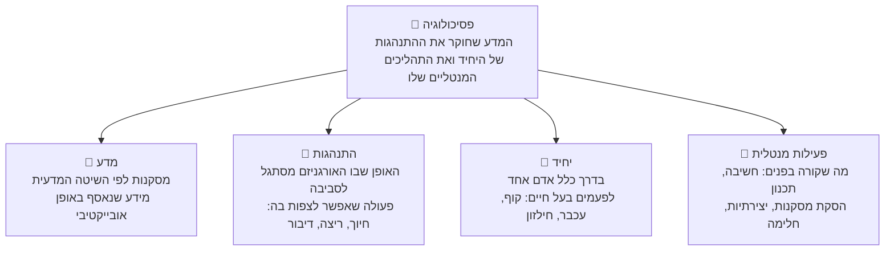
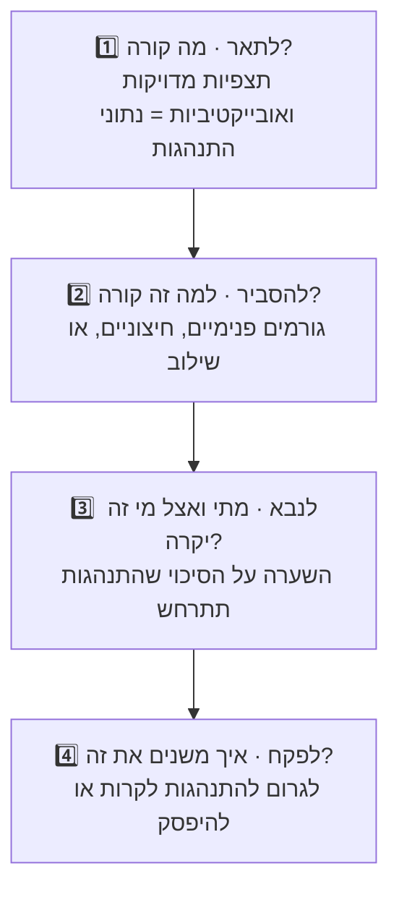

# עמ' 25–29 · במה עוסקים הפסיכולוגים?

> **מקור:** ספר הקורס, כרך א, עמ' 25–29 (מהסעיף "במה עוסקים הפסיכולוגים?" ועד "כיצד תשתמשו בספר זה?") · **מדריך הלמידה:** פרק 1, סעיף 1.3 (שאלה מנחה 9)
> **קובץ המקור:** [pages 25-29.pdf](../חומרי-מקור/pages%2025-29.pdf)
> **הסיכום הקודם:** [עמ' 16–25 · שבע הגישות](פרק-1-16-25-שבע-הגישות-בנות-זמננו.md) · **מונחים:** [מונחון](../מונחון.md)
> **פודקאסט:** [פרק-1-25-29-במה-עוסקים-הפסיכולוגים.m4a](../פודקאסטים/פרק-1-25-29-במה-עוסקים-הפסיכולוגים.m4a) · **מפת חשיבה:** [HTML](../מפות-חשיבה/פרק-1-25-29-במה-עוסקים-הפסיכולוגים.html) · [תמונה](../מפות-חשיבה/פרק-1-25-29-במה-עוסקים-הפסיכולוגים.png)

---

## בקצרה (אם יש לך רק דקה)

- הפסיכולוגיה מתפצלת ל**הרבה תחומי התמחות**. כל שאלה על בני אדם "שייכת" לסוג אחר של פסיכולוג (**טבלה 1.2**).
- כל פסיכולוג מנסה לאזן בין **מחקר** (לגלות תובנה חדשה) לבין **יישום** (להפוך אותה לעזרה בחיים). **חייב להיות קשר** בין השניים.
- בעולם יש **יותר מ־500,000** פסיכולוגים. רובם עובדים **כעצמאים** (33.6%) או **באקדמיה** (28%).
- בהתחלה הפסיכולוגיה הייתה כמעט רק של גברים. **מרגרט וושברן** הייתה האישה הראשונה שקיבלה דוקטורט בפסיכולוגיה (1894). **מרי קלקינס** לא קיבלה תואר מהרווארד רק כי הייתה אישה, אבל נהייתה **הנשיאה הראשונה** של האגודה האמריקנית לפסיכולוגיה.

---

## 1. רב־גוניות המחקר הפסיכולוגי: טבלה 1.2 (עמ' 25–26 · [שאלה 9](#שאלה-9))

**הרעיון:** אחרי שלמדת על הגישות, את כבר יכולה לנסח שאלות על בני אדם. רוב השאלות שתעלי נוגעות לתחום של **מישהו** שקורא לעצמו "פסיכולוג". הטבלה מציגה שאלות לדוגמה, **מי** עונה עליהן ו**במה** הוא מתמקד.

> 📌 **החלוקה לשלוש קבוצות היא שלי**, כדי שיהיה קל לזכור. בספר זו טבלה אחת ברצף.

### א. בריאות נפשית, שיקום ובריאות

| השאלה בספר                                          | מי עוסק בה                                            | במה הם מתמקדים                                                                                                                                                                        |
| --------------------------------------------------- | ----------------------------------------------------- | ------------------------------------------------------------------------------------------------------------------------------------------------------------------------------------- |
| איך אנשים יכולים להתמודד טוב יותר עם קשיי היום־יום? | **קליניים**, **יועצים**, **קהילתיים**, **פסיכיאטרים** | - חוקרים את **מקורות** ההפרעות הנפשיות ובודקים אפשרויות **טיפול**.  - **מאבחנים** הפרעות ובעיות הסתגלות, ו**מטפלים** בהן.                                                          |
| איך מתמודדים עם התוצאות של **שבץ מוחי**?            | **שיקומיים**                                          | - נותנים חוות דעת וייעוץ לאנשים חולים או עם לקות.  -מציעים אסטרטגיות התמודדות והדרכה לנפגעים, למטפלים, למעסיקים ולקהילה.                                                           |
| למה אני **חולה לפני כל בחינה**?                     | **רפואיים**                                           | - חוקרים <mark style="background: #ADCCFFA6;">איך **אורח החיים** משפיע על הבריאות הפיזית. </mark> - מתכננים תוכניות **מניעה**, ועוזרים לשנות הרגלים לא בריאים ולהתמודד עם **לחץ**. |

### ב. מחקר בסיסי: איך האדם "עובד"

| השאלה בספר                                            | מי עוסק בה                             | במה הם מתמקדים                                                                                            |
| ----------------------------------------------------- | -------------------------------------- | --------------------------------------------------------------------------------------------------------- |
| איך **זיכרונות** נשמרים במוח?                         | **ביולוגיים**, **פסיכו־פרמקולוגים**    | - **הבסיס הביוכימי** של התנהגות, רגשות ותהליכים מנטליים.                                                  |
| איך מלמדים **כלב** לציית לפקודות?                     | **ניסויים**, **מנתחי התנהגות**         | **ניסויי מעבדה**, הרבה פעמים **בבעלי חיים**, על תהליכים בסיסיים: למידה, חישה, תפיסה, רגשות ומוטיבציה.     |
| למה אני לא תמיד **זוכרת** משהו שאני בטוחה שאני יודעת? | **קוגניטיביים**                        | **תהליכים מנטליים**: זיכרון, תפיסה, הסקת מסקנות, פתרון בעיות, קבלת החלטות ושפה.                           |
| מה גורם לאנשים להיות **שונים זה מזה**?                | **אישיותיים**, **גנטיקאים התנהגותיים** | מפתחים **מבחנים ותיאוריות** להבנת הבדלים באישיות ובהתנהגות. בודקים השפעה של **גנטיקה וסביבה** על ההבדלים. |
| איך פועל **לחץ קבוצתי**?                              | **חברתיים**                            | איך אנשים מתפקדים **בקבוצות**, ואיך הם בוחרים, מפרשים וזוכרים **מידע חברתי**.                             |
| מה **תינוקות** יודעים על העולם?                       | **התפתחותיים**                         | **שינויים לאורך החיים** בתפקוד הפיזי, הקוגניטיבי והחברתי. השפעה של גנטיקה וסביבה על השינויים.             |

### ג. יישום בשטח: עבודה, חינוך, משפט וספורט

| השאלה בספר | מי עוסק בה | במה הם מתמקדים |
|---|---|---|
| למה **העבודה** שלי מדכאת אותי? | **תעשייתיים־ארגוניים**, **תעסוקתיים** | גורמים שמשפיעים על התפקוד **במקום העבודה** או על ביצוע משימה. מיישמים את התובנות בארגון. |
| איך מורים צריכים להתנהג עם **תלמידים מפריעים**? | **חינוכיים**, **של בית הספר** | איך לשפר את **תהליך הלמידה**. עוזרים לתכנן **תוכניות לימודים**, הכשרת מורים ותוכניות טיפול בילדים. |
| האם הנאשם היה **לא שפוי** כשביצע את הפשע? | **משפטיים** | מיישמים ידע פסיכולוגי על בעיות בתחום **אכיפת החוק**. |
| למה אני תמיד "נחנק" **במשחקי כדורסל חשובים**? | **פסיכולוגים של הספורט** | מעריכים את הביצועים של **ספורטאים**, ומשתמשים בעקרונות של מוטיבציה, קוגניציה והתנהגות כדי לעזור להם להגיע **לשיא**. |

### מה הטבלה מלמדת (עמ' 27)
- יש **מגוון עצום** של תתי־התמחויות.
- חלק מהשאלות מראות את **תחום ההתמחות העיקרי** של הפסיכולוג. *דוגמאות מהספר:* קוגניטיביים מתמקדים בתהליכים קוגניטיביים בסיסיים כמו **זיכרון ושפה**. חברתיים מתמקדים ב**כוחות חברתיים** שמעצבים עמדות והתנהגות.
- חלק מראים את **התחום שבו הם מיישמים** את הידע. *דוגמאות מהספר:* תעשייתיים־ארגוניים משפרים את ההסתגלות של אנשים **למקום העבודה**. חינוכיים משפרים את ההסתגלות של תלמידים **לסביבת הלמידה**.

> 💡 **שימי לב לקשר לגישות:** הרבה מהתחומים "מדברים" עם הגישות מעמ' 16–25. ביולוגיים ↔ **הגישה הביולוגית**. קוגניטיביים ↔ **הגישה הקוגניטיבית**. ניסויים ומנתחי התנהגות (אילוף כלב) ↔ **הגישה הביהביוריסטית**. חברתיים ↔ **הגישה החברתית־תרבותית**.

---

## 2. מחקר ויישום (עמ' 27)

פסיכולוגים מכל הגישות מנסים להגיע ל**איזון** בין שני סוגי פעילות:

| | **מחקר** | **יישום** |
|---|---|---|
| **מה זה** | **חיפוש אחר תובנה חדשה** | **תרגום התובנה** למעשה בחיי היום־יום |
| **דוגמה** | לגלות מה גורם לחרדה לפני מבחנים | לבנות סדנה שעוזרת לסטודנטים להירגע |

**הנקודה החשובה:** **חייב להתקיים קשר** בין מחקר ליישום.

**הדוגמה של הספר:** אנחנו נוטים לחשוב על **פסיכולוגים קליניים** רק כמי ש**מיישמים** ידע כדי לשפר חיים. אבל יש להם תפקיד חשוב **גם במחקר** (פרקים 14–15). המחקר ממשיך לשפר את היכולת **להבחין בין הפרעות שונות** ו**לבחור את הטיפול הטוב ביותר** שיקל על המצוקה של המטופל.

**צילום בספר:** פסיכולוגים התפתחותיים משתמשים **בבובות** כדי לחקור איך ילדים מתנהגים, חושבים ומרגישים. *השאלה בספר:* למה לילד קל יותר להביע מחשבות מול בובה מאשר מול מבוגר?

---

## 3. הפסיכולוגים בעולם (עמ' 28)

| מה | מספר |
|---|---|
| פסיכולוגים פעילים בעולם (לפי סקרים) | **יותר מ־500,000** |
| **האיגוד הבין־לאומי למדע הפסיכולוגיה** (IUPsyS) | ארגונים חברים מ־**70** ארצות (Ritchie, 2004) |
| **האגודה האמריקנית לפסיכולוגיה** (APA) | **יותר מ־150,000** פסיכולוגים מכל העולם |
| **האגודה האמריקנית למדע הפסיכולוגיה** (APS) | **יותר מ־14,000**. מתמקדת יותר **בצד המדעי** ופחות בצד הקליני והטיפולי |

- שיעור הפסיכולוגים באוכלוסייה **גבוה יותר במדינות מתועשות**, אבל העניין בפסיכולוגיה **הולך וגדל** בהרבה ארצות.

### תרשים 1.2: איפה עובדים פסיכולוגים?
סקר של ה־APA על פסיכולוגים **בעלי תואר דוקטור**:

| סביבת עבודה | % |
|---|---|
| **עצמאיים** | **33.6** |
| **סביבה אקדמית** | **28.0** |
| בתי חולים, מרפאות, מוסדות אחרים | 19.4 |
| אחר או לא צוין | 8.5 |
| עסקים, ממשלה | 6.3 |
| בתי ספר וסביבות חינוך נוספות | 4.2 |

> 🎯 **"בחנו את עצמכם" שואל:** מהן **שתי** סביבות העבודה שמעסיקות הכי הרבה פסיכולוגים? → **עבודה עצמאית** ו**אקדמיה**.

---

## 4. נשים בפסיכולוגיה (עמ' 28–29)

בהתחלה המחקר והעיסוק בפסיכולוגיה היו כמעט **רק של גברים**. היו מעט נשים, אבל הן תרמו תרומה חשובה.

| מי | מתי | מה חשוב לזכור |
|---|---|---|
| **מרגרט וושברן** (Margaret Washburn) | **1894** | סיימה את לימודיה ב**קורנל** והייתה **האישה הראשונה שקיבלה דוקטורט בפסיכולוגיה**. כתבה ספר לימוד רב השפעה: ***התודעה של בעלי החיים*** (The Animal Mind). |
| **מרי קלקינס** (Mary Calkins) | **1895** | השלימה את כל הדרישות לדוקטורט ב**הרווארד**, ובהצטיינות. ההנהלה **סירבה לתת דוקטורט לאישה**. למרות זאת נהייתה חוקרת מצליחה, ו**האישה הראשונה שכיהנה כנשיאת ה־APA**. |
| **אנה פרויד** (Anna Freud) | — | קידמה מאוד את **הפסיכואנליזה**, שיטת טיפול שמבוססת על **הגישה הפסיכודינמית**. |

**המסר של הספר:** הספר נותן מקום לחוקרות שפרצו דרך. היום יותר ויותר אנשים, **נשים וגברים מכל שכבות החברה**, בוחרים בפסיכולוגיה כמקצוע.

> ⚠️ **לא להתבלבל:** וושברן = **קורנל, 1894**, **קיבלה** דוקטורט. קלקינס = **הרווארד, 1895**, **לא קיבלה** דוקטורט, אבל נהייתה **נשיאת APA**.

---

## 5. חיבור למטרות הפסיכולוגיה ([שאלה 9](#שאלה-9))

- **ארבע המטרות:** **לתאר · להסביר · לנבא · לפקח**. הן נלמדות בעמ' 8–11 (סעיף 1.1 במדריך). הסבר קצר: [שאלה 3](#שאלה-3), ודוגמה של המדריך: [למחשבה 1](#למחשבה-1).
- איזו מטרה מתאימה לכל שאלה מטבלה 1.2: [שאלה 9](#שאלה-9).
- הגדרת הפסיכולוגיה (ארבעת המרכיבים) וההשוואה לתחומי דעת אחרים: [שאלה 1](#שאלה-1), [שאלה 2](#שאלה-2).

---

## 6. ⚠️ מלכודות: מה קל לבלבל

1. **מחקר ≠ יישום, אבל חייבים קשר ביניהם.** וגם **קליניים עושים מחקר**, לא רק טיפול.
2. **APA ≠ APS.** ב־APA יש **150,000+** (כל התחומים). ב־APS יש **14,000+**, והיא מתמקדת **בצד המדעי**.
3. **שתי סביבות העבודה המובילות:** **עצמאיים** (33.6%) ו**אקדמיה** (28%), **לא** בתי חולים (19.4%).
4. **וושברן מול קלקינס:** ראי בסעיף 4.
5. **אנה פרויד** ≠ זיגמונד פרויד. היא **בתו**, וקידמה את **הפסיכואנליזה** כשיטת טיפול.
6. **פסיכולוג רפואי** (בריאות פיזית, לחץ, אורח חיים) ≠ **פסיכולוג קליני** (הפרעות נפשיות).
7. **מנתחי התנהגות** (כלב, למידה) שייכים לאותה שורה עם **פסיכולוגים ניסויים**, לא עם הקליניים.
8. **התפתחותיים** חוקרים **כל החיים**, לא רק ילדים.

---

## 7. שאלות לבדיקה עצמית

> אל תסתכלי בסיכום. תביאי את התשובות אליי ונבדוק ביחד.

**"בחנו את עצמכם" מהספר (עמ' 29):**
1. מה הקשר בין מחקר ליישום?
2. ציינו את שתי סביבות העבודה שמעסיקות את רוב הפסיכולוגים.

**[שאלה מנחה 9](#שאלה-9) במדריך:**
3. בחרי שלוש שאלות מטבלה 1.2. לאיזו מטרה של הפסיכולוגיה (לתאר, להסביר, לנבא, לפקח) כל אחת מתאימה, ולמה?

✍️ **התשובות לכל השאלות של סעיפים 1.1 ו־1.3 במדריך** נמצאות בסוף הקובץ, מ[שאלה 1](#שאלה-1) ועד [שאלה 9](#שאלה-9).

**שאלות יישום שלי:**
4. חברה שלך בת 70 עברה שבץ, ואחיה רוצה לדעת איך לעזור לה לחזור לעבודה. לאיזה פסיכולוג כדאי לפנות? ואם היא סובלת גם מדיכאון?
5. חברת הייטק רוצה לדעת למה העובדים שלה נשחקים. מי יחקור את זה? ואיזו **גישה** (מעמ' 16–25) היה מתאים לשלב?
6. מי חוקר את השאלה "למה ילד בן 4 משקר"? ומה ההבדל בין מה שהוא יחקור לבין מה שיחקור פסיכולוג חברתי?

**🎯 אתגר פיינמן:**
> תסבירי לילד בן 12 מה ההבדל בין פסיכולוג שעושה **מחקר** לבין פסיכולוג שעושה **יישום**, ולמה הם צריכים אחד את השני.

---

## 8. איך זה מתחבר

| נושא מכאן | מתחבר ל... |
|---|---|
| ביולוגיים, קוגניטיביים, ניסויים, חברתיים | שבע הגישות, [עמ' 16–25](פרק-1-16-25-שבע-הגישות-בנות-זמננו.md) |
| אנה פרויד, פסיכואנליזה | הגישה הפסיכודינמית, [עמ' 16–25](פרק-1-16-25-שבע-הגישות-בנות-זמננו.md) › סעיף 2 |
| תעסוקתיים, התאמת אדם–ארגון | המסגרת על קריירה, [עמ' 12–16](פרק-1-12-16-היסודות-ההיסטוריים.md) › סעיף 8 |
| מטרות הפסיכולוגיה | עמ' 5–12 (סעיף 1.1): תשובות [שאלה 1](#שאלה-1)–[שאלה 3](#שאלה-3) בסוף הקובץ |
| קליניים במחקר, אבחון וטיפול | פרקים 14–15 בספר: הפרעות וטיפול |
| התפתחותיים | פרק 10 בספר: התפתחות האדם |

---

## 📌 סיכום מקוצר: כל הקטע בעמוד אחד

**תחומי ההתמחות (טבלה 1.2)** *(החלוקה לשלוש קבוצות שלי)*
- **בריאות נפשית ובריאות:** **קליניים**, יועצים, קהילתיים ופסיכיאטרים (אבחון וטיפול בהפרעות) · **שיקומיים** (חולים ובעלי לקות, למשל אחרי שבץ) · **רפואיים** (איך **אורח החיים** משפיע על הבריאות הפיזית, מניעה ולחץ).
- **מחקר בסיסי:** **ביולוגיים** (הבסיס הביוכימי, איך זיכרונות נשמרים) · **ניסויים ומנתחי התנהגות** (מעבדה, הרבה בבעלי חיים) · **קוגניטיביים** (זיכרון, תפיסה, שפה, פתרון בעיות) · **אישיותיים** (הבדלים בין אנשים, גנטיקה וסביבה) · **חברתיים** (קבוצות, לחץ קבוצתי) · **התפתחותיים** (שינויים לאורך **כל** החיים).
- **יישום בשטח:** **תעשייתיים־ארגוניים** (מקום העבודה) · **חינוכיים** (תהליך הלמידה) · **משפטיים** (אכיפת החוק) · **של הספורט** (ביצועי ספורטאים).
- יש שמות שמתארים **נושא** (קוגניטיביים: זיכרון ושפה), ויש שמות שמתארים **איפה מיישמים** (ארגוניים: מקום העבודה).
- **קשר לגישות:** ביולוגיים ↔ ביולוגית · קוגניטיביים ↔ קוגניטיבית · ניסויים ומנתחי התנהגות ↔ ביהביוריסטית · חברתיים ↔ חברתית־תרבותית.

**מחקר ויישום**

| | **מחקר** | **יישום** |
|---|---|---|
| **מה זה** | חיפוש **תובנה חדשה** | **תרגום** התובנה לחיי היום־יום |
| **דוגמה** | מה גורם לחרדה לפני מבחנים | סדנה שעוזרת לסטודנטים להירגע |

- **חייב להיות קשר** ביניהם. גם **קליניים** עושים מחקר: איך להבחין בין הפרעות ולבחור את הטיפול הטוב ביותר.

**הפסיכולוגים בעולם**
- **יותר מ־500,000** בעולם. שיעור גבוה יותר במדינות מתועשות, והעניין גדל בהרבה ארצות.
- **APA:** יותר מ־150,000 (כל התחומים). **APS:** יותר מ־14,000, מתמקדת **בצד המדעי**. **IUPsyS:** ארגונים מ־70 ארצות.
- **איפה עובדים** (בעלי דוקטורט): **עצמאיים 33.6%** · **אקדמיה 28%** · בתי חולים ומרפאות 19.4% · עסקים וממשלה 6.3% · חינוך 4.2%.

**נשים בפסיכולוגיה**

| מי | מה |
|---|---|
| **מרגרט וושברן** (Margaret Washburn) | **1894**, קורנל: **האישה הראשונה שקיבלה דוקטורט** בפסיכולוגיה. כתבה *התודעה של בעלי החיים* |
| **מרי קלקינס** (Mary Calkins) | **1895**, הרווארד: עמדה בכל הדרישות, אבל **לא קיבלה** דוקטורט כי הייתה אישה. **הנשיאה הראשונה של ה־APA** |
| **אנה פרויד** (Anna Freud) | קידמה את **הפסיכואנליזה**, טיפול שמבוסס על הגישה הפסיכודינמית |

**חיבור למטרות הפסיכולוגיה**
- **4 מטרות:** **לתאר** (מה קורה) · **להסביר** (למה) · **לנבא** (מתי ואצל מי) · **לפקח** (איך להשפיע ולשנות).
- שאלה אחת יכולה להתאים לכמה מטרות. *(ניתוח שלי)* אילוף כלב = **לפקח** · למה אני שוכחת = **להסביר** · מה תינוקות יודעים = **לתאר**.

---

## ✍️ תשובות לשאלות המדריך

> השאלות המנחות 1–3 ו־9 והשאלה למחשבה 1 של פרק 1 במדריך. מכל סעיף בסיכום יש קישור לתשובה, ומכל תשובה יש קישור חזרה לסעיף.
> 📌 **שאלות 1–3 ולמחשבה 1 שייכות לסעיף 1.1 במדריך (עמ' 5–12 בספר), שאין לו סיכום נפרד.** הן כאן כי הקובץ הזה כבר עוסק במטרות הפסיכולוגיה (סעיף 5). התשובות לפי הספר, עמ' 6–11.
> **השאלות המנחות:** למדריך אין תשובות להן. אלה תשובות שלי, לפי הספר. **השאלה למחשבה:** 📘 התשובה לפי המדריך (עמ' 18–19), במילים שלי.
> שאר השאלות של פרק 1: בסוף [עמ' 12–16](פרק-1-12-16-היסודות-ההיסטוריים.md) (שאלות 4–6) ובסוף [עמ' 16–25](פרק-1-16-25-שבע-הגישות-בנות-זמננו.md) (שאלות 7–8, למחשבה 2).
> 🧭 = דיאגרמה שעוזרת לזכור.

### 1.1.1 · הגדרות

### שאלה-1

**הגדירו מהי פסיכולוגיה, בעזרת ארבעת המרכיבים: התנהגות, יחיד, פעילות מנטלית ומדע** · ↩ אין סעיף בסיכום (📖 עמ' 6–7)

- 📖 **פסיכולוגיה (psychology)** היא **המדע** שחוקר את **ההתנהגות** של **היחיד** ואת **התהליכים המנטליים** שלו.

🧭

- **מדע:** **השיטה המדעית (scientific method)** היא מערכת שיטתית של צעדים לניתוח בעיות ולפתרונן (פרק 2).
- **יחיד:** חוקרים את היחיד בסביבה הטבעית או במעבדה.
- **פעילות מנטלית:** אי אפשר להבין פעולות בלי להבין גם תהליכים מנטליים. חוקרים פיתחו שיטות שהופכות את החוויה הפרטית הזו לגלויה.

### שאלה-2

**במה דומה הפסיכולוגיה לתחומי דעת אחרים ובמה היא שונה מהם? (טבלה 1 במדריך)** · ↩ אין סעיף בסיכום (📖 עמ' 7)

- 📖 **המפתח:** הפסיכולוגיה מתמקדת ב**יחיד**. זה מה שמבדיל אותה ממדעי חברה אחרים.

| פסיכולוגיה ו... | **דומה** | **שונה** |
|---|---|---|
| **סוציולוגיה** | 📖 שתיהן **מדעי חברה** שחוקרים **התנהגות** | 📖 סוציולוגים חוקרים **קבוצות וארגונים**, לא את היחיד |
| **ביולוגיה** | 📖 עניין משותף ב**מוח** וב**בסיס הביוכימי** של ההתנהגות | *(ניתוח שלי)* הביולוגיה חוקרת את הגוף. היא לא שואלת על **פעילות מנטלית** וחוויה |
| **חינוך** | 📖 הפסיכולוגיה קשורה לחינוך ושואפת לשפר **רווחה** | *(ניתוח שלי)* החינוך מיישם בכיתה. הפסיכולוגיה חוקרת את **תהליך הלמידה** עצמו, במעבדה ובשטח, ובכל גיל |
| **רפואה** | 📖 הפסיכולוגיה היא חלק מ**מדעי הבריאות**, כמו הרפואה | *(ניתוח שלי)* הרפואה מתמקדת ב**גוף** ובמחלה. הפסיכולוגיה מתמקדת ב**התנהגות** ובתהליכים **מנטליים** |
| **אנתרופולוגיה** (הבחירה שלי) | 📖 שתיהן **מדעי חברה** שחוקרים **התנהגות** | 📖 אנתרופולוגים חוקרים את **ההקשר התרבותי הרחב**, לא את היחיד |

- 📖 קשר נוסף: דרך **מדע הקוגניציה**, הפסיכולוגיה מתחברת ל**מדעי המחשב**, ל**בינה מלאכותית** ול**מתמטיקה יישומית**.

### 1.1.2 · מטרות הפסיכולוגיה

### שאלה-3

**מהן ארבע מטרות הפסיכולוגיה?** · ↩ סעיף 5

🧭 כל מטרה נשענת על הקודמת:

- **לתאר:** 📖 תצפיות מדויקות על ההתנהגות. **נתוני התנהגות (behavioral data)** הם דיווחים על התנהגות ועל התנאים שבהם היא קרתה. בוחרים **רמת ניתוח**: מהאדם השלם בתרבות ועד מה שקורה במוח. הכי חשוב: **אובייקטיביות**, בלי שהציפיות של החוקר ישפיעו.
- **להסביר:** 📖 עובר **מעבר למה שנצפה**. גורמים **פנימיים** (גנטיקה, מוטיבציה, אינטליגנציה) ו**חיצוניים** (לחץ חברתי, פקק תנועה). דוגמה מהספר: למה אנשים מתחילים לעשן? נטייה להסתכן (פנימי), לחץ חברתי (חיצוני), או שניהם.
- **לנבא:** 📖 **השערה** על הסיכוי שהתנהגות תתרחש, או שיהיה קשר בין משתנים. דוגמה מהספר: אם השותף לחדר **ביישן**, נוכל לנבא שלא ירגיש בנוח לדבר עם זר. הניבוי צריך להיות **מדויק**, כדי שאפשר יהיה לבדוק ולדחות אותו.
- **לפקח:** 📖 לגרום להתנהגות **לקרות או לא לקרות**: להתחיל, לשמור, להפסיק, לשנות את הכוח או הקצב שלה. כך פסיכולוגים **עוזרים לאנשים** לשפר את החיים (טיפול, הפסקת עישון).
- 📖 **למה להסביר ולנבא קשורים?** (שאלה מ"בחנו את עצמכם" בספר) הסבר טוב **מאפשר** ניבוי. ובודקים הסבר לפי **כמה טוב הוא מנבא**: אם הביישן פתאום "מתעורר" מול זר, צריך לחשוב מחדש על ההסבר.

### למחשבה-1

**אלימות ברשתות חברתיות: מה יבדוק הפסיכולוג בכל אחת מארבע המטרות?** · ↩ סעיף 5

📘

| מטרה | מה הפסיכולוג עושה | דוגמה של המדריך |
|---|---|---|
| **לתאר** | מה ההתנהגות ומה **ההיקף** שלה. צריך **הגדרה מדויקת ואובייקטיבית**, לא "נראה לי ש..." | **מספר הקללות** בקבוצות ווטסאפ של כיתות, והממוצע בין הקבוצות |
| **להסביר** | **למה** זה קורה. ההסבר נשען על **תיאוריה**, ואפשר לבדוק אותו במחקר | **הריחוק הפיזי:** כשלא רואים את הנפגע, מרשים לעצמנו יותר אלימות |
| **לנבא** | מזהה **מנבאים** של ההתנהגות, בלי חובה להבין למה. הניבוי **לא מושלם**: יש סיכוי, לא ודאות | נבא שתהיה **יותר אלימות מילולית ברשת** מאשר פנים אל פנים |
| **לפקח** | **משנה** את ההתנהגות, בעזרת הגורמים שמסבירים או מנבאים אותה | להוסיף ליד כל הודעה **תמונה קטנה של הכותב**, ולבדוק אם האלימות יורדת |

- 📘 שימי לב: **לפקח** משתמש באותו גורם שמצאנו ב**להסביר** (הריחוק מהנפגע). התמונה "מקרבת" את הכותב.
- 📘 המדריך מעיר שזו **שאלת יישום**: העיקר הוא **לקשר** בין הדוגמה לבין ארבע המטרות.

### 1.3 · במה עוסקים הפסיכולוגים?

### שאלה-9

**בחרו שלוש שאלות מטבלה 1.2. לאיזו מטרה (לתאר, להסביר, לנבא, לפקח) מתאימה כל אחת?** · ↩ סעיפים 1, 5

*(ניתוח שלי)* המדריך מזהיר: הקשר **לא פשוט**. שאלה אחת יכולה להתאים לכמה מטרות.

| שאלה מטבלה 1.2 | מטרה עיקרית | למה |
|---|---|---|
| איך מלמדים **כלב** לציית לפקודות? | **לפקח** | רוצים **לשנות** התנהגות |
| למה אני לא **זוכרת** משהו שאני בטוחה שאני יודעת? | **להסביר** | מחפשים את **הסיבה** לשכחה |
| מה **תינוקות** יודעים על העולם? | **לתאר** | רוצים לדעת **מה קיים** אצל תינוקות |
| האם הנאשם היה **לא שפוי** כשביצע את הפשע? | **לתאר** (ואולי **לנבא** מסוכנות) | מאבחנים את **המצב** שלו |
| למה אני **חולה לפני כל בחינה**? | **להסביר**, ואז **לפקח** | קודם מבינים למה, אחר כך בונים תוכנית **מניעה** (📖 הפסיכולוגים הרפואיים עושים את שניהם) |

- **רמז למילים בשאלה:** "מה" → לתאר · "למה" → להסביר · "האם יקרה / מי" → לנבא · "איך לשנות / לעזור" → לפקח. *(לא מהספר)*
