# עמ' 149–163, 192–211 · חישה ותפיסה

> **מקור:** ספר הקורס, כרך א, פרק 4 · **מדריך הלמידה:** פרק 4 (סעיפים 4.1–4.4.1): 38 שאלות מנחות ו־4 "שאלות למחשבה".
> **פודקאסטים (6 חלקים):** [1. שלבי התפיסה, דו־משמעות ואילוזיות](../פודקאסטים/פרק-4-149-156-שלבי-התפיסה-דו-משמעות-ואילוזיות.m4a) · [2. פסיכופיזיקה והתמרה](../פודקאסטים/פרק-4-156-163-פסיכופיזיקה-והתמרה.m4a) · [3. קשב והקבצה](../פודקאסטים/פרק-4-192-197-קשב-והקבצה-תפיסתית.m4a) · [4. אינטגרציה, תנועה ומרחב](../פודקאסטים/פרק-4-197-203-אינטגרציה-תנועה-ותפיסת-המרחב.m4a) · [5. קביעויות תפיסה](../פודקאסטים/פרק-4-203-206-קביעויות-תפיסה.m4a) · [6. זיהוי והיכר](../פודקאסטים/פרק-4-207-211-זיהוי-והיכר.m4a)
> **מפת חשיבה:** [XMind](../מפות-חשיבה/פרק-4-149-211-חישה-ותפיסה.xmind) · [HTML](../מפות-חשיבה/פרק-4-149-211-חישה-ותפיסה.html) · [תמונה](../מפות-חשיבה/פרק-4-149-211-חישה-ותפיסה.png)
>
> **סימנים:** ★ = מונח רשמי (בשולי הספר) · 📖 = מהספר · 📘 = מהמדריך · *(לא מהספר)* = אנלוגיה, דוגמה או ניתוח שלי.

---

## איך לקרוא את הפרק (לפי מדריך הלמידה)

| חלק במדריך | נושא | עמ' בספר | שאלות | בסיכום |
|---|---|---|---|---|
| 4.1 | תפיסה: חישה, ארגון, זיהוי והיכר | 149–152 | 1–3 | 1 |
| 4.1.1 | מציאות, דו־משמעות ואילוזיות | 153–156 | 4–5 | 2 |
| 4.2 | פסיכופיזיקה והתמרה | 156–163 | 6–16 · למחשבה 1–2 | 3–6 |
| 4.3.1 | תהליכי קשב | 192–195 | 17–23 | 7 |
| 4.3.2 | עקרונות ההקבצה התפיסתית | 195–197 | 24 | 8 |
| 4.3.3 | אינטגרציה של מרחב, זמן ותנועה | 197–199 | 25 · למחשבה 3 | 9 |
| 4.3.4 | תפיסת המרחב | 199–203 | 26–29 | 10 |
| 4.3.5 | קביעויות תפיסה | 203–206 | 30–33 | 11 |
| 4.4–4.4.1 | זיהוי והיכר: מלמטה־למעלה ומלמעלה־למטה | 207–211 | 34–38 · למחשבה 4 | 12 |

> 📘 **מה לא קוראים:** עמ' 164–191 (מתחיל ב"מערכת הראייה" בתחתית עמ' 163). המדריך קופץ מעמ' 163 ישר לעמ' 192.
> 📘 **מיומנות של הפרק:** לכל תרשים, לדעת **מה הוא מדגים** (מונח, ניסוי או תיאוריה), ולהסביר אותו לחברה. ראי את הטבלה "מה מודגם בכל תרשים" בשאלות לבדיקה עצמית.

## בקצרה

- **תפיסה היא עבודה, לא צילום.** שלושה שלבים: **חישה** (קולטנים יוצרים אותות עצביים) ← **ארגון** (בונים ייצוג: צורה, עומק, גודל) ← **זיהוי והיכר** (נותנים משמעות: "זה כדור").
- **הבעיה המרכזית:** על הרשתית יש תמונה דו־ממדית (**גירוי קרוב**). המוח צריך לשחזר ממנה את העצם האמיתי בעולם (**גירוי רחוק**). דו־משמעות ואילוזיות מראות שהשחזור לא תמיד מצליח.
- **חישה:** הפסיכופיזיקה מודדת כמה גירוי צריך כדי להרגיש (**סף מוחלט**) או להבחין בהבדל (**סף ההבדל**, **חוק ובר**). **תיאוריית גילוי האותות** מפרידה בין מה שהחושים קלטו לבין ההחלטה מה לענות.
- **ארגון:** **קשב** בוחר מה לעבד. **עקרונות הגשטאלט** מקבצים חלקים לשלם. רמזים מגלים **עומק**. **קביעויות** שומרות על עולם יציב, אף שהתמונה על הרשתית משתנה כל הזמן.
- **זיהוי:** משלב **מלמטה־למעלה** (מה שהחושים מביאים) עם **מלמעלה־למטה** (ידע, ציפיות, הקשר). שניהם נחוצים.

---

## 1. מהי תפיסה: שלושה שלבים (עמ' 149–152 · 📘 מדריך 4.1, שאלות [1](#שאלה-1)–[3](#שאלה-3))

### 1.1 תפיסה ומתפס ([שאלה 1](#שאלה-1))

- **תפיסה ★** (perception): **כל** התהליך שבו אנחנו מכירים עצמים ואירועים בעולם: חשים אותם, מבינים, מזהים, נותנים שם ומתכוננים להגיב.
- **מתפס ★** (percept): **התוצאה**. מה שנתפס, החוויה שנוצרת בסוף התהליך.
- 📖 **"אשליית הקלות":** התפיסה מרגישה מיידית וחסרת מאמץ. בפועל היא הרבה מאוד עבודה מנטלית.

### 1.2 שלושת השלבים ([שאלה 2](#שאלה-2) · 📖 תמונה על הקיר, עמ' 152)

| שלב | מה קורה | השאלה | 📖 תמונה תלויה על הקיר |
|---|---|---|---|
| **חישה ★** (sensation) | **קולטני חישה ★** (sensory receptors) בעין, באוזן ועוד הופכים גירוי לאותות עצביים | מה הגיע לחושים? | על הרשתית: **טרפז** דו־ממדי, הצלעות לא שוות |
| **ארגון התפיסה ★** (perceptual organization) | בונים **ייצוג פנימי**: גודל, צורה, תנועה, מרחק, כיוון. משלבים צבעים, קצוות וקווים. מהיר ולא מודע | איך זה נראה? | **מלבן** שנוטה אחורה במרחב תלת־ממדי |
| **זיהוי ★** (identification) **והיכר ★** (recognition) | נותנים **משמעות**, בעזרת זיכרון, ידע, ערכים ואמונות | מה זה? למה זה משמש? | "זו **תמונה**" |

> 📖 עוד דוגמה מהספר: עצמים עגולים הם, אחרי זיהוי, כדור, מטבע, שעון, תפוז או ירח.

### 1.3 גירוי רחוק וגירוי קרוב

| | **גירוי רחוק ★** (distal stimulus) | **גירוי קרוב ★** (proximal stimulus) |
|---|---|---|
| מה זה | העצם עצמו, בעולם | התמונה האופטית שלו **על הרשתית** |
| ממדים | שלושה | שניים |
| 📖 תרשים 4.1 | שולחן מלבני, שטיח שלם | משטח השולחן הוא **טרפז**; חלק מהשטיח מוסתר |

- **המשימה של התפיסה:** לקבוע מהו הגירוי **הרחוק** לפי המידע שבגירוי **הקרוב**. זה נכון לכל החושים.
- ⚠️ "רחוק" כאן הוא **העצם בעולם**, לא "משהו שנמצא במרחק". גם כוס ביד היא גירוי רחוק.

### 1.4 שני כיווני עיבוד (📖 תרשים 4.2)

```
גרייה סביבתית → חישה → ארגון התפיסה (ארגון, עומק, קביעות) → זיהוי / היכר
                                                                ↑
                         תהליכים מנטליים: ידע, זיכרון, שפה, ציפיות, אמונות
```

- **מלמטה־למעלה** (bottom-up), "מונחה נתונים": הייצוג נבנה **מהמידע שהגיע מהחושים**.
- **מלמעלה־למטה** (top-down), "מונחה מושגים": ידע קודם, מוטיבציה וציפיות **משפיעים** על מה שנתפס.
- 📘 במדריך: שני החצים בצד של תרשים 4.2 הם שני המסלולים. בהרחבה בסעיף 12.

### 1.5 השלבים במוח

- 📘 המדריך מבקש לשרטט את המסלול העצבי בכל שלב (נוירוני חישה, מוח השדרה, תלמוס, אונות החישה). 🧭 תרשים: [שאלה 3](#שאלה-3).

---

## 2. דו־משמעות ואילוזיות (עמ' 153–156 · 📘 מדריך 4.1.1, שאלות [4](#שאלה-4)–[5](#שאלה-5))

**למה זה חשוב:** 📘 לומדים איך התפיסה עובדת **מהמקומות שבהם היא נכשלת**. דו־משמעות ואילוזיות נוצרות מהשילוב בין תכונות הגירוי (מלמטה־למעלה) לבין ההנחות והידע שלנו (מלמעלה־למטה).

### 2.1 דו־משמעות ★ (ambiguity) ([שאלה 5](#שאלה-5))

- **הגדרה:** **תמונה אחת** ברמת החישה, ו**כמה פירושים** ברמת התפיסה או הזיהוי.

| 📖 דוגמה (תרשים 4.3) | באיזה שלב הדו־משמעות | מה מתחלף |
|---|---|---|
| **קוביית נקר** (לואי אלבר נקר, Louis Albert Necker) | **ארגון התפיסה** | אותו עצם, **שני כיוונים** במרחב (מלמטה או מלמעלה) |
| **ברווז / ארנב** | **זיהוי** | אותה צורה, **שני עצמים**: מה זה? |

- מרגע שראית את שני הפירושים, התפיסה **קופצת** ביניהם. חוסר היציבות הזה הוא סימן ההיכר של דו־משמעות.
- 📖 אמנים משתמשים בזה: סלבדור דאלי (Salvador Dalí), "שוק עבדים עם אנדרטת הראש החבויה של וולטר" (תרשים 4.4).
- **הנטייה הבסיסית:** התפיסה הופכת אי־ודאות ל**פירוש אחד ברור**, כדי שנוכל לפעול בביטחון.
- 📘 בהתחלה רואים **פירוש אחד בלבד**. את השני רואים רק כשמישהו מפנה אליו את תשומת הלב (מלמעלה־למטה). למה? ייצוב העולם חוסך אנרגיה, וקל יותר להגיב לגירוי חד־משמעי.

### 2.2 אילוזיה ★ (illusion) ([שאלה 4](#שאלה-4))

- **הגדרה:** מערכת התפיסה **מטעה** אותנו, ואנחנו חווים את הגירוי באופן שגוי. (בלטינית illudere: ללגלג.)
- **רוב האנשים** רואים את אותן אילוזיות, כי הן נובעות מהאופן שבו המערכת עובדת.

| | **אילוזיה** | **הזיה** (hallucination) |
|---|---|---|
| מקור | האופן הרגיל שבו התפיסה עובדת | מצב גופני או נפשי (מחלה, סמים) |
| אצל מי | כמעט אצל כולם | לא אצל כולם |

- **בכל החושים** (באופנות, modality, שונות): שמיעה, טעם, מגע, לא רק ראייה.
- 📖 **תרשים 4.5:** פוגנדורף (Poggendorff), כובע צילינדר, אבינגהאוס (Ebbinghaus), צלנר (Zöllner), מילר־לייר (Müller-Lyer), ושני משטחי השולחן.
- 📖 **ביום־יום:** השמש "זורחת" ו"שוקעת", אף שכדור הארץ הוא שמסתובב.
- 📖 **שימוש מכוון:** אדריכלים מגדילים דירה קטנה בעזרת צבעים בהירים ורהיטים נמוכים; נאס"א מעצבת חלליות; קולנוע ותיאטרון.
- **המסקנה:** אילוזיות מראות שהתפיסה לא מצליחה **תמיד** לשחזר את הגירוי הרחוק מהגירוי הקרוב.

---

## 3. פסיכופיזיקה: כמה גירוי צריך כדי להרגיש? (עמ' 156–158 · 📘 מדריך 4.2, שאלות [6](#שאלה-6)–[8](#שאלה-8))

### 3.1 פסיכופיזיקה ★ (psychophysics) ([שאלה 6](#שאלה-6))

- **הגדרה:** חקר הקשר בין **גירוי פיזיקלי** (עוצמה, ביחידות פיזיקליות) לבין **החוויה** שהוא יוצר (ביחידות פסיכולוגיות).
- 📖 שאלות לדוגמה: כמה חזקה צריכה להיות אזעקת עשן כדי להעיר? כמה סוכר צריך כדי שהקפה ירגיש מתוק?
- **גוסטב פכנר** (Gustav Fechner, 1801–1887), פיזיקאי גרמני, טבע את המונח. השיטות זהות לכל החושים: מודדים **ספים** ובונים **סולמות פסיכו־פיזיקליים ★** (psychophysical scales).

### 3.2 סף מוחלט ★ (absolute threshold) ([שאלה 7](#שאלה-7))

- **הגדרה:** הכמות **המינימלית** של אנרגיה שיוצרת חוויה חושית. (📘 נקרא גם **סף גילוי**.)
- **איך מודדים:** משימת **גילוי**. מציגים גירויים חלשים בעוצמות שונות, בהרבה ניסיונות, ושואלים כל פעם "הרגשת?". 📖 בדיקת שמיעה היא בדיוק זה.
- **פונקציה פסיכומטרית ★** (psychometric function), 📖 תרשים 4.6: גרף של **אחוז הגילוי** לפי **עוצמת הגירוי**.

| העקומה התאורטית | העקומה שמתקבלת בפועל |
|---|---|
| **מדרגה**: מתחת לסף 0%, מעליו 100% | עקומה בצורת **S**: מעבר הדרגתי |

- **למה S ולא מדרגה?** (1) המשתתף משתנה מניסיון לניסיון: קשב, עייפות. (2) לפעמים הוא עונה "כן" גם כשאין גירוי.
- **ההגדרה האופרציונלית:** הסף המוחלט = העוצמה שמתגלה ב־**50%** מהניסיונות.

📖 **טבלה 4.1, ספים משוערים:**

| חוש | הסף |
|---|---|
| ראייה | להבת נר במרחק 48 ק"מ, בלילה חשוך ובהיר |
| שמיעה | תקתוק שעון במרחק 6 מטרים, בשקט |
| טעם | כפית סוכר ב־7.5 ליטר מים |
| ריח | טיפת בושם בדירת 3 חדרים |
| מגע | כנף זבוב שנופלת על הלחי מגובה 1 ס"מ |

### 3.3 הסתגלות חישתית ★ (sensory adaptation) ([שאלה 8](#שאלה-8))

- **הגדרה:** **ירידה הדרגתית** בתגובה של מערכת החושים לגירוי **קבוע וממושך**.
- 📖 השמש נראית פחות מסנוורת אחרי זמן בחוץ. נכנסים לחדר עם ריח, ואחרי כמה דקות כבר לא מרגישים אותו.
- **למה זה טוב:** החושים רגישים יותר **לשינויים** מאשר למצב קבוע. ההסתגלות מאפשרת לשים לב מהר יותר למידע **חדש**.
- **ההשפעה על הזיהוי:** אחרי הסתגלות, צריך גירוי **חזק יותר** כדי להרגיש אותו.

---

## 4. הטיית תגובה ותיאוריית גילוי האותות (עמ' 158–160 · 📘 שאלות [9](#שאלה-9)–[13](#שאלה-13), [למחשבה 1](#למחשבה-1))

### 4.1 הטיית תגובה ★ (response bias) ([שאלה 9](#שאלה-9))

- **הגדרה:** נטייה **שיטתית** להעדיף תשובה מסוימת, מסיבות **שאינן קשורות לגירוי** עצמו.
- 📖 **הדוגמה:** ניסוי לגילוי אור חלש.
  - **שלב א:** מקבלים 20 ₪ על כל "כן" נכון. כשלא בטוחים, עונים "כן".
  - **שלב ב:** מקבלים 20 ₪ על כל "לא" נכון, ומשלמים קנס של 8 ₪ על כל טעות. כשלא בטוחים, עונים "לא".
  - העיניים לא השתנו. **ההחלטה** השתנתה.

### 4.2 תיאוריית גילוי האותות ★ (SDT, signal detection theory) ([שאלה 11](#שאלה-11))

**גרין וסווטס** (Green & Swets, 1966). במקום "סף" אחד, התיאוריה מדגישה **שיפוט ★** (judgment) ומפרידה בין **שני תהליכים**:

| | **תהליך חישה ★** (sensory process) | **תהליך החלטה ★** (decision process) |
|---|---|---|
| מה הוא משקף | **רגישות** הצופה לעוצמת הגירוי | **הטיית התגובה** של הצופה |
| מתי | קודם | אחר כך, בנפרד |
| 📘 כיוון העיבוד ([שאלה 12](#שאלה-12)) | **מלמטה־למעלה** (מהגירוי) | **מלמעלה־למטה** (מהמטרות והציפיות) |

### 4.3 ארבעת המצבים ([שאלה 13](#שאלה-13) · 📖 תרשים 4.7)

מציגים אות חלש ב**מחצית** מהניסיונות. בכל ניסיון עונים "כן" או "לא":

| | **ענה "כן"** | **ענה "לא"** |
|---|---|---|
| **היה אות** | ✅ **פגיעה ★** (hit) | ❌ **החטאה ★** (miss) |
| **לא היה אות** | ❌ **אזעקת שווא ★** (false alarm) | ✅ **דחייה נכונה ★** (correct rejection) |

- 📖 **דורית** עונה תמיד "כן": הרבה **פגיעות**, אבל גם הרבה **אזעקות שווא**.
- 📖 **בנימין** עונה תמיד "לא": פחות אזעקות שווא, אבל גם פחות פגיעות.
- **הרווח:** מתוך הפגיעות ואזעקות השווא מחשבים **בנפרד** רגישות והטיה. כך אפשר לגלות ששני אנשים **רואים באותה רמה** ורק **מחליטים אחרת**.
- *(לא מהספר)* **איך לזכור:** השם אומר מה קרה. **אזעקת שווא** = צעקת "יש!" כשלא היה כלום. **החטאה** = היה, ופספסת.

### 4.4 מיץ חדש: למה לרוני מתוק וליוני לא?

- שלושה הסברים, לפי סף מוחלט, הסתגלות חישתית והטיית תגובה: [שאלה 10](#שאלה-10).

### 4.5 מוקד המשטרה

- איך הטיית התגובה משנה את ארבעת המצבים: [למחשבה 1](#למחשבה-1).

---

## 5. סף ההבדל וחוק ובר (עמ' 160–162 · 📘 שאלות [14](#שאלה-14)–[15](#שאלה-15), [למחשבה 2](#למחשבה-2))

### 5.1 סף ההבדל ★ (difference threshold) ([שאלה 14](#שאלה-14))

- **הגדרה:** ההבדל הפיזיקלי **הקטן ביותר** בין שני גירויים שעדיין אפשר להבחין בו.
- **איך מודדים:** מציגים **זוגות** ושואלים "זהים או שונים?". 📖 חברה רוצה משקה קולה מתוק יותר: כמה סוכר הכי פחות צריך להוסיף כדי שירגישו?
- **ההגדרה האופרציונלית:** ההבדל שמזוהה כ"שונה" ב־**50%** מהניסיונות. הערך הזה נקרא **הפער המינימלי המובחן ★** (JND, just noticeable difference).

| | **סף מוחלט** | **סף ההבדל** |
|---|---|---|
| השאלה | יש או אין? | זהים או שונים? |
| מה מציגים | גירוי אחד, חלש | זוג גירויים |
| 50% של | "כן, הרגשתי" | "כן, שונים" |

### 5.2 חוק ובר ★ (Weber's law) ([שאלה 15](#שאלה-15))

**ארנסט ובר** (Ernst Weber), 1834.

- **הרעיון:** ה־JND הוא **יחס קבוע** מהגירוי הבסיסי. ככל שהגירוי הבסיסי **גדול יותר**, צריך להוסיף **יותר** כדי להרגיש הבדל.
- **הנוסחה:** ΔI / I = k
  - **I** = עוצמת הגירוי הבסיסי (הסטנדרט).
  - **ΔI** = התוספת הקטנה ביותר שמורגשת.
  - **k** = **הקבוע של ובר ★** (Weber's constant), קבוע לכל סוג גירוי.
- 📖 **תרשים 4.8 (אורך קו):** לקו של 10 מ"מ צריך להוסיף 1 מ"מ; ל־20 מ"מ צריך 2 מ"מ; ל־25 מ"מ צריך 2.5 מ"מ. היחס תמיד 0.1. ולקו של 5 מ"מ? 0.5 מ"מ.
- 📖 החוק הוא **קירוב טוב**, אבל לא מושלם. הוא נשבר בעיקר בעוצמות **קיצוניות**.

📖 **טבלה 4.2, הקבוע של ובר:**

| ממד | k |
|---|---|
| תדירות צליל | 0.003 |
| עוצמת אור | 0.01 |
| ריכוז ריח | 0.07 |
| עוצמת לחץ | 0.14 |
| עוצמת צליל | 0.15 |
| ריכוז טעם | 0.20 |

- **k קטן = רגישות גבוהה** (מבחינים בהבדל קטן). את תדירות הצליל אנחנו מבחינים הכי טוב, ואת הטעם הכי פחות. 📖 לכן חברת הקולה צריכה להוסיף כמות **גדולה יחסית** של סוכר.
- *(דוגמה שלי, לפי הטבלה)* בכוס תה עם 2 כפיות סוכר צריך להוסיף לפחות 0.4 כפית כדי שירגישו (20%). בכוס עם 5 כפיות צריך כפית שלמה.

### 5.3 מלח בחטיפים

- סף ההבדל וחוק ובר בשני שלבים, עם תרשים: [למחשבה 2](#למחשבה-2).

---

## 6. התמרה: מאנרגיה לאות עצבי (עמ' 162–163 · 📘 [שאלה 16](#שאלה-16))

- **התמרה ★** (transduction): **הפיכת** סוג אחד של אנרגיה פיזיקלית (למשל אור) לסוג אחר: **אות עצבי**.
- **בעיה:** כל החושים מתורגמים לאותו סוג של אותות עצביים. **איך המוח יודע** שזה צליל ולא אור? לפי **האזור בקורטקס** שאליו האות מגיע. לכל חוש אזור משלו.
- **הזרימה, אותה בכל החושים:**

```
גירוי ← קולטני חישה (התמרה) ← נוירונים ברמה גבוהה יותר: מאפיינים בסיסיים
(גודל, עוצמה, צורה, מרחק) ← דפוסים מורכבים בקורטקס החושי ובקורטקס האסוציאטיבי
```

---

## 7. קשב: מה נכנס ומה נשאר בחוץ (עמ' 192–195 · 📘 מדריך 4.3.1, שאלות [17](#שאלה-17)–[23](#שאלה-23))

📘 **למה צריך קשב:** החושים קולטים בכל רגע הרבה יותר ממה שהמערכת הקוגניטיבית יכולה לעבד. **קשב ★** (attention) **מסנן**: מידע רלוונטי מעובד, ולא רלוונטי מוזנח. ככל שמתמקדים במשהו, תופסים ולומדים אותו טוב יותר.

### 7.1 מה קובע את מוקד הקשב (שאלות [17](#שאלה-17)–[18](#שאלה-18))

**יאנטיס** (Yantis, 1993): שני מרכיבים.

| | **בחירה מכוונת־מטרה ★** (goal-directed selection) | **לכידה שמקורה בגירוי ★** (stimulus-driven capture) |
|---|---|---|
| מי מחליט | **אני**, לפי המטרות שלי | **הגירוי**, בגלל התכונות שלו, באופן אוטומטי |
| 📖 דוגמה | מחפשים משהו מתוק בחלון של מאפייה, והקשב הולך לעוגיות | חולמים בהקיץ ברמזור, והשינוי מאדום לירוק "תופס" אותנו |
| 📘 כיוון העיבוד | מלמעלה־למטה | מלמטה־למעלה |

### 7.2 הניסוי של תיאוס ועמיתיו (Theeuwes et al., 1998) (📘 [שאלה 19](#שאלה-19) · 📖 תרשים 4.25)

- **השאלה:** מה חזק יותר, המטרה שלי או גירוי חדש?
- **מה עשו:**
  1. שישה עיגולים אפורים, בכל אחד צורת 8.
  2. כל העיגולים חוץ מאחד הפכו לסגולים. **המשימה:** להסתכל על העיגול האפור שנשאר ולדווח אם האות C בתוכו רגילה או הפוכה. זו **בחירה מכוונת־מטרה**.
  3. בחצי מהניסיונות הופיע גם **עיגול סגול חדש**, לא רלוונטי למשימה.
- **מה מצאו:** ברוב המקרים העיגול החדש **משך את הקשב** באופן אוטומטי, אף שהוא הפריע לביצוע והמשתתפים התאמצו להצליח.
- **המסקנה:** לפחות בתנאים מסוימים, **לכידה שמקורה בגירוי גוברת** על בחירה מכוונת־מטרה. הקשב נמשך אוטומטית ל**עצמים חדשים** (Yantis & Jonides, 1996).

### 7.3 מה קורה למידע שלא שמנו אליו לב? (שאלות [20](#שאלה-20)–[23](#שאלה-23))

**מודל הפילטר ★** (filter model), **דונלד ברודבנט** (Donald Broadbent, 1958) · [שאלה 20](#שאלה-20)

- לתודעה יש **קיבולת מוגבלת ★** (limited capacity). לכן הקשב חוסם את רוב המידע.
- הסינון קורה **מוקדם**, **לפני** שמעבדים את המשמעות.
- **האזנה דיכוטית ★** (dichotic listening), 📖 תרשים 4.26: מסר שונה לכל אוזן באוזניות. באוזן שמאל 2, 6, 1 ובאוזן ימין 7, 9, 5.
  - שליפה חופשית: המשתתף מדווח **261** ו**795**.
  - כשמבקשים להתמקד רק באוזן ימין: רק **795**. הקשב פעל כמו **פילטר**.

**תופעת מסיבת הקוקטייל ★** (cocktail party phenomenon) · שאלות [21](#שאלה-21)–[22](#שאלה-22)

- 📖 בחדר רועש, באמצע שיחה, שומעים פתאום **את השם שלנו** משיחה אחרת, אף שלא הקשבנו לה (צ'רי, Cherry, 1953). במעבדה: הסיכוי לשים לב לשם שלך בערוץ הלא־קשוב גבוה הרבה יותר (Wood & Cowan, 1995a).
- **למה זה קורא תיגר על ברודבנט:** אם הפילטר חוסם **הכול** לפני עיבוד המשמעות, איך זיהינו את **המשמעות** (השם שלנו) בערוץ שלא הקשבנו לו?
- **[שאלה 22](#שאלה-22), איזה תהליך זה?** *(תשובה שלי)* **לכידה שמקורה בגירוי**: תכונה של הגירוי (השם שלי) מושכת את הקשב, בלי קשר למטרה שלי.

**ההסבר היום** · [שאלה 23](#שאלה-23)

- מידע בערוץ הלא־קשוב **כן עובר עיבוד מסוים**, אבל לא מספיק כדי להגיע למודעות (Wood & Cowan, 1995b).
- רק כשיש בו **תכונה מיוחדת** (כמו השם שלנו) הוא עובר למוקד הקשב.
- 📖 ובשורה התחתונה: אם לא מקשיבים להרצאה, החומר לא ייכנס לראש מעצמו.

---

## 8. עקרונות ההקבצה התפיסתית (עמ' 195–197 · 📘 מדריך 4.3.2, [שאלה 24](#שאלה-24))

### 8.1 דמות ורקע

- 📖 תרשים 4.27, **אגרטל או שני פרופילים**: **דמות ★** (figure) היא האזור שבולט קדימה ונראה כמו עצם. **רקע ★** (ground) הוא מה שהדמות בולטת על פניו.
- אחת המשימות הראשונות של התפיסה: להחליט מה דמות ומה רקע. אפשר להפוך את היחס, ואז האגרטל הופך לשני פרצופים.

### 8.2 פסיכולוגיית הגשטאלט ★ (Gestalt psychology)

- **קורט קופקה** (Kurt Koffka, 1935), **וולפגנג קוהלר** (Wolfgang Köhler, 1947), **מקס ורטהיימר** (Max Wertheimer, 1923).
- **הרעיון:** מבינים תופעות רק כ**שלם מאורגן**, לא כאוסף של יחידות קטנות. **השלם גדול מסכום חלקיו.** ("גשטאלט" ≈ צורה, שלם, תצורה.)
- איך גילו את העקרונות: שינו גורם אחד בתצוגה ובדקו איך השלם נתפס.

### 8.3 חמשת העקרונות ([שאלה 24](#שאלה-24))

| עיקרון | מקבצים יחד... | 📖 הדוגמה בספר | *(דוגמה שלי)* |
|---|---|---|---|
| **הסמיכות ★** (proximity) | מה ש**קרוב** זה לזה | נקודות נראות כ־5 **טורים** (הן קרובות יותר בטור) | אנשים שעומדים צמוד נראים "קבוצה" |
| **הדמיון ★** (similarity) | מה ש**דומה** זה לזה | ריבוע של O בתוך ריבוע של X | שחקנים באותה חולצה נראים קבוצה |
| **ההמשכיות הטובה ★** (good continuation) | קווים ש**ממשיכים** בצורה חלקה, גם כשהם קטועים | **חץ** שעובר דרך **לב**, ולא שלוש חתיכות | כביש שנעלם מאחורי גבעה "ממשיך" |
| **הסגירות ★** (closure) | **משלימים פערים** כדי לראות צורה שלמה | **עיגול** עם חלק חסר נתפס כעיגול שלם | לוגו עם קווים חסרים |
| **הגורל המשותף ★** (common fate) | מה ש**זז יחד**, באותו כיוון | שורות שזזות כל אחת לכיוון אחר | להקת ציפורים שעפה יחד |

- **מה כל עיקרון תורם:** כולם מארגנים פיסות נפרדות ל**מבנה אחד**, ועוזרים להבדיל **דמות** מ**רקע**.
- *(טריק זיכרון, לא מהספר)* **"חברים טובים: עומדים קרוב (סמיכות), לובשים דומה (דמיון), הולכים באותה דרך (המשכיות), משלימים זה את זה (סגירות) וחולקים גורל משותף."**

---

## 9. אינטגרציה של מרחב, זמן ותנועה (עמ' 197–199 · 📘 מדריך 4.3.3, [שאלה 25](#שאלה-25), [למחשבה 3](#למחשבה-3))

### 9.1 אינטגרציה מרחבית ואינטגרציה של זמן

- בכל רגע רואים רק **חלק קטן** מהסביבה. כדי לקבל תמונה שלמה צריך לחבר מידע:
  - **אינטגרציה מרחבית ★** (spatial integration): ממקומות שונים.
  - **אינטגרציה של זמן ★** (temporal integration): מזמנים שונים.
- **הפתעה:** הזיכרון החזותי **לא שומר פרטים** מדויקים בין מבט למבט (Simons & Ambinder, 2005).

### 9.2 עיוורון לשינוי: הניסוי של סיימונס (Simons, 1996) (📘 [שאלה 25](#שאלה-25) · 📖 תרשים 4.28)

- **מה עשו:** חמישה עצמים מוכרים, 2 שניות. אחרי 4 שניות תצוגה שנייה. בחצי מהניסיונות היא **זהה**, ובחצי **שונה**, באחת משלוש דרכים. המשימה: "זהה או שונה?".

| השינוי | מה השתנה | דיוק (50% = ניחוש) |
|---|---|---|
| **חילופי זהות** | עצם אחד **הוחלף** בעצם אחר (מהדק ← מנקב) | כ־**75%** |
| **חילופי מקום** | שני עצמים **החליפו מקומות** | כ־**65%** (הכי קשה) |
| **שינוי תצורה** | **כל** העצמים סודרו בתצורה חדשה | כ־**94%** (הכי קל) |

- **המסקנה:** אנחנו "עיוורים" לשינויים בולטים למדי, חוץ משינוי של **כל הסידור**.
- **למה אין לנו זיכרון מפורט?** 📖 העולם עצמו הוא **מקור מידע יציב** (O'Regan, 1992). אין צורך לזכור מה שתמיד אפשר להסתכל עליו שוב.
- **למה שינוי תצורה הכי קל?** [למחשבה 3](#למחשבה-3).

### 9.3 תפיסת תנועה

- 📖 חבר מתקרב אלייך: **התמונה שלו על הרשתית גדלה**, ומ**קצב** הגדילה מבינים את **מהירות** ההתקרבות (גיבסון, Gibson, 1979).
- **תופעת פי ★** (phi phenomenon): שתי נקודות אור במקומות שונים נדלקות ונכבות **לסירוגין**, 4–5 פעמים בשנייה. רואים **נקודה אחת שזזה** הלוך ושוב. 📖 חצים בשלטי ניאון, אורות דיסקו.
  - רואים את **הדרך הפשוטה ביותר**: **קו ישר** (Cutting & Proffitt, 1982; Shepard, 1984).
  - **חריג:** בתנועה של **גוף אדם**, המערכת משלימה מסלולי תנועה **ביולוגיים** טבעיים, לא קו ישר (Shiffrar, 1994).
- 📘 למה זה חשוב: חיבור "צילומי המצב" לתנועה רציפה קובע התנהגות. לא חוצים כביש כשמכונית מתקרבת מהר.

---

## 10. תפיסת המרחב: איך יודעים מה רחוק? (עמ' 199–203 · 📘 מדריך 4.3.4, שאלות [26](#שאלה-26)–[29](#שאלה-29))

- בלי תפיסה תלת־ממדית אי אפשר להתקרב למטרה או להתרחק מסכנה. צריך לדעת **עומק** (כמה רחוק) ו**כיוון**. האוזניים עוזרות בכיוון, לא במרחק.
- **רמזי מרחק ★** (depth cues): שלוש משפחות.

| משפחה | רמז | איך הוא עובד | 📖 בספר |
|---|---|---|---|
| **דו־עיניים** (צריך שתי עיניים) · [שאלה 26](#שאלה-26) | **פער בין־רשתי ★** (binocular disparity) | העיניים רחוקות 5–7 ס"מ זו מזו, ולכן כל אחת רואה תמונה **קצת אחרת**. המוח משווה, ו**ככל שהפער גדול יותר, ההבדל במרחק גדול יותר** | תרשים 4.29. אצבע קרובה "קופצת" יותר כשעוצמים עין אחת ואחר כך את השנייה |
| | **התכנסות ★** (convergence) | כדי להתמקד בעצם קרוב העיניים **פונות פנימה**. המוח קורא את המידע **משרירי העין**: זווית גדולה = קרוב. עובד רק עד כ־**3 מטרים** | תרשים 4.30. להסתכל על עיני חברה כשהיא עוברת ממבט רחוק לעצם במרחק 30 ס"מ |
| **תנועה** · [שאלה 27](#שאלה-27) | **היסט תנועה יחסי ★** (relative motion parallax) | כשאנחנו **זזים**, עצמים קרובים נראים זזים **יותר ומהר יותר** מרחוקים. העצם שמתמקדים בו לא זז בכלל | נסיעה במכונית: עצמים רחוקים נראים כמעט עומדים |
| **רמזי תמונה ★** (pictorial cues), עובדים **גם בעין אחת** · שאלות [28](#שאלה-28)–[29](#שאלה-29) | **הסתרה ★** (interposition) / **חסימה ★** (occlusion) | עצם שמסתיר חלק מעצם אחר נמצא **קרוב יותר** | תרשים 4.31: אישה מאחורי סורגים |
| | **גודל יחסי ★** (relative size) | עצמים זהים: הקטן ברשתית נתפס **רחוק יותר** (**היחס בין גודל למרחק**) | תרשים 4.32: עיגולים בגדלים שונים |
| | **פרספקטיבה קווית ★** (linear perspective) | קווים מקבילים שמתרחקים **מתכנסים** לנקודה באופק | תרשים 4.33: מסילת רכבת |
| | **דחיסות המרקם ★** (texture gradients) | המרקם נעשה **צפוף ועדין** יותר ככל שהמשטח מתרחק | תרשים 4.34: שדה חיטה |

- **רמזי תמונה** נקראים כך כי אלה בדיוק הרמזים שציירים משתמשים בהם כדי ליצור עומק על דף שטוח.
- **בבואה** (retinal image) = התמונה של העצם על הרשתית. "העצם מטיל בבואה גדולה" = התמונה שלו תופסת חלק גדול מהרשתית: כף יד קרובה לפנים מטילה בבואה גדולה, ואדם בצד השני של הרחוב מטיל בבואה קטנה. המונח חוזר לאורך כל התפיסה: **גירוי קרוב** הוא הבבואה (1.3), אותה בבואה יכולה לבוא מכמה עצמים (**דו־משמעות**, 2), בבואה שגדלה מראה שמשהו מתקרב (**תנועה**, 9), ובקביעויות הבבואה משתנה והתפיסה לא (11).
- **אילוזיית פונזו** (Ponzo, 1913), 📖 תרשים 4.33ב: שני קווים אופקיים זהים בין שני קווים מתכנסים. **העליון נראה ארוך יותר**. למה? לפי **הפרספקטיבה הקווית**, הקווים המתכנסים נקראים כמקבילים שמתרחקים, ולכן הקו העליון נתפס **רחוק יותר**. ועצם רחוק שיוצר תמונה באותו גודל ברשתית חייב להיות **ארוך יותר**.
- 📖 **בשורה התחתונה:** כל הרמזים משתלבים **אוטומטית** ו**בלי מודעות** לפירוש אחד. אנחנו חווים **עומק**, לא "רמזים".
- *(דוגמה שלי)* בציור נוף: עץ שמסתיר בית (הסתרה), פרות קטנות בשדה רחוק (גודל יחסי), דרך שמתכנסת לאופק (פרספקטיבה קווית), ושדה שהעשב בו נעשה צפוף (דחיסות המרקם).

---

## 11. קביעויות תפיסה: עולם יציב (עמ' 203–206 · 📘 מדריך 4.3.5, שאלות [30](#שאלה-30)–[33](#שאלה-33))

### 11.1 מהי קביעות, ולמה היא חשובה ([שאלה 30](#שאלה-30))

- 📖 **ניסוי קטן:** מקרבים את הראש לספר, ואז מרחיקים. התמונה ברשתית גדלה מאוד, אבל הספר **לא נראה גדל**. מטים את הראש: התמונה מסתובבת, אבל הספר נראה **יציב וישר**.
- **קביעות תפיסה ★** (perceptual constancy): הנטייה לתפוס את התכונות של **הגירוי הרחוק** (העצם, שבדרך כלל קבוע), ולא של **הגירוי הקרוב** (התמונה ברשתית, שמשתנה כל פעם שזזים).
- **למה חשוב:** **הישרדות**. צריך לדעת מה התכונות האמיתיות והקבועות של עצמים, אף שהאור שמגיע לעיניים משתנה כל הזמן.

### 11.2 שלוש הקביעויות (שאלות [31](#שאלה-31)–[33](#שאלה-33))

| קביעות | הגדרה | איך המערכת עושה את זה | 📖 דוגמה |
|---|---|---|---|
| **קביעות גודל ★** (size constancy) | לתפוס את **הגודל האמיתי** אף שהגודל ברשתית משתנה | (1) משלבת את גודל התמונה ברשתית עם **רמזי המרחק**. (2) **ידע קודם** על הגודל הרגיל של עצמים (בית, עץ, כלב) | ספר שמתקרב לא "גדל" |
| **קביעות צורה ★** (shape constancy) | לתפוס את **הצורה האמיתית** גם כשהעצם נוטה והצורה ברשתית אחרת | לוקחת בחשבון את **המרחק של כל חלק** בעצם מהצופה (צריך זמן ומידע על עומק) | תרשים 4.36: מטבע מסתובב הופך ברשתית לאליפסה ולמלבן צר, ועדיין נראה **עגול**. מלבן נוטה ← טרפז ברשתית |
| **קביעות הבהירות ★** (lightness constancy) | לתפוס את הלבן, האפור או השחור של עצם כ**קבוע**, גם כשהתאורה משתנה | **אחוז** האור שעצם מחזיר קבוע, גם כשהכמות המוחלטת משתנה | תרשים 4.37: קיר לבנים עם פסי צל נראה כולו מאותו חומר (Goldstein, 1999). חולצה לבנה מחזירה 80–90% מהאור, ג'ינס שחור כ־5%. לכן החולצה תמיד בהירה יותר, בשמש ובחדר חשוך |

### 11.3 כשהקביעות נכשלת: החדר של איימס (📖 תרשים 4.35)

- **מה רואים:** ילד בפינה אחת נראה **ענק**, ומבוגר בפינה השנייה נראה **זעיר**.
- **למה:** אנחנו מניחים שהחדר **מלבני**, ולכן ששתי הפינות האחוריות **באותו מרחק**. אז אנחנו שופטים גודל רק לפי התמונה ברשתית.
- **האמת:** החדר **טרפזי**. הפינה של הילד **קרובה** הרבה יותר לצופה, ולכן התמונה שלו ברשתית גדולה.
- **התנאי:** מסתכלים **בעין אחת**, דרך **חריר הצצה**. בשתי עיניים או בתנועה, מערכת הראייה הייתה מקבלת מידע על הצורה האמיתית.
- **הכלל:** **מי שמוטעה לגבי המרחק, מוטעה גם לגבי הגודל.**
- 📖 עוד כישלון: ממגדל גבוה אנשים נראים כמו **נמלים**. המרחק קיצוני ואין לנו ניסיון קודם איתו.

---

## 12. זיהוי והיכר: נותנים משמעות (עמ' 207–211 · 📘 מדריך 4.4, שאלות [34](#שאלה-34)–[38](#שאלה-38), [למחשבה 4](#למחשבה-4))

- 📖 **למה צריך את השלב הזה:** הארגון אומר **איפה** העצם ו**איך** הוא נראה (גודל, צורה, צבע), אבל לא **מה** הוא. בלי זיהוי היינו כמו **מבקר מכוכב אחר**: לא יודעים מה לאכול, מה לחבוש על הראש וממה לברוח.
- 📘 הזיהוי **נשען על היכרויות קודמות**: אנחנו מכירים עצמים כמשהו שכבר ראינו, השייך לקטגוריה בעלת משמעות.

### 12.1 שני סוגי עיבוד (שאלות [34](#שאלה-34)–[35](#שאלה-35))

| | **עיבוד מלמטה־למעלה ★** (bottom-up processing) | **עיבוד מלמעלה־למטה ★** (top-down processing) |
|---|---|---|
| שם נוסף | **עיבוד שמקורו בנתונים ★** (data-driven) | **עיבוד שמקורו במושגים (או בהשערות) ★** (conceptually / hypothesis driven) |
| מתחיל ב... | **המציאות**: המידע מהחושים | **מה שכבר בראש**: ניסיון, ידע, מוטיבציה, רקע תרבותי, ציפיות |
| נקודת המוצא לזיהוי | העדויות החושיות, כלומר **הנתונים** | **המושגים** השמורים בזיכרון, שמשפיעים על פירוש הנתונים |
| 📖 דוגמה | מזהים צורה לפי הקווים והצבעים שלה | בגן החיות תזהי **נמר** מהר יותר מאשר בחצר הבית, כי שם את **מצפה** לו |

- **[שאלה 35](#שאלה-35), למה "מקורו במושגים"?** כי **מושגים** השמורים בזיכרון קובעים איך נפרש את מה שהחושים מביאים.
- 📖 **דרודלס** (Droodles, Price, 1953/1980), תרשים 4.38: ציורים בלי משמעות. ברגע שמקבלים **שם**, פתאום "רואים". השם הוא מידע מלמעלה־למטה.

### 12.2 שחזור פונמי ★ (phonemic restoration) ([שאלה 36](#שאלה-36))

- 📖 במסיבה רועשת חלק מהצלילים מוסתרים בשיעול, צחוק או מוזיקה. ובכל זאת **לא שמים לב לפערים**: המוח **משלים** את הצלילים החסרים (Warren, 1970).
- **פונמות** (phonemes) = יחידות הדיבור הקטנות ביותר שנושאות משמעות.
- 📖 המשתתפים בקושי יודעים אם הרעש **החליף** חלק מהמילה או רק **נוסף** עליה (Samuel, 1981, 1991). הם "שומעים" את מה שחסר.
- 📖 **איך שני הכיוונים עובדים יחד** (McClelland & Elman, 1986), תרשים 4.39ב:
  - שומעים: "נקרעה לי החולצה. עליי למסור אותה ל...(רעש)קון".
  - **מלמטה־למעלה:** הצלילים /קו/ ו־/ן/ מעלים לרמת המילים כמה אפשרויות: **תיקון**, שיכון, סיכון.
  - **מלמעלה־למטה:** **ההקשר** (חולצה קרועה) בוחר את **תיקון**.
- **למה זו דוגמה למלמעלה־למטה:** את מה שחסר בגירוי ממלא **הידע** (מילים מוכרות) וה**הקשר**.

### 12.3 השפעת הקשרים וציפיות (📘 מדריך 4.4.1)

- 📖 **תרשים 4.40:** תמונה מנומרת ודו־משמעית. כשאומרים שיש בה **כלב דלמטי** שמרחרח מתחת לעץ, רואים אותו.
- 📖 **אדם מוכר במקום לא צפוי** (עיר אחרת, קבוצה חברתית אחרת): קשה לזהות אותו. ההקשר שונה, ולא ציפינו לראות אותו שם.
- 📖 **THE CAT** (Selfridge, 1955): האות האמצעית **זהה** בשתי המילים, אבל בראשונה קוראים H ובשנייה A. הידע על מילים באנגלית קובע.
- **השורה התחתונה:** זיהוי הוא תהליך של **בנייה ופירוש**. הוא תלוי בתכונות הגירוי, וגם במה שאנחנו יודעים, איפה אנחנו ומה עוד אנחנו רואים.

### 12.4 שלושה סוגי מערכים ([שאלה 38](#שאלה-38))

- **מערך ★** (set): **מוכנות זמנית** לתפוס גירוי או להגיב עליו בדרך מסוימת.

| מערך | המוכנות ל... | 📖 דוגמה |
|---|---|---|
| **מוטורי ★** (motor set) | **להגיב** מהר בתגובה מוכנה מראש | אצן מתאמן לזנק מהר ככל האפשר ביריית ההזנקה |
| **מנטלי ★** (mental set) | **להתמודד** עם מצב (בעיה, משחק) לפי כללים, הוראות, ציפיות או הרגלים | עלול להפריע: כללים ישנים שלא מתאימים לבעיה חדשה |
| **תפיסתי ★** (perceptual set) | **לגלות** גירויים מסוימים בהקשר מסוים | אם צעירה שמוכנה לשמוע את בכי התינוק |

- 📖 **מערך משנה פירוש:** "שועל, ינשוף, נחש, תרנגול, ברבור, פ_ל" ← **פיל**. "אורז, עדשים, חומוס, שעועית, אפונה, פ_ל" ← **פול**. הרשימה יצרה מערך שכיוון את החיפוש בזיכרון.
- כדי שהקשר ישפיע, הזיכרון צריך להיות מאורגן כך שהמידע הנכון זמין ברגע הנכון. 📖 לפעמים "רואים" עם הזיכרון לא פחות מאשר עם העיניים.

### 12.5 למה צריך את שניהם? ([שאלה 37](#שאלה-37) · 📖 "הערות אחדות לסיום", עמ' 211)

| אם התפיסה הייתה **רק מלמטה־למעלה** | אם התפיסה הייתה **רק מלמעלה־למטה** |
|---|---|
| היינו **תקועים בכאן ועכשיו**. חווים, אבל **לא לומדים** מהניסיון, ולא רואים את העולם אחרת במצבים שונים | היינו **הולכים לאיבוד בעולם פרטי** של מה שאנחנו מצפים או רוצים לראות |

- **האיזון** משיג את מטרת התפיסה: לחוות את העולם בדרך שמשרתת את הצרכים **הביולוגיים והחברתיים** שלנו ועוזרת להסתגל לסביבה.
- 📖 המתפס ממלא שני תפקידים: **בלש** (מבין את הקלט לפי ידע קודם ותיאוריות אישיות) ו**מעצב** (מארגן את הגירויים כך שיהיה ביניהם קשר ברור והגיוני).

### 12.6 כל הפרק בטבלה אחת

- כל מונח לפי שלב ולפי מסלול עיבוד: [למחשבה 4](#למחשבה-4).

---

## ⚠️ מלכודות: מה קל לבלבל

**שלבים ומושגי יסוד**

1. **חישה ↔ תפיסה.** חישה היא רק **השלב הראשון**. תפיסה היא **כל** התהליך: חישה, ארגון וזיהוי.
2. **תפיסה ↔ מתפס.** תפיסה = התהליך. מתפס = התוצאה, החוויה.
3. **גירוי רחוק ↔ גירוי קרוב.** רחוק = **העצם בעולם** (גם אם הוא ביד). קרוב = **התמונה ברשתית**.
4. **קוביית נקר ↔ ברווז/ארנב.** נקר: דו־משמעות ב**ארגון** (איך העצם מונח). ברווז/ארנב: ב**זיהוי** (מה העצם).
5. **אילוזיה ↔ הזיה.** אילוזיה: כמעט כולם, בגלל איך שהתפיסה עובדת. הזיה: מצב גופני או נפשי, לא אצל כולם.

**חישה**

6. **סף מוחלט ↔ סף ההבדל.** מוחלט: "יש או אין?" (גירוי אחד). הבדל: "זהים או שונים?" (זוג). בשניהם ההגדרה האופרציונלית היא **50%**. ה־**JND** שייך ל**סף ההבדל**.
7. **הסתגלות חישתית ↔ הטיית תגובה.** הסתגלות: **החושים** מגיבים פחות לגירוי קבוע. הטיה: החושים בסדר, **ההחלטה** מה לענות משתנה.
8. **החטאה ↔ אזעקת שווא.** החטאה: **היה** אות ואמרת "לא". אזעקת שווא: **לא היה** אות ואמרת "כן".
9. **רגישות ↔ הטיה ב־SDT.** "אומרת־כן" (דורית) **לא** רואה טוב יותר. יש לה יותר פגיעות **וגם** יותר אזעקות שווא.
10. **חוק ובר.** **היחס** קבוע, לא התוספת. גירוי גדול יותר צריך תוספת **גדולה יותר**. ו־**k קטן = רגישות גבוהה**.
11. **התמרה.** הפיכת **סוג** אנרגיה (אור ← אות עצבי). לא "העברה" של מידע. את החושים מבדילים לפי **האזור בקורטקס**, לא לפי סוג האות.

**ארגון**

12. **מכוונת־מטרה ↔ שמקורה בגירוי.** מי בוחר? **אני** (המטרה) מול **הגירוי** (אוטומטי). מסיבת הקוקטייל ותיאוס = **לכידה שמקורה בגירוי**.
13. **ברודבנט.** הפילטר **מוקדם**, **לפני** עיבוד המשמעות. מסיבת הקוקטייל קוראת עליו תיגר, כי **משמעות** (השם שלי) עברה בערוץ הלא־קשוב.
14. **סגירות ↔ המשכיות טובה.** סגירות: **משלימים חלק חסר** בצורה (עיגול). המשכיות: קו **ממשיך** בצורה חלקה (חץ דרך לב).
15. **עיוורון לשינוי.** הכי **קל**: שינוי **תצורה** (94%). הכי **קשה**: חילופי **מקום** (65%), לא חילופי זהות.
16. **פער בין־רשתי ↔ התכנסות.** פער: **שתי תמונות שונות** ברשתיות. התכנסות: **שרירי העין** פונים פנימה, ועובדת רק עד כ־3 מטרים.
17. **היסט תנועה יחסי.** רמז **תנועה**, לא דו־עיני: עובד גם בעין אחת, כשאני **זזה**. גם **רמזי התמונה** עובדים בעין אחת.
18. **גודל יחסי ↔ דחיסות המרקם ↔ פרספקטיבה קווית.** שלושתם נשענים על **היחס בין גודל למרחק**. גודל יחסי: **עצמים נפרדים** וזהים, והקטן ברשתית רחוק יותר. דחיסות: **משטח** עם מרקם אחיד, והיחידות נעשות קטנות **וצפופות** יותר ככל שהוא מתרחק. פרספקטיבה: **קווים מקבילים** מתכנסים לנקודה באופק (לכן אריחים רחוקים נראים כמו טרפז). ⚠️ בשאלה אמריקאית על דחיסות המרקם, "העצם הקרוב מטיל בבואה גדולה יותר" הוא משפט נכון, אבל הוא מתאר **גודל יחסי**.
19. **קביעות ↔ אילוזיה.** קביעות = תופסים נכון את הגירוי **הרחוק**. בחדר של איימס הקביעות **נכשלת**, כי טועים במרחק.
20. **קביעות הבהירות.** מה שקבוע הוא **אחוז** האור המוחזר, לא הכמות.

**זיהוי**

21. **מלמטה־למעלה = מקורו בנתונים. מלמעלה־למטה = מקורו במושגים (או בהשערות).** לא להפוך.
22. **שחזור פונמי** = מלמעלה־למטה, אבל קורה **ביחד** עם מלמטה־למעלה (הצלילים מעלים אפשרויות, וההקשר בוחר).
23. **שלושת המערכים.** מוטורי = **להגיב** (אצן). מנטלי = **לפתור** לפי כללים. תפיסתי = **לגלות** גירוי (בכי התינוק).
24. **אותה מילה, מושג אחר.** **מערך** כאן (set) = מוכנות זמנית, לא **מערך מחקר** (design) מפרק 2. **סף מוחלט** = הגירוי החלש ביותר שמרגישים, לא **הסף** של פוטנציאל הפעולה מפרק 3. **קולטני חישה** בעין ובאוזן ≠ **קולטנים** בסינפסה.

---

## שאלות לבדיקה עצמית

### שאלות המדריך: איפה ההסבר

✍️ **התשובות לכל השאלות** נמצאות בסוף הקובץ, מ[שאלה 1](#שאלה-1) ועד [למחשבה 4](#למחשבה-4).

| שאלות | נושא | סעיף |
|---|---|---|
| 1–3 | תפיסה, שלושת השלבים, השלבים במוח | 1 |
| 4–5 | אילוזיה, דו־משמעות | 2 |
| 6–8 | פסיכופיזיקה, סף מוחלט, הסתגלות חישתית | 3 |
| 9–13 · למחשבה 1 | הטיית תגובה, רוני ויוני, תיאוריית גילוי האותות, מוקד המשטרה | 4 |
| 14–15 · למחשבה 2 | סף ההבדל, חוק ובר, מלח בחטיפים | 5 |
| 16 | התמרה | 6 |
| 17–23 | קשב, תיאוס, ברודבנט, מסיבת הקוקטייל | 7 |
| 24 | חמשת עקרונות הגשטאלט | 8 |
| 25 · למחשבה 3 | עיוורון לשינוי | 9 |
| 26–29 | רמזי מרחק | 10 |
| 30–33 | קביעויות תפיסה | 11 |
| 34–38 · למחשבה 4 | מלמטה־למעלה ומלמעלה־למטה, שחזור פונמי, מערכים | 12 |

### מה מודגם בכל תרשים (📘 מיומנות הלמידה של הפרק)

כסי את העמודה הימנית ונסי להסביר כל תרשים:

| תרשים | מה רואים | מה הוא מדגים |
|---|---|---|
| 4.1 | חדר, והתמונה שלו ברשתית | **גירוי קרוב** דו־ממדי מול **גירוי רחוק** תלת־ממדי |
| 4.2 | שרשרת השלבים וחצים | **שלושת השלבים** ושני **כיווני העיבוד** |
| 4.3 | קוביית נקר, ברווז/ארנב | **דו־משמעות** בארגון ובזיהוי |
| 4.4 | הציור של דאלי | **דו־משמעות** באמנות |
| 4.5 | חמש אילוזיות + השולחנות | **אילוזיות** |
| 4.6 | עקומת מדרגה מול עקומת S | **פונקציה פסיכומטרית**, **סף מוחלט** = 50% |
| 4.7 | טבלה 2×2 | **ארבעת המצבים** בתיאוריית גילוי האותות |
| 4.8 | קווים באורכים שונים | **חוק ובר** (יחס קבוע 0.1) |
| 4.25 | עיגולים אפורים וסגולים | **לכידה שמקורה בגירוי** גוברת על **בחירה מכוונת־מטרה** |
| 4.26 | ספרות לשתי אוזניים | **האזנה דיכוטית**, **מודל הפילטר** |
| 4.27 | אגרטל או פרופילים | **דמות ורקע** |
| 4.28 | חמישה עצמים ושלושה שינויים | **עיוורון לשינוי**, **אינטגרציה מרחבית** |
| 4.29 | נרקיס וצבעוני מול שתי העיניים | **פער בין־רשתי** |
| 4.30 | זוויות של העיניים | **התכנסות** |
| 4.31 | אישה מאחורי סורגים | **הסתרה** |
| 4.32 | עיגולים בגדלים שונים | **גודל יחסי** |
| 4.33 | מסילת רכבת, שני קווים | **פרספקטיבה קווית**, **אילוזיית פונזו** |
| 4.34 | שדה חיטה | **דחיסות המרקם** |
| 4.35 | ילד ענק ומבוגר זעיר | **החדר של איימס**: קביעות גודל נכשלת כשטועים במרחק |
| 4.36 | מטבע מסתובב | **קביעות צורה** |
| 4.37 | קיר לבנים עם צל | **קביעות הבהירות** |
| 4.38 | ציורים בלי משמעות | **דרודלס**: שם נותן משמעות (מלמעלה־למטה) |
| 4.39 | רעש במקום אות; צלילים ומילים | **שחזור פונמי**, שני הכיוונים יחד |
| 4.40 | תמונה מנומרת | **הקשר וציפיות**: הכלב הדלמטי |

### שאלות יישום (שלי)

1. שמת בושם בבוקר, ובצהריים את כבר לא מריחה אותו. חברה אומרת שהוא חזק. איזה מונח מסביר את זה?
2. רדיולוגית נתבעה כי פספסה גידול, ומאז היא מסמנת יותר צילומים כ"חשודים". מה השתנה אצלה, הרגישות או הטיית התגובה? אילו שני מצבים מתוך הארבעה יעלו?
3. לחישה בספרייה שקטה בולטת מאוד, ובהופעה לא שומעים אותה בכלל. איזה חוק מסביר את זה?
4. מכונית לפנייך מתרחקת, והתמונה שלה ברשתית קטנה. למה את לא חושבת שהיא מתכווצת?

### 🧠 אתגר פיינמן

הסבירי לילד בן 12: את שומעת "עליי למסור את החולצה ל...(שיעול)קון", ובטוחה ששמעת "תיקון". מה עבד כאן **מלמטה־למעלה**, מה עבד **מלמעלה־למטה**, ולמה צריך את שניהם?

---

## איך זה מתחבר

- **פרק 1 (הגישות):** **הגשטאלט** של מקס ורטהיימר (Max Wertheimer) כחלופה לסטרוקטורליזם: "השלם גדול מסכום חלקיו" ([עמ' 12–16](פרק-1-12-16-היסודות-ההיסטוריים.md)). כאן רואים את העקרונות שלו בפעולה.
- **פרק 2 (שיטות מחקר):** הסף המוחלט וסף ההבדל הם **הגדרות אופרציונליות** (50%). בניסויים של תיאוס וסיימונס, חצי מהניסיונות **בלי** שינוי משמשים כ**ביקורת** ([עמ' 39–69](פרק-2-39-69-שיטות-מחקר-בפסיכולוגיה.md)).
- **פרק 3 (היסודות הביולוגיים):** **נוירונים סנסוריים**, **התלמוס** (ממסר חושי), **אונת העורף** (ראייה), **אונת הרקה** (שמיעה), **הקורטקס הסומטי־סנסורי** (מגע) ו**הקורטקס האסוציאטיבי**. ההתמרה יוצרת את **פוטנציאל הפעולה** ([עמ' 96–143](פרק-3-96-143-היסודות-הביולוגיים-של-ההתנהגות.md)).
- **פרק 6 במדריך (זיכרון):** הזיהוי ומלמעלה־למטה נשענים על ידע שמור בזיכרון.
- **פרק 7 במדריך (תהליכים קוגניטיביים):** **דו־משמעות** גם בשפה, במילים ובמשפטים (עמ' 388), ו**קשב** בתהליכים מבוקרים מול אוטומטיים (עמ' 380).

---

## 📌 סיכום מקוצר: כל הפרק בעמוד אחד

**מהי תפיסה**
- **תפיסה** = כל התהליך. **מתפס** = התוצאה. שלושה שלבים: **חישה** (קולטנים ← אות עצבי) ← **ארגון** (ייצוג: צורה, עומק, גודל) ← **זיהוי והיכר** (משמעות: "מה זה?").
- המשימה: לשחזר את **הגירוי הרחוק** (העצם בעולם) מתוך **הגירוי הקרוב** (התמונה ברשתית).
- **מלמטה־למעלה** = מקורו **בנתונים**. **מלמעלה־למטה** = מקורו **במושגים** (ידע, ציפיות, הקשר).
- **דו־משמעות:** תמונה אחת, כמה פירושים (נקר = ארגון; ברווז/ארנב = זיהוי). **אילוזיה:** המערכת מטעה כמעט את כולם (≠ הזיה).

**חישה: פסיכופיזיקה** (גוסטב פכנר, Gustav Fechner)
- **סף מוחלט:** הגירוי החלש ביותר שמורגש ב־50% מהפעמים (**פונקציה פסיכומטרית** בצורת S).
- **הסתגלות חישתית:** גירוי קבוע ← תגובה יורדת ← שמים לב לחדש.
- **סף ההבדל / JND:** ההבדל הקטן ביותר שמורגש ב־50%. **חוק ובר** (Ernst Weber): ΔI/I = k. k קטן = רגישות גבוהה (טעם 0.20, אור 0.01).
- **התמרה:** אנרגיה ← אות עצבי. החוש נקבע לפי האזור בקורטקס.

| תיאוריית גילוי האותות | ענה "כן" | ענה "לא" |
|---|---|---|
| **היה אות** | פגיעה | החטאה |
| **לא היה אות** | אזעקת שווא | דחייה נכונה |

- **תהליך חישה** (רגישות, מלמטה־למעלה) ≠ **תהליך החלטה** (**הטיית תגובה**, מלמעלה־למטה).

**ארגון**
- **קשב:** **בחירה מכוונת־מטרה** (אני בוחרת) מול **לכידה שמקורה בגירוי** (הגירוי תופס; לרוב גוברת). **ברודבנט:** פילטר מוקדם, לפני משמעות. **מסיבת הקוקטייל:** השם שלי עובר, ולכן יש עיבוד חלקי גם בערוץ הלא־קשוב.
- **גשטאלט** (קופקה, קוהלר, ורטהיימר): **דמות ורקע**. חמישה עקרונות: **סמיכות**, **דמיון**, **המשכיות טובה**, **סגירות**, **גורל משותף**.
- **עיוורון לשינוי** (סיימונס): תצורה 94% > זהות 75% > מקום 65%. מארגנים לפי **מבנה מרחבי**.
- **תנועה:** קצב הגדילה ברשתית = מהירות. **תופעת פי:** שני אורות לסירוגין = תנועה בקו ישר.

| רמזי מרחק | |
|---|---|
| **דו־עיניים** | **פער בין־רשתי** · **התכנסות** (עד 3 מ') |
| **תנועה** | **היסט תנועה יחסי**: קרוב זז יותר |
| **תמונה** (עין אחת) | **הסתרה** · **גודל יחסי** · **פרספקטיבה קווית** (→ אילוזיית פונזו) · **דחיסות המרקם** |

- **קביעויות:** תופסים את הגירוי **הרחוק**. **גודל** (רמזי מרחק + ידע קודם; החדר של איימס = כישלון) · **צורה** (מטבע נשאר עגול) · **בהירות** (אחוז האור המוחזר קבוע).

**זיהוי**
- **שחזור פונמי:** המוח משלים צליל חסר לפי ההקשר ("תיקון").
- **הקשר וציפיות:** הכלב הדלמטי, THE CAT, אדם מוכר במקום לא צפוי.
- **מערך:** **מוטורי** (להגיב), **מנטלי** (לפתור לפי כללים), **תפיסתי** (לגלות גירוי). פיל או פול?
- **צריך את שניהם:** רק מלמטה = תקועים בכאן ועכשיו. רק מלמעלה = עולם פרטי של ציפיות.

---

## ✍️ תשובות לשאלות המדריך

> 38 השאלות המנחות ו־4 השאלות למחשבה של פרק 4 במדריך. מכל סעיף בסיכום יש קישור לתשובה, ומכל תשובה יש קישור חזרה לסעיף.
> **השאלות המנחות:** למדריך אין תשובות להן. אלה תשובות שלי, לפי הספר. **השאלות למחשבה:** 📘 התשובות לפי המדריך (עמ' 59–60), במילים שלי.
> 🧭 = דיאגרמה שעוזרת לזכור.

### 4.1 · תפיסה: חישה, ארגון, זיהוי והיכר

### שאלה-1

**מהי תפיסה? (היעזרו במילון המונחים בסוף כרך ב)** · ↩ סעיף 1.1

- **תפיסה (perception)** היא כל התהליך שבו אנחנו מכירים עצמים ואירועים בעולם: חשים אותם, מבינים, מזהים, נותנים שם ומתכוננים להגיב.
- 📕 **מילון המונחים** (כרך ב, עמ' 994): התהליכים שמארגנים את המידע שבדימוי החושי, ומפרשים אותו ככזה שנוצר מתכונות של עצמים או אירועים בעולם התלת־ממדי.
- **מתפס (percept)** הוא **התוצאה** של התהליך: החוויה שנוצרת. 📖 (עמ' 150) המוח מחבר צבעים, גבולות וקווים למתפס של עצם, ובשלב הבא מזהים אותו.

### שאלה-2

**תרשים 1 מסכם את שלושת שלבי התפיסה. מה קורה בכל שלב?** · ↩ סעיף 1.2

🧭 📖 הדוגמה מהספר: תמונה תלויה על הקיר.

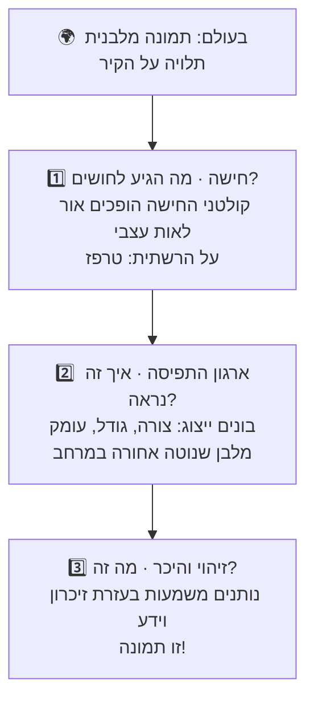

- **חישה (sensation):** קולטני החישה הופכים את הגירוי לאות עצבי. יש רק מידע גולמי, בלי משמעות.
- **ארגון התפיסה (perceptual organization):** בונים ייצוג פנימי של העצם: גודל, צורה, תנועה, מרחק וכיוון. התהליך מהיר ולא מודע.
- **זיהוי (identification) והיכר (recognition):** נותנים למתפס משמעות: מה זה, ולמה זה משמש.

### שאלה-3

**הוסיפו לתרשים 1 איור של התהליך העצבי בכל שלב** · ↩ סעיף 1.5

🧭 *(ניתוח שלי, לפי פרק 3)* דוגמה: היד נוגעת בכוס חמה.

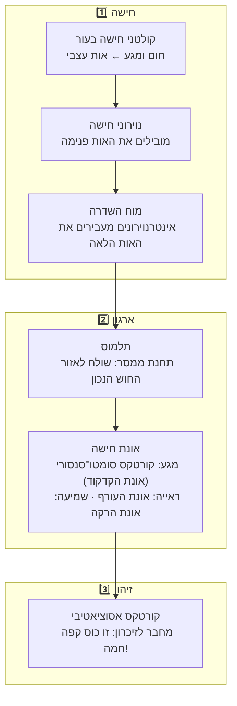

- בראייה ובשמיעה המסלול **לא עובר דרך מוח השדרה**. האות עובר מהעין או מהאוזן אל התלמוס, ומשם לאונת העורף או לאונת הרקה.

### 4.1.1 · מציאות, דו־משמעות ואילוזיות

### שאלה-4

**מהי אילוזיה?** · ↩ סעיף 2.2

- **אילוזיה (illusion):** מערכת התפיסה מטעה אותנו, ואנחנו חווים את הגירוי באופן שגוי. 📖 למשל במילר־לייר (Müller-Lyer) שני קווים שווים נראים באורכים שונים.
- היא קורית **כמעט לכולם**, כי היא נובעת מהדרך הרגילה שבה התפיסה עובדת. בזה היא שונה מ**הזיה** (hallucination), שנובעת ממצב גופני או נפשי.
- 📘 היא נוצרת מהשילוב בין **ההנחות והידע** שלנו על העולם (מלמעלה־למטה) לבין **תכונות הגירוי** (מלמטה־למעלה).

### שאלה-5

**מהי דו־משמעות?** · ↩ סעיף 2.1

- **דו־משמעות (ambiguity):** **תמונה אחת** ברמת החישה, ו**כמה פירושים** ברמת התפיסה. התפיסה קופצת בין הפירושים.
- 📖 **קוביית נקר:** דו־משמעות ב**ארגון** (לאיזה כיוון הקובייה פונה). **ברווז/ארנב:** דו־משמעות ב**זיהוי** (מה זה).
- 📘 בהתחלה רואים פירוש **אחד בלבד**. מערכת התפיסה מייצבת את העולם, כי קל יותר להגיב לגירוי חד־משמעי.

🧭 **אילוזיה מול דו־משמעות:**

| | **אילוזיה** | **דו־משמעות** |
|---|---|---|
| כמה פירושים | **אחד**, והוא **שגוי** | **כמה**, וכולם אפשריים |
| מה חווים | רואים בביטחון משהו שלא נכון | התפיסה **קופצת** בין הפירושים |
| 📖 דוגמה | מילר־לייר | קוביית נקר, ברווז/ארנב |

### 4.2 · פסיכופיזיקה והתמרה

### שאלה-6

**במה עוסקת הפסיכופיזיקה?** · ↩ סעיף 3.1

- **פסיכופיזיקה (psychophysics)** חוקרת את הקשר בין **הגירוי הפיזיקלי** (העוצמה שלו, ביחידות פיזיקליות) לבין **החוויה** שהוא יוצר.
- גוסטב פכנר (Gustav Fechner) טבע את המונח. השיטה זהה בכל החושים: מודדים **ספים** ובונים **סולמות פסיכו־פיזיקליים**.

### שאלה-7

**מהו סף מוחלט? איך מזהים אותו בעזרת הפונקציה הפסיכומטרית?** · ↩ סעיף 3.2

- **סף מוחלט (absolute threshold)**, שנקרא גם **סף גילוי:** הכמות המינימלית של אנרגיה שיוצרת חוויה חושית.
- **איך מודדים:** מציגים גירויים חלשים בעוצמות שונות, בהרבה ניסיונות, ושואלים "הרגשת?".
- **הפונקציה הפסיכומטרית (psychometric function)** היא גרף של **אחוז הגילוי** לפי **עוצמת הגירוי**. העקומה בצורת **S**, ולא מדרגה, כי המשתתף משתנה מניסיון לניסיון (עייפות, קשב). **הסף המוחלט = העוצמה שמתגלה ב־50% מהניסיונות.**

🧭 העקומה בצורת S:

```
 % גילוי
 100% |                 ________
      |               /
  50% | - - - - - - ●      ← הסף המוחלט
      |           /
   0% |__________/
      +---------------------------> עוצמת הגירוי
```

### שאלה-8

**מהי הסתגלות חישתית, ואיך היא משפיעה על זיהוי גירויים?** · ↩ סעיף 3.3

- **הסתגלות חישתית (sensory adaptation):** ירידה הדרגתית בתגובה של החושים לגירוי **קבוע וממושך**. 📖 נכנסים לחדר עם ריח, ואחרי כמה דקות כבר לא מריחים אותו.
- **ההשפעה על הזיהוי:** אחרי הסתגלות צריך גירוי **חזק יותר** כדי להרגיש אותו. מצד שני, החושים נשארים רגישים **לשינויים**, ולכן מגלים מהר יותר משהו **חדש**.

### שאלה-9

**מהי הטיית תגובה?** · ↩ סעיף 4.1

- **הטיית תגובה (response bias):** נטייה שיטתית להעדיף תשובה מסוימת, מסיבות **שלא קשורות לגירוי**.
- 📖 כשמשלמים על כל "כן" נכון, עונים "כן" כשלא בטוחים. כשמשלמים על "לא" נכון ונותנים קנס על טעות, עונים "לא". העיניים לא השתנו. **ההחלטה** השתנתה.

### שאלה-10

**רוני ויוני טעמו מיץ חדש. לרוני הוא מתוק, ויוני לא הרגיש מתיקות. שלושה הסברים** · ↩ סעיף 4.4

| הסבר | מה קרה |
|---|---|
| **סף מוחלט** | לרוני יש סף נמוך יותר למתיקות. כמות הסוכר במיץ **מעל** הסף שלו ו**מתחת** לסף של יוני |
| **הסתגלות חישתית** | יוני אכל קודם משהו מתוק מאוד. החושים שלו הסתגלו, ולכן הוא מרגיש פחות מתיקות |
| **הטיית תגובה** | שניהם הרגישו אותו דבר. רוני רוצה לרצות את מי שהכין את המיץ, ולכן כשהוא לא בטוח הוא אומר "מתוק". יוני נוטה לומר "לא" |

### שאלה-11

**שני תהליכי האיתור בתיאוריית גילוי האותות: תהליך חישה ותהליך החלטה** · ↩ סעיף 4.2

- **תיאוריית גילוי האותות (signal detection theory)** של גרין וסווטס (Green & Swets) מפרידה בין שני תהליכים:
  - **תהליך חישה (sensory process):** כמה טוב החושים קלטו את האות. זו **הרגישות** של הצופה.
  - **תהליך החלטה (decision process):** מה לענות, "כן" או "לא". כאן פועלת **הטיית התגובה**.
- שני אנשים יכולים להיות **רגישים באותה מידה**, ובכל זאת **להחליט אחרת**.

🧭 (גם לשאלה 12):

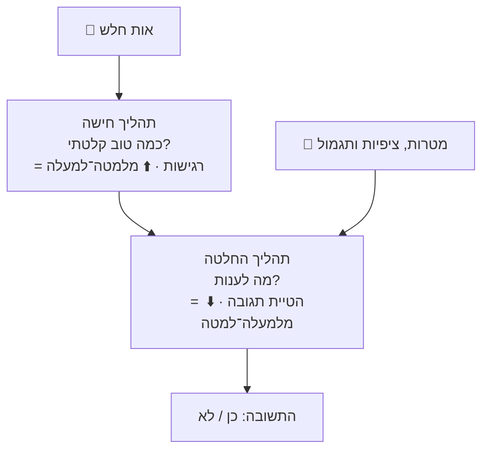

### שאלה-12

**קשרו בין שני תהליכי האיתור לבין שני מסלולי התפיסה** · ↩ סעיף 4.2

- **תהליך החישה = מלמטה־למעלה.** הוא מתחיל בגירוי ותלוי בתכונות שלו ובחושים.
- **תהליך ההחלטה = מלמעלה־למטה.** הוא מושפע ממה שכבר בראש: מטרות, ציפיות ומה ישתלם לענות.

### שאלה-13

**ארבעת המצבים שמחברים בין נוכחות הגירוי לתגובה (תרשים 4.7)** · ↩ סעיף 4.3

🧭

| | **עניתי "כן"** | **עניתי "לא"** |
|---|---|---|
| **היה אות** | ✅ **פגיעה** (hit) | ❌ **החטאה** (miss) |
| **לא היה אות** | ❌ **אזעקת שווא** (false alarm) | ✅ **דחייה נכונה** (correct rejection) |

- 📖 **דורית** עונה תמיד "כן": הרבה פגיעות, וגם הרבה אזעקות שווא. **בנימין** עונה תמיד "לא": מעט אזעקות שווא, וגם מעט פגיעות.
- *(לא מהספר)* **איך לזכור:** השם אומר מה קרה. **אזעקת שווא** = צעקתי "יש!" כשלא היה כלום. **החטאה** = היה, ופספסתי.

### למחשבה-1

**מוקד המשטרה: למה המוקדנים ביקשו הנחיה?** · ↩ סעיף 4.5

📘

- קשה להבחין בין פנייה אמיתית לפנייה פיקטיבית. **הגירוי עמום**, ולכן ההחלטה תלויה ב**הטיית התגובה**, ולא רק בגירוי.
- **נטייה לומר "כן" (לטפל):** יותר **פגיעות**, כי מטפלים בפניות אמיתיות. אבל גם יותר **אזעקות שווא**, כלומר בזבוז משאבים.
- **נטייה לומר "לא":** יותר **דחיות נכונות**, כלומר חיסכון. אבל גם יותר **החטאות**: אדם במצוקה לא יקבל עזרה.
- **לכן ביקשו הנחיה:** **קריטריון ההחלטה** תלוי ב"תגמול". המשטרה צריכה להחליט מה חשוב יותר: לחסוך במשאבים, או לא להחמיץ מצוקה אמיתית.

### שאלה-14

**מהו סף ההבדל?** · ↩ סעיף 5.1

- **סף ההבדל (difference threshold):** ההבדל הקטן ביותר בין שני גירויים שעדיין מבחינים בו. מגדירים אותו כהבדל שמזוהה ב־50% מהניסיונות, ונקרא **JND** (הפער המינימלי המובחן).
- 🧭 ההבדל מסף מוחלט: **מוחלט** שואל "יש או אין?" (גירוי אחד). **הבדל** שואל "זהים או שונים?" (זוג גירויים).

### שאלה-15

**מהו חוק ובר?** · ↩ סעיף 5.2

- **חוק ובר (Weber's law)**, של ארנסט ובר (Ernst Weber): ה־JND הוא **יחס קבוע** מהגירוי הבסיסי. **ΔI / I = k.**
- ככל שהגירוי הבסיסי **גדול** יותר, צריך להוסיף **יותר** כדי להרגיש הבדל. **k קטן = רגישות גבוהה.**

🧭 📖 תרשים 4.8, אורך קו (k = 0.1):

| הקו הבסיסי | כמה צריך להוסיף כדי שירגישו |
|---|---|
| 10 מ"מ | 1 מ"מ |
| 20 מ"מ | 2 מ"מ |
| 25 מ"מ | 2.5 מ"מ |

### למחשבה-2

**מלח בחטיפים: למה היצרניות הציעו להפחית 15% ואחר כך עוד 10%?** · ↩ סעיף 5.3

📘

- היצרניות רצו שהלקוחות **לא ירגישו** שהטעם השתנה. הקבוע של ובר לטעם הוא **20%** (📖 טבלה 4.2). לכן הפחתה של 25% בבת אחת **תורגש**.
- **שלב א:** 15%. זה מתחת לסף ההבדל, ולכן לא מורגש.
- אחרי **הסתגלות** לטעם החדש, כמות המלח הבסיסית קטנה יותר. לפי חוק ובר, בכמות קטנה יותר גם השינוי שמורגש קטן יותר. **שלב ב:** אפשר שוב שינוי יחסי מתחת לסף, עוד 10%.

🧭

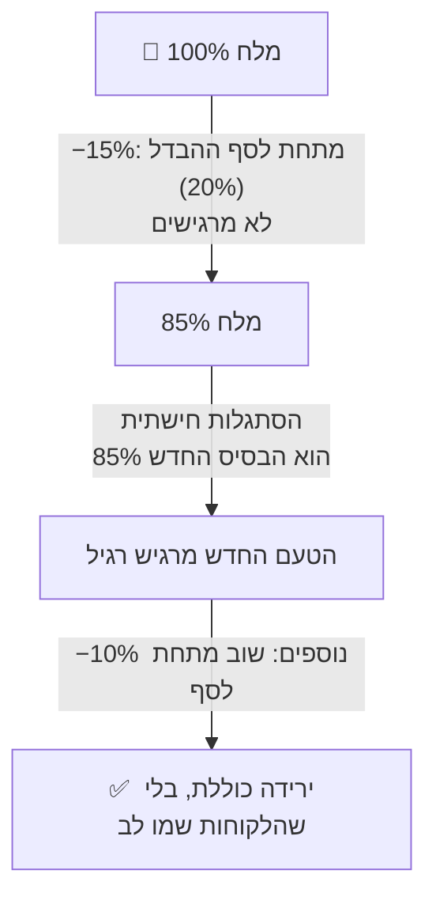

### שאלה-16

**מהי התמרה?** · ↩ סעיף 6

- **התמרה (transduction):** הפיכת סוג אחד של אנרגיה פיזיקלית (אור, קול, לחץ) ל**אות עצבי**. היא קורית בקולטני החישה.
- כל החושים מתורגמים לאותו סוג של אות. המוח יודע איזה חוש זה לפי **האזור בקורטקס** שאליו האות מגיע.

🧭

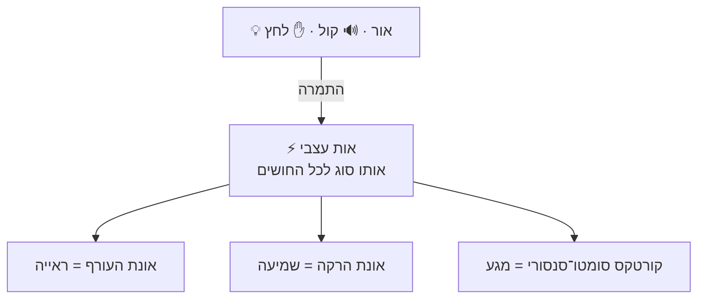

### 4.3.1 · תהליכי קשב

### שאלה-17

**מהי בחירה מכוונת־מטרה? דוגמה** · ↩ סעיף 7.1

- **בחירה מכוונת־מטרה (goal-directed selection):** **אני** בוחרת במה להתמקד, לפי המטרות שלי.
- 📖 מחפשים משהו מתוק בחלון של מאפייה, והקשב הולך לעוגיות.

🧭 שני הכוחות שמושכים את הקשב (גם לשאלה 18):

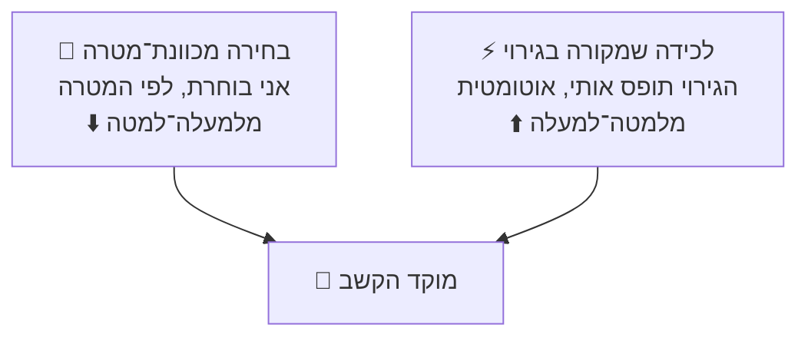

### שאלה-18

**מהי לכידה שמקורה בגירוי? דוגמה** · ↩ סעיף 7.1

- **לכידה שמקורה בגירוי (stimulus-driven capture):** **תכונה של הגירוי** מושכת את הקשב באופן אוטומטי, בלי קשר למטרה שלי.
- 📖 חולמים בהקיץ ברמזור, והשינוי מאדום לירוק "תופס" אותנו.

### שאלה-19

**הניסוי שהעמיד בתחרות בחירה מכוונת־מטרה מול לכידה שמקורה בגירוי (תרשים 4.25). מה משפיע יותר?** · ↩ סעיף 7.2

- **תיאוס ועמיתיו (Theeuwes et al., 1998):** שישה עיגולים אפורים. כולם חוץ מאחד הופכים לסגולים. **המשימה (מטרה):** להסתכל על העיגול האפור שנשאר. בחצי מהניסיונות מופיע גם **עיגול סגול חדש**, שלא קשור למשימה.
- **התוצאה:** ברוב המקרים העיגול החדש **משך את המבט**, אף שהפריע למשימה.
- **המסקנה:** לפחות בתנאים מסוימים, **לכידה שמקורה בגירוי משפיעה יותר**. הקשב נמשך אוטומטית לעצמים חדשים.

### שאלה-20

**מודל הפילטר של ברודבנט לעיבוד מידע לא־קשוב** · ↩ סעיף 7.3

- **דונלד ברודבנט (Donald Broadbent):** לתודעה יש **קיבולת מוגבלת**. לכן הקשב פועל כמו **פילטר** שחוסם את רוב המידע.
- הסינון קורה **מוקדם**, **לפני** שמעבדים את המשמעות. מה שלא נבחר לא מעובד בכלל.
- 📖 **האזנה דיכוטית:** כשמתמקדים באוזן ימין, מדווחים רק את הספרות ששמעו בה.

🧭 ברודבנט מול ההסבר היום (גם לשאלות 21 ו־23):

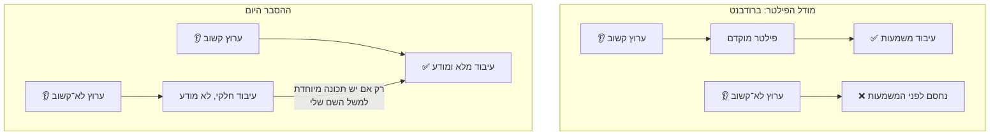

### שאלה-21

**מהי תופעת מסיבת הקוקטייל, ואיך היא קוראת תיגר על מודל הפילטר?** · ↩ סעיף 7.3

- **תופעת מסיבת הקוקטייל (cocktail party phenomenon):** 📖 בחדר רועש, באמצע שיחה, שומעים פתאום את **השם שלנו** משיחה אחרת שלא הקשבנו לה.
- **התיגר:** לפי ברודבנט, הפילטר חוסם את הערוץ הלא־קשוב **לפני** עיבוד המשמעות. אבל כדי לזהות את השם שלנו, היה צריך לעבד את **המשמעות** של מה שנאמר בערוץ הזה.

### שאלה-22

**איזה תהליך מודגם במסיבת הקוקטייל: לכידה שמקורה בגירוי או בחירה מכוונת־מטרה?** · ↩ סעיף 7.3

- **לכידה שמקורה בגירוי.** לא חיפשתי את השם שלי. תכונה של הגירוי (השם שלי) משכה את הקשב באופן אוטומטי.

### שאלה-23

**איך מסבירים היום את עיבוד המידע בערוץ הלא־קשוב?** · ↩ סעיף 7.3

- מידע בערוץ הלא־קשוב **כן עובר עיבוד מסוים**, אבל לא מספיק כדי להגיע למודעות (Wood & Cowan).
- רק כשיש בו **תכונה מיוחדת**, כמו השם שלנו, הוא עובר למוקד הקשב. (ראי את הדיאגרמה בשאלה 20.)

### 4.3.2 · עקרונות ההקבצה התפיסתית

### שאלה-24

**חמשת עקרונות ההקבצה, ואיך כל אחד תורם לארגון התפיסה** · ↩ סעיף 8.3

כל חמשת העקרונות של **פסיכולוגיית הגשטאלט (Gestalt psychology)** מחברים חלקים נפרדים ל**מבנה אחד**, ועוזרים להפריד **דמות** מ**רקע**.

🧭 *(איור שלי)*

| עיקרון | מה מקבצים יחד | איך זה נראה |
|---|---|---|
| **הסמיכות** (proximity) | מה ש**קרוב** זה לזה | `●●    ●●    ●●` ← שלושה זוגות |
| **הדמיון** (similarity) | מה ש**דומה** זה לזה | `○○○●●●○○○` ← שלוש קבוצות לפי צבע |
| **ההמשכיות הטובה** (good continuation) | קו שממשיך בצורה **חלקה**, גם כשמשהו קוטע אותו | 📖 חץ שעובר דרך לב נראה כחץ אחד, ולא כשלוש חתיכות |
| **הסגירות** (closure) | **משלימים** חלק חסר לצורה שלמה | `( )` ← רואים עיגול, אף שחסרים בו חלקים |
| **הגורל המשותף** (common fate) | מה ש**זז יחד** | `→→→  ←←←` ← שתי קבוצות לפי כיוון התנועה |

- *(טריק זיכרון, לא מהספר)* **"חברים טובים: עומדים קרוב (סמיכות), לובשים דומה (דמיון), הולכים באותה דרך (המשכיות), משלימים זה את זה (סגירות) וחולקים גורל משותף."**

### 4.3.3 · אינטגרציה של מרחב, זמן ותנועה

### שאלה-25

**עיוורון לשינוי: חילופי זהות, חילופי מקום ושינוי תצורה. אילו שינויים מזהים יותר, ואילו פחות?** · ↩ סעיף 9.2

- 📖 **סיימונס (Simons, 1996):** מציגים חמישה עצמים, ואחרי 4 שניות תצוגה שנייה. שואלים: "זהה או שונה?". 50% הוא ניחוש.

🧭

| השינוי | מה השתנה | דיוק |
|---|---|---|
| **שינוי תצורה** | **כל** העצמים סודרו בסידור חדש | ██████████████████▊ **94%** · הכי קל |
| **חילופי זהות** | עצם אחד **הוחלף** בעצם אחר | ███████████████ **75%** |
| **חילופי מקום** | שני עצמים **החליפו מקומות** | █████████████ **65%** · הכי קשה |

### למחשבה-3

**למה הדיוק גבוה יותר בשינוי תצורה מאשר בחילופי מקום?** · ↩ סעיף 9.2

📘 אנחנו מארגנים גירויים חזותיים לפי **עיקרון מרחבי**: איפה כל דבר נמצא ביחס לאחרים. זו **אינטגרציה מרחבית (spatial integration)**. לכן אנחנו רגישים יותר לשינוי **במבנה הכללי** (שינוי תצורה) מאשר להחלפה בין שני פריטים, כשהמבנה הכללי נשאר.

### 4.3.4 · תפיסת המרחב

🧭 כל רמזי המרחק (לשאלות 26–29):

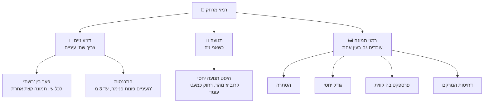

### שאלה-26

**איך הרמזים הדו־עיניים תורמים לתפיסת מרחק?** · ↩ סעיף 10

- **פער בין־רשתי (binocular disparity):** העיניים רחוקות זו מזו בכמה סנטימטרים, ולכן כל עין רואה תמונה **קצת אחרת**. המוח משווה בין התמונות: **ככל שהפער גדול יותר, ההבדל במרחק גדול יותר.**
- **התכנסות (convergence):** כשמתמקדים בעצם קרוב, העיניים **פונות פנימה**. המוח קורא את המידע משרירי העין: זווית גדולה = קרוב. עובד רק עד כ־3 מטרים.

### שאלה-27

**מהו היסט תנועה יחסי, ואיזה מידע הוא נותן על המרחב?** · ↩ סעיף 10

- **היסט תנועה יחסי (relative motion parallax):** כשאנחנו **זזים**, עצמים קרובים נראים זזים **יותר ומהר יותר** מעצמים רחוקים.
- 📖 בנסיעה במכונית העצים ליד הכביש חולפים מהר, וההרים באופק כמעט עומדים. מהירות התזוזה אומרת למוח מה קרוב ומה רחוק.

### שאלה-28

**מהם רמזי תמונה?** · ↩ סעיף 10

- **רמזי תמונה (pictorial cues):** רמזי מרחק שעובדים **גם בעין אחת**. הם נקראים כך כי ציירים משתמשים בהם כדי ליצור עומק על דף שטוח.

### שאלה-29

**ארבעת רמזי התמונה, ואיך כל אחד משפיע על תפיסת המרחב** · ↩ סעיף 10

| רמז | מה הוא אומר | 📖 בספר |
|---|---|---|
| **הסתרה** (interposition) | עצם שמסתיר חלק מעצם אחר **קרוב יותר** | אישה מאחורי סורגים |
| **גודל יחסי** (relative size) | משני עצמים זהים, מה שקטן יותר ברשתית **רחוק יותר** | עיגולים בגדלים שונים |
| **פרספקטיבה קווית** (linear perspective) | קווים מקבילים **מתכנסים** ככל שהם מתרחקים | מסילת רכבת |
| **דחיסות המרקם** (texture gradients) | המרקם נעשה **צפוף ועדין** יותר ככל שהמשטח מתרחק | שדה חיטה |

- *(טריק זיכרון, לא מהספר)* **ארבעה כלים של צייר שרוצה עומק:** מסתיר דבר אחד מאחורי דבר אחר, מקטין את מה שרחוק, מכנס את הקווים לאופק, ומצופף את המרקם.

### 4.3.5 · קביעויות תפיסה

### שאלה-30

**מהי קביעות תפיסה, ולמה היא חשובה?** · ↩ סעיף 11.1

- **קביעות תפיסה (perceptual constancy):** תופסים את התכונות של **הגירוי הרחוק** (העצם, שבדרך כלל לא משתנה), ולא של **הבבואה** ברשתית, שמשתנה כל פעם שזזים.
- **למה חשובה:** **הישרדות**. צריך לדעת מה התכונות האמיתיות של עצמים, אף שהאור שמגיע לעיניים משתנה כל הזמן.

🧭 (גם לשאלות 31–33):

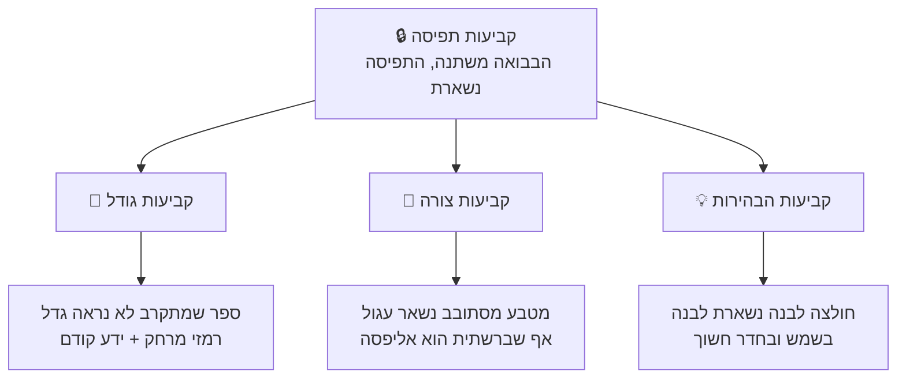

### שאלה-31

**מהי קביעות גודל? דוגמה** · ↩ סעיף 11.2

- **קביעות גודל (size constancy):** תופסים את **הגודל האמיתי** של עצם, אף שהגודל שלו ברשתית משתנה. המוח משלב את גודל הבבואה עם **רמזי המרחק** ועם **ידע קודם** על הגודל הרגיל של העצם.
- 📖 מקרבים ספר לפנים: הבבואה גדלה מאוד, אבל הספר לא נראה גדל.
- 📖 **כשזה נכשל:** בחדר של איימס טועים במרחק, ולכן גם בגודל. ילד נראה ענק ומבוגר נראה זעיר.

### שאלה-32

**מהי קביעות צורה? דוגמה** · ↩ סעיף 11.2

- **קביעות צורה (shape constancy):** תופסים את **הצורה האמיתית** של עצם גם כשהוא נוטה, והצורה שלו ברשתית אחרת.
- 📖 מטבע מסתובב: ברשתית הוא הופך לאליפסה ואחר כך למלבן צר, ובכל זאת נראה **עגול**.

### שאלה-33

**מהי קביעות הבהירות? דוגמה** · ↩ סעיף 11.2

- **קביעות הבהירות (lightness constancy):** תופסים את הלבן, האפור או השחור של עצם כ**קבועים**, גם כשהתאורה משתנה. מה שקבוע הוא **אחוז** האור שהעצם מחזיר.
- 📖 חולצה לבנה מחזירה 80–90% מהאור, וג'ינס שחור כ־5%. לכן החולצה בהירה מהג'ינס גם בשמש וגם בחדר חשוך.

### 4.4 · זיהוי והיכר: מלמטה־למעלה ומלמעלה־למטה

### שאלה-34

**הבחינו בין עיבוד מלמטה־למעלה לעיבוד מלמעלה־למטה, ואיך הם משפיעים על התפיסה** · ↩ סעיף 12.1

- **עיבוד מלמטה־למעלה (bottom-up processing):** הזיהוי מתחיל **בגירוי**: בקווים, בצבעים ובצלילים שהחושים קולטים.
- **עיבוד מלמעלה־למטה (top-down processing):** הזיהוי מושפע **ממה שכבר בראש**: ידע, ניסיון, ציפיות והקשר.
- 📖 בגן החיות תזהי **נמר** מהר יותר מאשר בחצר הבית, כי שם את מצפה לו.

🧭

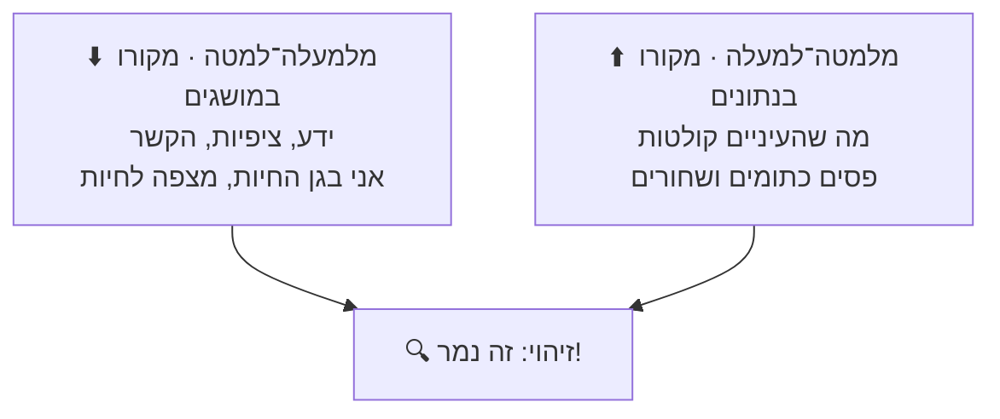

### שאלה-35

**למה עיבוד מלמעלה־למטה נקרא גם "עיבוד שמקורו במושגים"?** · ↩ סעיף 12.1

- כי נקודת המוצא שלו היא **המושגים** ששמורים בזיכרון, ולא הנתונים מהחושים. המושגים שכבר יש לנו קובעים איך נפרש את מה שהחושים מביאים.
- 📖 **דרודלס:** ציור בלי משמעות. ברגע שמקבלים **שם** (מושג), פתאום "רואים" אותו.

### שאלה-36

**איך השחזור הפונמי מסביר את התפיסה מלמעלה־למטה?** · ↩ סעיף 12.2

- **שחזור פונמי (phonemic restoration):** כשצליל במילה מוסתר ברעש, המוח **משלים** אותו, ואנחנו בכלל לא שמים לב שהיה חסר.
- את מה שחסר בגירוי ממלאים **הידע** (מילים מוכרות) ו**ההקשר**. זה בדיוק עיבוד מלמעלה־למטה.

🧭 📖 הדוגמה מהספר:

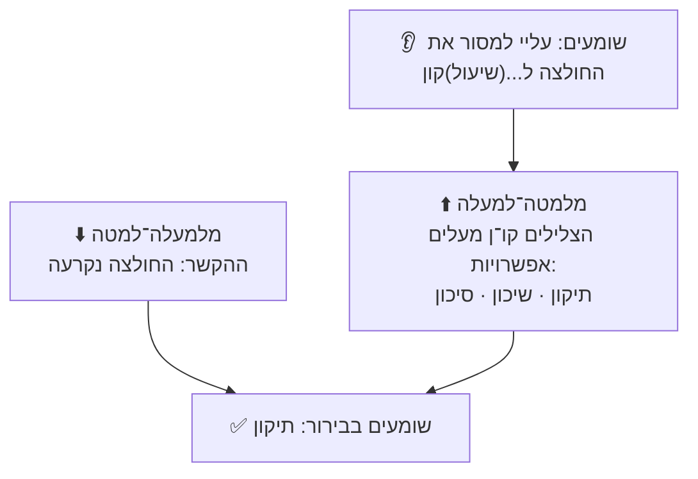

### שאלה-37

**למה חשוב לשלב בין שני סוגי העיבוד? מה החשיבות של כל אחד?** · ↩ סעיף 12.5

| אם התפיסה הייתה **רק מלמטה־למעלה** | אם התפיסה הייתה **רק מלמעלה־למטה** |
|---|---|
| היינו **תקועים בכאן ועכשיו**. חווים את הגירוי, אבל **לא לומדים** מהניסיון | היינו **הולכים לאיבוד בעולם פרטי** של מה שאנחנו מצפים או רוצים לראות |

- **החשיבות של מלמטה־למעלה:** מחבר אותנו **למציאות**, למה שבאמת נמצא שם.
- **החשיבות של מלמעלה־למטה:** נותן **משמעות**, ומאפשר לזהות מהר גם כשהגירוי חלקי או רועש.
- **יחד** הם עוזרים לנו להסתגל לסביבה.

### שאלה-38

**שלושת סוגי המערכים, והשפעתם על התפיסה** · ↩ סעיף 12.4

- **מערך (set):** מוכנות **זמנית** לתפוס גירוי או להגיב עליו בדרך מסוימת.

🧭

| מערך | מה מוכן | 📖 דוגמה |
|---|---|---|
| **מוטורי** (motor set) | **הגוף** מוכן להגיב מהר בתגובה מוכנה מראש | אצן ביריית ההזנקה |
| **מנטלי** (mental set) | **החשיבה** מוכנה לפתור לפי כללים, הרגלים וציפיות | עלול להפריע: כלל ישן לבעיה חדשה |
| **תפיסתי** (perceptual set) | **החושים** מוכנים לגלות גירוי מסוים בהקשר מסוים | אם שמוכנה לשמוע את בכי התינוק |

- **ההשפעה על התפיסה:** המערך מכוון אותנו לפירוש מסוים. 📖 אחרי רשימה של חיות קוראים "פ_ל" כ**פיל**, ואחרי רשימה של קטניות כ**פול**.

### למחשבה-4

**מקמו כל מונח בטבלה: שלב בתפיסה × מסלול עיבוד** · ↩ סעיף 12.6

📘

| שלב | ⬆️ מלמטה־למעלה | ⬇️ מלמעלה־למטה |
|---|---|---|
| **חישה** | תיאוריית גילוי האותות: **תהליך חישה** | תיאוריית גילוי האותות: **תהליך החלטה** · **הטיית תגובה** |
| **ארגון** | **לכידה שמקורה בגירוי** | **בחירה מכוונת־מטרה** |
| **זיהוי / היכר** | — | **שחזור פונמי** · **מערך** (הקשר) |

- *(לא מהספר)* **איך לזכור:** בעמודה של מלמעלה־למטה כל המונחים קשורים למשהו **שבתוכי**: החלטה, נטייה, מטרה, ידע, ציפייה.
