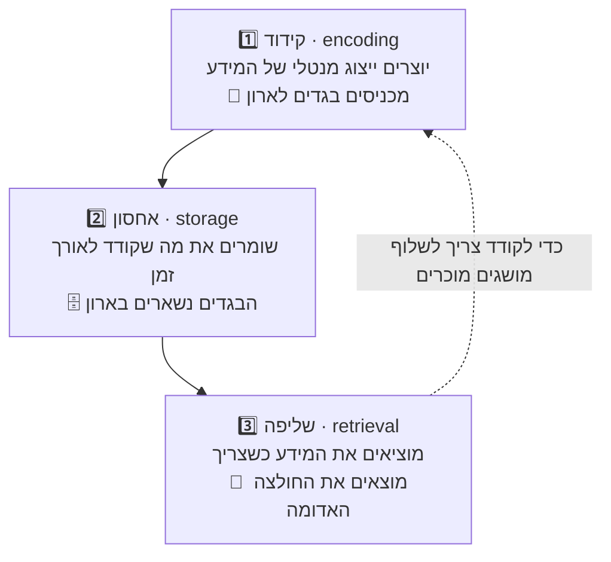
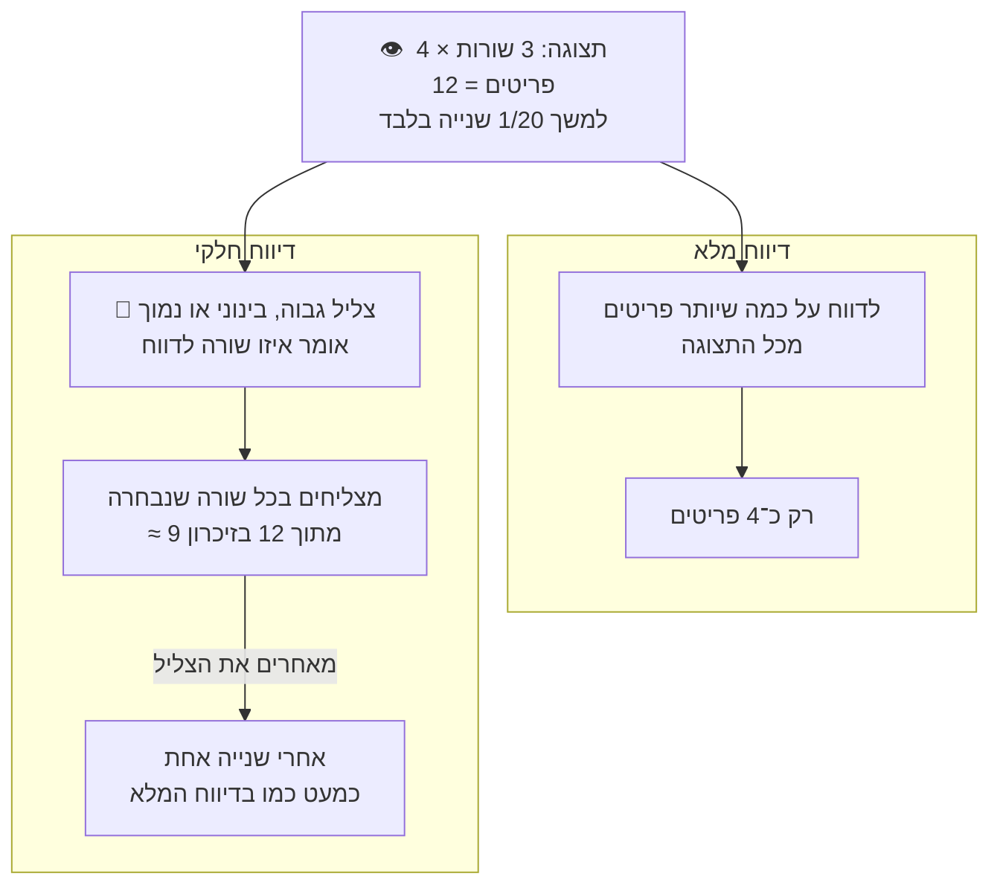
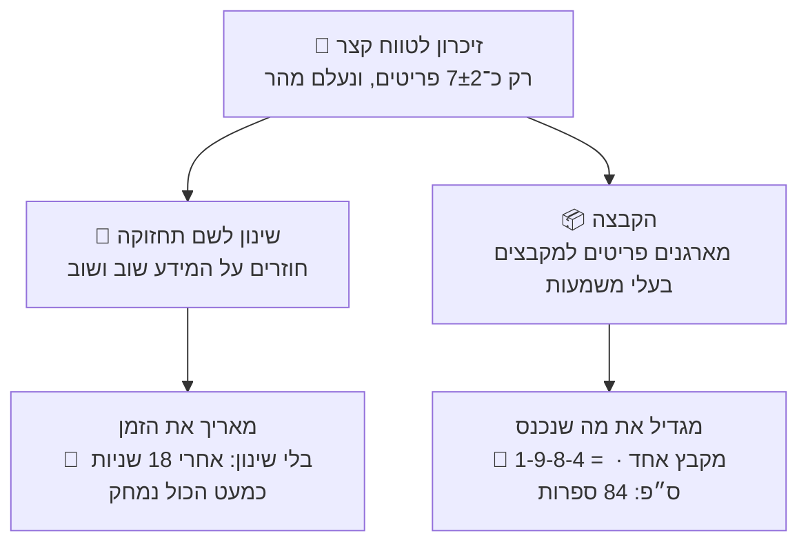
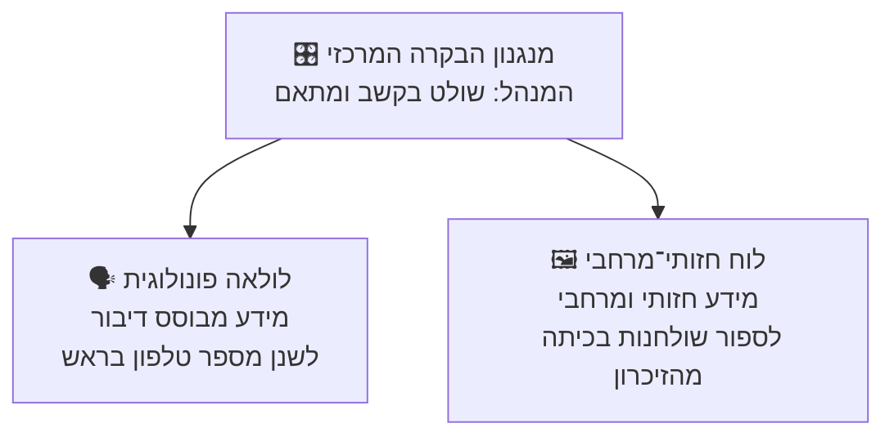
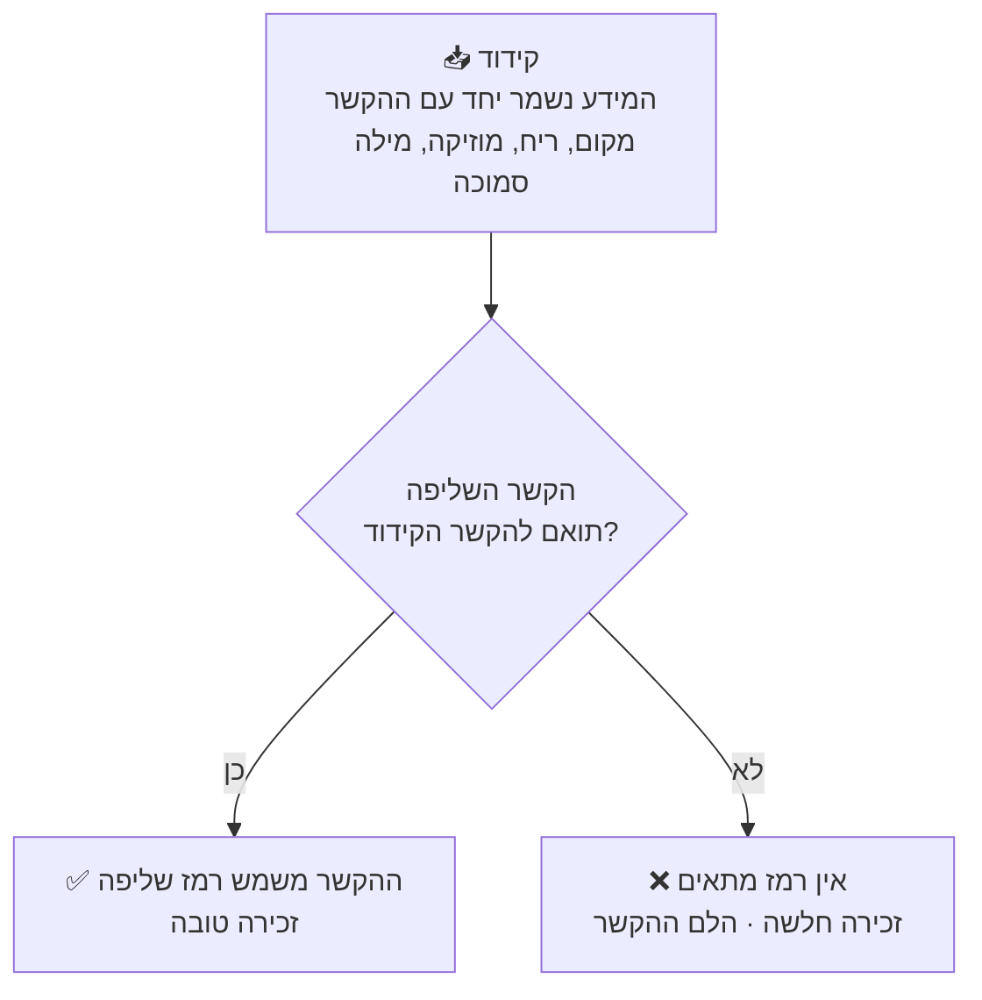
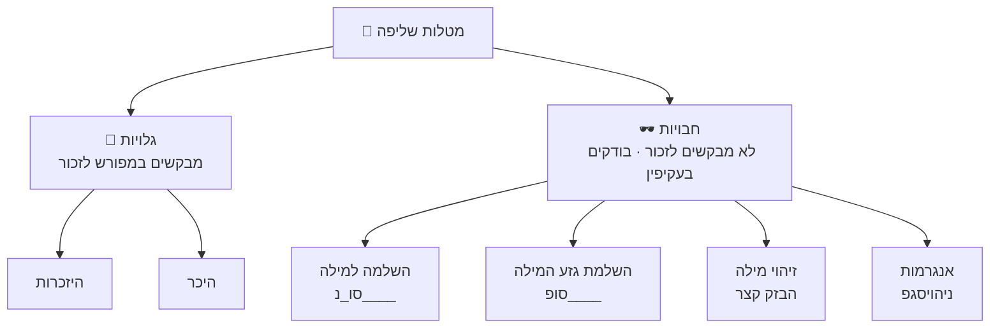
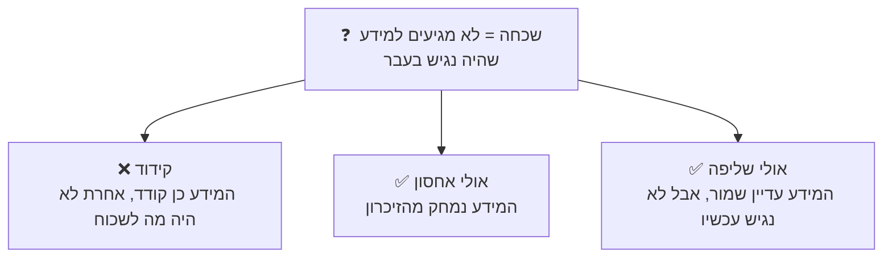
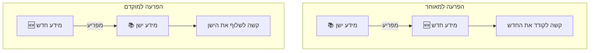
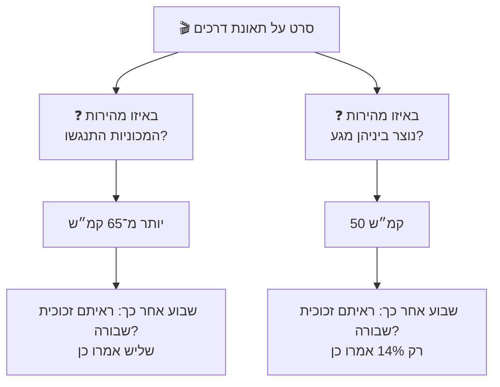
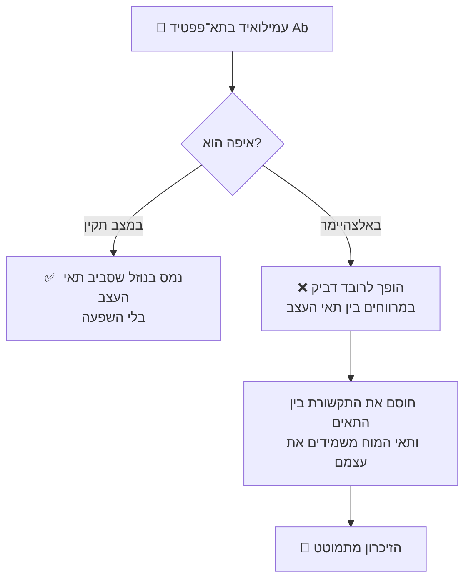

# עמ' 320–338, 341–346, 350, 359–368 · זיכרון

> **מקור:** ספר הקורס, כרך א, פרק 7 · **מדריך הלמידה:** פרק 6 (סעיפים 6.1–6.4): 43 שאלות מנחות, 3 "שאלות למחשבה" וטבלה 1 למילוי.
> **פודקאסטים (4 חלקים):** [1. תהליכי הזיכרון וזיכרון לטווח קצר](../פודקאסטים/פרק-6-320-331-תהליכי-הזיכרון-וזיכרון-לטווח-קצר.m4a) · [2. זיכרון לטווח ארוך, רמזי שליפה והקשר](../פודקאסטים/פרק-6-331-338-זיכרון-לטווח-ארוך-רמזי-שליפה-והקשר.m4a) · [3. זיכרון חבוי, שכחה ושיפור הזיכרון](../פודקאסטים/פרק-6-341-350-זיכרון-חבוי-שכחה-ושיפור-הזיכרון.m4a) · [4. עדי ראייה והיבטים ביולוגיים](../פודקאסטים/פרק-6-359-368-עדי-ראייה-והיבטים-ביולוגיים.m4a)
> **תוכניות הפרקים:** [1](../פודקאסטים/תוכניות/פרק-6-320-331-תהליכי-הזיכרון-וזיכרון-לטווח-קצר-תוכנית.md) · [2](../פודקאסטים/תוכניות/פרק-6-331-338-זיכרון-לטווח-ארוך-רמזי-שליפה-והקשר-תוכנית.md) · [3](../פודקאסטים/תוכניות/פרק-6-341-350-זיכרון-חבוי-שכחה-ושיפור-הזיכרון-תוכנית.md) · [4](../פודקאסטים/תוכניות/פרק-6-359-368-עדי-ראייה-והיבטים-ביולוגיים-תוכנית.md)
> **מפת חשיבה:** [XMind](../מפות-חשיבה/פרק-6-320-368-זיכרון.xmind) · [HTML](../מפות-חשיבה/פרק-6-320-368-זיכרון.html) · [תמונה](../מפות-חשיבה/פרק-6-320-368-זיכרון.png)
>
> **סימנים:** ★ = מונח רשמי (בשולי הספר) · 📖 = מהספר · 📘 = מהמדריך · *(לא מהספר)* = אנלוגיה, דוגמה או ניתוח שלי.

---

## איך לקרוא את הפרק (לפי מדריך הלמידה)

| חלק במדריך | נושא | עמ' בספר | שאלות | בסיכום |
|---|---|---|---|---|
| 6.1–6.1.1 | מהו זיכרון: קידוד, אחסון ושליפה | 320–322 | 1 · למחשבה 1 | 1 |
| 6.2.1 | זיכרון חושי וזיכרון איקוני | 322–325 (מ"זיכרון הנשמר לזמן קצר" עד "זיכרון לטווח קצר") | 2–5 | 2 |
| 6.2.2 | זיכרון לטווח קצר | 325–328 (עד "זיכרון עבודה") | 6–9 | 3 |
| 6.2.3 | זיכרון עבודה | 328–331 (עד "זיכרון לטווח ארוך: קידוד ושליפה") | 10–12 | 4 |
| 6.3–6.3.1 | זיכרון לטווח ארוך: סוגים לפי תוכן | 📘 טקסט המדריך (בלי עמודים בספר) | — | 5 |
| 6.3.2 | שליפה בעזרת רמזים | 331–334 (מ"שליפה בעזרת רמזים" עד "קידוד הכולל הקשר") | 13–18 | 6 |
| 6.3.3 | קידוד הכולל הקשר | 334–338 (עד "תהליכי קידוד ושליפה") | 19–23 | 7 |
| 6.3.4 | מטלות זיכרון גלוי וחבוי, הטרמה | 📘 טקסט המדריך (בלי עמודים בספר) | 24–25 | 8 |
| 6.3.5 | שכחה | 341–344 (הסעיף "מדוע אנו שוכחים") | 26–31 · למחשבה 2 | 9 |
| 6.3.6 | שיפור הזיכרון למידע לא מובנה | 344–346 | 32–35 · למחשבה 3 | 10 |
| מיומנויות למידה | איך המחקר על הזיכרון עוזר ללמוד | 350 | — | 10.4 |
| 6.3.7 | הזיכרון של עדי ראייה | 359–361 (הסעיף "זיכרונו של עד ראייה") | 36–38 | 11 |
| 6.4 | היבטים ביולוגיים: היכן האנגרם? | 361–368 | 39–40 · טבלה 1 | 12 |
| 6.4 | מחלת אלצהיימר | 368 | 41–43 | 13 |

> 📘 **מה לא קוראים:** פתיחת הפרק ו"סוגי זיכרון" (315–320, את הסוגים המדריך מלמד בעצמו בסעיפים 6.3.1 ו־6.3.4) · "תהליכי קידוד ושליפה" (338–341: רמות העיבוד) · "מטה־זיכרון" (347–349) · "מבנים בזיכרון לטווח ארוך" ו"זכירה כתהליך בנייה מחדש" עד "זיכרונו של עד ראייה" (351–359) · סיכום ומבחן הפרק (369 והלאה).
> 📘 בהקלטה של אליזבת לופטוס (Elizabeth Loftus) שהמדריך מפנה אליה (סעיף 6.3.7) לא צפיתי. היא לא בסיכום.

## בקצרה

- **זיכרון = עיבוד מידע בשלושה תהליכים:** **קידוד** (מכניסים) ← **אחסון** (שומרים) ← **שליפה** (מוציאים). 📘 מודל המאגרים המרובים: זיכרון חושי ← זיכרון עבודה ← זיכרון לטווח ארוך.
- **לזמן קצר:** **הזיכרון האיקוני** קולט כמעט הכול, אבל לפחות משנייה (ספרלינג). **הזיכרון לטווח קצר** מחזיק רק כ־7±2 פריטים (מילר), ואפשר להרחיב אותו ב**שינון** וב**הקבצה**. **זיכרון העבודה** גם **מעבד**: לולאה פונולוגית, לוח חזותי־מרחבי ומנגנון בקרה מרכזי (באדלי).
- **לטווח ארוך:** **תהליכי** (איך) מול **מוצהר** (מה), והמוצהר מתחלק ל**אפיזודי** (אירועים שלי) ו**סמנטי** (עובדות ומשמעויות). שולפים בעזרת **רמזי שליפה**. הזיכרון הכי טוב כשהקשר הקידוד **תואם** להקשר השליפה (**ייחודיות הקידוד**).
- **למה שוכחים:** הזמן (עקומת השכחה של אבינגהאוס) ו**הפרעה** בין זיכרונות. **מידע מטעה** אחרי אירוע משנה את מה שעדי ראייה "זוכרים" (לופטוס).
- **במוח:** אין מקום אחד לזיכרון (לאשלי). מבנים שונים לסוגים שונים: **היפוקמפוס** ו**אמיגדלה**, **מוחון**, **קליפת המוח**. **שיכחון** והדמיה מוחית מראים זאת. **אלצהיימר:** רובד של עמילואיד בתא־פפטיד הורס תאי עצב.

---

## 1. מהו זיכרון: שלושה תהליכים (עמ' 320–322 · 📘 מדריך 6.1–6.1.1, [שאלה 1](#שאלה-1), [למחשבה 1](#למחשבה-1))

- 📘 **זיכרון ★** (memory): תהליך של **עיבוד מידע ★** (information processing) שמשלב קידוד, אחסון ושליפה. ההגדרה באה מההקבלה בין המוח ל**מחשב**: מקודדים מידע, מאחסנים ושולפים לפי הצורך.

### 1.1 שלושת התהליכים ([שאלה 1](#שאלה-1) · 📘 תרשים 1 במדריך: שלושה גלגלי שיניים)

| תהליך | מה קורה | 📖 / 📘 דוגמה |
|---|---|---|
| **קידוד ★** (encoding) | העיבוד **הראשוני** של המידע, שיוצר ייצוג בזיכרון. דורש **ייצוג מנטלי ★** (mental representation): העולם החיצוני "עובר" לייצוגים פנימיים | 📖 לתאר את מתנת יום ההולדת בלי שהיא ביד: לתאר, לצייר או להראות בפנים מה הרגשת. כל ייצוג פחות טוב מהחפץ עצמו, אבל שומר את התכונות העיקריות |
| **אחסון ★** (storage) | **שמירה** של מה שקודד לאורך זמן. דורש שינויים במבנה המוח, לטווח קצר ולטווח ארוך | 📘 בארון: לסדר את הבגדים לפי סוג (חולצות, מכנסיים) |
| **שליפה ★** (retrieval) | **הוצאה** של המידע המאוחסן ברגע שצריך אותו | 📖 תוכלי לשלוף "קידוד" באותה מהירות ובאותו ביטחון עוד כמה שבועות? |

- 📖 **שלושת התהליכים שזורים זה בזה:** כדי **לקודד** "ראיתי נמר", צריך קודם **לשלוף** את המושג "נמר". כדי להבין "הוא תם וישר ממש כמו אל קפונה", צריך לשלוף את המשמעות של כל מילה ומידע על אל קפונה (שהיה ראש מאפיה, ולכן המשפט אירוני).
- 📘 **הארון:** ככל שמשקיעים יותר בסידור (קידוד משמעותי ומבוסס), כך קל יותר למצוא (שליפה). חולצה אדומה אחת בין חולצות שחורות קל למצוא. חולצה אדומה מסוימת בין הרבה חולצות אדומות קשה למצוא.
- 📖 **הידור ידע ★** (knowledge compilation, Anderson, 1987; ראש עמ' 320): תרגול הופך רשימה של עובדות מוצהרות ("להקיש 2, אז 0, אז 7") ליחידה **אוטומטית** אחת. הרווח: מהיר, בלי מודעות. המחיר: קשה לשחזר את העובדות, ויש **טעויות**: 📖 קלדנית שרגילה להקליד "שלום" מקלידה ם גם כשהתכוונה ל"שלוש".

### 1.2 📘 "שלום, רוני כהן" (שאלה [למחשבה 1](#למחשבה-1))

- איך שלושת התהליכים באים לידי ביטוי במקרה של רוני כהן: [למחשבה 1](#למחשבה-1).

### 1.3 📘 מודל המאגרים המרובים (Multi-Store Model, Atkinson & Shiffrin, 1968 · 📖 תרשים 7.2)

```
זיכרון חושי ──► זיכרון עבודה (כולל זיכרון לטווח קצר) ◄──► זיכרון לטווח ארוך
        └──── זיכרון לזמן מצומצם ────┘
```

| מאגר | כמה זמן | 📖 תהליך בתרשים 7.2 |
|---|---|---|
| **זיכרון חושי** | פחות משנייה | **קידוד** ראשוני: חושי ← עבודה |
| **זיכרון עבודה** | משניות ועד כמה דקות | **אחסון:** עבודה ← לטווח ארוך |
| **זיכרון לטווח ארוך** | ימים ואף שנים | **שליפה:** לטווח ארוך ← עבודה |

- 📘 לפי המודל, כדי שזיכרון יישמר לאורך זמן הוא **עובר קודם** במאגרים לזמן קצר. 📘 המדריך מציין שיש ביקורות על המודל ומודלים אחרים, אבל בקורס מתמקדים **בו בלבד**.

---

## 2. זיכרון חושי וזיכרון איקוני (עמ' 322–325 · 📘 מדריך 6.2.1, שאלות [2](#שאלה-2)–[5](#שאלה-5))

- 📖 **ההדגמה (תרשים 7.3):** מסתכלים 10 שניות על ציור עמוס, מסתירים ועונים על שאלות (מה מחזיק הילד הקטן?). קשה. רוב המידע שקולטים **לא נשאר**.
- 📘 **זיכרון חושי** (sensory memory): הזיכרון הראשון של מה שהחושים קלטו. מכיל **הרבה** מידע, אבל לזמן **קצר מאוד** (בראייה כחצי שנייה). מידע "ישן" **דועך** או **נדחק** בידי מידע חדש.
  - חזותי = **זיכרון איקוני**. שמיעתי = **זיכרון אקואי** (לא נלמד בקורס).
- **זיכרון איקוני, תמונתי ★** (iconic memory, Neisser, 1967): הזיכרון החושי של **הראייה**. שומר כמויות גדולות של מידע לזמן קצר מאוד, כחצי שנייה. 📘 **ניסוי לבד:** לעצום עיניים, לקרב כף יד לפנים, לפקוח ולעצום מהר. לרגע "רואים" את היד גם בעיניים עצומות.

### 2.1 הניסויים של ג'ורג' ספרלינג (George Sperling, 1960, 1963) (שאלות [2](#שאלה-2)–[4](#שאלה-4))

- **התצוגה:** 3 שורות של 4 אותיות ומספרים (12 פריטים), למשך **1/20 שנייה** בלבד.

| | **הליך דיווח מלא** (whole-report procedure) | **הליך דיווח חלקי** (partial-report procedure) |
|---|---|---|
| המשימה | לדווח על **כמה שיותר** פריטים מכל התצוגה | לדווח רק על **שורה אחת**. מיד אחרי שהתצוגה נעלמת נשמע **צליל** (גבוה, בינוני או נמוך) שאומר איזו שורה |
| התוצאה | רוב המשתתפים דיווחו רק כ־**4** פריטים | דיווחו היטב על **כל** שורה, לא משנה איזו נבחרה |

- **[שאלה 3](#שאלה-3), קיבולת גדולה:** המשתתפים **לא ידעו מראש** איזו שורה ישאלו עליה. אם הם מצליחים בכל שורה שנבחרת, **כל** התצוגה נכנסה לזיכרון האיקוני (בתרשים 7.4: כ־9 פריטים מתוך 12 מיד אחרי התצוגה).
- **[שאלה 4](#שאלה-4), עמידות נמוכה:** בדיווח המלא לא הספיקו לדווח על הכול, כי המידע **דעך** בזמן הדיווח. 📖 כשהצליל הגיע **באיחור** (השהיה), הדיווח החלקי ירד. אחרי **שנייה אחת** הוא כמעט שווה לדיווח המלא (תרשים 7.4).
- **המשמעות:** כדי להיעזר ב"הצצה הנוספת" הזאת, תהליכי הזיכרון חייבים להעביר מידע **מהר מאוד** למאגר ארוך יותר. 📘 רק חלק קטן ממנו עובר לזיכרון העבודה.

```
תרשים 7.4 (מילולית):  השהיית הצליל  0 ← 0.15 ← 0.3 ← 0.5 ← 1 שנייה
                      דיווח חלקי    ~9 ← ~7.5 ← ~6.3 ←   ...  ← ~4.5
                      דיווח מלא     ~4.3 לאורך כל הדרך (קו מקווקו)
```

### 2.2 זיכרון צילומי ≠ זיכרון איקוני ([שאלה 5](#שאלה-5))

| | **זיכרון איקוני** | **זיכרון צילומי ★** (photographic memory) = **דימוי / זיכרון צורני ★** (eidetic imagery/memory) |
|---|---|---|
| כמה זמן | פחות משנייה | **הרבה** יותר זמן: כאילו עדיין מסתכלים בתמונה |
| אצל מי | **אצל כולם** | 📖 כ־**8%** מהילדים לפני גיל ההתבגרות, וכמעט אף מבוגר (Neath & Surprenant, 2003) |
| הסבר | — | עוד לא ידוע למה היכולת נעלמת עם הגיל (Crowder, 1992) |

---

## 3. זיכרון לטווח קצר (עמ' 325–328 · 📘 מדריך 6.2.2, שאלות [6](#שאלה-6)–[9](#שאלה-9))

### 3.1 מהו (שאלות [6](#שאלה-6)–[7](#שאלה-7))

- **זיכרון לטווח קצר ★** (STM, short-term memory): זיכרון שמחזיק מידע **לזמן קצר בלבד**. 📖 הוא **לא מקום**, אלא מנגנון שממקד משאבים קוגניטיביים בקבוצה **קטנה** של ייצוגים מנטליים (Shiffrin, 2003).
- 📖 **דוגמה:** לחפש מספר טלפון, לזכור אותו עד שמחייגים. מישהו מדבר באמצע, וצריך לחפש שוב.
- *(דוגמה שלי, ל[שאלה 7](#שאלה-7))* להעתיק קוד אימות של 6 ספרות מהודעה לאתר. אחרי ההקלדה הוא נעלם מהראש.

### 3.2 הקיבולת: כמה נכנס? ([שאלה 8](#שאלה-8))

- **טווח הזיכרון ★** (memory span): כמה פריטים אפשר לחזור עליהם **בסדר הנכון** אחרי קריאה אחת. 📖 קוראים 8 1 7 3 4 9 4 2 8 5, מסתירים ורושמים.
- 📖 **"המספר הקסום": שבע פלוס מינוס שתיים** (ג'ורג' מילר, George Miller, 1956): רוב האנשים זוכרים **5 עד 9** פריטים: אותיות, מילים, מספרים או כל פריט מוכר ובעל משמעות.
- 📖 **אבל:** מבחני הטווח **מגזימים**, כי משתמשים בהם גם במקורות מידע אחרים. בלעדיהם, הקיבולת "הטהורה" היא כ־**3 עד 5** פריטים (Cowan, 2001).
- **אז למה לא מרגישים את המגבלה?** כי אפשר להגדיל את מה שנכנס בשתי דרכים: **שינון** ו**הקבצה** ([שאלה 9](#שאלה-9)).

### 3.3 שינון ([שאלה 9](#שאלה-9))

- **שינון לשם תחזוקה ★** (maintenance rehearsal): לחזור על המידע **שוב ושוב**, כמו מספר טלפון. כך הוא לא נעלם מהזיכרון לטווח קצר.
- 📖 **מה קורה בלי שינון? פיטרסון ופיטרסון (Peterson & Peterson, 1959), תרשים 7.5:**
  - **מה עשו:** שלושה עיצורים (למשל F, C, V). זכירה אחרי 3 עד 18 שניות. כדי **למנוע שינון** הכניסו **מטלת הסחה ★** (distractor task): לספור לאחור בקפיצות של 3 ממספר תלת־ספרתי עד שנשמע אות.
  - **מה מצאו:** ככל שהזמן ארוך יותר, הזכירה יורדת. כבר אחרי **3 שניות** יש אובדן ניכר. אחרי **18 שניות** הזיכרון כמעט נמחק.
  - **המסקנה:** כשאי אפשר לשנן, המידע בזיכרון לטווח קצר **נעלם מהר**. 📖 גם ההסחה עצמה **מפריעה** (הפרעה, סעיף 9.2).
- 📖 **ביום־יום:** מכירים מישהו חדש ושוכחים את שמו מיד, כי הדעת מוסחת. 📖 עצה: לשנן את השם **לפני** שממשיכים בשיחה.

### 3.4 הקבצה ([שאלה 9](#שאלה-9))

- **מקבץ ★** (chunk): **יחידת מידע בעלת משמעות** (Anderson, 1996). אות אחת, מספר, מילה, ואפילו משפט שלם.
- **הקבצה ★** (chunking): ארגון מחדש של פריטים ל**קבוצות** לפי תכונה משותפת או עיקרון מארגן, או צירוף לתבנית גדולה יותר לפי **ידע בזיכרון לטווח ארוך** (Baddeley, 1994).

| 📖 הדוגמה | בלי הקבצה | עם הקבצה |
|---|---|---|
| 1-9-8-4 | 4 ספרות: ממלאות את הקיבולת | **מקבץ אחד**: שנה, או הספר "1984" של ג'ורג' אורוול (George Orwell) |
| 20 ספרות ברצף, בלי רווחים: 1948 1956 1967 1973 1982 | 20 פריטים: אין סיכוי | **5 מקבצים**: שנות מלחמות בתולדות ישראל |
| 12 ספרות ברצף: 181 379 256 460 | **קצב**: 181, הפסקה, 379, הפסקה, 256, הפסקה, 460 |

- 📖 **ס"פ** (S.F.) הגיע לזכירה של **84 ספרות**. הוא היה **אצן**, וקיבץ את הספרות לזמני ריצה ("3,4,9,2" = 3:49.2, קרוב לשיא העולם במייל), לגילים ולתאריכים. לאותיות לא היו לו אסטרטגיות, ולכן בהן הוא היה ממוצע (Chase & Ericsson, 1981; Ericsson & Chase, 1982).
- **הלקח:** הקיבולת נמדדת ב**מקבצים**, לא בספרות. ככל שיש יותר ידע בזיכרון לטווח ארוך, המקבצים גדולים יותר.

---

## 4. זיכרון עבודה (עמ' 328–331 · 📘 מדריך 6.2.3, שאלות [10](#שאלה-10)–[12](#שאלה-12))

### 4.1 מהו ([שאלה 10](#שאלה-10))

- **זיכרון עבודה ★** (working memory): משאב הזיכרון שבו משתמשים כדי **לבצע מטלות**, כמו הסקת מסקנות והבנת שפה. הוא **מחזיק וגם מעבד**.
- 📖 **הדוגמה:** זוכרים מספר טלפון (זיכרון לטווח קצר) **ובאותו זמן** מחפשים עיפרון ונייר. זיכרון העבודה מספק בסיס **לרצף** של מחשבה ופעולה.
- 📘 **בתרגיל 25 × 47:** מחזיקים את המספרים בזיכרון קצר, מפרקים לתרגילים פשוטים (47 × 20 ו־47 × 5), **שולפים** את לוח הכפל מהזיכרון לטווח ארוך, ושומרים את **תוצאות הביניים** עד התוצאה הסופית.
- 📖 **הזיכרון לטווח קצר הוא אחד הרכיבים** של זיכרון העבודה (בעיקר הלולאה הפונולוגית).

### 4.2 שלושת הרכיבים ([שאלה 11](#שאלה-11) · אלן באדלי, Alan Baddeley, 1986, 1992; Baddeley & Andrade, 2000)

| רכיב | מה הוא עושה | 📖 דוגמה |
|---|---|---|
| **לולאה פונולוגית ★** (phonological loop) | מחזיק ומעבד מידע מבוסס **דיבור**. חופף בעיקר לזיכרון לטווח קצר | לשנן מספר טלפון "בראש", חוזר ו"מקשיב" לו |
| **לוח חזותי־מרחבי ★** (visuospatial sketchpad) | אותו דבר, למידע **חזותי ומרחבי** | כמה שולחנות יש בכיתה? יוצרים תמונה מנטלית של הכיתה וסופרים |
| **מנגנון הבקרה המרכזי ★** (central executive) | **מנהל**: שולט בקשב ומתאם את המידע משני הרכיבים האחרים | לתאר תמונה מהזיכרון (משלב תמונה ומילים). חוזרים אליו בפרק 7 במדריך |

- 📖 *אפשר לחשוב על זיכרון העבודה כקידוד מיוחד:* קצר, ממוקד ופעיל. כמו להאיר **באור חזק** על חלק מהייצוגים המנטליים כדי לפעול עליהם.

### 4.3 איך מודדים את הקיבולת? ([שאלה 12](#שאלה-12))

- **טווח זיכרון העבודה ★** (working memory span): קוראים בקול סדרת משפטים, ואז חוזרים על **המילה האחרונה** בכל משפט (📖 טבלה 7.1, Daneman & Carpenter, 1980).
  - **טווח גדול** (high span): 4 מילים ומעלה. **טווח קטן** (low span): 2.5 מילים או פחות.
- **למה זה חשוב:** הטווח מודד כמה **משאבים** יש לאדם לתהליכים קצרים, ולכן **מנבא** ביצוע. ככל שהקיבולת גדולה יותר, אפשר **לשלב** יותר פיסות מידע (Conway et al., 2005).
- 📖 **פון הקר ודוטקה (von Hecker & Dutke, 2004):** המשתתפים קיבלו יחסים בין צמדים בקבוצה ("בין בוב לבין פול יש יחסים טובים") וניסו לגלות את המבנה של הקבוצה. מתוך 60: קיבולת גדולה ← כ־**48** נכון; קיבולת קטנה ← כ־**38**.
- 📖 **עוד תפקיד:** זיכרון העבודה שומר על **ההווה הפסיכולוגי**. הוא קובע את ההקשר לאירועים חדשים, מחבר אירועים נפרדים לסיפור רציף, ועוקב אחרי נושאים שמתחלפים בשיחה. הוא **צינור** למידע שנכנס לזיכרון לטווח ארוך ולמידע שיוצא ממנו.

---

## 5. זיכרון לטווח ארוך: סוגים לפי תוכן (📘 מדריך 6.3–6.3.1 · 📖 עמ' 333–334)

- **זיכרון לטווח ארוך ★** (LTM, long-term memory): **המחסן** של כל החוויות, האירועים, המידע, הרגשות, המיומנויות, המילים, הכללים והדעות. כל הידע של אדם על העולם ועל עצמו. 📘 מה הזיכרון המוקדם ביותר שלך? כמה שנים הוא נשמר?
- 📘 מה משותף לכל הזיכרונות האלה: הם נשמרים **זמן רב**. מה מבדיל ביניהם: **התוכן** (📘 תרשים 3 במדריך).

```
                     זיכרון לטווח ארוך
                 ┌────────────┴────────────┐
           זיכרון מוצהר                 זיכרון תהליכי
          ("לדעת ש...")                ("לדעת איך...")
        ┌──────┴──────┐
  זיכרון אפיזודי   זיכרון סמנטי
```

| סוג | מה הוא שומר | 📘 / 📖 דוגמה |
|---|---|---|
| **זיכרון תהליכי ★** (procedural memory) = פרוצדורלי | ידע **איך** עושים: פועל מהר, **אוטומטית**, בלי מחשבה | להחזיק כוס קפה, ללכת, לרכוב על אופניים, לסכם שיעור |
| **זיכרון מוצהר ★** (declarative memory) = דקלרטיבי | ידע על **עובדות ואירועים**, שאפשר **לבטא במילים** | שמות של אנשים, לוח הכפל, יום הנישואין |
| ↳ **זיכרון אפיזודי ★** (episodic memory) | **אירועים** שחוויתי בעצמי, בזמן ובמקום מסוים: מה קרה, מי היה, מה הרגשתי | 📖 יום ההולדת המשמח ביותר, הנשיקה הראשונה |
| ↳ **זיכרון סמנטי ★** (semantic memory) | **עובדות** ומשמעויות של מילים ומושגים, **בלי** לזכור מתי ואיפה למדנו אותן | 📖 E = MC², פריז היא בירת צרפת · 📘 "לציפור יש כנפיים" |

- 📖 **אנדל טלווינג** (Endel Tulving, 1972) היה הראשון שהבחין בין אפיזודי לסמנטי. ההבדל מתבטא ב**רמזי השליפה** שכל אחד צריך (סעיף 6.3).
- 📖 **אפיזודי תלוי בקידוד:** יש לך זיכרון מובחן של ארוחת צהריים לפני עשרה ימים, לעומת לפני אחד־עשר ימים? כנראה לא, כי שתי הארוחות קודדו בלי שום ייחוד.

---

## 6. שליפה בעזרת רמזים (עמ' 331–334 · 📘 מדריך 6.3.2, שאלות [13](#שאלה-13)–[18](#שאלה-18))

### 6.1 רמזי שליפה ([שאלה 13](#שאלה-13))

- **רמזי שליפה ★** (retrieval cues): הגירויים שעומדים לרשותנו כשמחפשים זיכרון. הם יכולים להיות **חיצוניים** (שאלה שנשאלת) או **פנימיים** ("איפה פגשתי אותה?").
- 📖 **רמז טוב = שליפה טובה:** "מה שם הקיסר הרומי היחיד שאת זוכרת?" קשה. "מי היה הקיסר אחרי קלאודיוס?" ← "נרון". הרמז השני ממקד את החיפוש.
- **זמן החזקה ★** (retention interval): הזמן שבו צריך להחזיק את המידע בזיכרון, עד שבודקים אותו.

### 6.2 היזכרות והיכר (שאלות [14](#שאלה-14)–[16](#שאלה-16))

| | **היזכרות ★** (recall) | **היכר ★** (recognition) |
|---|---|---|
| מה עושים | **מפיקים** בעצמנו מידע שנחשפנו אליו | מזהים שמשהו **כבר נראה** קודם |
| 📖 שאלה | "מהו אפקט המיקום הסדרתי?" | "איזה מושג מתאר זיכרון חושי חזותי? (1) הד (2) אנגרם (3) איקון (4) צופן" |
| 📖 במשטרה | הקורבן **מתאר** את התוקף | הקורבן בוחר מתוך **תצלומי חשודים** או מסדר זיהוי |
| 📖 צמדי המילים | "כובע–?" | לבחור את "כובע–עצם" מתוך כמה אפשרויות |
| קושי | בדרך כלל **קשה** יותר | בדרך כלל **קל** יותר |

- **[שאלה 16](#שאלה-16), למה היכר קל יותר?** חלק מהעבודה כבר **נעשה בשבילך**: הפריט עצמו מוצג, והוא **רמז שליפה** חזק מאוד. השאלה היא רק "נתקלתי בזה?". בהיזכרות צריך למצוא את המידע בעצמך מתוך רמז חלש יותר ("כובע–?").
- 📖 **אבל היכר יכול להיות קשה:** כשהמסיחים דומים. "כובע–שעון" או "כובע–עצם"? שתי המילים ראית, וצריך לזכור גם **באיזה הקשר** (באיזה צמד) ראית אותן. 📖 מי שכתב מבחני רב־ברירה קשים יודע זאת.

### 6.3 רמזים לזיכרון אפיזודי ולזיכרון סמנטי (שאלות [17](#שאלה-17)–[18](#שאלה-18))

| | **זיכרון אפיזודי** | **זיכרון סמנטי** |
|---|---|---|
| איזה רמז עוזר | 📖 רמזים על **הזמן והמקום** של האירוע, ועל האירוע עצמו | לא צריך רמז של הקשר: הידע זמין **בהרבה הקשרים** |
| *(תשובה שלי ל[שאלה 17](#שאלה-17))* | "זוכרים את הטיול לאילת, בקיץ שבו אבא נשרף בשמש?" | — |
| *(תשובה שלי ל[שאלה 18](#שאלה-18))* | — | "איך קוראים לעוגה שסבתא תמיד אופה?" הרמז: **משמעות** וקטגוריה, לא מתי למדו |

- 📖 **טריק כשלא מצליחים לשלוף ידע סמנטי:** להפוך אותו לאפיזודי. "אני יודעת שלמדתי את שמות קיסרי רומא בקורס על תרבות המערב". ההקשר שחוזר עשוי לספק רמזים.

---

## 7. קידוד הכולל הקשר (עמ' 334–338 · 📘 מדריך 6.3.3, שאלות [19](#שאלה-19)–[23](#שאלה-23))

### 7.1 עקרון ייחודיות הקידוד (שאלות [19](#שאלה-19)–[20](#שאלה-20))

- 📖 **"הלם ההקשר":** את רואה מישהי במסיבה, יודעת שאת מכירה אותה ולא מצליחה להיזכר מי היא. לבסוף מתברר: השוטר שנתן לך דוח. הקושי נבע מכך שראית אותו **בהקשר אחר** (📖 תמונת השוטר בעמ' 335).
- **עקרון ייחודיות הקידוד ★** (encoding specificity principle): זיכרונות נשלפים **הכי טוב** כשהקשר **השליפה תואם** להקשר **הקידוד**. **ייחודיות הקידוד ★** (encoding specificity) היא התופעה עצמה.

📖 **המחקרים ([שאלה 20](#שאלה-20)):**

| מחקר | מה עשו | מה מצאו |
|---|---|---|
| **טלווינג ותומסון** (Endel Tulving & Donald Thomson, 1973) | למדו צמדים כמו "רכבת–**שחור**" (לזכור את המילה השנייה). אחר כך הפיקו אסוציאציות למילים כמו "לבן" (ולכן כתבו גם "שחור"), וסימנו אילו מהן היו ברשימה | **היכר** בהקשר החדש ("לבן"): רק **54%**. **היזכרות** עם הרמז המקורי "רכבת": **61%**. ההיזכרות **גברה** על ההיכר! הסיבה: "שחור" קודד בהקשר של "רכבת" |
| **גודן ובאדלי** (Gooden & Baddeley, 1975) | צוללנים למדו רשימות מילים **על החוף** או **מתחת למים**, ונבחנו באחד משני המקומות | כשהמקום **זהה**, הביצוע טוב בכ־**50%**, אף שהמילים לא קשורות למים |
| **באלץ' ולואיס** (Balch & Lewis, 1996) | מוזיקת רקע בקצב מסוים בלמידה ובמבחן | זכירה טובה יותר כשה**קצב זהה** |
| **שאב** (Schab, 1990) | ריח **שוקולד** במעבדה | שיפור ניכר כשהריח היה גם בקידוד וגם בשליפה |
| **הרץ** (Herz, 1997) | שלושה ריחות: **חדש** (אוסמנתוס), מוכר **שלא מתאים** למעבדה (מנתה), מוכר **שמתאים** למעבדה (אורנים). מבחן אחרי 48 שעות, 20 מילים | זכירה טובה יותר כשהריח זהה, **רק** באוסמנתוס ובמנתה: הריחות ה**חריגים**, שמשכו תשומת לב |

- **המסקנה מהרץ:** ההקשר עוזר רק כשהוא **מובחן**. 📖 בחנות ממתקים, ריח מנתה כבר לא בולט, ולכן לא יעזור.
- *(טריק זיכרון, לא מהספר)* **"מה שלמדתי בים, אזכור הכי טוב בים."**

### 7.2 אפקט המיקום הסדרתי ([שאלה 21](#שאלה-21) · 📖 תרשים 7.6)

- **אפקט המיקום הסדרתי ★** (serial position effect): ברשימה, זוכרים טוב את **ההתחלה** ואת **הסוף**, ופחות את **האמצע**.
  - **אפקט הראשונות ★** (primacy effect): זכירה טובה של **המילים הראשונות**.
  - **אפקט האחרונות ★** (recency effect): זכירה טובה של **המילים האחרונות**.
- **עקומת המיקום הסדרתי ★** (serial position curve): הגרף של אחוז הזכירה לפי המיקום ברשימה. צורת **U**.
- 📖 תרשים 7.6: רשימות של 6, 10 ו־15 מילים, בשתי שיטות. בכולן: U.

| **היזכרות לפי סדר ★** (serial recall) | **היזכרות חופשית ★** (free recall) |
|---|---|
| להיזכר במילים **בסדר** שבו נשמעו | להיזכר בכמה שיותר מילים, **בכל סדר** |

- 📖 גם בחיים: "איזה יום היום?" עונים מהר יותר בתחילת השבוע ובסופו מאשר באמצעו (Koriat & Fischhoff, 1974).

### 7.3 ההסבר: מובחנות ההקשר ([שאלה 22](#שאלה-22) · 📖 תרשים 7.7)

- **מובחנות ההקשר ★** (contextual distinctiveness, Neath et al., 2006): עד כמה ההקשר של מה שלמדתי **שונה** מההקשר שבו אני מנסה להיזכר.
- 📖 **פסי הרכבת (תרשים 7.7א):** זיכרונות הם כמו פסי רכבת שמתרחקים לאופק. הקרובים **בולטים ונפרדים**, והרחוקים **מתמזגים**.
- **אחרונות:** הפריטים האחרונים **קרובים** להקשר של עכשיו, ולכן מובחנים, כמעט אוטומטית. 📖 את הסרט האחרון שראית תזכרי הכי טוב.
- **ראשונות:** כל פעילות חדשה יוצרת **הקשר חדש**. בתוכו, החוויות **הראשונות** מובחנות במיוחד.
- 📖 **ניסוי (Neath & Crowder, 1990):** כמו להרחיק את הפסים הרחוקים (תרשים 7.7ב). למדו אותיות, וביניהן קראו ספרות בקול. **רגיל:** שתי ספרות בין כל שתי אותיות. **יחסי:** ארבע ספרות אחרי הראשונה, ובסוף אף אחת. **תוצאה:** כשההפרדה בהתחלה גדולה, זוכרים טוב יותר את **הראשונות**.
- **הקשר לשליפה ([שאלה 22](#שאלה-22)):** ההסבר מחבר קידוד ושליפה: מה שמשנה הוא **היחס** בין הקשר הקידוד להקשר השליפה, כמו בעקרון ייחודיות הקידוד.

### 7.4 איך לנצל את זה? ([שאלה 23](#שאלה-23) · 📖 עמ' 350)

- את החומר מ**אמצע** השיעור זוכרים הכי פחות (Holen & Oaster, 1976; Jensen, 1962). להזכיר לעצמך להתרכז דווקא באמצע.
- בחזרה, להקדיש **יותר זמן** לחומר מהאמצע, ו**לשנות את הסדר** של הלמידה, כדי שכל חלק יזכה גם להיות "בהתחלה".

---

## 8. מטלות זיכרון גלוי וחבוי, והטרמה (📘 מדריך 6.3.4, שאלות [24](#שאלה-24)–[25](#שאלה-25))

> הסעיף הזה **כולו מהמדריך**. אין עמודים בספר.

### 8.1 גלוי מול חבוי

| | **זיכרון גלוי ★** (explicit memory) | **זיכרון חבוי ★** (implicit memory) |
|---|---|---|
| המטלה | 📘 **מטלות זיכרון גלוי** (explicit memory tasks): דורשות **מאמץ מודע** להשתמש בזיכרון | 📘 **מטלות זיכרון חבוי** (implicit memory tasks): **לא** דורשות מאמץ מודע להיזכר |
| 📘 דוגמה | "רשמי את כל המילים שהיו ברשימה" | להשלים "סופ____" במילה הראשונה שעולה |

- 📘 **למה מטלות ולא סוגי זיכרון?** ההבחנה בין זיכרון גלוי לחבוי תלויה ב**מודעות**, ומודעות היא מושג מעורפל. לכן בקורס מבחינים בין **מטלות**: מטלות **קידוד** גלויות או חבויות, ומטלות **שליפה** גלויות או חבויות.

### 8.2 קידוד: למידה מכוונת ולמידה מקרית

| **תהליך למידה מכוון** (intentional learning) | **קידוד בתהליך למידה מקרי** (incidental learning) |
|---|---|
| 📘 יודעים שצריך לזכור, ומשקיעים מאמץ מודע | 📘 עושים משימה **כביכול לא קשורה** (מטלת הסחה), למשל לסמן אילו מילים הן שמות עצם. אחר כך, הפתעה: מבחן זיכרון |
| | 📘 הקידוד קרה **בלי** מאמץ מודע. כך לומדים רוב הזמן בעולם האמיתי |

### 8.3 שליפה: ארבע מטלות חבויות ([שאלה 24](#שאלה-24))

📘 נניח שברשימה היתה המילה **"סופגנייה"**:

| מטלה | מה מציגים | למה זה חבוי |
|---|---|---|
| **השלמה למילה** | חלק מהאותיות: "סו_נ____" | יש כמה השלמות (סובלנות, סולנים), ולא מבקשים להיזכר |
| **השלמת גזע המילה** | תחילת המילה: "סופ____" | אפשר גם "סופרות", "סופרים" |
| **זיהוי מילה** | המילה מוצגת לרגע קצר מאוד, וצריך לנחש מה היא | מזהים נכון ומהר יותר מילים מהרשימה |
| **אנגרמות** | האותיות מעורבבות: "ניהויסגפ" | אומרים את המילה הראשונה שעולה |

- 📘 **מה משותף:** לא מבקשים מהמשתתפים לזכור. אבל אם הם בוחרים במילה מהרשימה **יותר מהצפוי** (בדרך כלל אחרי למידה **מקרית**), הקידוד השפיע. כך בודקים זיכרון **באופן עקיף** (indirect).
- **[שאלה 24](#שאלה-24), איך זה מתחבר להיזכרות ולהיכר?** *(תשובה שלי)* **היזכרות והיכר הן מטלות גלויות**: מבקשים במפורש לזכור. ארבע המטלות האלה **חבויות**.
- **[שאלה 25](#שאלה-25), למה עקיף?** *(תשובה שלי, לפי המדריך)* בודקים זיכרון **בלי לבקש דיווח מפורש**. כך רואים השפעה של מה שקודד גם כשהאדם לא מודע לה ולא יכול לדווח עליה (וזה חשוב, למשל, אצל הלוקים בשיכחון, סעיף 12.2).

### 8.4 הטרמה ★ (priming)

- 📘 **הטרמה:** חושפים את המשתתף לגירוי ראשוני, ובודקים איך הוא משפיע על **החשיפה הבאה**. 📘 מציגים לרגע את המילה **"רופא"**, ואחר כך מטלת זיהוי מילים:

| סוג | מה מזהים מהר יותר | 📘 דוגמה |
|---|---|---|
| **הטרמת חזרה** (repetition priming) | **אותה מילה** בפעם השנייה | "רופא" |
| **הטרמה סמנטית** (semantic priming) / **אסוציאטיבית** (associative priming) | מילים **קשורות** במשמעות או באסוציאציה | "אחות", "אמבולנס" (ולא "כיסא") |

- 📘 **מה לומדים מזה:** הזיכרון מאורגן ב**מבנים** שמייצגים **קשרים סמנטיים ואסוציאטיביים**. וזה נמדד **בעקיפין**, בלי לסמוך על דיווח.
- 📘 ההטרמה היא תופעת **זיכרון**: המשתתף לא זוכר במודע את "רופא", ובכל זאת ההשפעה נמשכת שניות ואף **ימים ושנים**. קשה לתאר אותה דרך קידוד, אחסון ושליפה, ולכן רואים בה **תופעה עצמאית**.

---

## 9. שכחה (עמ' 341–344 · 📘 מדריך 6.3.5, שאלות [26](#שאלה-26)–[31](#שאלה-31), [למחשבה 2](#למחשבה-2))

### 9.1 📘 שכחה: בעיה של קידוד, אחסון או שליפה? (שאלה [למחשבה 2](#למחשבה-2))

- התשובה, עם תרשים: [למחשבה 2](#למחשבה-2).

### 9.2 הרמן אבינגהאוס (Hermann Ebbinghaus) מכמת שכחה (1885) (שאלות [26](#שאלה-26)–[28](#שאלה-28))

- 📖 המחקר המסודר הראשון על זיכרון. אבינגהאוס היה גם **החוקר וגם הנחקר**: בדק את עצמו.
- **[שאלה 26](#שאלה-26), למה הברות תפל?** **הברות תפל ★** (nonsense syllables): צירוף חסר משמעות של שלוש אותיות, עיצור־תנועה־עיצור (📖 "שוס", "ליק"). מילה כמו "שור" כבר מחוברת לאסוציאציות מלמידה קודמת. הברת תפל נותנת מדד **"טהור"** של למידה חדשה.
- 📖 **השיטה:** **למידה בעזרת שינון ★** (rote learning): חזרה מכנית על הרשימה שוב ושוב, עד שחזר עליה פעמיים בלי טעות (**ביצוע הקריטריון**).
- **[שאלה 27](#שאלה-27), המדד: שיטת החיסכון.** אחרי הפסקה, בדק כמה צעדים צריך כדי **ללמוד מחדש** (relearn) את הרשימה.

```
📖 הדוגמה:  למידה ראשונה = 12 צעדים · למידה מחדש = 9 צעדים
           חיסכון = (12 − 9) ÷ 12 = 3 ÷ 12 = 25%
```

- **[שאלה 28](#שאלה-28), עקומת השכחה של אבינגהאוס (📖 תרשים 7.9):** במהלך 30 ימים. **בהתחלה** השכחה **מהירה מאוד**, ואחר כך היא **מאטה** והעקומה כמעט ישרה. הגורם שמסביר שכחה כאן: **הזמן שעבר** מהלמידה.
- 📖 **ביום־יום:** לא תיבחני על חומר שבוע אחרי שסיימת להתכונן. רוב מה שלמדת כבר לא יהיה זמין.

### 9.3 הפרעות (שאלות [29](#שאלה-29)–[31](#שאלה-31))

- **הפרעה ★** (interference): זיכרונות **מתחרים** זה בזה. 📖 התרגיל: לומדים צמדים חדשים לאותן מילים ("תפוח–חלוק" במקום "תפוח–סירה"). קשה ללמוד את החדשים, וקשה להיזכר בישנים.

| | **הפרעה למאוחר ★** (proactive interference) | **הפרעה למוקדם ★** (retroactive effect / interference) |
|---|---|---|
| מי מפריע למי | מידע **ישן** מפריע למידע **חדש** | מידע **חדש** מפריע למידע **ישן** |
| 📖 באיזה תהליך ([שאלה 31](#שאלה-31)) | קשה **לקודד** מידע חדש | קשה **לשלוף** מידע ישן |
| 📖 מספר טלפון חדש | בהתחלה המספר הישן "קופץ" ומפריע ללמוד את החדש | אחרי שלמדת את החדש, כבר לא מצליחה לזכור את הישן |
| *(דוגמה שלי)* | עברת לשכונה חדשה, ובטעות את נוסעת לבית הישן | אחרי שנה בעבודה החדשה, את לא זוכרת שמות מהעבודה הקודמת |

- 📖 **תרשים 7.10:** החץ "מפריע" הולך מהישן לחדש (למאוחר) או מהחדש לישן (למוקדם).
- *(טריק זיכרון, לא מהספר)* **"השם אומר מי נפגע":** הפרעה **למאוחר** פוגעת במידע **המאוחר** (החדש). הפרעה **למוקדם** פוגעת במידע **המוקדם** (הישן).
- 📖 אבינגהאוס היה הראשון שתיעד הפרעות: אחרי עשרות רשימות, שכח כ־**65%** מההברות החדשות. אנדרווד (Underwood, 1948, 1949) מצא אותו דבר אצל סטודנטים: רשימות **קודמות** הפריעו לזכור רשימות **מאוחרות** יותר (הפרעה למאוחר).

---

## 10. שיפור הזיכרון למידע לא מובנה (עמ' 344–346, 350 · 📘 מדריך 6.3.6, שאלות [32](#שאלה-32)–[35](#שאלה-35), [למחשבה 3](#למחשבה-3))

### 10.1 מידע לא מובנה ([שאלה 32](#שאלה-32))

- 📖 **מידע לא מובנה:** מידע **שרירותי**, בלי קשרים בעלי משמעות בין הפריטים. 📖 **מלצרית** שצריכה לזכור: "האישה בחולצה הירוקה: פחזנית מזמרה וצינור שקיה. האיש בחולצה הכחולה: רוצה פלאייר, שישה ברגים, מגרד צבע". זה כמו ניסוי צמדי המילים.
- **למה קשה:** אין משמעות שמחברת, ולכן אין **רמזי שליפה**. 📖 העצה: להפוך את הקשרים ל**פחות שרירותיים**, בעזרת שינון מעמיק ונמוניות.
- 📖 **עוד עיקרון:** הזיכרון טוב יותר כשההקשר בזמן ההיזכרות דומה להקשר בזמן הרכישה (סעיף 7).

### 10.2 שינון מעמיק ★ (elaborate rehearsal) ([שאלה 33](#שאלה-33))

| | **שינון לשם תחזוקה** (סעיף 3.3) | **שינון מעמיק** |
|---|---|---|
| מה עושים | חוזרים על המידע **כמו שהוא** | בזמן השינון **מעשירים** את המידע: מוצאים קשרים, יוצרים סיפור או תמונה |
| מה זה נותן | שומר אותו **עכשיו** בזיכרון לטווח קצר | **קידוד עשיר** יותר ← זכירה טובה יותר |
| 📖 דוגמה | "עכבר–עץ, עכבר–עץ, עכבר–עץ" | לדמיין **עכבר** מטפס במהירות על **עץ**, בורח מחתול שרוצה את הגבינה שלו |

- 📖 **דימוי חזותי** עוזר, כי הוא נותן **שני קודים**: מילולי וחזותי (Paivio, 1995).
- 📖 **"אפקט הבא בתור"** (next-in-line effect, Bond et al., 1991): כשיושבים במעגל ומציגים את עצמנו, לא זוכרים מה אמר **מי שדיבר רגע לפנינו**. הקשב הלך להכנת מה שנגיד. **הפתרון:** שינון מעמיק. 📖 "**יעקב**, אני חייב **לעקוב** אחר דבריו".
- 📘 **הרשימה של רונית** (נוצה, ספר, כובע, שמש, ספינה): שיטה לפי שינון מעמיק, ומה המחיר שלה: [למחשבה 3](#למחשבה-3).

### 10.3 נמוניות ★ (mnemonics) (שאלות [34](#שאלה-34)–[35](#שאלה-35))

- **נמוניות:** טכניקות לקידוד רשימה ארוכה, שמקשרות מידע **חדש** למידע **מוכר** שכבר מקודד. 📖 הן עובדות כי הן נותנות **רמזי שליפה מוכנים מראש**, שמארגנים מידע שאחרת היה שרירותי. (📖 mnemonikos ביוונית: "שייך לזיכרון".)

| | **טכניקת המקומות ★** (method of loci) | **טכניקת מילות המפתח ★** (peg-words method) |
|---|---|---|
| מה הרמזים | **מקומות מוכרים** לאורך מסלול | **רמזים** חרוזים: מספר + מילה |
| איך | 📖 מדמיינים שהולכים במסלול מוכר, ומניחים כל פריט בנקודת ציון. בשליפה "עוברים" שוב במסלול | 📖 "אחת – מבט", "שתיים – שעתיים", "שלוש – תירוש". מקשרים כל פריט לרמז של המקום שלו ברשימה |
| 📖 דוגמה | הנואמים ביוון העתיקה זכרו כך את סדר הנאום. רשימת קניות לאורך הדרך לעבודה (תרשים 7.11) | קיסרי רומא: **אוגוסטוס** היה **מבט** מפחיד; **טיבריוס** איחר בשעתיים; **קליגולה** שתה תירוש |

- **[שאלה 35](#שאלה-35), משותף:** שתיהן נותנות רמזי שליפה **מוכנים, מוכרים ובסדר קבוע**, וקושרות אליהם את המידע החדש. **שונה:** הרמזים הם **מקומות במרחב** (מקומות) או **מילים חרוזות למספרים** (מילות מפתח).
- *(טריק זיכרון, לא מהספר)* **"מקומות = מסלול בבית. מילות מפתח = מספרים שמתחרזים."**

### 10.4 📖 איך המחקר על הזיכרון עוזר ללמוד (עמ' 350 · 📘 מיומנויות למידה)

📖 מסגרת "חשיבה ביקורתית בחיינו" בספר, "כיצד יכול המחקר על הזיכרון לסייע לכם להתכונן לבחינות?":

| עיקרון | העצה |
|---|---|
| **ייחודיות הקידוד** | ההקשר של הלמידה הוא ההרצאה. אם השאלות מגיעות מזווית אחרת, היתרון אובד. לכן כדאי **לגוון את ההקשר**: לסדר מחדש את הרשימות, לשאול שאלות שמשלבות כמה נושאים. כשנתקעים, לייצר **רמזי שליפה** שמחזירים להקשר המקורי ("למדנו את זה באותה הרצאה על זיכרון לטווח קצר...") |
| **אפקט המיקום הסדרתי** | החומר מ**אמצע** ההרצאה נזכר פחות. להתרכז בו יותר, ולשנות את סדר החזרה |
| **שינון מעמיק ונמוניות** | חומר הקורס מרגיש לפעמים "לא מובנה". להבין אותו בעצמך, ליצור דימויים וסיפורים. 📖 מחבר הספר זכר את תפקיד ההיפותלמוס הוונטרו־מדיאלי (מרכז השובע, ראשי התיבות הו"מ) בעזרת "**הוא מורעב**" |
| **מטה־זיכרון** | 📖 בדרך כלל יש לנו אינטואיציה **טובה** לגבי מה שאנחנו יודעים ומה לא. כשהזמן קצר, אפשר לסמוך עליה כדי לחלק אותו |

---

## 11. הזיכרון של עדי ראייה (עמ' 359–361 · 📘 מדריך 6.3.7, שאלות [36](#שאלה-36)–[38](#שאלה-38))

- 📖 בבית המשפט עדים נשבעים לומר "את כל האמת". אבל דיוק הזיכרון תלוי ב**תשומת הלב** בזמן הקידוד וב**התאמה** בין הקידוד לשליפה. גם כשרוצים לדווח את האמת, לא תמיד מצליחים.
- 📖 **זיכרון של עד ראייה** (eyewitness memory): חוקרים אותו כדי לעזור למערכת החוק לדעת מה השיטות הכי טובות לדיוק העדות.

### 11.1 לופטוס ופאלמר: "התנגשו" או "נוצר מגע"? ([שאלה 36](#שאלה-36))

📖 **אליזבת לופטוס** (Elizabeth Loftus, 1979) ועמיתיה (Wells & Loftus, 2003). **המסקנה הכללית:** זיכרונות של עדי ראייה **מושפעים מאוד** ממידע שנרכש **אחרי** האירוע.

| | |
|---|---|
| **השאלה** | האם ניסוח השאלה אחרי האירוע משנה את הזיכרון? |
| **השיטה** (Loftus & Palmer, 1974) | צפו בסרט של **תאונת דרכים**. שאלו חלק: "מה הייתה המהירות כשהמכוניות **התנגשו**?", ואחרים: "...כשנוצר ביניהן **מגע**?" |
| **התוצאות** | "התנגשו" ← הערכה של **יותר מ־65** קמ"ש. "מגע" ← **50** קמ"ש. **שבוע אחר כך:** "ראיתם זכוכית שבורה?" (בסרט **לא** הייתה). מקבוצת "התנגשו" **שליש** אמרו כן; מקבוצת "מגע" רק **14%** |
| **המסקנה** | מידע שנרכש **אחרי** האירוע (המילה בשאלה) משנה את מה שהעדים מדווחים שראו |

- **[שאלה 36](#שאלה-36), אפשר לסמוך על עדי ראייה?** *(לפי הספר)* **לא לגמרי.** אחרי אירוע יש הרבה הזדמנויות לקבל מידע חדש (שאלות, שיחות, חדשות), והוא יכול להשתלב בזיכרון של האירוע.

### 11.2 אפקט המידע המטעה ★ (misinformation effect) (שאלות [37](#שאלה-37)–[38](#שאלה-38))

- **הגדרה:** מידע **מטעה** שמגיע **אחרי** האירוע משנה את הזיכרון של האירוע (Loftus, 2005).
- 📖 **התמרור** (Loftus et al., 1978): שקופיות של מכונית אדומה שעוצרת ליד תמרור **"עצור"**. לחצי מהמשתתפים השאלה הזכירה תמרור **"תן זכות קדימה"**. במבחן היכר בין שתי השקופיות: מי ששאלו אותו על "עצור" ← **75%** נכון; מי ששאלו על "תן זכות קדימה" ← רק **41%**.
- 📖 **הגניבה ממשרד ([שאלה 38](#שאלה-38)):** שקופיות של גניבה, ופסקול שמתאר את האירועים עם **מידע מטעה** (בשקופית: העיתון *Glamour*; בפסקול: *Vogue*). אחרי 48 שעות אמרו למשתתפים **במפורש** שבפסקול **אין** אף תשובה נכונה. ובכל זאת, לעיתים קרובות "זכרו" את המידע מהפסקול ולא מהאירוע (Lindsay, 1990).
- **[שאלה 38](#שאלה-38), למה אמרו להם?** *(תשובה שלי)* כדי לבדוק אם המשתתפים מסוגלים **להפריד בין מקורות**: האירוע עצמו מול מה ששמעו אחריו. אם היו מצליחים, האזהרה הייתה מבטלת את ההשפעה. היא לא ביטלה. **המסקנה:** הבעיה היא **בלבול מקורות**, לא רק "שכנוע".
- 📖 **מתי ההשפעה חזקה יותר?** כשמקור המידע המטעה **דומה** למקור האירוע. כשהמקורות שונים, קל יותר לעקוב אחרי המקור של כל פרט (Lindsay et al., 2004).

---

## 12. היבטים ביולוגיים: היכן האנגרם? (עמ' 361–368 · 📘 מדריך 6.4, שאלות [39](#שאלה-39)–[40](#שאלה-40), טבלה 1)

### 12.1 האנגרם ([שאלה 39](#שאלה-39))

- **אנגרם ★** (engram): **הייצוג הפיזי** של הזיכרון במוח.
- 📖 **קרל לאשלי** (Karl Lashley, 1929, 1950): אימן חולדות להתמצא **במבוך**, הסיר **חלקים בגדלים שונים** מקליפת המוח, ובדק אם הן זוכרות. **הליקוי תלוי בכמות** הרקמה שהוסרה, **לא במקום**. **המסקנה:** האנגרם **לא נמצא במקום אחד**, אלא מפוזר על פני קליפת המוח.
- 📖 **למה לא מצא?** גם מטלה "פשוטה" כמו מבוך מפעילה הרבה סוגי זיכרון: מרחבי, חזותי, ריח. היום: זיכרון הוא מערכת **מבוזרת**, וסוגי ידע שונים מעובדים באזורים שונים (Markowitsch, 2000; Rolls, 2000).

📖 **ארבעה מבנים עיקריים** (תרשים 7.15):

| מבנה | התפקיד בזיכרון |
|---|---|
| **המוחון** (cerebellum), "המוח הקטן" | זיכרון **תהליכי**, זיכרון שנרכש בשינון, תגובות של **התניה קלאסית** |
| **הסטריאטום** (striatum) | מבנים במוח הקדמי: בסיס ליצירת **הרגלים** ולקשרי גירוי־תגובה |
| **קליפת המוח** (cerebral cortex) | זיכרונות **חושיים** וקשרים בין תחושות |
| **האמיגדלה והיפוקמפוס** (amygdala, hippocampus) | זיכרון **מוצהר** של עובדות, תאריכים ושמות, וזיכרונות **רגשיים** |

- 📖 **תחנות ביניים:** **התלמוס**, **מסד המוח הקדמי** (basal forebrain) ו**הקורטקס הקדם־מצחי** (prefrontal cortex).

### 12.2 שיכחון ★ (amnesia) ([שאלה 40](#שאלה-40))

- **שיכחון:** **חוסר תפקוד של הזיכרון** לאורך זמן ממושך.
- 📖 **ניק א'** (N.A.): ב־1960, טכנאי מכ"ם צעיר בחיל האוויר האמריקני. חרב סיף של חבר חדרה דרך הנחיר הימני לצד **השמאלי** של המוח.
  - שכח אירועים מיד אחרי שקרו. בסוף פסקה שכח את תחילתה. לא זכר תוכנית טלוויזיה אלא אם שינן אותה בזמן הפרסומות.
  - **אבל** זכר **איך** לעשות דברים: ערבב מרכיבים של מתכון, אבל שכח מהם. **הזיכרון התהליכי נשמר, המוצהר נפגע** (O'Connor & Lafleche, 2005).

| | **שיכחון למאוחר ★** (anterograde amnesia) | **שיכחון למוקדם ★** (retrograde amnesia) |
|---|---|---|
| מה אובד | **לא יוצרים** זיכרונות חדשים, מהפגיעה **והלאה** | זיכרונות **מלפני** הפגיעה |
| 📖 דוגמה | ניק א' | מי שקיבל מכה בראש בתאונה ושוכח את האירועים **שהובילו** אליה |

- *(טריק זיכרון, לא מהספר)* כמו בהפרעות, **"השם אומר מי נפגע":** למאוחר = הזיכרונות **שאחרי** הפגיעה. למוקדם = הזיכרונות **שלפניה**.
- 📖 **דיסוציאציה** (dissociation, הערת שוליים): ליקוי בתפקוד אחד (זיהוי פנים) בלי ליקוי בתפקוד אחר (קריאת מילים). מכאן אפשר לטעון שיש **שתי מערכות נפרדות**, באזורים שונים.
- 📖 **גושן־גוטשטיין ועמיתיו** (Goshen-Gottstein et al., 2000): 15 לוקים בשיכחון ו־12 בקבוצת ביקורת. יצרו משפט מצמדים כמו "**ארנק–רוטב**" ("מילאתי את הארנק ברוטב").
  - **מטלה גלויה** (האם ראית את הצמד?): הלוקים בשיכחון **חלשים** מהביקורת.
  - **מטלה חבויה** (האם שתי המחרוזות הן מילים?): הלוקים בשיכחון **לא נפלו** מהביקורת, ונעזרו בהתנסות הקודמת.
  - **המסקנה:** הפגיעה היא **בזיכרון הגלוי בלבד**. זו דיסוציאציה: גלוי וחבוי הם מערכות נפרדות.
- 📖 **ק"ו** (Rajaram & Coslett, 2000): שיכחון בגלל פגיעה ב**אונת הרקה התיכונה**. היה לו **זיכרון תפיסתי חבוי** (צורה), אבל **לא** זיכרון **מושגי** חבוי (משמעות). **המסקנה:** בלי זיכרון גלוי, אי אפשר לקודד קשרים מסוגים מסוימים.

### 12.3 הדמיה מוחית ([שאלה 40](#שאלה-40))

- 📖 בעבר רוב הידע בא מלוקים בשיכחון. **הדמיה מוחית** מאפשרת לחקור זיכרון אצל אנשים **בלי** פגיעה (Nyberg & Cabeza, 2000).
- 📖 **PET** (Habib et al., 2003, תרשים 7.16): **קידוד** מידע אפיזודי ← פעילות בקורטקס הקדם־מצחי **השמאלי**. **שליפה** מידע אפיזודי ← הקדם־מצחי **הימני**. ההבחנה הקוגניטיבית (קידוד מול שליפה) מקבלת **בסיס אנטומי**.
- 📖 **fMRI, ראנגנאת' ועמיתיו** (Ranganath et al., 2005): המשתתפים החזיקו שרטוט קווים בזיכרון העבודה 7–13 שניות. אחרי 128 צעדים, **מבחן פתע** לטווח ארוך. כשהקורטקס **הקדם־מצחי** ו**ההיפוקמפוס** היו **פעילים יותר** בזמן הקידוד בזיכרון העבודה, המשתתפים **זיהו** את השרטוט אחר כך. הפעילות **ניבאה** מה ייזכר: הבסיס הביולוגי ללידת זיכרון חדש.
- 📖 **fMRI, זיינה ועמיתיו** (Zeineh et al., 2003, תרשים 7.17): לומדים שמות לפנים של זרים ("אביבה").

| אזור בהיפוקמפוס | מתי פעיל |
|---|---|
| שדות 2 ו־3 של **קרן אמון** (CA23) ו**הרכס המשונן** (DG) | **קידוד** של קשרים חדשים (בתחילת הלמידה) |
| **הסוביקולום** | **שליפה** של הקשרים (שמות ↔ פנים) |
| **רכס הכישור** (FG) | גם בקידוד וגם בשליפה |

- 📖 **הלקח:** פסיכולוגים ומדעני מוח **חייבים לעבוד יחד**. העובדות הפיזיולוגיות **מגבילות** את התיאוריות הפסיכולוגיות.

### 12.4 📘 טבלה 1: היכן האנגרם? ([שאלה 40](#שאלה-40) · ראי גם [פרק 3, סעיף 7](פרק-3-96-143-היסודות-הביולוגיים-של-ההתנהגות.md))

- הטבלה המלאה (שלושת סוגי המחקר: שיטה, סוג הזיכרון ומסקנה): [שאלה 40](#שאלה-40).

---

## 13. מחלת אלצהיימר (עמ' 368 · 📘 מדריך 6.4, שאלות [41](#שאלה-41)–[43](#שאלה-43))

📖 מסגרת "הפסיכולוגיה בחיינו": מדוע משפיעה מחלת אלצהיימר על הזיכרון?

- **[שאלה 41](#שאלה-41), מה היא?** **מחלת אלצהיימר** (Alzheimer's disease): מצב ביולוגי שבו תפקוד הזיכרון **הולך ומתמוטט**.
  - 📖 **כמה נפוצה:** כ־5% מהאמריקנים בגיל 65–74. אחרי 65 הסיכון **מוכפל כל 5 שנים**. מעל 85 כמעט **50%** (National Institute on Aging, 2005).

| שלב | 📖 תסמינים |
|---|---|
| **ראשון** | המחלה מתונה. לפעמים התסמין היחיד: **ליקוי בזיכרון** |
| **בהמשך** | הידרדרות בקצב קבוע. שינויים **באישיות**: אפתיה, חוסר ספונטניות, הימנעות מקשרים עם אנשים |
| **מתקדם** | עלולים להיעשות **אילמים**, לאבד ריכוז, ולשכוח את שם בן הזוג ושמות הילדים |

- **[שאלה 42](#שאלה-42), מה הסיבה?**
  - 📖 ב־1906 תיאר **אלואיס אלצהיימר** (Alois Alzheimer) רקמה סבוכה ו**רובד** (פלאק, plaques) דביק במוח של מי שמתו מהמחלה. אבל הוא **לא** יכול היה לדעת אם הרובד **גורם** למחלה או **תוצר** שלה (מתאם ≠ סיבתיות, פרק 2).
  - 📖 ב־10–15 השנים האחרונות: עדויות שהרובד **עצמו גורם** להידרדרות (Esler & Wolfe, 2001; Hardy & Selkoe, 2002).
  - 📖 הרובד בנוי מ**עמילואיד בתא־פפטיד** (Ab). **במצב תקין** הוא **נמס** בנוזל שסביב תאי העצב, בלי השפעה. **באלצהיימר** הוא הופך ל**קוטל תאי עצב**: יוצר רובד דביק, שגורם לתאי המוח להשמיד את עצמם (Marx, 2001). 📖 הרובד מצטבר **במרווחים בין תאי העצב** ומונע את התקשורת ביניהם.
- **[שאלה 43](#שאלה-43), איך ההבנה הביולוגית עוזרת לריפוי?**
  - 📖 **אבחון מוקדם:** בעבר אבחנו בוודאות רק **אחרי המוות**. היום **PET** עם **סמן רדיואקטיבי** שנצמד לרובד מראה את ה־Ab **במוח חי** (Helmuth, 2002a). אבחון מוקדם ← **טיפול מוקדם**.
  - 📖 **מניעה וטיפול:** שיטות שמפריעות לתהליכים הביוכימיים **שיוצרים** את ה־Ab, וטכניקות ל**הריסת** רובד שכבר נוצר (Travis, 2005).

---

## ⚠️ מלכודות: מה קל לבלבל

**תהליכים ומאגרים**

1. **קידוד ↔ אחסון ↔ שליפה.** קידוד = **מכניסים** (יוצרים ייצוג). אחסון = **שומרים**. שליפה = **מוציאים**. שכחה היא **לא** בעיה של קידוד (המידע קודד), אלא של אחסון או של שליפה.
2. **זיכרון חושי ↔ זיכרון איקוני.** איקוני הוא **סוג** של זיכרון חושי: החזותי. (השמיעתי = אקואי.)
3. **איקוני ↔ צילומי (צורני).** איקוני: **לכולם**, פחות משנייה. צילומי: **נדיר** (כ־8% מהילדים), נמשך הרבה זמן.
4. **דיווח מלא ↔ דיווח חלקי.** הדיווח **החלקי** הוא שמראה **קיבולת גדולה**. **השהיית הצליל** מראה **עמידות נמוכה**.
5. **7±2 ↔ 3–5.** 7±2 (מילר) = **טווח הזיכרון** במבחן. 3–5 (קואן) = הקיבולת **הטהורה**, בלי מקורות עזר.
6. **זיכרון לטווח קצר ↔ זיכרון עבודה.** קצר = **מחזיק** (והוא רכיב בתוך זיכרון העבודה, בעיקר הלולאה הפונולוגית). עבודה = **מחזיק ומעבד**. **טווח הזיכרון** (ספרות) ≠ **טווח זיכרון העבודה** (המילה האחרונה במשפטים).
7. **מקבץ ↔ הקבצה.** מקבץ = **היחידה** ("1984"). הקבצה = **התהליך** של ארגון ליחידות.
8. **שינון לשם תחזוקה ↔ שינון מעמיק.** תחזוקה: **אותו דבר שוב ושוב**, שומר בזיכרון לטווח קצר. מעמיק: **מעשיר** (קשרים, סיפור, דימוי), משפר את הזכירה לטווח ארוך.

**זיכרון לטווח ארוך ושליפה**

9. **תהליכי ↔ מוצהר.** תהליכי = **איך** (אופניים). מוצהר = **מה**, אפשר לומר במילים. **אפיזודי וסמנטי שניהם מוצהרים.**
10. **אפיזודי ↔ סמנטי.** אפיזודי = **אני הייתי שם** (זמן ומקום). סמנטי = **עובדה**, בלי לזכור מתי למדתי.
11. **היזכרות ↔ היכר.** היזכרות = **מפיקים** בעצמנו. היכר = **מזהים** מתוך אפשרויות. בדרך כלל היכר קל יותר, **אבל** אצל טלווינג ותומסון ההיזכרות גברה (61% מול 54%), כי ההקשר השתנה.
12. **גלוי/חבוי ↔ מכוון/מקרי.** מכוון/מקרי = איך **קודד** המידע. גלוי/חבוי = איך **בודקים** אותו. היזכרות והיכר הן מטלות **גלויות**. השלמת מילה, גזע, זיהוי ואנגרמות הן **חבויות**.
13. **הטרמת חזרה ↔ סמנטית/אסוציאטיבית.** חזרה = **אותה** מילה ("רופא"). סמנטית/אסוציאטיבית = מילה **קשורה** ("אחות").
14. **ראשונות ↔ אחרונות.** ראשונות = **תחילת** הרשימה. אחרונות = **סוף** הרשימה. ההסבר לשניהם: **מובחנות ההקשר**.
15. **היזכרות לפי סדר ↔ חופשית.** לפי סדר = **בסדר** המקורי. חופשית = **בכל סדר**. בשתיהן מתקבלת עקומת U.

**שכחה ועיוות**

16. **הפרעה למאוחר ↔ למוקדם.** למאוחר = **הישן מפריע לחדש** (קשה **לקודד**). למוקדם = **החדש מפריע לישן** (קשה **לשלוף**). השם אומר **מי נפגע**.
17. **אבינגהאוס.** **שיטת החיסכון** (כמה פחות צעדים בלמידה מחדש). עקומת השכחה יורדת **מהר בהתחלה** ואז **מתייצבת**, לא ירידה קבועה.
18. **אפקט המידע המטעה.** המידע המטעה מגיע **אחרי** האירוע, לא בזמנו. גם **אזהרה מפורשת** לא ביטלה אותו.
19. **טכניקת המקומות ↔ מילות המפתח.** מקומות = **מסלול** במרחב. מילות מפתח = **חרוזים** למספרים.

**המוח**

20. **שיכחון למאוחר ↔ למוקדם.** למאוחר = **לא נוצרים זיכרונות חדשים** (ניק א'). למוקדם = **אובדים זיכרונות ישנים** (מכה בראש בתאונה).
21. **אנגרם.** הוא **הייצוג הפיזי** של זיכרון, לא מבנה במוח. לאשלי לא מצא לו **מקום אחד**.
22. **PET: שמאל ↔ ימין.** קדם־מצחי **שמאלי** = **קידוד** אפיזודי. **ימני** = **שליפה** אפיזודית.
23. **אותה מילה, מושג אחר.** **הקבצה** כאן (chunking) ≠ **עקרונות ההקבצה התפיסתית** (גשטאלט) מפרק 4. **היכר** כאן (מבחן זיהוי של מה שנלמד) ≠ **היכר** בתפיסה (שלב שלישי, "למה זה משמש?"). **קידוד** כאן ≠ **התמרה** מפרק 4.

---

## שאלות לבדיקה עצמית

### שאלות המדריך: איפה התשובה

✍️ **התשובות לכל השאלות** נמצאות בסוף הקובץ, מ[שאלה 1](#שאלה-1) ועד [שאלה 43](#שאלה-43).

| שאלות | נושא | סעיף |
|---|---|---|
| 1 · למחשבה 1 | קידוד, אחסון ושליפה; רוני כהן | 1 |
| 2–5 | ספרלינג: דיווח מלא וחלקי, קיבולת ועמידות; איקוני מול צילומי | 2 |
| 6–9 | זיכרון לטווח קצר, 7±2, שינון והקבצה | 3 |
| 10–12 | זיכרון עבודה: שלושה רכיבים, טווח זיכרון העבודה | 4 |
| 13–18 | רמזי שליפה, היזכרות והיכר, אפיזודי וסמנטי | 5–6 |
| 19–23 | ייחודיות הקידוד, אפקט המיקום הסדרתי, מובחנות ההקשר | 7 |
| 24–25 | מטלות גלויות וחבויות, הטרמה | 8 |
| 26–31 · למחשבה 2 | אבינגהאוס, עקומת השכחה, הפרעות | 9 |
| 32–35 · למחשבה 3 | מידע לא מובנה, שינון מעמיק, נמוניות | 10 |
| 36–38 | עדי ראייה, אפקט המידע המטעה | 11 |
| 39–40 · טבלה 1 | אנגרם, לאשלי, שיכחון, הדמיה | 12 |
| 41–43 | אלצהיימר | 13 |

### מה מודגם בכל תרשים

כסי את העמודה הימנית ונסי להסביר כל תרשים:

| תרשים | מה רואים | מה הוא מדגים |
|---|---|---|
| 📘 1 (מדריך) | שלושה גלגלי שיניים | **קידוד, אחסון ושליפה** שזורים זה בזה |
| 7.2 | זיכרון חושי ← עבודה ↔ לטווח ארוך | **מודל המאגרים המרובים**, ואיפה כל תהליך |
| 7.3 | ציור עמוס | רוב המידע לא נשמר: **זיכרון איקוני** קצר |
| 7.4 | קו יורד וקו מקווקו | **ספרלינג**: דיווח חלקי מול מלא, דעיכה עם ההשהיה |
| 7.5 | עקומה יורדת עד 18 שניות | **פיטרסון ופיטרסון**: זיכרון לטווח קצר **בלי שינון** |
| טבלה 7.1 | משפטים | **טווח זיכרון העבודה** |
| 📘 3 (מדריך) | עץ: מוצהר/תהליכי, אפיזודי/סמנטי | **סוגי הזיכרון לטווח ארוך** |
| 7.6 | עקומות U | **אפקט המיקום הסדרתי**: ראשונות ואחרונות |
| 7.7 | פסי רכבת | **מובחנות ההקשר** |
| 7.9 | ירידה חדה ואז קו כמעט ישר | **עקומת השכחה של אבינגהאוס** |
| 7.10 | חצים בין "קודם" ל"עכשיו" | **הפרעה למאוחר ולמוקדם** |
| 7.11 | מסעדה, מלצר | **שינון מעמיק ונמוניות** (טכניקת המקומות) |
| 7.15 | מבני המוח | **המבנים שמעורבים בזיכרון** |
| 7.16 | מוח, שמאל וימין | **PET**: קידוד שמאל, שליפה ימין |
| 7.17 | ההיפוקמפוס בצבעים | **fMRI**: אזורים לקידוד ולשליפה |

### שאלות יישום (שלי)

1. את מספרת לחברה מספר טלפון, והיא חוזרת עליו בקול כל הדרך לטלפון. איזה תהליך היא עושה? ומה יקרה אם תשאלי אותה שאלה בדרך?
2. למדת לנהוג ברכב אוטומטי, ועכשיו את מנסה ללמוד ברכב ידני, ורגל שמאל "שוכחת" את המצמד. איזה סוג הפרעה זה?
3. בצילום של מסיבה, את מזהה מיד את כל מי שהיה, אבל כשביקשו ממך לפני כן לרשום מי היה, שכחת שלושה. איזה שני סוגי מבחן אלה, ולמה האחד קל יותר?
4. במבחן נשאלת שאלה על החומר מאמצע ההרצאה, ואת מתקשה. איזו תופעה מסבירה את זה, ומה תעשי בפעם הבאה?
5. שוטר שואל עד: "באיזו מהירות **דהרה** המכונית כשפגעה בהולך הרגל?". מה הבעיה בשאלה?

### 🧠 אתגר פיינמן

הסבירי לילד בן 12: למה כשאת לומדת למבחן בחדר שלך ונבחנת בחדר אחר, את זוכרת פחות? השתמשי במילים **קידוד**, **שליפה** ו**רמז שליפה**, ותני דוגמה מהצוללנים.

---

## איך זה מתחבר

- **פרק 1 (הגישות):** **הרמן אבינגהאוס** (Hermann Ebbinghaus) מופיע שם כמי שאמר ש"לפסיכולוגיה עבר ממושך אבל היסטוריה קצרה" ([עמ' 12–16](פרק-1-12-16-היסודות-ההיסטוריים.md)). כאן רואים את המחקר שלו על שכחה. **הגישה הקוגניטיבית**: הזיכרון כ**עיבוד מידע**, כמו מחשב ([עמ' 16–25](פרק-1-16-25-שבע-הגישות-בנות-זמננו.md)).
- **פרק 2 (שיטות מחקר):** אבינגהאוס בדק **את עצמו**, משתתף אחד (בעיה של הכללה). **מטלת ההסחה** היא **בקרה** על השינון. אצל לופטוס, הפועל בשאלה הוא **המשתנה הבלתי תלוי** והערכת המהירות היא **התלוי**. ברובד של אלצהיימר: **מתאם אינו סיבתיות** ([עמ' 39–69](פרק-2-39-69-שיטות-מחקר-בפסיכולוגיה.md)).
- **פרק 3 (היסודות הביולוגיים):** **היפוקמפוס** ו**ה"מ** (שיכחון למאוחר, כמו ניק א'), **אמיגדלה**, **מוחון**, **תלמוס**, **קליפת המוח**. **שיטות לחקר המוח**: פגע ממוקד (לאשלי), פציעה קיימת (ניק א'), PET ו־fMRI (טבלה 1). **אצטילכולין** ואלצהיימר ([עמ' 96–143](פרק-3-96-143-היסודות-הביולוגיים-של-ההתנהגות.md)).
- **פרק 4 (חישה ותפיסה):** **קשב** ו**קיבולת מוגבלת** (ברודבנט) ← הקיבולת המוגבלת של הזיכרון לטווח קצר ומנגנון הבקרה המרכזי. **עיוורון לשינוי**: הזיכרון החזותי לא שומר פרטים, כמו הזיכרון האיקוני שדועך. **עיבוד מלמעלה־למטה** נשען על ידע בזיכרון, ו**מערך** דומה להטרמה ([עמ' 149–211](פרק-4-149-211-חישה-ותפיסה.md)).
- **פרק 5 במדריך (למידה):** אבינגהאוס מזכיר את **החיסכון** בלמידה מחדש של תגובה מותנית. **המוחון** אחראי על תגובות של **התניה קלאסית**.
- **פרק 7 במדריך (תהליכים קוגניטיביים):** **מנגנון הבקרה המרכזי** של זיכרון העבודה, ומושגים וקטגוריות בזיכרון הסמנטי.

---

## 📌 סיכום מקוצר: כל הפרק בעמוד אחד

**שלושה תהליכים**
- **זיכרון** = **עיבוד מידע**: **קידוד** (יוצרים **ייצוג מנטלי**) ← **אחסון** ← **שליפה**. הם שזורים זה בזה.
- 📘 **מודל המאגרים המרובים** (Atkinson & Shiffrin): **חושי** (פחות משנייה) ← **עבודה** (שניות עד דקות) ↔ **לטווח ארוך** (שנים).

**לזמן קצר**

| מאגר | קיבולת | זמן | עיקר |
|---|---|---|---|
| **איקוני** (Neisser) | גדולה מאוד | פחות משנייה | **ספרלינג**: דיווח **חלקי** מוכיח קיבולת, **השהיה** מוכיחה דעיכה. ≠ **צילומי** (8% מהילדים) |
| **לטווח קצר** | **7±2** (מילר) / 3–5 (קואן) | שניות | **שינון לשם תחזוקה** (בלעדיו: פיטרסון, 18 שניות) · **מקבץ** ו**הקבצה** (ס"פ, 84 ספרות) |
| **עבודה** (באדלי) | **טווח זיכרון העבודה** | — | **לולאה פונולוגית** (דיבור) · **לוח חזותי־מרחבי** · **מנגנון בקרה מרכזי** (קשב). מחזיק **ומעבד** |

**לטווח ארוך**
- **תהליכי** (איך) ↔ **מוצהר** (מה): **אפיזודי** (אירועים שלי) ↔ **סמנטי** (עובדות). טלווינג.
- **רמזי שליפה**. **היזכרות** (להפיק) ↔ **היכר** (לזהות, בדרך כלל קל יותר).
- **ייחודיות הקידוד:** הקשר שליפה = הקשר קידוד ← זכירה טובה (טלווינג ותומסון; צוללנים; ריחות **מובחנים**).
- **אפקט המיקום הסדרתי:** **ראשונות** + **אחרונות**, עקומת U. ההסבר: **מובחנות ההקשר** (פסי הרכבת).
- 📘 **מטלות גלויות** (היזכרות, היכר) ↔ **חבויות** (השלמה למילה, גזע, זיהוי, אנגרמות). **למידה מכוונת ↔ מקרית**. **הטרמה**: חזרה, סמנטית, אסוציאטיבית.

**שכחה ושיפור**
- **אבינגהאוס:** **הברות תפל**, **למידה בעזרת שינון**, **שיטת החיסכון**. **עקומת השכחה**: מהר ואז מתייצבת.
- **הפרעה למאוחר** (ישן ← חדש, קידוד) ↔ **הפרעה למוקדם** (חדש ← ישן, שליפה).
- **שינון מעמיק** (סיפור, דימוי; "אפקט הבא בתור") · **נמוניות**: **טכניקת המקומות** (מסלול) ↔ **מילות המפתח** (חרוזים).
- **עדי ראייה** (לופטוס): "התנגשו" ← מהירות גבוהה וזכוכית שבורה שלא הייתה. **אפקט המידע המטעה**: מידע **אחרי** האירוע משנה את הזיכרון.

**במוח**
- **אנגרם** = הייצוג הפיזי. **לאשלי:** תלוי בכמות, לא במקום ← מפוזר.
- **מוחון** (תהליכי, התניה) · **סטריאטום** (הרגלים) · **קליפת המוח** (חושי) · **היפוקמפוס ואמיגדלה** (מוצהר, רגשי).
- **שיכחון למאוחר** (אין זיכרונות חדשים: ניק א') ↔ **למוקדם** (אובדים ישנים). **דיסוציאציה**: גלוי נפגע, חבוי שמור.
- **PET:** קידוד = קדם־מצחי **שמאלי**, שליפה = **ימני**. **fMRI:** בהיפוקמפוס CA23/DG = קידוד, סוביקולום = שליפה.
- **אלצהיימר:** רובד של **עמילואיד בתא־פפטיד** (Ab) קוטל תאי עצב. **PET** עם סמן רדיואקטיבי ← אבחון מוקדם.

---

## ✍️ תשובות לשאלות המדריך

> 43 השאלות המנחות ו־3 השאלות למחשבה של פרק 6 במדריך. מכל סעיף בסיכום יש קישור לתשובה, ומכל תשובה יש קישור חזרה לסעיף.
> **השאלות המנחות:** למדריך אין תשובות להן. אלה תשובות שלי, לפי הספר. **השאלות למחשבה:** 📘 התשובות לפי המדריך (עמ' 85–86), במילים שלי.
> 🧭 = דיאגרמה שעוזרת לזכור.

### 6.1.1 · סקירה כללית של תהליכי הזיכרון

### שאלה-1

**הסבירו כל אחד משלושת תהליכי הזיכרון (תרשים 1)** · ↩ סעיף 1.1

🧭 📘 הארון של המדריך:



- **קידוד:** העיבוד הראשוני, שיוצר **ייצוג מנטלי** של המידע.
- **אחסון:** שמירה של המידע לאורך זמן. דורש שינויים במבנה המוח.
- **שליפה:** הוצאה של המידע המאוחסן ברגע שצריך אותו.
- **שזורים זה בזה** (שלושת גלגלי השיניים): 📖 כדי לקודד "ראיתי נמר" צריך לשלוף את המושג "נמר". 📘 ככל שהקידוד מסודר יותר, השליפה קלה יותר.

### למחשבה-1

**"שלום, רוני כהן": איך באים לידי ביטוי שלושת התהליכים?** · ↩ סעיף 1.2

📘 ידיד מציג לך את אחותו, רוני כהן. למחרת את פוגשת אותה באוטובוס ואומרת "שלום, רוני כהן".

| תהליך | מה קרה |
|---|---|
| **קידוד** | כשראית אותה ושמעת את השם, יצרת **ייצוג מנטלי** שמקשר בין הפנים לשם (ייצוג חדש, או קישור חדש בין ייצוגים קיימים) |
| **אחסון** | שמרת את הקשר בין הפנים לשם בזיכרון, עד למחרת |
| **שליפה** | באוטובוס, הפנים שלה היו **רמז** ששלף את השם מהייצוג השמור |

### 6.2.1 · זיכרון חושי מסוג זיכרון איקוני

### שאלה-2

**מה התבקשו המשתתפים לעשות בדיווח המלא ובדיווח החלקי של ג'ורג' ספרלינג (George Sperling)?** · ↩ סעיף 2.1

🧭 (גם לשאלות 3–4):



- **דיווח מלא:** לדווח על **כל** מה שזוכרים מהתצוגה.
- **דיווח חלקי:** לדווח רק על **שורה אחת**. צליל שנשמע **מיד אחרי** התצוגה אומר איזו.

### שאלה-3

**איך מסיקים מספרלינג על הקיבולת הגדולה של הזיכרון האיקוני?** · ↩ סעיף 2.1

- בדיווח **החלקי** המשתתפים **לא ידעו מראש** איזו שורה ישאלו עליה, ובכל זאת הצליחו בכל שורה.
- מכאן: **כל** התצוגה נכנסה לזיכרון האיקוני (כ־9 מתוך 12), אף שבדיווח המלא דיווחו רק כ־4.

### שאלה-4

**איך מסיקים מספרלינג על העמידות הנמוכה של הזיכרון האיקוני?** · ↩ סעיף 2.1

- בדיווח **המלא** המידע **דעך** בזמן שדיווחו, ולכן הספיקו רק כ־4 פריטים.
- 📖 כשהצליל של הדיווח החלקי **התאחר**, הביצוע ירד. אחרי **שנייה אחת** הוא כמעט שווה לדיווח המלא. המידע נשמר פחות משנייה.

### שאלה-5

**מה ההבדל בין זיכרון צילומי לזיכרון איקוני?** · ↩ סעיף 2.2

| | **זיכרון איקוני** | **זיכרון צילומי** (צורני, eidetic) |
|---|---|---|
| כמה זמן | פחות משנייה | הרבה יותר זמן, כאילו עדיין מסתכלים |
| אצל מי | אצל **כולם** | 📖 כ־8% מהילדים, כמעט אף מבוגר |

### 6.2.2 · זיכרון לטווח קצר

### שאלה-6

**מהו זיכרון לטווח קצר?** · ↩ סעיף 3.1

- **זיכרון לטווח קצר (STM)** מחזיק מידע **לזמן קצר בלבד**.
- 📖 הוא **לא מקום**, אלא מנגנון שממקד משאבים קוגניטיביים בקבוצה **קטנה** של ייצוגים מנטליים.

### שאלה-7

**דוגמה לשימוש שעשית היום בזיכרון לטווח קצר** · ↩ סעיף 3.1

- *(דוגמה שלי)* להעתיק קוד אימות של 6 ספרות מהודעה לאתר. אחרי ההקלדה הוא נעלם מהראש.
- 📖 הדוגמה מהספר: לזכור מספר טלפון עד שמחייגים.

### שאלה-8

**מהי קיבולת הזיכרון לטווח קצר? ("המספר הקסום" של ג'ורג' מילר, George Miller)** · ↩ סעיף 3.2

- **שבע פלוס מינוס שתיים:** רוב האנשים זוכרים **5 עד 9** פריטים (נמדד ב**טווח הזיכרון**).
- 📖 בלי מקורות עזר, הקיבולת ה"טהורה" היא רק כ־**3 עד 5** פריטים (קואן, Cowan, 2001).
- את המגבלה אפשר לעקוף בשינון ובהקבצה ([שאלה 9](#שאלה-9)).

### שאלה-9

**איך שינון והקבצה מגדילים את המידע בזיכרון לטווח קצר?** · ↩ סעיפים 3.3–3.4

🧭



- **שינון לשם תחזוקה:** חוזרים על המידע כדי שלא יעלם. 📖 פיטרסון ופיטרסון (Peterson & Peterson): כשמטלת הסחה מנעה שינון, הזכירה ירדה מהר.
- **הקבצה:** מארגנים פריטים ל**מקבצים** בעזרת ידע מהזיכרון לטווח ארוך. הקיבולת נמדדת **במקבצים**, לא בספרות.

### 6.2.3 · זיכרון עבודה

### שאלה-10

**מהו זיכרון עבודה?** · ↩ סעיף 4.1

- **זיכרון עבודה:** משאב הזיכרון שבו **מבצעים מטלות** (הסקת מסקנות, הבנת שפה). הוא **מחזיק וגם מעבד**.
- 📘 ב־25 × 47 מחזיקים את המספרים, שולפים את לוח הכפל מהזיכרון לטווח ארוך, ושומרים את תוצאות הביניים.
- הזיכרון לטווח קצר הוא **רכיב** בתוכו.

### שאלה-11

**שלושת הרכיבים של זיכרון העבודה, לפי אלן באדלי (Alan Baddeley)** · ↩ סעיף 4.2

🧭



- **לולאה פונולוגית:** מחזיקה ומעבדת **דיבור**. חופפת בעיקר לזיכרון לטווח קצר.
- **לוח חזותי־מרחבי:** אותו דבר, ל**תמונות ומרחב**.
- **מנגנון הבקרה המרכזי:** **מנהל** את הקשב ומשלב את המידע משני האחרים.

### שאלה-12

**איך בודקים את הקיבולת של זיכרון העבודה?** · ↩ סעיף 4.3

- **טווח זיכרון העבודה:** קוראים בקול סדרת משפטים, ואז חוזרים על **המילה האחרונה** בכל משפט (📖 Daneman & Carpenter, 1980).
- 4 מילים ומעלה = טווח **גדול**. 2.5 ומטה = טווח **קטן**.
- 📖 הטווח **מנבא** ביצוע: בפון הקר ודוטקה (von Hecker & Dutke) בעלי טווח גדול גילו נכון יותר את מבנה הקבוצה (כ־48 מול כ־38 מתוך 60).

### 6.3.2 · שליפה בעזרת רמזים

### שאלה-13

**מהם רמזי שליפה, ואיך הם משמשים אותנו?** · ↩ סעיף 6.1

- **רמזי שליפה:** הגירויים שעומדים לרשותנו כשמחפשים זיכרון. **חיצוניים** (שאלה) או **פנימיים** ("איפה פגשתי אותה?").
- הם **ממקדים את החיפוש**. 📖 "מי היה הקיסר אחרי קלאודיוס?" שולף "נרון" יותר טוב מ"איזה קיסר רומי את זוכרת?".

### שאלה-14

**מהי היזכרות? דוגמה** · ↩ סעיף 6.2

- **היזכרות (recall):** **מפיקים בעצמנו** מידע שנחשפנו אליו.
- 📖 דוגמה: הקורבן **מתאר** למשטרה את התוקף. או שאלה פתוחה: "מהו אפקט המיקום הסדרתי?".

### שאלה-15

**מהו היכר? דוגמה** · ↩ סעיף 6.2

- **היכר (recognition):** מזהים שמשהו **כבר נראה** קודם.
- 📖 דוגמה: הקורבן בוחר את התוקף מתוך **מסדר זיהוי**. או שאלת רב־ברירה.

### שאלה-16

**למה הביצוע שונה בהיזכרות ובהיכר? (במונחים של רמזי שליפה)** · ↩ סעיף 6.2

🧭

| | **היזכרות** | **היכר** |
|---|---|---|
| הרמז | **חלש** ("כובע–?") | **חזק מאוד**: הפריט עצמו מוצג |
| מה צריך לעשות | למצוא את המידע בעצמי | רק להחליט "נתקלתי בזה?" |
| קושי | בדרך כלל **קשה** יותר | בדרך כלל **קל** יותר |

- 📖 **אבל:** היכר נעשה קשה כשהמסיחים **דומים**, כי צריך לזכור גם **באיזה הקשר** ראיתי את הפריט.

### שאלה-17

**איזה רמז תיתני לבני המשפחה כדי שייזכרו בזיכרון אפיזודי משותף?** · ↩ סעיף 6.3

- *(תשובה שלי)* "זוכרים את הטיול לאילת, בקיץ שבו אבא נשרף בשמש?"
- **מה מאפיין את הרמז:** 📖 פרטים על **הזמן והמקום** של האירוע, ועל מה שקרה בו.

### שאלה-18

**איזה רמז תיתני כדי שייזכרו בזיכרון סמנטי משותף?** · ↩ סעיף 6.3

- *(תשובה שלי)* "איך קוראים לעוגה שסבתא תמיד אופה?"
- **מה מאפיין את הרמז:** **משמעות** וקטגוריה, בלי זמן ומקום. הידע הסמנטי זמין בהרבה הקשרים.

### 6.3.3 · קידוד הכולל הקשר

### שאלה-19

**מהו עקרון ייחודיות הקידוד, ואיך הוא מסביר את הקשר בין קידוד לשליפה?** · ↩ סעיף 7.1

🧭 (גם לשאלה 20):



- **העיקרון:** זוכרים **הכי טוב** כשהקשר השליפה **תואם** להקשר הקידוד.
- **הקשר לשליפה:** מה שקודד יחד עם המידע הופך ל**רמז שליפה**. 📖 את השוטר מהדוח לא מזהים במסיבה, כי ההקשר השתנה.

### שאלה-20

**איך הקשרי הקידוד משפיעים על הזכירה? (לפי המחקרים)** · ↩ סעיף 7.1

| מחקר | מה הראה |
|---|---|
| **אנדל טלווינג ודונלד תומסון** (Endel Tulving & Donald Thomson) | "שחור" שקודד ליד "רכבת": **היזכרות** עם "רכבת" (61%) גברה על **היכר** בהקשר חדש (54%) |
| **גודן ובאדלי** (Gooden & Baddeley) | צוללנים: כשמקום הלמידה והמבחן **זהה** (חוף או מים), הביצוע טוב בכ־50% |
| **באלץ' ולואיס** (Balch & Lewis) · **שאב** (Schab) | אותו **קצב מוזיקה** / אותו **ריח שוקולד** בלמידה ובמבחן ← זכירה טובה יותר |
| **הרץ** (Herz) | הריח עזר **רק** כשהיה **מובחן** (אוסמנתוס, מנתה), ולא ריח שמתאים למעבדה |

### שאלה-21

**מהו אפקט המיקום הסדרתי? (ראשונות ואחרונות)** · ↩ סעיף 7.2

- **אפקט המיקום הסדרתי:** זוכרים טוב את **ההתחלה** (**אפקט הראשונות**) ואת **הסוף** (**אפקט האחרונות**) של רשימה, ופחות את **האמצע**.

🧭 עקומת המיקום הסדרתי:

```
 % זכירה
  גבוה | ●                     ●
       |   ●                 ●
       |      ●   ●   ●   ●
  נמוך +----------------------------> מיקום ברשימה
         ראשונות    אמצע    אחרונות
```

### שאלה-22

**הסבירו ראשונות ואחרונות בעזרת מובחנות ההקשר. איך ההסבר מחבר קידוד לשליפה?** · ↩ סעיף 7.3

- **מובחנות ההקשר:** עד כמה ההקשר של מה שלמדתי **שונה** מההקשר שבו אני נזכרת. 📖 כמו פסי רכבת: הקרובים **נפרדים**, הרחוקים **מתמזגים**.
- **אחרונות:** הפריטים האחרונים קרובים ל**הקשר של עכשיו**, ולכן מובחנים.
- **ראשונות:** כל פעילות חדשה פותחת **הקשר חדש**, ובתוכו הפריטים הראשונים בולטים.
- **החיבור:** מה שקובע הוא **היחס** בין הקשר הקידוד להקשר השליפה, כמו בייחודיות הקידוד.

### שאלה-23

**איך לנצל את אפקט המיקום הסדרתי כדי לזכור טוב יותר?** · ↩ סעיף 7.4

- להתרכז דווקא ב**אמצע** השיעור, כי אותו זוכרים הכי פחות.
- בחזרה: להקדיש **יותר זמן** לחומר מהאמצע, ו**לשנות את הסדר** כדי שכל חלק יהיה גם "בהתחלה".

### 6.3.4 · מטלות זיכרון חבוי ומטלות זיכרון גלוי

### שאלה-24

**קשרו בין היזכרות והיכר לבין מטלות גלויות וחבויות** · ↩ סעיף 8.3

🧭



- **היזכרות והיכר הן מטלות גלויות:** המשתתף יודע שבודקים את הזיכרון שלו, ומשתמש בו במודע.
- ארבע המטלות החבויות לא מבקשות לזכור. רואים את הזיכרון כשהמשתתף בוחר במילה מהרשימה **יותר מהצפוי**.

### שאלה-25

**במה עדיפה בדיקה עקיפה של זיכרון על דיווח מפורש?** · ↩ סעיף 8.3

- היא חושפת השפעה של מה שקודד גם כש**האדם לא מודע** לה ולא יכול לדווח עליה.
- היא **לא תלויה בדיווח** של המשתתף. 📘 כך לומדים, למשל בהטרמה, איך הזיכרון מאורגן בקשרים סמנטיים ואסוציאטיביים.
- 📖 חשוב במיוחד אצל הלוקים בשיכחון: בגלוי הם חלשים, ובחבוי הם לא נופלים מהביקורת (סעיף 12.2).

### 6.3.5 · שכחה

### למחשבה-2

**שכחה היא בעיה של קידוד, אחסון או שליפה?** · ↩ סעיף 9.1

📘



- **לא קידוד:** מה שנשכח **היה נגיש** בעבר, אז הוא קודד.
- **אחסון:** אולי המידע פשוט "**נמחק**".
- **שליפה:** אולי הוא עדיין **מאוחסן**, אבל קשה לשלוף אותו, ולכן בפועל הוא לא זמין.

### שאלה-26

**למה הרמן אבינגהאוס (Hermann Ebbinghaus) השתמש דווקא בהברות תפל?** · ↩ סעיף 9.2

- **הברות תפל** (כמו "שוס") **חסרות משמעות**, ולכן אין להן אסוציאציות מלמידה קודמת.
- כך הוא קיבל מדד **"טהור"** של למידה חדשה. מילה כמו "שור" כבר מחוברת לידע קיים.

### שאלה-27

**איזה מדד שימש את אבינגהאוס לכימות השכחה?** · ↩ סעיף 9.2

- **שיטת החיסכון:** כמה **פחות** צעדים צריך כדי **ללמוד מחדש** את הרשימה.
- 📖 למידה ראשונה 12 צעדים, למידה מחדש 9 ← חיסכון = (12 − 9) ÷ 12 = **25%**.

### שאלה-28

**לפי תרשים 7.9, מהו הגורם שמסביר שכחה?** · ↩ סעיף 9.2

- **הזמן שעבר** מהלמידה.
- השכחה **מהירה מאוד בהתחלה**, ואחר כך **מאטה** כמעט לקו ישר.

🧭 עקומת השכחה:

```
 % חיסכון
  גבוה | ●
       |  ●
       |    ●
       |       ●  ●   ●     ●          ●
  נמוך +-------------------------------------> ימים (עד 30)
         ↑ ירידה חדה        ↑ כמעט ישר
```

### שאלה-29

**מהי הפרעה למאוחר? דוגמה** · ↩ סעיף 9.3

- **הפרעה למאוחר (proactive interference):** מידע **ישן** מפריע למידע **חדש**.
- 📖 מספר הטלפון הישן "קופץ" ומפריע ללמוד את החדש. *(דוגמה שלי)* עברת דירה, ובטעות את נוסעת לבית הישן.

### שאלה-30

**מהי הפרעה למוקדם? דוגמה** · ↩ סעיף 9.3

- **הפרעה למוקדם (retroactive interference):** מידע **חדש** מפריע למידע **ישן**.
- 📖 אחרי שלמדת את המספר החדש, כבר לא זוכרת את הישן. *(דוגמה שלי)* שמות מהעבודה הקודמת נשכחים.

### שאלה-31

**איזו הפרעה פוגעת בקידוד, ואיזו בשליפה?** · ↩ סעיף 9.3

🧭 (גם לשאלות 29–30):



- **למאוחר ← קידוד** (קשה להכניס את החדש). **למוקדם ← שליפה** (קשה להוציא את הישן).
- *(טריק זיכרון, לא מהספר)* **השם אומר מי נפגע:** "למאוחר" פוגעת במידע **המאוחר**, "למוקדם" במידע **המוקדם**.

### 6.3.6 · שיפור הזיכרון למידע לא מובנה

### שאלה-32

**מהו מידע לא מובנה, ולמה קשה לזכור אותו?** · ↩ סעיף 10.1

- **מידע לא מובנה:** פריטים **שרירותיים**, בלי קשר בעל משמעות ביניהם. 📖 המלצרית שזוכרת מי הזמין פלאייר ומי צינור השקיה.
- **קשה, כי** אין משמעות שמחברת, ולכן **אין רמזי שליפה**. מידע מובנה נקשר לידע קיים.

### שאלה-33

**איך שינון מעמיק משפר את הזכירה?** · ↩ סעיף 10.2

- **שינון מעמיק:** בזמן השינון **מעשירים** את המידע: מוצאים קשרים, יוצרים סיפור או תמונה.
- כך נוצר **קידוד עשיר**, עם יותר **רמזי שליפה**. 📖 דימוי חזותי נותן **שני קודים**, מילולי וחזותי (Paivio).
- 📖 עכבר מטפס על עץ ובורח מחתול זוכרים יותר טוב מ"עכבר–עץ, עכבר–עץ".

### למחשבה-3

**הרשימה של רונית (נוצה, ספר, כובע, שמש, ספינה): שיטה לפי שינון מעמיק** · ↩ סעיף 10.2

📘

- **לחבר את המילים בסיפור:** סופר כותב **ספר** ב**נוצה**, על **ספינה** שמפליגה ביום **שמש**, ועליה רב חובל חובש **כובע**.
- **למה זה עובד:** החיבור נותן **משמעות**, והמילים כבר לא שרירותיות. **הדימוי החזותי** מעשיר את הקידוד, ולכן קל יותר לשלוף.
- **המחיר:** במבחן היזכרות רונית עלולה להוסיף בטעות מילה מהסיפור שלא הייתה ברשימה, כמו "רב חובל".

### שאלה-34

**מהן נמוניות, ולמה הן סוג של שינון מעמיק?** · ↩ סעיף 10.3

- **נמוניות:** טכניקות שמקשרות מידע **חדש** למידע **מוכר** שכבר מקודד.
- **שינון מעמיק, כי** הן מעשירות את המידע בקשרים ובדימויים. 📖 הן נותנות **רמזי שליפה מוכנים מראש**, שמארגנים מידע שרירותי.

### שאלה-35

**טכניקת המקומות וטכניקת מילות המפתח: מה משותף ומה שונה?** · ↩ סעיף 10.3

🧭

| | **טכניקת המקומות** | **טכניקת מילות המפתח** |
|---|---|---|
| הרמזים | **מקומות** לאורך מסלול מוכר | **מילים חרוזות** למספרים ("אחת – מבט") |
| איך | מניחים כל פריט בנקודה במסלול, ו"עוברים" בו שוב בשליפה | קושרים כל פריט לחרוז של המקום שלו ברשימה |

- **משותף:** שתיהן נותנות רמזי שליפה **מוכרים, מוכנים מראש ובסדר קבוע**, ומחברות אליהם את המידע החדש.
- **שונה:** **מקומות במרחב** מול **מילים שמתחרזות עם מספרים**.

### 6.3.7 · הזיכרון המתעתע של עדי ראייה

### שאלה-36

**המחקר של אליזבת לופטוס (Elizabeth Loftus): אפשר לסמוך על עדי ראייה?** · ↩ סעיף 11.1

🧭



- **המשתנה הבלתי תלוי:** הפועל בשאלה. **התלוי:** הערכת המהירות והדיווח על זכוכית (שלא הייתה בסרט).
- **אפשר לסמוך? לא לגמרי.** מידע שמגיע **אחרי** האירוע (שאלות, שיחות, חדשות) משתלב בזיכרון ומשנה את מה שהעד מדווח.

### שאלה-37

**מהו אפקט המידע המטעה, ואיך הוא משפיע על הזיכרון?** · ↩ סעיף 11.2

- **אפקט המידע המטעה:** מידע **מטעה** שמגיע **אחרי** האירוע משנה את הזיכרון של האירוע.
- 📖 התמרור: מי ששאלו אותו על "תן זכות קדימה" (במקום "עצור" שהיה בשקופית) זיהה נכון רק 41%, לעומת 75%.

### שאלה-38

**הגניבה ממשרד: למה החוקרים אמרו למשתתפים שהמידע ששמעו מוטעה?** · ↩ סעיף 11.2

- *(תשובה שלי)* כדי לבדוק אם המשתתפים יכולים **להפריד בין מקורות**: מה שראו בשקופיות, מול מה ששמעו בפסקול.
- גם אחרי האזהרה הם "זכרו" את מה ששמעו (*Vogue* במקום *Glamour*). **המסקנה:** הבעיה היא **בלבול מקורות**, ולא רק שהמשתתפים השתכנעו.

### 6.4 · היבטים ביולוגיים של הזיכרון: היכן האנגרם?

### שאלה-39

**מהו האנגרם של הזיכרון?** · ↩ סעיף 12.1

- **אנגרם (engram):** **הייצוג הפיזי** של הזיכרון במוח.
- 📖 קרל לאשלי (Karl Lashley) לא מצא לו **מקום אחד**. היום: זיכרון הוא מערכת **מבוזרת**, וסוגי זיכרון שונים נשענים על מבנים שונים.

### שאלה-40

**שלושה סוגי מחקר על "היכן האנגרם?": שיטה, סוג הזיכרון ומסקנה (📘 טבלה 1)** · ↩ סעיפים 12.1–12.3 · ראי גם [פרק 3, סעיף 7](פרק-3-96-143-היסודות-הביולוגיים-של-ההתנהגות.md)

📘 **טבלה 1 במדריך, מלאה:**

| המחקר | שיטה לחקר המוח | המסקנות העיקריות: איזה זיכרון, ומה אפשר להסיק על מיקומו |
|---|---|---|
| **לאשלי:** הסיר חלקים מקליפת המוח של חולדות ובדק אם הן זוכרות את המבוך | **פגע ממוקד** (התערבות במוח, בבעלי חיים) | זיכרון של **מסלול במבוך** (למידה מרחבית). הליקוי תלוי **בכמות** הרקמה שהוסרה ולא במקום ← האנגרם **מפוזר**, אין לו מקום אחד |
| **שיכחון:** ניק א' (ומחקרי גושן־גוטשטיין, ק"ו) | **חקר פציעה קיימת** ("ניסוי טבעי") | ניק: זיכרון **מוצהר** נפגע, **תהליכי** נשמר ← סוגים שונים של זיכרון נשענים על **אזורים שונים**. גושן־גוטשטיין: **גלוי** נפגע, **חבוי** נשמר (דיסוציאציה). ק"ו: פגיעה ב**אונת הרקה התיכונה** |
| **הדמיה מוחית** | **PET**, **fMRI** (רישום והדמיה) | זיכרון **אפיזודי** ותמונות: **קידוד** ← קדם־מצחי **שמאלי**; **שליפה** ← קדם־מצחי **ימני** (PET). קדם־מצחי והיפוקמפוס פעילים בקידוד **מנבאים** זכירה (fMRI). בהיפוקמפוס: CA23 ו־DG = קידוד, סוביקולום = שליפה |

- **השורה התחתונה:** אין "מקום אחד" לזיכרון, אבל לכל **סוג** זיכרון יש מבנים שקשורים אליו.

### 6.4 · (המשך) מחלת אלצהיימר

### שאלה-41

**מהי מחלת אלצהיימר, ומהם הסימפטומים שלה?** · ↩ סעיף 13

- **מחלת אלצהיימר:** מצב ביולוגי שבו תפקוד הזיכרון **הולך ומתמוטט**.
- **בהתחלה:** לפעמים רק **ליקוי בזיכרון**. **בהמשך:** שינויים **באישיות** (אפתיה, חוסר ספונטניות, הימנעות מאנשים). **בשלב מתקדם:** אילמות, אובדן ריכוז, שוכחים את שמות בן הזוג והילדים.

### שאלה-42

**מהי הסיבה למחלת אלצהיימר?** · ↩ סעיף 13

🧭



- 📖 אלואיס אלצהיימר (Alois Alzheimer) תיאר את **הרובד** ב־1906, אבל לא ידע אם הוא **סיבה** או **תוצאה** (מתאם ≠ סיבתיות).
- 📖 היום יש עדויות שהרובד **עצמו גורם** להידרדרות.

### שאלה-43

**איך הבנת הבסיס הביולוגי עשויה לעזור לריפוי?** · ↩ סעיף 13

- **אבחון מוקדם:** **PET** עם **סמן רדיואקטיבי** שנצמד לרובד מראה אותו **במוח חי**. פעם אבחנו בוודאות רק אחרי המוות. אבחון מוקדם ← **טיפול מוקדם**.
- **מניעה וטיפול:** לחסום את התהליכים **שיוצרים** את ה־Ab, ולהרוס רובד שכבר נוצר.
