# עמ' 375–398, 419–434 · תהליכים קוגניטיביים

> **מקור:** ספר הקורס, כרך א, פרק 8 · **מדריך הלמידה:** פרק 7 (סעיפים 7.1–7.3.5): 57 שאלות מנחות ו־2 "שאלות למחשבה".
> **פודקאסטים (5 חלקים):** [1. חקר הקוגניציה](../פודקאסטים/פרק-7-375-382-חקר-הקוגניציה.m4a) · [2. הפקת שפה וטעויות דיבור](../פודקאסטים/פרק-7-383-388-הפקת-שפה-וטעויות-דיבור.m4a) · [3. הבנת שפה, אבולוציה ותרבות](../פודקאסטים/פרק-7-388-398-הבנת-שפה-אבולוציה-ותרבות.m4a) · [4. היריסטיקות ושיפוט](../פודקאסטים/פרק-7-419-426-היריסטיקות-ושיפוט.m4a) · [5. קבלת החלטות](../פודקאסטים/פרק-7-427-434-קבלת-החלטות.m4a)
> **תוכניות הפודקאסטים:** [1](../פודקאסטים/תוכניות/פרק-7-375-382-חקר-הקוגניציה-תוכנית.md) · [2](../פודקאסטים/תוכניות/פרק-7-383-388-הפקת-שפה-וטעויות-דיבור-תוכנית.md) · [3](../פודקאסטים/תוכניות/פרק-7-388-398-הבנת-שפה-אבולוציה-ותרבות-תוכנית.md) · [4](../פודקאסטים/תוכניות/פרק-7-419-426-היריסטיקות-ושיפוט-תוכנית.md) · [5](../פודקאסטים/תוכניות/פרק-7-427-434-קבלת-החלטות-תוכנית.md)
> **מפת חשיבה:** [XMind](../מפות-חשיבה/פרק-7-375-434-תהליכים-קוגניטיביים.xmind) · [HTML](../מפות-חשיבה/פרק-7-375-434-תהליכים-קוגניטיביים.html) · [תמונה](../מפות-חשיבה/פרק-7-375-434-תהליכים-קוגניטיביים.png)
>
> **סימנים:** ★ = מונח רשמי (בשולי הספר) · 📖 = מהספר · 📘 = מהמדריך · *(לא מהספר)* = אנלוגיה, דוגמה או ניתוח שלי.

---

## איך לקרוא את הפרק (לפי מדריך הלמידה)

| חלק במדריך | נושא | עמ' בספר | שאלות | בסיכום |
|---|---|---|---|---|
| מבוא | מהי קוגניציה | 375–376 | 1 | 1 |
| 7.1 | חקר הקוגניציה: דונדרס, סדרתי ומקבילי, מבוקר ואוטומטי | 376–382 | 2–10 · למחשבה 1 | 2–4 |
| 7.2 | שימוש בשפה: מרכיבי השפה וחומסקי (📘), משמעות המשפט והדובר | 383 (עד "הפקת שפה") | 11–14 · למחשבה 2 | 5–6 |
| 7.2.1 | הפקת שפה: עיצוב לפי קהל המאזינים | 383–386 | 15–16 | 7 |
| 7.2.2 | הפקת דיבור וטעויות דיבור | 386–388 | 17–21 · טבלה 1 | 8 |
| 7.2.3 | הבנת שפה: דו־משמעות | 388–392 | 22–24 | 9 |
| 7.2.4 | תוצרי ההבנה: היגדים והיסקים | 392–394 | 25–28 | 10 |
| 7.2.5 | שפה ואבולוציה | 394–396 | 29–32 | 11 |
| 7.2.6 | שפה, חשיבה ותרבות | 396–398 | 33–34 | 12 |
| 7.3 | שיפוט וקבלת החלטות: רציונליות מוגבלת, היריסטיקות | 419–421 | 35–39 | 13 |
| 7.3.1 | היריסטיקת הזמינות | 421–423 | 40–45 | 14 |
| 7.3.2 | היריסטיקת היציגות | 424–425 | 46–48 | 15 |
| 7.3.3 | היריסטיקת העיגון | 425–426 | 49–51 | 16 |
| 7.3.4 | היריסטיקות: סיכום (+ מיומנות "תרגול") | — | 52 | 17 |
| 7.3.5 | הפסיכולוגיה של קבלת החלטות | 427–434 | 53–57 | 18 |

> 📘 **מה לא קוראים:** עמ' 399–418 (התיבה על שקרים, **קוגניציה חזותית**, **פתרון בעיות והסקה**). המדריך עוצר ב"סוף עמ' 398" וחוזר בעמ' 419, בכותרת "שיפוט וקבלת החלטות" (באמצע העמוד). גם עמ' 435 והלאה (סיכום הפרק ומבחן לתרגול) לא נכללים.
> 📘 **מיומנות של הפרק: תרגול.** לאסוף דוגמאות לשלוש ההיריסטיקות ולבדוק אם את מזהה איזו היריסטיקה פועלת בכל אחת. ראי את הטבלה בשאלות לבדיקה עצמית.

## בקצרה

- **קוגניציה** = כל צורות הידיעה: **תכנים** (מה שאנחנו יודעים) ו**תהליכים** (איך מפעילים אותם). חוקרים את "הקופסה השחורה" בעזרת **זמן תגובה** (דונדרס: עוד צעד מנטלי = עוד זמן) ובעזרת **טעויות**.
- **ארגון התהליכים:** **סדרתיים** (בזה אחר זה) מול **מקבילים** (בו בזמן). **משאבים מנטליים** מוגבלים: תהליכים **מבוקרים** דורשים קשב, **אוטומטיים** כמעט לא. אימון הופך מבוקר לאוטומטי.
- **שפה:** הדובר **מעצב את המסר לפי הקהל** (עקרון שיתוף הפעולה של גרייס, בסיס משותף). **טעויות דיבור** חושפות את התכנון. המאזין פותר **דו־משמעות** בעזרת ההקשר, שומר בזיכרון **היגדים** ומשלים **היסקים**. רק בני אדם מפעילים דקדוק מורכב. **יחסות לשונית:** לפעמים השפה משפיעה על החשיבה (צבעים אצל ההימבה).
- **שיפוט:** בגלל **רציונליות מוגבלת** משתמשים ב**היריסטיקות**, קיצורי דרך שבדרך כלל עובדים: **זמינות** (מה שקל להיזכר בו), **יציגות** (מה שנראה טיפוסי), **עיגון** (תיקון לא מספיק מערך התחלתי).
- **החלטות:** **המסגרת** (רווח או הפסד, העדפה או ביטול) משנה את ההחלטה על אותו מידע. פחד מ**חרטה** מוביל ל**רתיעה מהחלטה**. **מחפשי שלמות** משיגים יותר, אבל מרוצים פחות מ**המסתפקים**.

---

## 1. מהי קוגניציה (עמ' 375–376 · 📘 מבוא לפרק 7, [שאלה 1](#שאלה-1))

📖 **החוט שעובר בפרק:** בחצות מישהו דופק בדלת. אין איש, רק מעטפה ובה פתק: **"החתולה נמצאת על המחצלת"**. כדי להבין אותו צריך שפה, זיכרון, שיפוט והחלטה. הפרק חוזר למשפט הזה בכל נושא.

- **קוגניציה ★** (cognition): מושג כללי ל**כל צורות הידיעה**. כוללת **תכנים** ו**תהליכים**.

| | **תכנים** | **תהליכים קוגניטיביים ★** (cognitive processes) |
|---|---|---|
| מה זה | מה שאנחנו **יודעים**: מושגים, עובדות, טענות, כללים, זיכרונות | **איך** מפעילים את התכנים כדי לפרש את העולם ולמצוא פתרונות |
| 📖 דוגמה | "כלב הוא יונק", "אור אדום משמעו עצור" | לזהות שהפתק הוא הודעה, לחפש בזיכרון מה היא אומרת |

- 📘 **הגדרת המדריך:** תהליכים קוגניטיביים הם הפונקציות המנטליות הגבוהות שבעזרתן רוכשים ידע ומשתמשים בו כדי לעצב התנהגות ולהבין אותה: קשב, תפיסה, זיכרון, שפה, אינטליגנציה, חשיבה ופתרון בעיות, קבלת החלטות.
- 📖 **תרשים 8.1, התחום:** תפיסה, קשב, זיכרון, שפה, חשיבה ופתרון בעיות, אינטליגנציה אנושית.

| | **פסיכולוגיה קוגניטיבית ★** (cognitive psychology) | **מדעי הקוגניציה ★** (cognitive science) |
|---|---|---|
| מה זה | התחום **בתוך הפסיכולוגיה** שחוקר קוגניציה | תחום **בין־תחומי** (📖 תרשים 8.2): פילוסופיה, מדעי המוח, בלשנות, פסיכולוגיה קוגניטיבית, מדעי המחשב (בינה מלאכותית) |

- 📘 **שני דברים שונים:** **תוצרי החשיבה** (עמדות, רגשות, דעות, אמונות) מול **אופן החשיבה** (הפעולות הבסיסיות שמובילות אליהם). הפרק עוסק בשני.
- 📘 **הקופסה השחורה:** הביהביוריסטים חקרו רק גירוי ותגובה, כי חשיבה היא פעולה פנימית שאי אפשר לצפות בה ישירות. הגישה הקוגניטיבית חוקרת דווקא את מה שבתוך הקופסה. **איך?** דרך **התנהגות**: מודדים זמנים, ובודקים **כשלים** (טעויות), כמו שלמדנו על תפיסה מתוך **אילוזיות** בפרק 4.

---

## 2. גילוי תהליכי התודעה: השיטה של דונדרס (עמ' 376–378 · 📘 מדריך 7.1, שאלות [2](#שאלה-2)–[3](#שאלה-3))

- **הבעיה:** רואים את הקלט (הפתק) ואת הפלט (התגובה שלנו). מה קרה באמצע?
- **פ"ק דונדרס** (F. C. Donders), פיזיולוג הולנדי, **1868**: מדד את "מהירות התהליכים המנטליים" בעזרת סדרת מטלות (Lachman et al., 1979).

📖 **טבלה 8.1:** הטקסט "To be or not to be" באותיות גדולות וקטנות מעורבבות. מודדים כמה זמן לוקחת כל מטלה.

| מטלה | ההוראה | הצעדים המנטליים |
|---|---|---|
| **1** | סמני **C** מעל כל אות גדולה | (א) אות גדולה או קטנה? (ב) אם גדולה, לסמן C |
| **2** | סמני **V** מעל תנועה גדולה ו־**C** מעל עיצור גדול | (א) גדולה או קטנה? (ב) **עיצור או תנועה?** (ג) **לסמן C או V** |
| **3** (ביקורת) | סמני **V** מעל כל אות גדולה | כמו מטלה 1, רק עם V |

- **התוצאה:** מטלה 2 לקחה **כחצי דקה יותר**.
- **[שאלה 2](#שאלה-2), למה?** במטלה 2 נוספו **שני צעדים**:
  - **קטגוריזציה של גירויים ★** (stimulus categorization): עיצור או תנועה?
  - **בחירת תגובה ★** (response selection): לבחור בין שתי תגובות, C או V.
- **למה צריך את מטלה 3?** כדי לשלול הסבר אחר: אולי כתיבת V פשוט ארוכה מכתיבת C. מטלה 3 דורשת לכתוב V בלי הצעדים הנוספים, ולכן היא צפויה להיות **קצרה בהרבה** ממטלה 2. כך ההפרש נובע מהצעדים המנטליים, לא מהכתיבה.
- **התובנה הבסיסית:** מטלה עם **יותר צעדים מנטליים** דורשת **יותר זמן**.
- **זמן תגובה ★** (reaction time): הזמן שהמשתתף צריך כדי לבצע מטלה.
- **[שאלה 3](#שאלה-3), למה מודדים אותו?** כדי לבחון השערות על **אופן הביצוע** של תהליך קוגניטיבי. ההנחה של דונדרס (עוד צעד = עוד זמן) עדיין בבסיס חלק גדול מהמחקר, כבר 135 שנה.
- *(לא מהספר)* **ההיגיון במשפט אחד:** משווים שתי מטלות שנבדלות בצעד מסוים, וההפרש בזמן אומר כמה זמן לוקח הצעד הזה.

---

## 3. תהליכים סדרתיים ומקבילים (עמ' 378–380 · 📘 שאלות [4](#שאלה-4)–[7](#שאלה-7), [למחשבה 1](#למחשבה-1))

📖 **הקוביות:** פעילות מורכבת (שיחה, פתרון בעיה) בנויה מ"קוביות", תהליכים מנטליים. המטרה: לזהות כל קובייה ולגלות **איך הן מסודרות** יחד.

| | **תהליכים סדרתיים ★** (serial processes) | **תהליכים מקבילים ★** (parallel processes) |
|---|---|---|
| מה זה | מתרחשים **בזה אחר זה** | **חופפים בזמן**, בו בזמן |
| 📖 במסעדה | שופטים כל מנה בתפריט, אחת אחרי השנייה | כשהמלצר שואל, **מבינים** את השאלה ובאותו זמן **מנסחים** תשובה. לכן עונים ברגע שהוא מסיים |
| 📖 דונדרס | מטלה 2 **חייבת** להיות סדרתית: אי אפשר להתכונן לכתוב C או V לפני שיודעים מה האות | — |

📖 **תרשים 8.3:** (א) מטלת דונדרס: אות גדולה? ← עיצור או תנועה? ← לרשום C או V. (ב) שלושה תהליכים בזה אחר זה, מול שלושה במקביל. (ג) **שקילות בזמן:** X ואחריו Y לוקחים בדיוק אותו זמן כמו X ו־Y במקביל, כשכל אחד מהם איטי יותר.

- **[שאלה 7](#שאלה-7), למה זמן תגובה עוזר אבל לא מדויק?** הוא עוזר, כי תהליכים במקביל בדרך כלל חוסכים זמן. אבל לפי תרשים 8.3ג, **אותו זמן כולל** יכול לנבוע משני הסידורים. לכן האתגר הגדול הוא להמציא מטלות שמבחינות בין האפשרויות.

- **[שאלה 6](#שאלה-6), ארבע דוגמאות (ריצה ומוזיקה, עוגה, ספר וטלוויזיה, טלפון ושרוכים):** סדרתי או מקבילי? בטבלה בסוף הקובץ.
- **[למחשבה 1](#למחשבה-1), טיול, שיחה וצלצול על ציר זמן:** התרשים של המדריך בסוף הקובץ.

---

## 4. משאבים מנטליים: תהליכים מבוקרים ואוטומטיים (עמ' 380–382 · 📘 שאלות [8](#שאלה-8)–[10](#שאלה-10))

- **משאבים מנטליים ★** (mental resources): כמה "כוח עיבוד" תהליך צריך. תאורטיקנים מעריכים אותם כדי לקבוע אם תהליכים סדרתיים או מקבילים.
- 📖 **הליכה ושיחה:** במדרכה ישרה, הניווט והשיחה רצים **במקביל**. בצומת עמוס, הניווט דורש עוד משאבים, ו**השיחה נדחקת** הצידה זמנית.
- **ההנחה המרכזית:** משאבי העיבוד **מוגבלים**, וצריך לחלק אותם בין מטלות.
- **תהליכי קשב ★** (attentional processes) (Logan, 2002): התהליכים ש**מחלקים** את המשאבים. בפרק 4 קשב בחר **איזה מידע** לעבד. כאן הוא בוחר **לאילו תהליכים** לתת משאבים.

### 4.1 מבוקר מול אוטומטי (שאלות [8](#שאלה-8)–[9](#שאלה-9))

**שיפרין ושניידר** (Shiffrin & Schneider, 1977): רצף בין שני קצוות.

| | **תהליכים מבוקרים ★** (controlled processes) | **תהליכים אוטומטיים ★** (automatic processes) |
|---|---|---|
| קשב | **דורשים** קשב | לרוב **לא** דורשים קשב |
| משאבים | צורכים הרבה | צורכים מעט |
| כמה בבת אחת | **קשה** לבצע יותר מתהליך מבוקר אחד | אפשר לבצע **לצד** מטלות אחרות בלי שיפריעו |
| 📘 הקשר ל[שאלה 9](#שאלה-9) | נוטים להיות **סדרתיים** | יכולים לרוץ **במקביל** |
| 📖 דוגמה | הליכה במדרכה צפופה | הליכה במדרכה ישרה; ספירה למבוגר |

- **אימון הופך מבוקר לאוטומטי:** 📖 ילד לומד שספרות מייצגות כמויות, ואצל מבוגר זה כבר אוטומטי. גם נהיגה והקלדה עיוורת.
- **זה רצף, לא שתי קופסאות** (Tombu & Jolicœur, 2005): ככל שהמצב **מאתגר** יותר, התהליך צריך יותר קשב ונעשה **מבוקר** יותר. הליכה היא אוטומטית, עד שהמדרכה מתמלאת.

### 4.2 עיבוד מספרים: אוטומטי גם כשזה מפריע (📖 טבלה 8.2 · 📘 [שאלה 10](#שאלה-10))

**דהאן ואקהבין** (Dehaene & Akhavein, 1995).

- **המטלה:** לסמן ✓ ליד כל זוג ש**שונה פיזית** (ספרות או מילים), למשל 4–6 וגם ארבע–שש.
- **הרשימות:**
  - **רשימה א:** בזוגות השונים, המספרים **קרובים** בכמות (2–1, 9–8, שמונה–תשע).
  - **רשימה ב:** בזוגות השונים, המספרים **רחוקים** בכמות (8–1, 9–2, שמונה–אחת).
- **התוצאה:** קשה יותר לסמן "שונים" כשהמספרים **קרובים**, בספרות ובמילים כאחד. לכן רשימה א קשה יותר.
- **ההסבר:** כשרואים "2" או "שתיים", **חושבים אוטומטית על הכמות**, גם כשהמטלה בכלל לא שואלת על כמות, וגם כשזה מפריע.
- **מה לומדים על תהליכים אוטומטיים:**
  - הם קורים **גם כשלא צריך ולא רוצים**.
  - הם נשענים על **שימוש יעיל בזיכרון** (Barrett et al., 2004): גם "2" וגם "שתיים" שולפים מיד מהזיכרון את הכמות.

---

## 5. שימוש בשפה: התמונה הכללית (📘 מדריך 7.2 · שאלות [11](#שאלה-11)–[12](#שאלה-12), [למחשבה 2](#למחשבה-2))

> 📘 הסעיף הזה בנוי בעיקר מטקסט המדריך, לפני ההפניה לספר.

- 📘 שפה היא כלי **לתקשורת ולחשיבה**, והיא מבדילה את האדם משאר המינים. לכן חוקרים אותה גם בפסיכולוגיה.

### 5.1 חמשת מרכיבי השפה (📘)

| מרכיב | במה עוסק | *(דוגמה שלי)* |
|---|---|---|
| **תחביר** (syntax) | איך מילים **מצטרפות** למשפטים, ואיך **סדר המילים** משפיע על המשמעות | "הכלב נשך את האיש" ≠ "האיש נשך את הכלב" |
| **סמנטיקה** (semantics) | **המשמעות** של מילים ומשפטים, כפי שהיא מיוצגת | "שמש" ו"חמה" אומרות אותו דבר |
| **פרגמטיקה** (pragmatics) | המשמעות **בשימוש**: איך **ההקשר** תורם למשמעות | "קר פה" = בקשה לסגור חלון |
| **מורפולוגיה** (morphology) | **מבנה המילים** והרכיבים שלהן | כתב, מכתב, כתובת: אותו שורש |
| **פונולוגיה** (phonology) | תורת ההגה: היחסים בין **הצלילים**, הטעמה ועוד | בעברית "ש" לפני "ט" מתחלפת: "השתמש", לא "התשמש" |

- ⚠️ 📘 **סמנטיקה ↔ פרגמטיקה:** שתיהן עוסקות במשמעות. סמנטיקה = משמעות **בייצוג** של מילים ומשפטים. פרגמטיקה = משמעות **בשימוש**, בהקשר.
- 📘 המרכיבים האלה מאפיינים את **כל** השפות האנושיות.

- 📘 **[למחשבה 2](#למחשבה-2), שש תופעות ("אני הולך לא", "קרן", שמש וחמה, המלח, מכתב וכתובת, "צומת לב"):** איזה מרכיב בכל אחת? בטבלה בסוף הקובץ.

### 5.2 קלט ופלט (📘)

| | **הבנת שפה** (קלט) | **הפקת שפה** (פלט) |
|---|---|---|
| הכיוון | **מלמטה־למעלה**: מהגירוי אל המוח | **מלמעלה־למטה**: מהמוח החוצה |
| 📘 | מבינים **יותר** מילים ממה שמשתמשים בהן בשפת היום־יום | |

- 📘 פגיעה מוחית יכולה לפגוע **בעיקר בהפקה** או **בעיקר בהבנה** (קישור לאזור ברוקה ולאזור ורניקה, פרק 3).
- 📘 בהבנה פועל גם עיבוד **מלמעלה־למטה**: ההקשר משפיע על ההבנה (סעיף 9).

### 5.3 חומסקי מול הביהביוריזם (📘 שאלות [11](#שאלה-11)–[12](#שאלה-12))

**נועם חומסקי** (Noam Chomsky, 1965, 1975): ילדים **נולדים עם היכולת** לרכוש שפה.

| | **ההסבר הביהביוריסטי** | **חומסקי** |
|---|---|---|
| איך רוכשים שפה | **חיקוי** ו**חיזוק**: קשר בין גירוי לתגובה | יכולת **מולדת**. רוכשים בעזרת **חשיפה** לשפה |
| יצירתיות | אפשר לומר רק מה ששמענו וחוזקנו עליו | דוברים יוצרים **אין־סוף משפטים** חדשים, שלא שמעו מעולם |
| הדקדוק | — | המבנים התחביריים **סמויים** מן העין. ילד לא מקבל שיעורים בתחביר, ובכל זאת לומד אותו |
| המסקנה | — | תיאוריה שמשתמשת רק במה שאפשר לצפות בו **לא תגיע** למהות האמיתית של השפה |

- **[שאלה 11](#שאלה-11), ההסבר הביהביוריסטי במונחי למידה** (התניה אופרנטית, חיזוק, עיצוב): בסוף הקובץ.
- **[שאלה 12](#שאלה-12):** הטיעונים שבטבלה (יצירתיות, מבנים סמויים, רכישה בלי שיעורים) ערערו על הביהביוריזם והסיטו את המחקר אל **התהליכים הקוגניטיביים הנסתרים** שבין הגירוי לתגובה.

---

## 6. משמעות המשפט ומשמעות הדובר (עמ' 383 · 📘 שאלות [13](#שאלה-13)–[14](#שאלה-14))

📖 **הפתק שוב:** אם אתם סוכנים חשאיים, ו"החתולה" היא איש הקשר שלכם ו"על המחצלת" פירושו בזירת ההיאבקות, ההודעה ברורה. אבל גם בלי קוד, אותו משפט אומר דברים שונים:

| 📖 המצב | מה הדובר מתכוון |
|---|---|
| החתולה מחכה ליד הדלת כשהיא רוצה לצאת, ואת אומרת את המשפט לשותפה לדירה | "תוכלי לקום ולפתוח לה את הדלת?" |
| חברה חוששת להוציא את המכונית כי לא ברור איפה החתולה | "את יכולה לצאת בלי חשש" |
| את מנסה לארגן מרוץ בין החתולה שלך לכלב של חבר | "החתולה שלי לא מוכנה להשתתף" |

| | **משמעות המשפט ★** (sentence meaning) | **משמעות הדובר ★** (speaker's meaning) |
|---|---|---|
| מה זה | המשמעות **הפשוטה**, בדרך כלל **המילולית**, של המילים במשפט | המשמעות ש**הדובר מתכוון** להעביר באמצעות המשפט |
| כמה | אחת | מספר **בלתי מוגבל** של משמעויות |

- **גרייס** (Grice, 1968) הבחין ביניהן.
- **[שאלה 13](#שאלה-13), הקשר:** משמעות הדובר נבנית **על** משמעות המשפט. הדובר משתמש במילים כדי להעביר כוונה, והמאזין צריך להגיע מהמילים אל הכוונה.
- **[שאלה 14](#שאלה-14), שאלות המחקר:**
  1. **הפקה:** איך דוברים בוחרים את המילים הנכונות כדי להעביר את המשמעות שהתכוונו אליה?
  2. **הבנה:** איך מאזינים מבינים את המסר שהדובר רצה להעביר?
  3. ועוד: ההקשר **האבולוציוני** וה**תרבותי** של השפה (סעיפים 11–12).

---

## 7. הפקת שפה: עיצוב על־פי קהל המאזינים (עמ' 383–386 · 📘 מדריך 7.2.1, שאלות [15](#שאלה-15)–[16](#שאלה-16))

- **הפקת שפה ★** (language production): **מה** אנשים אומרים, ו**התהליכים** שהם עוברים כדי ליצור את המסר. כוללת גם שפת סימנים וכתיבה.
- **דוברים ★** (speakers): מי שמפיקים שפה. **מאזינים ★** (listeners): מי שמבינים אותה.
- 📖 **תרשים 8.4:** איך תתארי את הבחור בתמונה לחברה? ואיך תתארי אותו לחבר עיוור? התיאור השני ידרוש מאמץ מנטלי רב יותר.

### 7.1 עיצוב על־פי קהל ועקרון שיתוף הפעולה ([שאלה 15](#שאלה-15))

- **עיצוב על־פי קהל ★** (audience design): בכל מבע לוקחים בחשבון את **המאזין** ואת **הידע המשותף** לנו ולו (Clark, 1996; Clark & Van Der Wege, 2002). 📖 אין טעם לומר "החתולה נמצאת על המחצלת" למי שלא יודע שהחתולה יושבת שם רק כשהיא רוצה לצאת.
- 📘 ההתאמות קורות **אוטומטית**, כמעט בלי מאמץ. "בקורס **זה** נלמד..." עובד, כי ברור לקוראים באיזה קורס מדובר.
- **עקרון שיתוף הפעולה ★** (cooperative principle), הפילוסוף **ה' פול גרייס** (H. Paul Grice, 1975): הדובר מפיק מבעים שמתאימים **לנסיבות, לזמן ולמטרות** של השיחה.

📖 **טבלה 8.3, ארבעת החוקים של גרייס:**

| חוק | הכלל | המשמעות לדובר |
|---|---|---|
| **כמות** (quantity) | מידע **ככל הנדרש**, לא יותר | לשפוט כמה מידע המאזין צריך |
| **איכות** (quality) | לומר **אמת**, רק מה שיש לו הוכחה | המאזין מניח שאת יכולה לגבות את מה שאמרת |
| **קשר** (relation) | להיות **רלוונטית** | המאזין מניח שמה שנאמר קשור למה שנאמר קודם |
| **סגנון** (manner) | להיות **ברורה**: בלי עמימות ודו־משמעות, בקיצור ובסדר | לוודא שהמאזין יבין את המסר |

📖 **שיחה בין שירה לדן** (החוק שדן חושב עליו, *ניתוח שלי*):

| שירה | דן | דן חושב... | החוק |
|---|---|---|---|
| היית פעם בניו יורק? | פעם אחת, ב־2002 | לא ברור למה היא שואלת, אז אענה קצת יותר מ"כן" | כמות |
| אני פוחדת שישדדו אותי שם | יש הרבה אזורים בטוחים | לא אגיד "אל תדאגי", היא לא תאמין. מה נכון וגם מרגיע? | איכות |
| איך היה המלון שלך? | לא נשארנו בלילה | "לא היינו במלון" יישמע כאילו היינו במקום אחר. צריך תשובה רלוונטית | קשר |
| היית רוצה לבוא איתי? | אצטרך לחשוב על דרך לעזוב בלי שזה יסתבך | לא רוצה, אבל לא רוצה לנהוג בגסות | סגנון (תשובה עמומה) |

- *(טריק זיכרון, לא מהספר)* **"שותף טוב לשיחה אומר מספיק (כמות), אומר אמת (איכות), נשאר בנושא (קשר) ומדבר ברור (סגנון)."**
- **למה העיקרון חשוב בהפקה:** היכולת לשתף פעולה תלויה בכמה **מדויקות** הציפיות של הדובר לגבי **הידע של המאזין**.

### 7.2 בסיס משותף ([שאלה 16](#שאלה-16))

- 📖 "אני נפגשת עם **טל** לארוחת צהריים" עובד רק אם החברה יודעת איזו טל. **בסיס משותף ★** (common ground): הידע **שאת והמאזין חולקים**.
- **הרברט קלארק** (Herbert Clark, 1996): שלושה מקורות לשיפוט מה בבסיס המשותף.

| מקור | מה הדובר מניח | 📖 טל |
|---|---|---|
| **חברות בקהילה ★** (community membership) | ידע משותף בגלל **קהילה** משותפת, קטנה או גדולה | אתן שותפות לדירה, ויש בקהילה הזו רק טל אחת |
| **נוכחות משותפת בפעולות ★** (copresence for actions) | פעולות ואירועים **שעשינו יחד**, מוקדם יותר בשיחה או בשיחות קודמות | הזכרתן את טל לפני רגע |
| **נוכחות משותפת בתפיסה ★** (perceptual copresence) | חוויות תפיסה **משותפות** עכשיו: מראות, קולות | טל עומדת לידכן בחדר |

- *(טריק זיכרון, לא מהספר)* **"אנחנו מאותה קהילה, עשינו את זה יחד, ואנחנו רואות את זה יחד."**
- תהליכי **זיכרון** מספקים מידע על יחידים ועל קהילות (Horton & Gerrig, 2005a, 2005b): "טל" צריכה להיות זכורה למאזינה.

📖 **מחקר: אתרים בהונג־קונג** (Lau et al., 2001)

- **ניסוי 1:** סטודנטים בהונג־קונג ראו 30 שקופיות של אתרים מפורסמים (הונג־קונג, מקאו, ניו יורק). לכל אתר: האם הם מזהים אותו, ואיזה אחוז מחבריהם יזהו.
  - **ממצא:** ההערכות היו **די מדויקות**.
  - **אבל:** הם נטו לחשוב ש**אחרים יודעים מה שהם יודעים**. על אתרים שהם עצמם זיהו, ההערכות היו גבוהות יותר.
- **ניסוי 2:** משתתפים חדשים תיארו כל אתר כך שחבר יזהה אותו מתוך 30 השקופיות.
  - **ממצא:** אורך התיאור התאים לידע הקהילה: **יותר מילים** לאתרים **פחות מוכרים**.
- 📖 **ביום־יום:** לחבר לכיתה אומרים "ניפגש במזנון". למבקר שלא מכיר את הקמפוס מוסיפים: "הבניין האדום משמאל, כ־30 מטר אחרי המזרקה".

---

## 8. הפקת דיבור וטעויות דיבור (עמ' 386–388 · 📘 מדריך 7.2.2, שאלות [17](#שאלה-17)–[21](#שאלה-21))

### 8.1 ספונריזם ומה הוא מגלה ([שאלה 17](#שאלה-17))

- **ספונריזם ★** (spoonerism): **החלפת הצליל הראשון** של שתי מילים או יותר במשפט. על שם הכומר **ספונר** (W. A. Spooner) מאוקספורד.
- 📖 "you have **t**asted the whole **w**orm" במקום "you have **w**asted the whole **t**erm" ("טעמת את כל התולעת" במקום "בזבזת את כל הסמסטר").
- **מה לומדים:** שיבושי לשון מגלים את **התכנון** של המבע. מתכננים **בכמה רמות**, ולכל רמה יש שיבושים משלה (Bock & Levelt, 1994; Rapp & Goldrick, 2000).
- **השיבושים לא מקריים. הם שומרים על חוקי השפה:**
  - 📖 באנגלית יוצא "tips of the slung", אבל לעולם לא "tlips of the sung", כי מילה באנגלית לא מתחילה ב־"tl" (Fromkin, 1980).
  - 📖 בעברית יוצא "שבורית זכוכה", אבל לא "כבורית שבוכה", כי כ' בראש מילה חייבת דגש.

📖 **טבלה 8.4, רמות התכנון:**

| מה הדובר צריך לעשות | השיבוש | 📖 דוגמה |
|---|---|---|
| לבחור את **מילות התוכן** המתאימות | **מיזוג מילים** | חושבת על "בוכה" ועל "צוחקת" ← "**בוחקת**" |
| להציב כל מילה **במקומה** | **החלפת מילים** | "הכלב של השכן" ← "השכן של הכלב"; "חביתה תוגש במהלך הארוחה" ← "ארוחה תוגש במהלך החביתה" |
| להשלים את **הצלילים** של המילים | **החלפת צלילים** | "מיץ מישמיש" ← "מיש מיצמיץ" |

### 8.2 שיבושים מלאכותיים במעבדה (שאלות [18](#שאלה-18)–[20](#שאלה-20) · 📘 טבלה 1)

שיבושים טבעיים נדירים, אז החוקרים **מייצרים אותם** בתנאים מבוקרים (Hartsuiker et al., 2003; Warker & Dell, 2006).

- **שתי טכניקות:** **SLIP** (Baars, 1992) מכינה מבנה צלילי וגורמת להחליף צלילים ("דירה בלה" ← "בירה דלה"), ומלמדת על **תהליכים**. **מיזוג ביטויים** (Cutting & Bock, 1997) מבקש לשלוף ביטוי תחת לחץ זמן ("קור זלעפות"), ומלמד על **ייצוגים**.
- 📘 **טבלה 1 מהמדריך, ממולאת** (טכניקה, ממצאים, תובנות): [שאלה 18](#שאלה-18) בסוף הקובץ.

- **[שאלה 19](#שאלה-19), למה "דירה בלה" נכשלת יותר?** תהליכי איתור השגיאות מזהים בקלות "בלת דטון", כי אלה לא מילים, ועוצרים אותן. "בירה דלה" הן מילים אמיתיות, ולכן הן עוברות את הבדיקה.
- **[שאלה 20](#שאלה-20), למה מתמזגים ביטויים דומים?** כי הם **מקושרים בזיכרון** לפי משמעות.
- **[שאלה 21](#שאלה-21), ההסבר במונחי זיכרון** (פרק 6 במדריך): בסוף הקובץ.

---

## 9. הבנת שפה: דו־משמעות (עמ' 388–392 · 📘 מדריך 7.2.3, שאלות [22](#שאלה-22)–[24](#שאלה-24))

📘 **כמו בתפיסה (פרק 4):** אפשר לחשוב שהבנה היא רק **מלמטה־למעלה**, אות אחר אות ומילה אחר מילה. אבל גם **מלמעלה־למטה** פועל: **ההקשר** משפיע על ההבנה.

### 9.1 שני סוגי דו־משמעות (שאלות [22](#שאלה-22)–[23](#שאלה-23))

| | **דו־משמעות מילונית ★** (lexical ambiguity) | **דו־משמעות מבנית ★** (structural ambiguity) |
|---|---|---|
| מה דו־משמעי | **מילה** אחת עם כמה משמעויות ("מילוני" = שייך לאוצר המילים) | **המבנה** של המשפט מאפשר כמה פירושים (Akmajian et al., 1990) |
| 📖 דוגמה | "הוא פרש את ה**מפה**" (לטיול או לשולחן). "הוא התקרב אל ה**אח**": קרוב משפחה, חובש, או קמין | "ההורים של **הילד והילדה** יגיעו בקרוב": ההורים של שני הילדים, או ההורים של הילד, וגם הילדה. "בעלת השרשרת **היפה**": מי יפה? |

- 📖 **תרשים 8.5, אילנות גזירה** (tree diagrams): משפט = צירוף שמני + צירוף פועלי. ב"החתולה נמצאת על המחצלת": "החתולה" (צירוף שמני) + "נמצאת על המחצלת" (צירוף פועלי, ובתוכו צירוף היחס "על המחצלת"). למשפט על ההורים יש **שני אילנות** אפשריים, ולכן שני פירושים.

### 9.2 איך פותרים: ההקשר ([שאלה 22](#שאלה-22))

- 📖 המשפט "הוא התקרב אל האח" לבדו **לא מספיק**. אחרי שקוראים אותו, **שלוש המשמעויות** נגישות בזיכרון (Vu et al., 1998).
- **ההקשר בוחר** (Vu et al., 1998, 2000):

| 📖 המשפט | מה בהקשר עזר | המשמעות |
|---|---|---|
| הוא התקרב אל האח, כי לא מצא את הרופא בבית החולים | **המקום** | חובש |
| הוא התקרב אל האח והתעלם מן האב, האם והאחות | **הנושא** (בני משפחה) | קרוב משפחה |
| הוא התקרב אל האח כדי להתחמם, אך נזהר שלא להיכוות | **הקשר סיפורי** | קמין |

- ההקשר משפיע **מיד** על שיקולי המאזין (Gorfein, 2001). כך גם בדו־משמעות **מבנית** (Filik et al., 2005; Spivey et al., 2002).

### 9.3 דו־משמעות במוח (📖 תרשים 8.6 · 📘 [שאלה 24](#שאלה-24))

**רוד ועמיתיה** (Rodd et al., 2005), סריקות **fMRI** בזמן האזנה:

- **דו־משמעות גבוהה:** "**האח** וה**אחות** חילקו את ה**כדורים**" (שלוש מילים דו־משמעיות).
- **דו־משמעות נמוכה:** "הילדים שיחקו בחצר".
- **ביקורת:** **רעש** (לא שפה).

| צבע בתרשים | אזורים שהיו פעילים יותר... |
|---|---|
| כחול | במשפטים עם דו־משמעות **נמוכה**, לעומת רעש |
| צהוב | בשני סוגי המשפטים, לעומת רעש |
| **אדום** | במשפטים עם דו־משמעות **גבוהה**, לעומת **נמוכה** |

- **[שאלה 24](#שאלה-24):** ההשוואה בין גבוהה לנמוכה (האדום) מראה **אזורים נוספים** שפועלים רק כשיש דו־משמעות לפתור. כלומר, יש אזורים ספציפיים לעיבוד דו־משמעות.
- 📖 **התמונה הגדולה:** הדובר **מעצב לפי הקהל**, והמאזין מצפה שהדובר **ישתף פעולה**. לכן המאזין נותן להקשר להנחות את הציפיות שלו לגבי **כוונת הדובר**. יש התאמה טובה בין הפקה להבנה.

---

## 10. תוצרי ההבנה: היגדים והיסקים (עמ' 392–394 · 📘 מדריך 7.2.4, שאלות [25](#שאלה-25)–[28](#שאלה-28))

**השאלה:** אילו ייצוגים **נשארים בזיכרון** אחרי שהבנו?

### 10.1 היגדים (שאלות [25](#שאלה-25)–[26](#שאלה-26))

- **היגדים ★** (propositions): **הרעיונות המרכזיים** של מבעים (Clark & Clark, 1977; Kintsch, 1974).
- 📖 "החתולה נמצאת על המחצלת": הרעיון המרכזי הוא שמשהו נמצא על משהו. ההיגד "על" מבטא את הקשר: **על (חתולה, מחצלת)**.
- 📖 משפט יכול להכיל **כמה היגדים**: "החתולה ראתה שהעכבר ברח אל מתחת לספה":

```
מתחת (עכבר, ספה)
ברח (עכבר, מתחת (עכבר, ספה))
ראתה (חתולה, ברח (עכבר, מתחת (עכבר, ספה)))
```

- 📖 **ההוכחה** (Kintsch, 1974): שתי מילים מאותו היגד מיוצגות **יחד** בזיכרון, גם כשהן לא סמוכות במשפט.
  - **המשפט:** "ה**מאוזוליאום** שקידש את זכר הצאר השקיף על ה**כיכר**". ההיגד: השקיף (מאוזוליאום, כיכר).
  - **המטלה:** לקרוא רשימת מילים ולומר אם הופיעו במשפט.
  - **הממצא:** "כן, ראיתי מאוזוליאום" **מהר יותר** כשהמילה הופיעה מיד אחרי "כיכר" (מאותו היגד), מאשר אחרי מילה מהיגד אחר (Ratcliff & McKoon, 1978).
- **[שאלה 26](#שאלה-26), למה קשה לזכור מילה במילה?** ההבנה **מחלצת היגדים**, והנוסח המדויק **נשכח מהר**. "החתולה רדפה אחר העכבר" ו"העכבר נרדף על ידי החתולה" הן אותו היגד. לכן זוכרים מסרט את **המשמעות** של משפט, לא את הניסוח.

### 10.2 היסקים (שאלות [27](#שאלה-27)–[28](#שאלה-28))

- **היסק ★** (inference): הנחה לוגית שמתאפשרת בזכות **מידע השמור בזיכרון**. המאזין **משלים** את מה שהדובר לא אמר במפורש.
- 📖 "אני הולך לפגוש את דנה במעדנייה. היא הבטיחה לקנות לי כריך לארוחת הצהריים." שני היסקים:
  1. "היא" = דנה.
  2. ההליכה למעדנייה קשורה להבטחה לקנות כריך.
- הדובר **סומך** על המאזין. איש לא היה אומר את הגרסה הארוכה ("היא, כלומר דנה, ומעדנייה היא מקום שבו קונים כריכים...").
- **אילו היסקים עושים בקביעות?** (Gerrig & O'Brien, 2005): ההיסקים האפשריים **בלי סוף** (לדנה יש לב, שתי ריאות). לא סביר שאת מסיקה אותם.
- 📖 **תמונת המצב קובעת** (טבלה 8.5, Peracchi & O'Brien, 2004): בעלה של קרול צעק עליה על הספגטי.
  - **פסקה 1:** קרול חמת מזג ואימפולסיבית. הקוראים **מסיקים** שזרקה עליו את הספגטי.
  - **פסקה 2:** קרול משכינת שלום. הקוראים **פחות** מסיקים זאת, ומדמיינים סוף אחר.
- **[שאלה 28](#שאלה-28):** בגלל שהמאזין יודע להסיק, הדובר יכול לנסח **משפטים קצרים** ולהשאיר פערים. ההבנה תלויה בהיסקים שהמאזין עושה, לפי הזיכרון שלו ותמונת המצב.
- 📖 **השורה התחתונה:** השפה יעילה מאוד, והעבודה של הדובר ושל המאזין קורית כמעט בלי שנשים לב.

---

## 11. שפה ואבולוציה (עמ' 394–396 · 📘 מדריך 7.2.5, שאלות [29](#שאלה-29)–[32](#שאלה-32))

- **[שאלה 29](#שאלה-29), למה לבדוק מינים אחרים?** כדי להבין **אילו תהליכים** אפשרו את השפה האנושית ומה **ייחודי לאדם**. 📖 המחקר מתמקד בשני דברים: **מבנה השפה** ו**עיצוב לפי קהל**.

### 11.1 מבנה השפה: דקדוק

- 📖 **מה מיוחד בשפה האנושית:** מספר **אין־סופי** של מסרים ממספר **מוגבל** של מילים, בעזרת **כללי דקדוק** (תרשים 8.5).
- 📖 רק **האדם** מסוגל ליישם כללים מורכבים כאלה (Fitch & Hauser, 2004; Hauser et al., 2002). זו מסקנה מעשרות שנים של ניסיונות ללמד שפה למינים אחרים.
- **[שאלה 31](#שאלה-31), הקושי העיקרי:** לשימפנזים **אין מערכת קול** שמתאימה לדיבור. לכן צריך שיטות אחרות: סימנים או סמלים. וגם **מחלוקת**: האם לצירופים שלהם יש משמעות, או שהמשמעות נמצאת **בראש של החוקרים** (Seidenberg & Petitto, 1979)?

| 📖 מי | השיטה | מה הושג |
|---|---|---|
| **וושאו** (Gardner & Gardner, 1969) | שפת סימנים אמריקאית פשוטה | צירופים כמו "וושאו מצטער", "את עוד לשתות" |
| **שרה** (Premack, 1971) | סמלים על לוח מגנטי ("תפוח", "תני") | הפעלת סמלים כמושגים |
| **קנזי ומוליקה**, קופי **בונובו** · **סו סוואג'־רמבאו** (Sue Savage-Rumbaugh et al., 1998) | סמלים מפלסטיק. **בלי אימון מפורש**: למדו מצפייה באחרים | הבינו חלק מאנגלית מדוברת: שמע "דבורה" ומצא את הסמל או התמונה. ביצע הוראות כמו "חלוץ את הנעל של סו". **אבל** לא רכש מערכת כללים ליצירת אין־סוף מבעים |

- 📖 בונובו קרוב לאדם מבחינה אבולוציונית **עוד יותר** משימפנזה רגיל.
- **המסקנה:** רק בני אדם פיתחו תהליכים **להפיק ולהבין מבנים דקדוקיים מורכבים** (Fitch & Hauser, 2004).

### 11.2 עיצוב לפי קהל אצל בעלי חיים

| 📖 מחקר | מה מצאו | המשמעות |
|---|---|---|
| **דורותי צ'ייני ורוברט סייפארס** (Dorothy Cheney & Robert Seyfarth, 1990): **קופי הירוק** (vervet monkeys) | קריאות אזהרה **שונות** לסכנות שונות (נמרים, נשרים, נחשים). נקבות קוראות **מהר יותר** כשהצאצאים שלהן בסביבה | מתאימים לקהל **לפי מי הוא**. **אבל** קראו אותו דבר בין אם הצאצא ראה את האירוע ובין אם לא: **לא** מתאימים לפי **מה הקהל יודע** |
| **גיבונים** (pileated gibbons) (Horton & Caldwell, 2006) | ראו תמונות של אדם או גיבון שמביט ימינה או שמאלה. צעצוע הונח בצד שאליו הביט. הגיבונים מצאו את הצעצוע לפי **כיוון המבט** | להשתמש בדמות אחרת **כמקור מידע** על העולם: **צעד** בכיוון עיצוב לפי קהל |

- חוקרים ממשיכים לחפש מה מבדיל את האדם ביכולת לעצב תקשורת לפי הקהל (Karin-D'Arcy & Povinelli, 2002; Povinelli & Prince, 1998).
- **שאלות [30](#שאלה-30), [32](#שאלה-32), בקיצור:** השפה האנושית שונה בשני דברים: **דקדוק** שמייצר אין־סוף משפטים, ו**עיצוב לפי הידע** של המאזין. מינים אחרים לומדים סמלים ומתאימים קריאות לקהל, אבל לא מגיעים לשני אלה.

---

## 12. שפה, חשיבה ותרבות (עמ' 396–398 · 📘 מדריך 7.2.6, שאלות [33](#שאלה-33)–[34](#שאלה-34))

📘 **תרשים 1 במדריך:** חשיבה ⇄ שפה. ראינו שהחשיבה משפיעה על השפה. האם גם **השפה שלנו משפיעה על החשיבה**?

- 📖 **עברית מול טורקית:** ילדה רואה את אבא זורק כדור.
  - **בעברית:** "אבא זרק את הכדור".
  - **בטורקית:** "Topu babam att**i**". הסיומת "ti" מציינת ש**הדוברת ראתה** את האירוע. אם לא ראתה, הייתה אומרת "at**miş**".
  - **ההבדל:** דוברי טורקית **חייבים** להבחין בין אירוע שראו לאירוע ששמעו עליו. דוברי עברית לא (Slobin, 1982; Slobin & Aksu, 1982). האם זה משנה איך הם חושבים? לגבי המקרה הזה, איש עוד לא יודע.
- **אדוארד ספיר** (Edward Sapir) ותלמידו **בנג'מין לי וורף** (Benjamin Lee Whorf) הגיעו למסקנות **קיצוניות**: הבדלים בשפה **יוצרים** הבדלים בחשיבה. לפי ספיר, הרגלי השפה של הקהילה מטים אותנו מראש לפירושים מסוימים של מה שאנחנו רואים ושומעים (Sapir, 1941/1964).
- **יחסות לשונית ★** (linguistic relativity) (Brown, 1976): **מבנה השפה** שאדם מדבר משפיע על **הדרך שבה הוא חושב** על העולם. 📘 המדריך קורא לזה **"השערת ספיר וורף"**. מחקרים עכשוויים מנסים לבחון אותה במדויק (Gentner & Goldin-Meadow, 2003).

### 12.1 שמות צבעים

- 📖 **באנגלית 11 מונחי צבע בסיסיים** (שחור, לבן, אדום, צהוב, ירוק, כחול, חום, סגול, ורוד, כתום, אפור). **בשפת הדאני** בפפואה גינאה החדשה **2 בלבד**: שחור ולבן, או כהה ובהיר (Berlin & Kay, 1969).
- 📖 לפי וורף (Whorf, 1956), דוברים "מנתחים" את הטבע לפי הקווים ששפת האם שלהם מתווה.

📖 **מחקר: ההימבה** (Robertson et al., 2005)

- **מי:** 12 דוברי **הימבה** (צפון נמיביה).
- **המטלה:** שלושה בדידי צבע על הרצף **כחול–ירוק**: "איזה מהשלושה הכי שונה משני האחרים?"
- **הרקע:** בהימבה **אין** הבחנה מילונית בין כחול לירוק. המילה **בּוֹרוֹאוּ** (borou) מקיפה את רוב גווני הירוק והכחול.
- **מה חיפשו:** **תפיסה קטגוריאלית ★** (categorical perception). צבעים **בתוך** קטגוריה שהשפה קובעת נשפטים **דומים יותר** מצבעים **בין** קטגוריות.
- **התוצאה:** המבנה הקטגוריאלי של השפה **השפיע בבירור** על שיפוט הדמיון בין הצבעים.
- 📘 **[שאלה 34](#שאלה-34):** דוברי אנגלית (ועברית) רואים כחול וירוק כ**שונים**, כי הם בשתי קטגוריות בשפה. לדוברי הימבה שניהם "בּוֹרוֹאוּ", ולכן הם נראים **דומים יותר**. ההבדל בתפיסה הולך **לפי השפה**, וזו תמיכה ביחסות הלשונית.
- 📖 **הזהירות:** השפה **עשויה, במקרים מסוימים**, להשפיע על החשיבה. ייתכן שרוב ההבדלים בין שפות **לא** משפיעים (Slobin, 2003). כדאי להיזהר לפני שמייחסים הבדלי תרבות לשפה.

---

## 13. שיפוט וקבלת החלטות: רציונליות מוגבלת והיריסטיקות (עמ' 419–421 · 📘 מדריך 7.3, שאלות [35](#שאלה-35)–[39](#שאלה-39))

📖 **הפתק שוב:** כמה סביר שזו בדיחה? כמה סביר שזו הודעה חשובה? אולי פשוט לוותר וללכת לישון? **אי־ודאות** היא חלק מכל יום: לשלם 35 ₪ על סרט? ללמוד מהסיכומים או לקרוא שוב את הפרק? להתחייב לקשר?

### 13.1 רציונליות מוגבלת

- **הרברט סימון** (Herbert Simon), ממייסדי הפסיכולוגיה הקוגניטיבית: יכולות החשיבה שלנו **צנועות** לעומת **מורכבות הסביבה**. לכן מסתפקים בפתרונות "**טובים מספיק**", ולא מחפשים את הטובים ביותר (Simon, 1979). 📘 הוא טבע את המונח בשנות החמישים.
- **רציונליות מוגבלת ★** (bounded rationality): החשיבה מונחית על ידי **משאבים מוגבלים**. השיפוטים וההחלטות לא תמיד מיטביים או "רציונליים", אבל אפשר להבין אותם: אלה תוצאות של משאבים מוגבלים במצבים שדורשים **פעולה מהירה**.

### 13.2 שיפוט מול קבלת החלטות (שאלות [35](#שאלה-35)–[37](#שאלה-37))

| | **שיפוט ★** (judgment) | **קבלת החלטות ★** (decision making) |
|---|---|---|
| מה זה | התהליך שבו **מגבשים דעות**, מגיעים **למסקנות** ומעריכים **באופן ביקורתי** אירועים ואנשים | התהליך של **בחירה בין חלופות**: לבחור אפשרות אחת ולדחות אחרות |
| איך | הרבה פעמים **ספונטני**, בלי כוונה | קשור יותר ל**פעולות** בהתנהגות |
| 📖 מסיבה | אחרי שיחה קצרה: "הוא אינטליגנטי, מעניין, נחמד והגון" | להעביר איתו את הערב ולקבוע פגישה לסוף השבוע |

- **[שאלה 37](#שאלה-37), הקשר:** השיפוט מספק את **החומר** להחלטה. קודם שופטים, אחר כך מחליטים לפי השיפוט.

### 13.3 היריסטיקות (שאלות [38](#שאלה-38)–[39](#שאלה-39))

- 📖 **הדרך "המושלמת":** טבלה של "מה אוהב בסרט" מול "מה לא", עם **משקל** לכל גורם. אבל בפועל אין זמן ואין מספיק מידע.
- **עמוס טברסקי** (Amos Tversky) ו**דניאל כהנמן** (Daniel Kahneman): השיפוטים שלנו נשענים על **היריסטיקות** (heuristics), ולא דווקא על ניתוח פורמלי.
  - **היריסטיקות** = "**כללי אצבע**" לא פורמליים. הן מספקות **קיצורי דרך** ומקטינות את **מורכבות** השיפוט.
  - 📖 שני הפסיכולוגים הישראלים השפיעו גם על כלכלה. ב־2002 זכה כהנמן ב**פרס נובל בכלכלה** על העבודה המשותפת עם טברסקי.
- **[שאלה 39](#שאלה-39), למה חוקרים דווקא טעויות?** בדיוק כמו ש**אילוזיות** חושפות את התפיסה (פרק 4), **טעויות** חושפות את **קיצור הדרך** שהשתמשנו בו (Kahneman, 1991).
- ⚠️ **לא להסיק שהשיפוט שלנו גרוע.** הטעויות קורות **רק לפעמים**. בדרך כלל ההיריסטיקות עובדות טוב.
- 📖 **אילוזיית מילר־לייר:** גם כשיודעים שהקווים שווים, הם **ממשיכים** להיראות שונים. גם ידע על היריסטיקות **לא** מבטל את הטעויות, אבל **עשוי לעזור** להימנע מחלקן.
  - כישורים אינטלקטואליים **לא** מגינים.
  - גם שופטים מנוסים טועים בנסיבות מסוימות.
  - **אימון ספציפי** עשוי לעזור.

---

## 14. היריסטיקת הזמינות (עמ' 421–423 · 📘 מדריך 7.3.1, שאלות [40](#שאלה-40)–[45](#שאלה-45))

- **היריסטיקת הזמינות ★** (availability heuristic): מבססים את השיפוט על **מידע שזמין בזיכרון**, כלומר על מה שקל להיזכר בו.
- **בדרך כלל זה הגיוני:** מה שזמין בזיכרון הוא בדרך כלל מדויק. 📖 כששופטים שבאולינג מסוכן פחות מדאייה, הזמינות משרתת היטב.

📖 **האות k** (Tversky & Kahneman, 1973) · [שאלה 41](#שאלה-41)

- **השאלה:** ביותר מילים באנגלית k היא **האות הראשונה** (kangaroo), או **האות השלישית** (duke)?
- **מה עונים:** רוב האנשים עונים "ראשונה".
- **המציאות:** k מופיעה כאות **שלישית** בערך **פי שניים**.
- **למה?** קל יותר **לחשוב** על מילים שמתחילות ב־k, כי המילים **מאורגנות בזיכרון** לפי האות הראשונה.

### 14.1 שתי סיבות לטעות ([שאלה 42](#שאלה-42))

| הסיבה | 📖 המחקר | מה קרה |
|---|---|---|
| **(א) תהליכי הזיכרון** גורמים לכך שהמידע שנשלף **מוטה** | האות k | הזיכרון מאורגן לפי אות ראשונה |
| | **מצב רוח** (Macleod & Campbell, 1992) · [שאלה 43](#שאלה-43) | נזכרו באירועים נעימים ולא נעימים מהעבר (הזמנה לארוחה, פציעה כואבת) והעריכו אם יקרו שוב בחצי השנה הקרובה. **במצב רוח טוב**, אירועים נעימים עלו בקלות, ולכן ניבאו **יותר** אירועים נעימים ופחות לא נעימים |
| **(ב) המידע שבזיכרון מוטה מלכתחילה** | **גודל אוכלוסייה** (Brown & Siegler, 1992) | ככל שידעו יותר על ארץ, העריכו שהאוכלוסייה שלה **גדולה יותר**. הידע התאים למספר האזכורים שלה ב"ניו יורק טיימס" באותה שנה. *(הסדר הנכון מהקטנה לגדולה: ישראל, שבדיה, ניגריה, אינדונזיה)* |
| | **שינוי תשובה במבחן** (Kruger et al., 2005) · [שאלה 44](#שאלה-44) | ראי בהמשך |

- 📖 **השאלה לשאול את עצמך לפני שיפוט חשוב:** "האם יש משהו במצב הרוח שלי שעלול להטות את המידע שמגיע מהזיכרון?"

📖 **מחקר: לשנות תשובה במבחן אמריקאי?** (Kruger et al., 2005) · [שאלה 44](#שאלה-44)

- **ניסוי 1:** בדקו מבחנים של **1,561** סטודנטים. מתוך **3,291** שינויי תשובה:

| השינוי | % |
|---|---|
| משגויה ← לשגויה אחרת | 23.2% |
| **משגויה ← לנכונה** | **51.4%** |
| מנכונה ← לשגויה | 25.4% |

  - **ממצא:** שינוי בדרך כלל **משתלם**.
  - **אבל:** **75%** מתת־קבוצה שנשאלה חשבו שעדיף **לדבוק בתשובה הראשונה**.
- **ההשערה:** הטיה בזיכרון. סטודנטים **שומרים בזיכרון** יותר מקרים שבהם השינוי **הזיק**.
- **ניסוי 2:** קיבלו משוב על התשובות מיד אחרי המבחן. אחרי **4–6 שבועות** נזכרו במקרים שבהם שקלו לשנות.
  - **ממצא:** הטיה עקבית. **הגזימו** בתדירות של נכונה ← שגויה, ו**המעיטו** בתדירות של שגויה ← נכונה.
- **הלקח:** לא "תמיד לשנות". אבל להבין שתחושת המתח לפני שינוי נשענת על **זיכרון מוטה**.

- **[שאלה 45](#שאלה-45), דוגמאות מהחיים** (אחת שהובילה למסקנה טובה ואחת לטעות): בסוף הקובץ.

---

## 15. היריסטיקת היציגות (עמ' 424–425 · 📘 מדריך 7.3.2, שאלות [46](#שאלה-46)–[48](#שאלה-48))

- **היריסטיקת היציגות ★** (representativeness heuristic): מניחים שאם למשהו יש את התכונות ה**טיפוסיות** של קטגוריה, הוא **שייך** לקטגוריה הזו.
- 📖 זו **מהות ההסקה האינדוקטיבית**: משתמשים במידע מהעבר כדי לשפוט מצב דומה בהווה. כל עוד הרעיונות שלנו על הקטגוריות לא מוטים, זה הגיוני. 📖 מתלבטת אם לנסות **דייג**? תשאלי עד כמה הוא דומה לפעילויות שנהנית מהן בעבר.
- **הבעיה:** היציגות גורמת **להתעלם ממידע רלוונטי אחר** (Kahneman & Frederick, 2002; Kahneman & Tversky, 1973).
- 📘 **איזה מידע?** **שיעור הבסיס** של המקרים באוכלוסייה, **גודל המדגם**, וחשבון **הסתברויות**. נשענים יותר מדי על **תכונות מאפיינות**.

📖 **מחקר: עורך הדין** (תרשים 8.19, Bar-Hillel & Neter, 1993) · [שאלה 47](#שאלה-47)

- **התיאור:** עורך דין ירושלמי מצליח, תחרותי, אינו עובד טוב בצוות. רזה, לא גבוה, שומר על הגזרה ושחצן. כמה שעות בשבוע מקדיש לספורט האהוב עליו.
- **השאלה:** איזה ענף ספורט? (א) הליכה מהירה (ב) **משחק כדור** (ג) **טניס** (ד) אתלטיקה קלה.
- **הפרס:** הוצעו **45 דולר** למי שמדרג את התשובה הנכונה ראשונה.
- **התוצאה:** רובם בחרו **טניס**, כי הוא נראה **מתאים לתיאור**, והפסידו את הכסף.
- **למה זו טעות:** טניס **נכלל** בתוך "משחק כדור". הקטגוריה הכוללת **חייבת** להיות סבירה יותר.
- **מה קרה:** היציגות גרמה להתעלם מ**מבנה הקטגוריות**.

```
┌──────── משחק כדור ────────┐
│     ┌── טניס ──┐          │   הקטגוריה הכוללת = תמיד סבירה יותר
│     └──────────┘          │
└───────────────────────────┘
```

📖 **הגרלה:** איזה מספר תבחרי? 333 · 101 · 859 · 772 · 948 · 574

- **מה עושים:** רוב המהמרים **נמנעים** ממספרים עם ספרה חוזרת. הם לא נראים "**מייצגים**" של רצף מקרי.
- **המציאות:** ב־**28%** מכל המספרים התלת־ספרתיים יש לפחות ספרה אחת שחוזרת.
- **בפועל:** בהגרלת "בחר־3" באינדיאנה, במשך 15 ימים, רק **12.6%** בחרו מספר עם ספרה חוזרת (Holtgraves & Skeel, 1992).
- 📖 **הלקח:** לפני שנמשכים לאפשרות ה"מייצגת", לבדוק את **המבנה של כל החלופות**.
- **[שאלה 48](#שאלה-48), דוגמה מהחיים:** בסוף הקובץ.

---

## 16. היריסטיקת העיגון (עמ' 425–426 · 📘 מדריך 7.3.3, שאלות [49](#שאלה-49)–[51](#שאלה-51))

📖 **התרגיל** (Tversky & Kahneman, 1974) · [שאלה 50](#שאלה-50): יש לך 5 שניות להעריך:

| הקבוצה | המכפלה | חציון ההערכות |
|---|---|---|
| עולה | 1×2×3×4×5×6×7×8 | **512** |
| יורדת | 8×7×6×5×4×3×2×1 | **2,250** |
| **התשובה הנכונה** | | **40,320** |

- **מה קרה:** ב־5 שניות מספיקים לחשב רק **חלק** (1×2×3×4 = 24, או 8×7 = 56) ואז **מתקנים כלפי מעלה**.
  - ההתחלה הגבוהה (בסדר היורד) הובילה להערכה **גבוהה** יותר.
  - בשתי הקבוצות התיקון היה **רחוק מלהספיק**.
- **היריסטיקת העיגון ★** (anchoring heuristic): השיפוט שלנו לגבי ערך משקף **תיקונים לא מספיקים**, למעלה או למטה, מ**ערך התחלתי** (העוגן).
- **[שאלה 51](#שאלה-51), למה זו טעות:** נצמדים לעוגן **גם כשהוא חסר ערך**.

📖 **שני מחקרים:**

| | העוגן | מה קרה |
|---|---|---|
| **מספר זיהוי** (Wilson et al., 1996) | מספר זיהוי אקראי (1,928–1,935) שהסטודנטים העתיקו לשאלון. **לגמרי לא רלוונטי** | העריכו כמה רופאים יש ב"דפי זהב" המקומיים. **קבוצת ביקורת** בלי עוגן: ממוצע **219**. עם העוגן: **539**, אף שהוזהרו מראש |
| **מאדים** (Epley & Gilovich, 2006) | **365** ימים (שנה בכדור הארץ). עוגן **סביר** שיצרו בעצמם | מאדים רחוק יותר מהשמש, ולכן מתקנים למעלה. ממוצע: **492**. האמת: **869** |

- **ההסבר:** מתחילים בעוגן ומתקנים עד שמגיעים לערך **הראשון שנראה מתקבל על הדעת**, ושם עוצרים.
- 📖 **הפתרון:** כשאת מעגנת ומתקנת, להשקיע **עוד מאמץ** כדי לוודא שהערך באמת נכון.

---

## 17. שלוש ההיריסטיקות: השוואה (📘 מדריך 7.3.4, [שאלה 52](#שאלה-52) · מיומנות: תרגול)

| | **זמינות** | **יציגות** | **עיגון** |
|---|---|---|---|
| השאלה שבאמת עונים עליה | **כמה קל להיזכר** בדוגמאות? | **כמה זה דומה** לטיפוסי של הקטגוריה? | **מאיפה התחלתי**, וכמה תיקנתי? |
| מתי זה עובד | כשהזיכרון משקף את המציאות | כשהרעיונות על הקטגוריה מדויקים | כשהעוגן קרוב לאמת |
| הטעות | זיכרון מוטה (מצב רוח, תקשורת) | מתעלמים ממבנה הקטגוריות ומהסתברויות | תיקון **לא מספיק** |
| 📖 המחקר המרכזי | האות k | עורך הדין והטניס | המכפלה 1–8 |

- *(טריק זיכרון, לא מהספר)* **"מה שעולה לי לראש (זמינות), מה שנראה לי מתאים (יציגות), ומה ששמעתי ראשון (עיגון)."**
- 📖 **בשורה התחתונה:** ברוב המצבים ההיריסטיקות מאפשרות שיפוט **יעיל ומקובל**, בהתחשב באי־הוודאות ובמשאבים המוגבלים. ובכל זאת, להיות **ביקורתית**, במיוחד כשמישהו מנסה להטות את השיפוט שלך.

- **[שאלה 52](#שאלה-52), למיין שלושה משפטים** (תאונות דרכים, העוגה של יניב, שולה בחליפה): בסוף הקובץ.

---

## 18. הפסיכולוגיה של קבלת החלטות (עמ' 427–434 · 📘 מדריך 7.3.5, שאלות [53](#שאלה-53)–[57](#שאלה-57))

### 18.1 העדפה מול ביטול (📖 טבלה 8.7)

**שפיר** (Shafir, 1993): חופשה, שתי אפשרויות במחיר סביר, ומידע מוגבל.

| | **אתר א** | **אתר ב** |
|---|---|---|
| התכונות | **הכול בינוני**: מזג אוויר, חופים, מלון, מים, חיי לילה | **שמש, חופים נפלאים ושוניות, מלון מודרני**, אבל **מים קרים מאוד, רוחות חזקות, אין חיי לילה** |
| שאלת **העדפה** ("איזה תעדיפו?") | 33% | **67%** בחרו ב |
| שאלת **ביטול** ("איזה תבטלו?") | — | **48%** ביטלו את ב (כלומר רק 52% שמרו עליו) |

- **למה זה מוזר:** המידע **זהה**.
- **ההסבר:**
  - שאלת **העדפה** מפנה קשב לתכונות **החיוביות**: אוספים עדויות **בעד**.
  - שאלת **ביטול** מפנה קשב לתכונות **השליליות**: אוספים עדויות **נגד**.
  - לאתר ב יש הרבה משתי הסוגים, ולכן ההחלטה עליו מתהפכת.
- 📖 **הלקח:** ניסוח השאלה משנה את ההחלטה (Slovic, 1995).
  - לשאול את עצמך: "איך הייתה משתנה ההחלטה אם הייתי צריכה **לבטל** ולא לבחור?"
  - אם אותה אפשרות היא גם הראשונה לביטול, יש לה הרבה יתרונות וחסרונות.
  - ואז לשאול: "האם זה מתקבל על הדעת?"

### 18.2 מסגור ההחלטה (שאלות [53](#שאלה-53)–[54](#שאלה-54))

- **מסגרת ★** (frame): **תיאור מסוים** של בעיית בחירה.
- **נקודות ייחוס ★** (reference points) (Kahneman, 1992): מה שנראה **רווח** או **הפסד** נקבע לפי **הציפיות**.
  - 📖 העלאה של **300 ₪** בחודש נראית **רווח** אם לא ציפית לכלום.
  - אבל אם אמרו לך כמה פעמים לצפות ל־**3,000 ₪**, אותם 300 ₪ מרגישים **הפסד**.
  - אובייקטיבית זה אותו מצב, אבל האפקט הפסיכולוגי שונה מאוד.

📖 **טבלה 8.8, אפקט המסגור** (McNeil et al., 1982): סרטן ריאות, **ניתוח** או **הקרנות**? אותם נתונים בשתי מסגרות:

| | **מסגרת הישרדות** (מתוך 100) | **מסגרת תמותה** (מתוך 100) |
|---|---|---|
| **ניתוח** | 90 שורדים את הניתוח · 68 חיים אחרי שנה · 34 חיים אחרי 5 שנים | 10 מתים בניתוח או מיד אחריו · 32 מתים עד סוף שנה · 66 עד 5 שנים |
| **הקרנות** | כולם חיים בסוף הטיפול · 77 חיים אחרי שנה · 22 חיים אחרי 5 שנים | אף אחד לא מת בטיפול · 23 מתים עד סוף שנה · 78 עד 5 שנים |
| **בחרו בהקרנות** | **18%** | **44%** |

- 📖 אפקט דומה אצל **מטופלים**, אצל **סטודנטים למנהל עסקים** שמבינים בסטטיסטיקה ואצל **רופאים מנוסים**.
- *(ניתוח שלי)* במסגרת התמותה בולטים "**10 מתים בניתוח**" מול "**אף אחד לא מת** בהקרנות", כלומר ההפסד המיידי. במסגרת ההישרדות בולטים "90 שורדים" ו"68 חיים".

📖 **עוד מסגרות:**

| המצב | מסגרת **רווח** | מסגרת **הפסד** | התוצאה |
|---|---|---|---|
| **זוגיות** (Knee & Boon, 2001) | בן הזוג הדמיוני **יש לו** שתיים מהשלוש: כן וחוש הומור | **חסרה לו** אחת: אינטליגנציה | אותו אדם, אבל במסגרת ההפסד **פחות אופטימיות** לגבי הקשר |
| **מכונית יד שנייה** | "**78%** מהמכוניות לא צריכות שום תיקון בשנה הראשונה" (כך המוכר יציג) | "**22%** צריכות תיקונים בשנה הראשונה" (כך כדאי לך למסגר) | |
| **פוליטיקה** (Tversky & Kahneman, 1981; Vaughan & Seifert, 1992) | "אני מאמין במדיניות שהוכחה כמוצלחת" | "הוא פוחד מרעיונות חדשים" | המועמדים נאבקים על **השליטה במסגור**. איזו מסגרת משכנעת תלוי גם בהיסטוריה האישית |

- **[שאלה 54](#שאלה-54), בקיצור:** אותו מידע במסגרת **רווח** מול מסגרת **הפסד** מוביל להחלטות שונות.
- 📖 **הפתרון:** לחשוב על החלטה חשובה **בשתי המסגרות**, ולשאול איך **אחרים** מסגרים לך את המידע.

### 18.3 תוצאות ההחלטה: חרטה ורתיעה מהחלטה (שאלות [55](#שאלה-55)–[56](#שאלה-56))

- **במה מתחרטים הכי הרבה?** **לימודים** ו**קריירה** (Roese & Summerville, 2005). בשני התחומים יש **המון אפשרויות**, ולכן קל לחשוב שלא בחרנו נכון.
- **מתחרטים יותר כשהמחיר ברור** (van Dijk & Zeelenberg, 2005):
  - 📖 במשחק טלוויזיה בחרת בקופסה עם 30 ₪ ולא בזו עם 30,000 ₪: ברור למה מתחרטים.
  - 📖 עוגת תפוחים או עוגת אגוזים: אחרי הטעימה יודעים מה הפסדת.
  - 📖 אבל אם אימצת **פודל**, לעולם לא תדעי איך היו החיים עם **בולדוג**. לכן הסיכוי לחרטה נמוך יותר.
- **רתיעה מהחלטה ★** (decision aversion): דרך אחת להתמודד עם הפחד מחרטה היא **להימנע מלהחליט בכלל**.

📖 **טבלה 8.9, נגן תקליטורים** (Tversky & Shafir, 1992), מכירת חיסול של יום אחד:

| הגרסה | האפשרויות | **מחכים למידע נוסף** |
|---|---|---|
| **שתי אפשרויות** | סוני פופולרי ב־**350 ₪** (הרבה מתחת למחיר המחירון): לקנות או לחכות? | **34%** |
| **שלוש אפשרויות** | + **אייווה** איכותי ב־**480 ₪** | **46%** |
| *(ניסוי נוסף)* | + נגן **באיכות ירודה** | **24%** |

- **למה זה מפתיע:** בדרך כלל אפשרות נוספת **לוקחת** חלק מהאחרות. 📖 מועמד שלישי בבחירות לוקח קולות מהשניים הראשונים. כאן אפשרות נוספת **הגדילה** את "לחכות" ב־12%.
- **[שאלה 56](#שאלה-56), ההסבר:** הבחירה בין סוני **הזול** לאייווה **האיכותי** היא **קשה** (קונפליקט). נוח יותר לדחות את ההחלטה ו"לחכות למידע". עם נגן ירוד, הבחירה בסוני **קלה**, ולכן פחות מחכים.

### 18.4 מסתפקים ומחפשי שלמות ([שאלה 57](#שאלה-57))

| | **המסתפקים** (satisficers) | **המחפשים שלמות** (maximizers) |
|---|---|---|
| 📖 בוחרים סרט וידאו | מחפשים עד שמוצאים סרט **מעניין מספיק** | עוברים על **כל** הסרטים עד שבטוחים שמצאו את **הטוב ביותר** |
| 📖 בחיפוש עבודה (Iyengar et al., 2006) | משכורת נמוכה יותר | משכורת גבוהה **בכ־20%** |
| ההרגשה | מרוצים יותר | **פחות מרוצים**: פסימיים, לחוצים, עייפים, חרדים, מודאגים, מדוכאים |

- 📖 **שני הסוגים קיימים**, ולסגנון ההחלטה יש תוצאות חשובות (Schwartz et al., 2002).
- 📖 **המחקר** (Iyengar et al., 2006):
  - **מי:** 548 סטודנטים מ־11 מכללות ואוניברסיטאות, לפני הכניסה לשוק העבודה.
  - **מה עשו:** שאלון שבדק מסתפק או מחפש שלמות (למשל "כשאני עורך קניות, קשה לי למצוא בגדים שאני ממש אוהב"). חזרו אליהם אחרי **3** ו**6** חודשים, בזמן הראיונות וקבלת העבודה.
  - **הממצא:** המרדף אחרי "הטוב ביותר" החמקמק מעמיס **נטל פסיכולוגי** כבד.
- *(ניתוח שלי)* המסתפקים מתנהגים כמו ש**הרברט סימון** (Herbert Simon) תיאר: פתרון "טוב מספיק" (סעיף 13.1).

### 18.5 📖 חשיבה ביקורתית בחיינו: האם מומחים לפוליטיקה יכולים לחזות את העתיד? (עמ' 434)

**פיליפ טטלוק** (Philip Tetlock, 2005).

- **מי:** **284** מומחים לחיזוי פוליטי. הובטחה להם **אנונימיות**.
- **מה עשו:** כל חיזוי כלל **שלוש אפשרויות** (למשל המפלגה הגדולה תישאר, תיחלש, תתחזק), עם סבירות מ־0% עד 100%. נבדקו **27,451** חיזויים לאורך זמן.
- **מה מצאו:**
  - **מקרי = שליש.** בחלק מההשוואות המומחים היו **גרועים יותר ממקרי**.
  - הם לא הצליחו יותר **בתחום המומחיות** שלהם מאשר מחוצה לו. מומחים לרוסיה ומומחים לאיטליה הגיעו לאותן תוצאות בשאלות על רוסיה.
  - המומחים **המפורסמים** היו בעלי **ביטחון עצמי מופרז**.
- **למה ממשיכים להקשיב להם?** לא מטילים עליהם **אחריות**. הם מסבירים טעויות ("כמעט צדקתי", "טעיתי מהסיבות הנכונות", "כוחות שאי אפשר היה לצפות").
- **המסקנה:** איש לא יכול לחזות את העתיד הפוליטי באופן קבוע, ואי אפשר לזהות את הטובים לפי **הביטחון** או **המוניטין**. זה לא נכון לכל המומחים: רופאים, למשל, חוזים על סמך הכשרה וניסיון.

---

## ⚠️ מלכודות: מה קל לבלבל

**חקר הקוגניציה**

1. **קוגניציה ↔ פסיכולוגיה קוגניטיבית ↔ מדעי הקוגניציה.** קוגניציה = **כל צורות הידיעה**. פסיכולוגיה קוגניטיבית = **התחום בפסיכולוגיה** שחוקר אותה. מדעי הקוגניציה = **בין־תחומי** (פילוסופיה, מוח, בלשנות, מחשב).
2. **תכנים ↔ תהליכים.** תוכן = **מה** שיודעים ("כלב הוא יונק"). תהליך = **איך** מפעילים אותו.
3. **דונדרס.** מטלה 2 מוסיפה **שני** צעדים: קטגוריזציה של גירויים **וגם** בחירת תגובה. מטלה 3 היא **ביקורת** (שוללת את "V לוקח יותר זמן לכתוב").
4. **סדרתי/מקבילי ↔ מבוקר/אוטומטי.** אלה **שני ממדים שונים**. הקשר: מבוקרים קשה להריץ יחד, ולכן הם נוטים להיות סדרתיים. אוטומטיים רצים במקביל. ומבוקר/אוטומטי הוא **רצף**, לא שתי קופסאות.
5. **זמן תגובה** לא תמיד מבחין בין סדרתי למקבילי (תרשים 8.3ג: אותו זמן כולל בשני הסידורים).
6. **אוטומטי ≠ תמיד מועיל.** בניסוי של דהאן, עיבוד הכמות האוטומטי **מפריע** למטלה. ורשימה **א** (מספרים **קרובים**) קשה יותר.

**שפה**

7. **משמעות המשפט ↔ משמעות הדובר.** המשפט = המילים כפשוטן (אחת). הדובר = מה שהוא מתכוון (בלי הגבלה).
8. **גרייס ↔ קלארק.** **גרייס** (Grice) = **עקרון שיתוף הפעולה** וארבעת החוקים. **קלארק** (Clark) = **בסיס משותף** ושלושת המקורות שלו.
9. **שלושת מקורות הבסיס המשותף.** קהילה (**מי אנחנו**), פעולות (**מה עשינו או אמרנו**), תפיסה (**מה רואים עכשיו**).
10. **סמנטיקה ↔ פרגמטיקה.** סמנטיקה = משמעות המילים והמשפטים. פרגמטיקה = משמעות **בשימוש ובהקשר** ("להעביר את המלח?" = בקשה).
11. **SLIP ↔ מיזוג ביטויים.** SLIP מלמד על **תהליכים** (איתור שגיאות). מיזוג מלמד על **ייצוגים** (משמעות דומה = מקושרים בזיכרון). ו"דירה בלה" נכשלת **יותר** מ"דלת בטון", כי התוצאה היא **מילים אמיתיות**.
12. **דו־משמעות מילונית ↔ מבנית.** מילונית = **מילה** ("אח"). מבנית = **מבנה המשפט** ("ההורים של הילד והילדה"). ושתיהן ≠ **דו־משמעות בתפיסה** (קוביית נקר, פרק 4).
13. **היגד ↔ היסק.** היגד = הרעיון המרכזי **שנאמר**. היסק = מה שהמאזין **משלים** ולא נאמר.
14. **בעלי חיים.** קנזי **הבין** מילים והוראות, אבל **בלי** מערכת כללים. קופי הירוק מתאימים לקהל לפי **מי הוא**, לא לפי **מה הוא יודע**.
15. **יחסות לשונית.** השפה **עשויה, במקרים מסוימים**, להשפיע על החשיבה. ספיר ו**וורף** טענו טענה **קיצונית** יותר. וההוכחה מההימבה היא **תפיסה קטגוריאלית** של צבעים.

**שיפוט והחלטות**

16. **שיפוט ↔ קבלת החלטות.** שיפוט = **לגבש דעה** ("הוא נחמד"). החלטה = **לבחור** בין חלופות ("ניפגש בשבת"). ו"שיפוט" כאן ≠ השיפוט בתיאוריית גילוי האותות (פרק 4).
17. **היריסטיקה ≠ טעות.** בדרך כלל היא **עובדת**. חוקרים טעויות כי הן **חושפות** את קיצור הדרך.
18. **שתי הסיבות בזמינות.** **(א)** הזיכרון מטה את השליפה (k, מצב רוח). **(ב)** המידע מוטה **מלכתחילה** (תקשורת וגודל אוכלוסייה, שינוי תשובות).
19. **זמינות ↔ יציגות.** זמינות = **כמה קל להיזכר**. יציגות = **כמה דומה לטיפוסי**. בעורך הדין, הטעות היא שטניס **נכלל** במשחק כדור.
20. **עיגון.** הבעיה היא **התיקון הלא מספיק**, והעוגן יכול להיות **לא רלוונטי** בכלל (מספר זיהוי).
21. **לשנות תשובה?** הנתונים: שינוי בדרך כלל **משתלם** (51.4% משגויה לנכונה, מול 25.4% מנכונה לשגויה). האמונה ההפוכה באה מ**זיכרון מוטה**.
22. **מסגרת ↔ נקודות ייחוס.** מסגרת = **איך מתארים** את הבעיה (הישרדות או תמותה). נקודת ייחוס = **הציפייה** שלפיה משהו נראה רווח או הפסד (300 מול 3,000).
23. **רתיעה מהחלטה.** אפשרות נוספת **טובה** מגדילה את הדחייה (34% ← 46%). אפשרות **ירודה** מקטינה (24%).
24. **מחפשי שלמות ↔ מסתפקים.** מחפשי השלמות **מרוויחים יותר** (כ־20%), אבל **מרוצים פחות**.
25. **סימון ↔ סיימונס.** **הרברט סימון** (Herbert Simon) = **רציונליות מוגבלת**. **סיימונס** (Simons) = **עיוורון לשינוי** (פרק 4).

---

## שאלות לבדיקה עצמית

### שאלות המדריך: איפה התשובה

✍️ **התשובות לכל השאלות** נמצאות בסוף הקובץ, מ[שאלה 1](#שאלה-1) ועד [שאלה 57](#שאלה-57), כולל [למחשבה 1](#למחשבה-1) ו[למחשבה 2](#למחשבה-2).

| שאלות | נושא | סעיף |
|---|---|---|
| 1 | מהי קוגניציה | 1 |
| 2–3 | דונדרס, זמן תגובה | 2 |
| 4–7 · למחשבה 1 | סדרתי ומקבילי | 3 |
| 8–10 | משאבים, מבוקר ואוטומטי, דהאן ואקהבין | 4 |
| 11–12 · למחשבה 2 | מרכיבי השפה, חומסקי והביהביוריזם | 5 |
| 13–14 | משמעות המשפט והדובר | 6 |
| 15–16 | עקרון שיתוף הפעולה, בסיס משותף | 7 |
| 17–21 · טבלה 1 | ספונריזם, SLIP, מיזוג ביטויים | 8 |
| 22–24 | דו־משמעות מילונית ומבנית, fMRI | 9 |
| 25–28 | היגדים והיסקים | 10 |
| 29–32 | שפה ואבולוציה | 11 |
| 33–34 | יחסות לשונית, ההימבה | 12 |
| 35–39 | שיפוט, החלטות, היריסטיקות | 13 |
| 40–45 | זמינות | 14 |
| 46–48 | יציגות | 15 |
| 49–51 | עיגון | 16 |
| 52 | השוואה | 17 |
| 53–57 | מסגור, רתיעה מהחלטה, מסתפקים ומחפשי שלמות | 18 |

### 📘 מיומנות "תרגול": איזו היריסטיקה?

כסי את העמודה השמאלית ונסי לזהות:

| הדוגמה | ההיריסטיקה |
|---|---|
| "יותר מילים מתחילות ב־k" | זמינות |
| במצב רוח טוב מנבאים יותר אירועים נעימים | זמינות |
| ארץ שמרבים לכתוב עליה נראית גדולה יותר | זמינות |
| "עדיף לא לשנות תשובה במבחן" | זמינות |
| עורך הדין "משחק טניס" | יציגות |
| נמנעים ממספר הגרלה 333 | יציגות |
| מעריכים 1×2×...×8 = 512 | עיגון |
| מספר זיהוי אקראי מעלה את ההערכה של מספר הרופאים | עיגון |
| מאדים: 492 ימים במקום 869 | עיגון |

### שאלות יישום (שלי)

1. נהג מונית מספר שהוא מסיע נשים לחדר לידה בעיקר בלילות של ירח מלא. למה הוא כל כך בטוח, ואיזו היריסטיקה פועלת?
2. בחנות כתוב "90% מהלקוחות מרוצים". איך היית מנסחת את אותו מידע במסגרת הפסד, ולמה כדאי לעשות את זה?
3. את מתלבטת בין שתי דירות טובות, כל אחת עם יתרון אחר, ומחליטה "לחכות שתופיע עוד אחת". איך קוראים לזה, ולמה זה קורה דווקא כשיש שתי אפשרויות טובות?
4. חברה אומרת לך "ניפגש איפה שהיינו בפעם הקודמת". על איזה מקור של בסיס משותף היא נשענת?
5. למה קל לך לנהל שיחה בזמן נהיגה בכביש ריק, וקשה כשנכנסים לצומת עמוס? השתמשי במונחים משאבים מנטליים ותהליכים מבוקרים.
6. 📖 *(חשיבה ביקורתית, עמ' 433)* למה החוקרים הציעו למשתתפים בניסוי של עורך הדין 45 דולר על תשובה נכונה?

### 🧠 אתגר פיינמן

הסבירי לילד בן 12: מה זו **היריסטיקה**, ולמה קיצור דרך שעוזר לנו לחשוב מהר מוביל לפעמים לטעות? השתמשי בדוגמה של **האות k**.

---

## איך זה מתחבר

- **פרק 1 (הגישות):** **הגישה הקוגניטיבית** חוקרת את מה שהביהביוריזם קרא לו "קופסה שחורה". **חומסקי** (Noam Chomsky) ערער על ההסבר הביהביוריסטי לשפה ([עמ' 16–25](פרק-1-16-25-שבע-הגישות-בנות-זמננו.md)).
- **פרק 2 (שיטות מחקר):** **זמן תגובה** הוא הגדרה אופרציונלית לצעדים מנטליים. מטלה 3 של דונדרס, תנאי הרעש בסריקת ה־fMRI והקבוצה בלי עוגן אצל וילסון הם כולם **ביקורת** ([עמ' 39–69](פרק-2-39-69-שיטות-מחקר-בפסיכולוגיה.md)).
- **פרק 3 (היסודות הביולוגיים):** **אזור ברוקה** (הפקה) ו**אזור ורניקה** (הבנה). **fMRI** בניסוי הדו־משמעות ([עמ' 96–143](פרק-3-96-143-היסודות-הביולוגיים-של-ההתנהגות.md)).
- **פרק 4 (חישה ותפיסה):** **קיבולת מוגבלת** וקשב (ברודבנט, Broadbent) ↔ **משאבים מנטליים**. **מלמטה־למעלה ומלמעלה־למטה** גם בהבנת שפה. **שחזור פונמי** = ההקשר משלים, כמו בדו־משמעות. **אילוזיות** ↔ טעויות שיפוט. **דו־משמעות** בתפיסה ↔ בשפה ([עמ' 149–211](פרק-4-149-211-חישה-ותפיסה.md)).
- **פרק 5 במדריך (למידה):** **התניה אופרנטית** ו**חיזוק**: ההסבר הביהביוריסטי לרכישת שפה ([שאלה 11](#שאלה-11)).
- **פרק 6 במדריך (זיכרון):** **זיכרון סמנטי** ו**רמזי שליפה** במיזוג ביטויים ([שאלה 21](#שאלה-21)). היגדים נשמרים בזיכרון. **היריסטיקת הזמינות** תלויה במה שקל **לשלוף**.
- **פרק 8 במדריך (פסיכולוגיה חברתית):** איך אנחנו שופטים אנשים, ואילו **הטיות** נוצרות בפירוש העולם החברתי.

---

## 📌 סיכום מקוצר: כל הפרק בעמוד אחד

**איך חוקרים קוגניציה**
- **קוגניציה** = כל צורות הידיעה: **תכנים** (מה יודעים) + **תהליכים קוגניטיביים** (איך מפעילים). **פסיכולוגיה קוגניטיבית** (תחום) · **מדעי הקוגניציה** (בין־תחומי).
- **דונדרס** (F. C. Donders, 1868): עוד צעד מנטלי = עוד **זמן תגובה**. מטלה 2 הוסיפה **קטגוריזציה של גירויים** ו**בחירת תגובה**. מטלה 3 = ביקורת.
- **סדרתיים** (בזה אחר זה) ↔ **מקבילים** (בו בזמן). זמן תגובה לא תמיד מבחין ביניהם.
- **משאבים מנטליים** מוגבלים, ו**תהליכי קשב** מחלקים אותם. **מבוקרים** (דורשים קשב, אחד בכל פעם) ↔ **אוטומטיים** (בלי קשב, במקביל). רצף. אימון הופך מבוקר לאוטומטי. **דהאן**: כמות מעובדת אוטומטית גם כשמפריע.

**שפה: הדובר**
- **משמעות המשפט** (המילים) ↔ **משמעות הדובר** (הכוונה).
- **עיצוב על־פי קהל**. **עקרון שיתוף הפעולה** של **גרייס**: כמות, איכות, קשר, סגנון.
- **בסיס משותף** (קלארק): **חברות בקהילה** · **נוכחות משותפת בפעולות** · **נוכחות משותפת בתפיסה**. חושבים שאחרים יודעים מה שאנחנו יודעים (הונג־קונג).
- **ספונריזם** וטעויות דיבור: מתכננים ברמות (מילה, מקום, צליל), והטעויות שומרות על חוקי השפה. **SLIP**: יותר טעויות כשיוצאות מילים אמיתיות. **מיזוג**: משמעות דומה מקושרת בזיכרון.

**שפה: המאזין, האבולוציה והתרבות**
- **דו־משמעות מילונית** ("אח") ↔ **מבנית** ("ההורים של הילד והילדה"). **ההקשר** פותר (מקום, נושא, סיפור). אזורים נוספים במוח (fMRI).
- **היגדים** = רעיונות מרכזיים, על (חתולה, מחצלת). הנוסח נשכח. **היסקים** = משלימים מה שלא נאמר (דנה והכריך).
- רק לאדם **דקדוק** לאין־סוף משפטים. קנזי הבין מילים, בלי כללים. קופי הירוק: לפי מי הקהל, לא לפי מה הוא יודע.
- **יחסות לשונית** (ספיר ו**וורף**): השפה **לפעמים** משפיעה על החשיבה. **ההימבה**: **תפיסה קטגוריאלית** של כחול–ירוק.

**שיפוט**
- **רציונליות מוגבלת** (הרברט סימון): "טוב מספיק". **שיפוט** = לגבש דעה ↔ **קבלת החלטות** = לבחור.
- **היריסטיקות** (טברסקי וכהנמן) = כללי אצבע. בדרך כלל עובדות. הטעויות חושפות אותן, כמו אילוזיות.

| היריסטיקה | מה עושים | 📖 הטעות |
|---|---|---|
| **זמינות** | מה שקל להיזכר בו | k · מצב רוח · גודל אוכלוסייה · "לא לשנות תשובה" |
| **יציגות** | מה שנראה טיפוסי | עורך דין "טניס" (טניס ⊂ משחק כדור) · נמנעים מ־333 |
| **עיגון** | תיקון לא מספיק מעוגן | 512 מול 2,250 (40,320) · מספר זיהוי · מאדים 492 (869) |

**החלטות**
- **העדפה ↔ ביטול** (שפיר): חיובי מול שלילי. 67% העדיפו את ב, אבל 48% ביטלו אותו.
- **מסגרת** + **נקודות ייחוס**: הישרדות מול תמותה, ובחרו בהקרנות 18% מול 44%.
- **חרטה** (בעיקר לימודים וקריירה) ← **רתיעה מהחלטה**: עוד אפשרות טובה = יותר דחייה (34% ← 46%).
- **מסתפקים** ↔ **מחפשי שלמות**: מחפשי השלמות מרוויחים כ־20% יותר ומרוצים פחות.
- **טטלוק** (Philip Tetlock): מומחים לפוליטיקה לא חוזים טוב ממקרי, והמפורסמים בטוחים בעצמם מדי.

---

## ✍️ תשובות לשאלות המדריך

> 57 השאלות המנחות ו־2 השאלות למחשבה של פרק 7 במדריך. מכל סעיף בסיכום יש קישור לתשובה, ומכל תשובה יש קישור חזרה לסעיף.
> **השאלות המנחות:** למדריך אין תשובות להן. אלה תשובות שלי, לפי הספר. **השאלות למחשבה:** 📘 התשובות לפי המדריך (עמ' 98), במילים שלי.
> 🧭 = דיאגרמה שעוזרת לזכור.

### מבוא · תהליכים קוגניטיביים

### שאלה-1

**מהי קוגניציה?** · ↩ סעיף 1

- **קוגניציה (cognition):** מושג כללי ל**כל צורות הידיעה**. יש בה **תכנים** (מה שאנחנו יודעים: "כלב הוא יונק") ו**תהליכים** (איך מפעילים את התכנים כדי להבין את העולם ולפתור בעיות).
- 📘 **תהליכים קוגניטיביים (cognitive processes)** הם הפונקציות המנטליות הגבוהות: קשב, תפיסה, זיכרון, שפה, אינטליגנציה, חשיבה ופתרון בעיות, קבלת החלטות.
- **איך חוקרים את "הקופסה השחורה":** דרך התנהגות, **זמני תגובה** ו**טעויות**.

### 7.1 · חקר הקוגניציה

### שאלה-2

**למה מטלה 2 של דונדרס ארכה יותר ממטלות 1 ו־3?** · ↩ סעיף 2

- במטלה 2 נוספו **שני צעדים מנטליים**: **קטגוריזציה של גירויים** (stimulus categorization), עיצור או תנועה, ו**בחירת תגובה** (response selection), C או V.
- **עוד צעדים = עוד זמן**: בערך חצי דקה יותר.
- מטלה 3 היא **ביקורת**: כותבים V בלי הצעדים הנוספים. כך שוללים את ההסבר ש"V פשוט לוקח יותר זמן לכתוב".

🧭 פ"ק דונדרס (F. C. Donders), 1868:

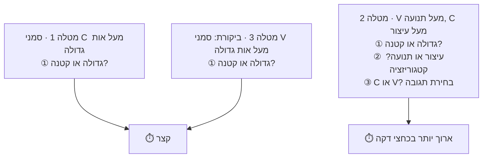

### שאלה-3

**למה משמשת מדידה של זמני תגובה בפסיכולוגיה הקוגניטיבית?** · ↩ סעיף 2

- **זמן תגובה (reaction time):** הזמן שלוקח לבצע מטלה.
- משתמשים בו כדי **לבחון השערות** על אופן הביצוע של תהליך קוגניטיבי: אילו צעדים יש בו, ואיך הם מסודרים.
- ההיגיון: משווים שתי מטלות שנבדלות בצעד אחד. **ההפרש בזמן** = הזמן של הצעד הזה.

### שאלה-4

**מהם תהליכים סדרתיים?** · ↩ סעיף 3

- **תהליכים סדרתיים (serial processes):** מתרחשים **בזה אחר זה**. אחד מסתיים, ואז מתחיל הבא.
- 📖 שופטים מנה אחרי מנה בתפריט. במטלה 2 של דונדרס אי אפשר לבחור C או V לפני שיודעים מה האות.

### שאלה-5

**מהם תהליכים מקבילים?** · ↩ סעיף 3

- **תהליכים מקבילים (parallel processes):** מתרחשים **בו בזמן**, חופפים בזמן.
- 📖 כשהמלצר שואל, **מבינים** את השאלה ובאותו זמן כבר **מנסחים** תשובה.

### שאלה-6

**סדרתי או מקבילי? ארבע דוגמאות** · ↩ סעיף 3

*(תשובות שלי)*

| הדוגמה | התשובה | למה |
|---|---|---|
| א. יוצאים לריצה ומאזינים למוזיקה | **מקבילי** | שני התהליכים קורים באותו זמן |
| ב. אופים עוגה ושוקלים את הקמח והסוכר | **סדרתי** | שוקלים קודם אחד ואחר כך את השני |
| ג. קוראים ספר ומציצים מדי פעם בטלוויזיה | **סדרתי** | הקשב החזותי עובר הלוך ושוב, לא לשניהם בו בזמן |
| ד. משוחחים בטלפון ושורכים נעליים | **מקבילי** | השיחה והשרוכים בו בזמן |

### למחשבה-1

**טיול, שיחה וצלצול: לשרטט על ציר זמן ולסמן מה סדרתי ומה מקבילי** · ↩ סעיף 3

📘 🧭 התשובה של המדריך:

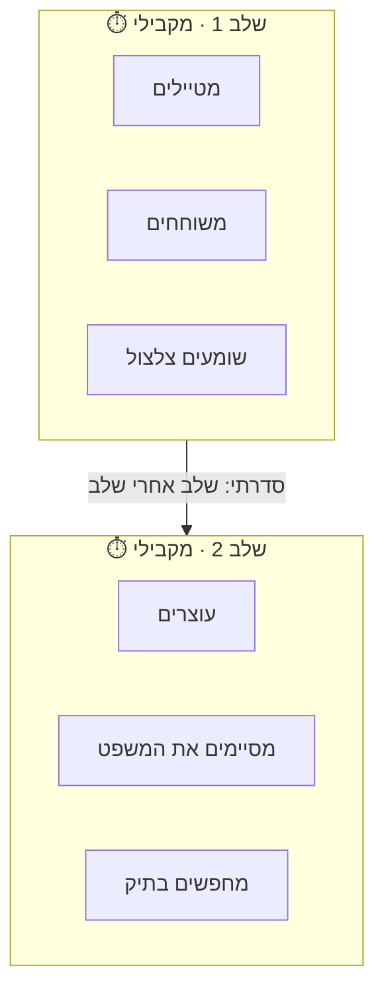

- **בתוך** כל שלב התהליכים **מקבילים**. השלבים עצמם באים **בזה אחר זה**, ולכן הם **סדרתיים**.

### שאלה-7

**למה זמן תגובה עוזר להבחין בין סדרתי למקבילי, אבל אינו מדד מדויק?** · ↩ סעיף 3

- **עוזר:** תהליכים מקבילים בדרך כלל **חוסכים זמן**, ולכן זמן קצר רומז על עיבוד מקבילי.
- **לא מדויק:** 📖 לפי תרשים 8.3ג, **אותו זמן כולל** יכול לצאת משני הסידורים: X ואחריו Y, או X ו־Y במקביל כשכל אחד מהם איטי יותר.
- לכן צריך להמציא מטלות מיוחדות שמבחינות בין האפשרויות.

### שאלה-8

**ההבדל בין תהליכים מבוקרים לאוטומטיים, במונחים משאבים מנטליים ותהליכי קשב** · ↩ סעיף 4.1

- **משאבים מנטליים (mental resources)** הם "כוח העיבוד", והם **מוגבלים**. **תהליכי קשב (attentional processes)** מחלקים אותם בין המטלות.
- **מבוקרים (controlled processes):** **דורשים קשב** וצורכים הרבה משאבים. קשה להריץ יותר מאחד.
- **אוטומטיים (automatic processes):** כמעט **לא דורשים קשב**, צורכים מעט משאבים, ורצים לצד מטלות אחרות.
- שיפרין ושניידר (Shiffrin & Schneider, 1977): זה **רצף**. אימון הופך מבוקר לאוטומטי, ומצב מאתגר מחזיר אותו למבוקר.

### שאלה-9

**איך קשורים מבוקר ואוטומטי לסדרתי ומקבילי?** · ↩ סעיף 4.1

🧭

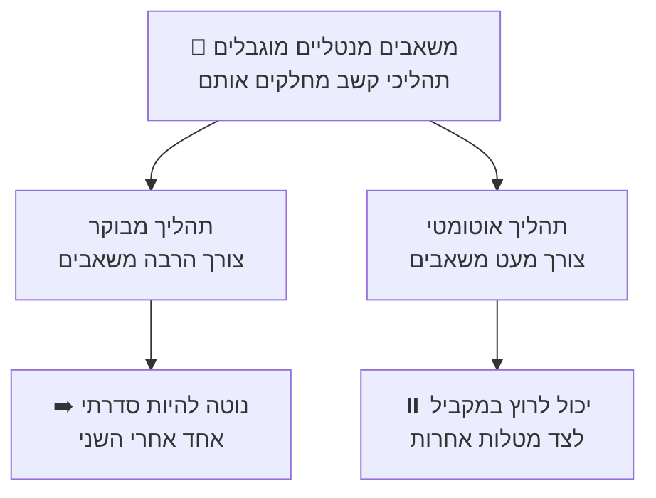

- 📖 הליכה ושיחה במדרכה ישרה: במקביל. בצומת עמוס הניווט נעשה מבוקר, והשיחה נדחקת הצידה.

### שאלה-10

**דהאן ואקהבין: למה רשימה עם מספרים "קרובים" קשה יותר, ומה זה מלמד על תהליכים אוטומטיים?** · ↩ סעיף 4.2

- דהאן ואקהבין (Dehaene & Akhavein, 1995). המטלה: לסמן זוגות ש**שונים פיזית**. הכמות בכלל לא רלוונטית.
- **ההסבר:** כשרואים "2" או "שתיים" **חושבים אוטומטית על הכמות**. כמויות קרובות (8–9) נראות "דומות", וזה מאט את ההחלטה "שונים".
- **מה לומדים:**
  - תהליך אוטומטי קורה **גם כשלא צריך וגם כשהוא מפריע**.
  - הוא נשען על **שליפה יעילה מהזיכרון** (Barrett et al., 2004).

🧭

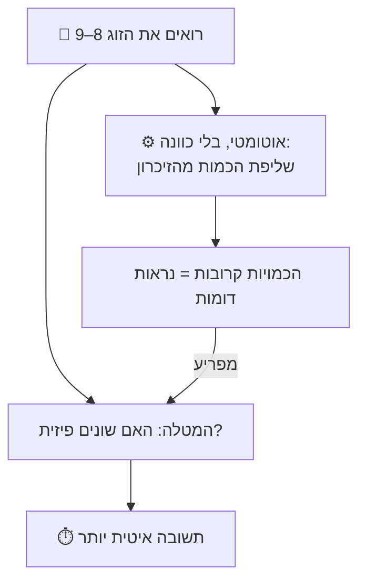

### 7.2 · שימוש בשפה

### למחשבה-2

**לאיזה מרכיב בשפה שייכת כל תופעה?** · ↩ סעיף 5.1

📘 התשובות של המדריך:

| התופעה | המרכיב |
|---|---|
| א. "אני הולך לא" אינו משפט מובן, אף שכל המילים בעברית | **תחביר** (syntax) |
| ב. "קרן" יכולה להיות קרן השקעות או קרן שמש | **סמנטיקה** (semantics) |
| ג. שמש וחמה (מילים נרדפות) | **סמנטיקה** |
| ד. "אתם יכולים להעביר את המלח?" היא בקשה, לא שאלה של כן או לא | **פרגמטיקה** (pragmatics) |
| ה. "מכתב" קשורה ל"כתובת" בעברית, אבל ל־letter ול־address באנגלית אין קשר | **מורפולוגיה** (morphology) |
| ו. ת' לפני ס' או ש' נשמעת כמו צד"י: "תשומת לב" נשמע "צומת לב" | **פונולוגיה** (phonology) |

- *(לא מהספר)* **איך לזכור:** ב ו־ג עוסקות במשמעות **של המילה עצמה** (סמנטיקה). ד עוסקת במשמעות **במצב** (פרגמטיקה).

### שאלה-11

**איך תסביר הגישה הביהביוריסטית רכישה של שפה? (במונחים של פרק 5 במדריך)** · ↩ סעיף 5.3

*(תשובה שלי)*

- **חיקוי:** הילד שומע מילים וחוזר עליהן.
- **התניה אופרנטית (operant conditioning):** מבע שמביא תוצאה טובה מקבל **חיזוק חיובי** (positive reinforcement), ולכן הסיכוי שיחזור עולה.
- **עיצוב (shaping):** בהתחלה מחזקים כל ניסיון דומה ("מַ־מַ"), ואחר כך רק מבע שקרוב יותר לנכון ("מים").

🧭

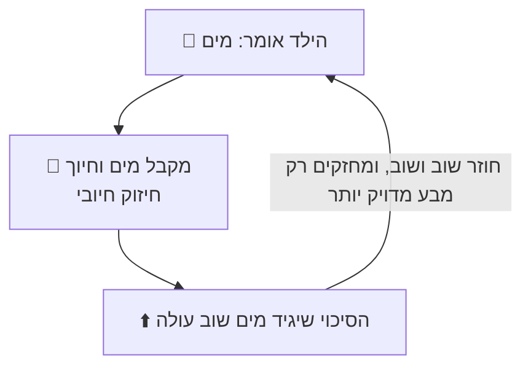

### שאלה-12

**אילו טיעונים הציג חומסקי בעד גישה קוגניטיבית לחקר השפה?** · ↩ סעיף 5.3

- נועם חומסקי (Noam Chomsky): ילדים **נולדים עם היכולת** לרכוש שפה.
- **יצירתיות:** דוברים יוצרים **אין־סוף משפטים** שלא שמעו מעולם. חיקוי וחיזוק לא מסבירים את זה.
- **מבנים סמויים:** יש מבנים תחביריים **שלא רואים**, וילדה לומדת אותם בלי שיעורים בתחביר, רק מ**חשיפה** לשפה.
- **המסקנה:** תיאוריה שמסתמכת רק על מה שאפשר לצפות בו (גירוי ותגובה) לא תסביר שפה. צריך לחקור את **התהליכים הנסתרים** שבאמצע.

### שאלה-13

**הקשר בין משמעות המשפט למשמעות הדובר** · ↩ סעיף 6

- **משמעות המשפט (sentence meaning):** המשמעות המילולית של המילים. אחת.
- **משמעות הדובר (speaker's meaning):** מה שהדובר **מתכוון** להעביר. אין לה הגבלה.
- גרייס (H. Paul Grice): משמעות הדובר נבנית **על** משמעות המשפט. המאזין צריך לעבור מהמילים אל הכוונה.

🧭 📖 הפתק "החתולה נמצאת על המחצלת":

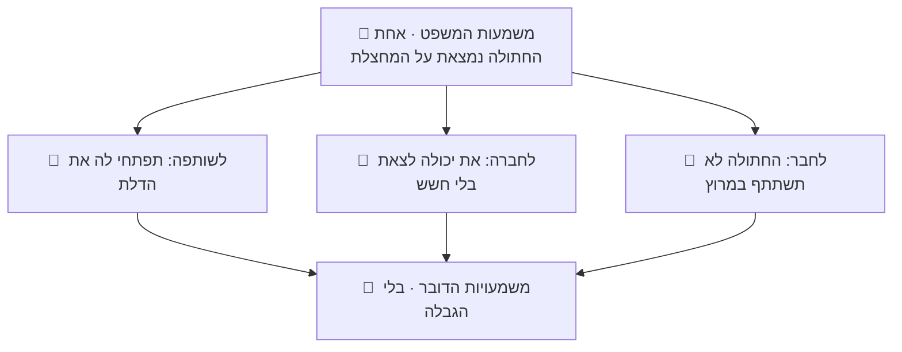

### שאלה-14

**על אילו שאלות מחקר מתמקדים חוקרי השימוש בשפה?** · ↩ סעיף 6

1. **הפקה:** איך דוברים בוחרים מילים שיעבירו את מה שהתכוונו?
2. **הבנה:** איך מאזינים מבינים את המסר שהדובר רצה להעביר?
3. ועוד: ההקשר **האבולוציוני** וה**תרבותי** של השפה.

### 7.2.1 · הפקת שפה: עיצוב על־פי קהל המאזינים

### שאלה-15

**מהו עקרון שיתוף הפעולה, ומה חשיבותו בהפקת שפה?** · ↩ סעיף 7.1

- **עקרון שיתוף הפעולה (cooperative principle)** של ה' פול גרייס (H. Paul Grice, 1975): הדובר מפיק מבעים שמתאימים **לנסיבות, לזמן ולמטרות** של השיחה.
- ארבעה חוקים: **כמות** (מידע ככל הנדרש) · **איכות** (אמת) · **קשר** (רלוונטיות) · **סגנון** (בהירות).
- **החשיבות:** הוא בסיס ל**עיצוב על־פי קהל** (audience design). כדי לשתף פעולה, הדובר צריך לנחש נכון **מה המאזין יודע**.

### שאלה-16

**איך הבסיס המשותף משפיע על תוכן המבעים?** · ↩ סעיף 7.2

- **בסיס משותף (common ground):** הידע שהדובר והמאזין **חולקים**. ככל שהוא גדול יותר, אומרים **פחות**.
- 📖 לשותפה לדירה מספיק "טל". למבקר בקמפוס צריך "הבניין האדום משמאל, אחרי המזרקה".
- 📖 לאו ועמיתיו (Lau et al., 2001): תיאורים **ארוכים יותר** לאתרים פחות מוכרים. אבל נטו לחשוב ש**אחרים יודעים מה שהם יודעים**.

🧭 שלושת המקורות של הרברט קלארק (Herbert Clark, 1996):

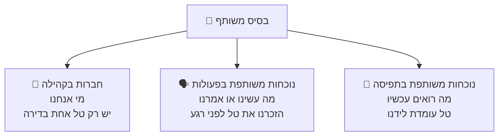

### 7.2.2 · הפקת דיבור וטעויות דיבור

### שאלה-17

**מהו ספונריזם, ומה לומדים ממנו על תהליכי השפה?** · ↩ סעיף 8.1

- **ספונריזם (spoonerism):** החלפת **הצליל הראשון** בין שתי מילים. 📖 "tasted the whole worm" במקום "wasted the whole term".
- **מה לומדים:**
  - מתכננים את המבע **בכמה רמות**, ולכל רמה יש טעויות משלה.
  - הטעויות **לא מקריות**: הן שומרות על **חוקי השפה** (באנגלית אין מילה שמתחילה ב־tl).

🧭 📖 טבלה 8.4, רמות התכנון והטעות בכל רמה:

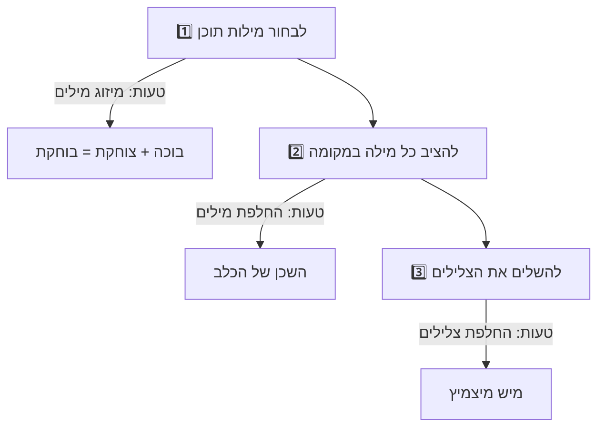

### שאלה-18

**שתי הטכניקות ליצירת שיבושים מלאכותיים: טכניקה, ממצאים ותובנות (טבלה 1 במדריך)** · ↩ סעיף 8.2

| | **תהליכים:** טכניקת SLIP | **ייצוגים:** מיזוג ביטויים |
|---|---|---|
| **הטכניקה** | קוראים בלי קול זוגות שמכינים מבנה צלילי (בּוֹס דּוֹף; בֶּטַח דָּבָר; בִּינָה דֶּגֶק), ואז אומרים בקול "**דירה בלה**". לפעמים יוצא "**בירה דלה**" (Baars, 1992) | קוראים שני ביטויים ("קור כלבים", "גשם זלעפות"). אחרי 2 שניות מפיקים אחד מהם מהזיכרון, מהר ככל האפשר |
| **ממצאים** | יותר שיבושים כש**התוצאה היא מילים אמיתיות**: "דירה בלה" ← "בירה דלה" נפוץ יותר מ"דלת בטון" ← "בלת דטון" (Baars et al., 1975; Hartsuiker et al., 2005) | תחת לחץ זמן יוצא "**קור זלעפות**". המיזוג נפוץ יותר כשלביטויים **משמעות דומה** (Cutting & Bock, 1997) |
| **תובנות** | יש תהליך של **איתור שגיאות ותיקונן**. הוא בודק בעיקר אם יוצאות **מילים** | ביטויים בעלי **משמעות דומה קשורים בזיכרון**. כשמפיקים אחד, השני "קופץ" ומתערבב |

### שאלה-19

**איך תהליכי איתור שגיאות מסבירים למה "דירה בלה" משתבשת יותר מ"דלת בטון"?** · ↩ סעיף 8.2

🧭

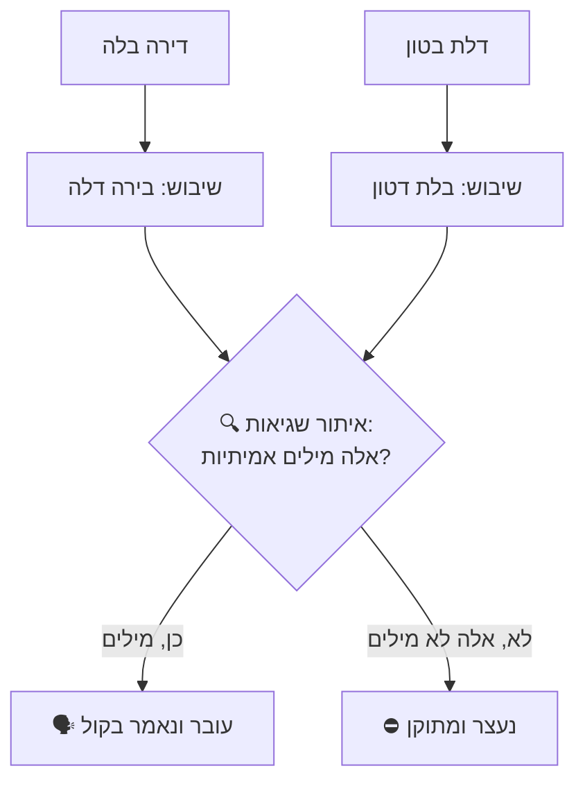

- הבודק מחפש בעיקר **לא־מילים**. "בירה דלה" הן מילים, ולכן הן **עוברות** את הבדיקה.

### שאלה-20

**למה המשתתפים מיזגו דווקא ביטויים בעלי משמעות דומה?** · ↩ סעיף 8.2

- ייצוגים של ביטויים בעלי **משמעות דומה קשורים זה לזה בזיכרון**.
- כשמתחילים להפיק אחד, השני **מופעל גם הוא**, והחלקים מתערבבים ("קור זלעפות").
- ביטויים בלי קשר במשמעות ("שביל הזהב", "ללעג ולקלס") כמעט לא מתמזגים.

### שאלה-21

**להסביר את ניסוי המיזוג במונחים של פרק 6 (זיכרון)** · ↩ סעיף 8.2

*(תשובה שלי)*

- הביטויים שמורים ב**זיכרון הסמנטי** (semantic memory), זה ליד זה, כי המשמעות שלהם קרובה.
- כשמתחילים ל**שלוף** ביטוי אחד, המשמעות שלו משמשת **רמז שליפה** (retrieval cue) גם לביטוי הדומה.
- שני הביטויים נשלפים יחד, ותחת לחץ זמן יוצא מיזוג.

### 7.2.3 · הבנת שפה: דו־משמעות

### שאלה-22

**מהי דו־משמעות מילונית, ומה צריך כדי לבטל אותה?** · ↩ סעיף 9.1

- **דו־משמעות מילונית (lexical ambiguity):** **מילה** אחת עם כמה משמעויות. 📖 "הוא התקרב אל ה**אח**": קרוב משפחה, חובש או קמין.
- **מה צריך:** **הקשר**. 📖 אחרי המשפט לבדו כל המשמעויות פעילות בזיכרון, וההקשר (מקום, נושא, סיפור) בוחר אחת (Vu et al., 1998).
- זה עיבוד **מלמעלה־למטה**, כמו בתפיסה (פרק 4).

### שאלה-23

**מהי דו־משמעות מבנית, ומה צריך כדי לבטל אותה?** · ↩ סעיף 9.1

- **דו־משמעות מבנית (structural ambiguity):** **מבנה המשפט** מאפשר כמה פירושים. 📖 "ההורים של הילד והילדה": של שניהם, או ההורים של הילד וגם הילדה.
- 📖 לאותו משפט יש **שני אילנות גזירה** (tree diagrams) אפשריים.
- **מה צריך:** גם כאן **ההקשר** בוחר את המבנה, וההשפעה שלו **מיידית** (Filik et al., 2005).

🧭

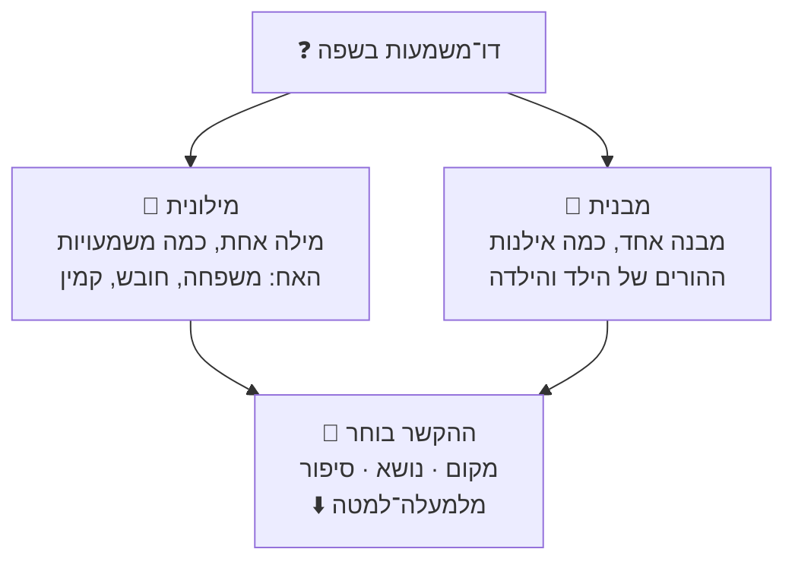

### שאלה-24

**איך הראו שהמוח מעבד משפט דו־משמעי אחרת?** · ↩ סעיף 9.3

- רוד ועמיתיה (Rodd et al., 2005): סריקות **fMRI** בזמן האזנה.
- שלושה תנאים: דו־משמעות **גבוהה** ("האח והאחות חילקו את הכדורים"), דו־משמעות **נמוכה** ("הילדים שיחקו בחצר"), ו**רעש** (ביקורת).
- **הממצא:** בהשוואה בין גבוהה לנמוכה פעלו **אזורים נוספים**. יש אזורים שעובדים במיוחד כשצריך לפתור דו־משמעות.

### 7.2.4 · תוצרי ההבנה: היגדים והיסקים

### שאלה-25

**מהם היגדים? דוגמה** · ↩ סעיף 10.1

- **היגדים (propositions):** **הרעיונות המרכזיים** של מבע. מה שנשמר בזיכרון אחרי ההבנה.
- 📖 "החתולה נמצאת על המחצלת" = **על (חתולה, מחצלת)**.
- 📖 משפט יכול להכיל כמה היגדים, זה בתוך זה.

🧭 📖 "החתולה ראתה שהעכבר ברח אל מתחת לספה":

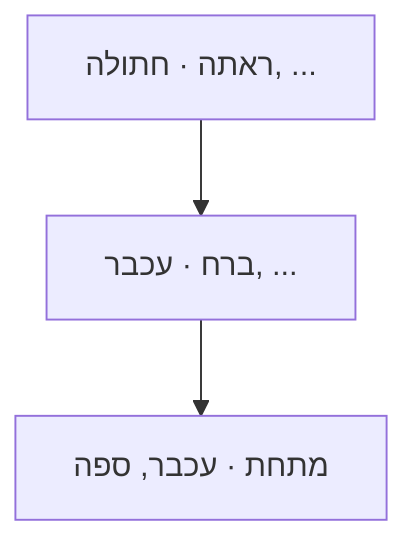

- 📖 קינץ' (Kintsch, 1974): מילים מאותו היגד מיוצגות **יחד** בזיכרון, גם כשהן רחוקות במשפט.

### שאלה-26

**למה קשה לזכור שיחה מילה במילה, אבל קל לזכור את העיקר?** · ↩ סעיף 10.1

- ההבנה **מחלצת היגדים**, והם נשמרים בזיכרון.
- **הנוסח המדויק** (סדר המילים, הניסוח) **נשכח מהר**.
- 📖 "החתולה רדפה אחר העכבר" ו"העכבר נרדף על ידי החתולה" הם **אותו היגד**. לכן אחרי כמה שעות זוכרים את המשמעות, לא את המילים.

### שאלה-27

**מהם היסקים? דוגמה** · ↩ סעיף 10.2

- **היסק (inference):** הנחה שהמאזין **משלים** בעזרת מידע שבזיכרון, אף שלא נאמרה במפורש.
- 📖 "אני הולך לפגוש את דנה במעדנייה. היא הבטיחה לקנות לי כריך": מסיקים ש"היא" = דנה, ושהכריך קשור למעדנייה.
- 📖 **תמונת המצב** קובעת אילו היסקים עושים: אם קרול חמת מזג, מסיקים שזרקה את הספגטי (Peracchi & O'Brien, 2004).

### שאלה-28

**איך יכולת ההיסק משפיעה על ניסוח המשפטים ועל הבנתם?** · ↩ סעיף 10.2

| | |
|---|---|
| **על הניסוח (הדובר)** | סומך על המאזין, ולכן אומר **משפטים קצרים** ומשאיר פערים. לא אומרים "היא, כלומר דנה" |
| **על ההבנה (המאזין)** | משלים את הפערים לפי **הזיכרון** ו**תמונת המצב**. אם ההיסק שונה, גם ההבנה שונה |

- 📖 בזכות זה השפה **יעילה מאוד**, ושני הצדדים עושים את העבודה כמעט בלי לשים לב.

### 7.2.5 · שפה ואבולוציה

### שאלה-29

**למה חוקרים התעניינו בשפה של מינים אחרים?** · ↩ סעיף 11

- כדי להבין **אילו תהליכים** אפשרו את השפה האנושית, ומה בה **ייחודי לאדם**.
- 📖 המחקר בודק שני דברים: **מבנה השפה** (דקדוק) ו**עיצוב לפי קהל**.

### שאלה-30

**מה ההבדל בין שפה אנושית לשפות של מינים אחרים?** · ↩ סעיף 11

| | **בני אדם** | **מינים אחרים** |
|---|---|---|
| **דקדוק** | כללים שמייצרים **אין־סוף** מסרים ממספר מוגבל של מילים | לומדים סמלים וצירופים פשוטים, **בלי** מערכת כללים |
| **עיצוב לפי קהל** | לפי **מה המאזין יודע** | 📖 קופי הירוק: לפי **מי** הקהל (צאצאים), לא לפי מה הוא יודע |

### שאלה-31

**מה הקושי המחקרי העיקרי בבדיקת שפה של שימפנזים?** · ↩ סעיף 11.1

- לשימפנזים **אין מערכת קול** שמתאימה לדיבור. לכן מלמדים אותם **סימנים** או **סמלים**.
- **מחלוקת בפירוש:** האם לצירופים שלהם יש משמעות, או שהמשמעות נמצאת **בראש של החוקרים** (Seidenberg & Petitto, 1979)?

### שאלה-32

**תוצאות המחקר על שפת שימפנזים: במה היא דומה לשפה אנושית ובמה שונה?** · ↩ סעיף 11.1

- 📖 **מה הושג:** וושאו (גרדנר וגרדנר, Gardner & Gardner) צירפה סימנים ("וושאו מצטער"). שרה (פרימק, Premack) הפעילה סמלים כמושגים. הבונובו קנזי (סו סוואג'־רמבאו, Sue Savage-Rumbaugh) למד **מצפייה**, הבין אנגלית מדוברת וביצע הוראות.
- **דומה:** משתמשים בסמלים כמייצגים של מושגים, מצרפים צירופים קצרים, ומבינים חלק מהשפה המדוברת.
- **שונה:** לא רוכשים **מערכת כללים** שמייצרת אין־סוף מבעים. רק בני אדם מפיקים ומבינים **מבנים דקדוקיים מורכבים** (Fitch & Hauser, 2004).

### 7.2.6 · שפה, חשיבה ותרבות

### שאלה-33

**מהי השערת היחסות הלשונית לפי ספיר וורף?** · ↩ סעיף 12

- **יחסות לשונית (linguistic relativity):** **מבנה השפה** שאדם מדבר משפיע על **הדרך שבה הוא חושב** על העולם.
- אדוארד ספיר (Edward Sapir) ובנג'מין לי וורף (Benjamin Lee Whorf) טענו בגרסה **קיצונית**: הבדלים בשפה **יוצרים** הבדלים בחשיבה.
- 📖 היום הזהירות גדולה יותר: השפה **עשויה, במקרים מסוימים**, להשפיע (Slobin, 2003).

### שאלה-34

**איך ההשוואה בין דוברי אנגלית לדוברי הימבה תומכת בהשערה?** · ↩ סעיף 12.1

- בהימבה **אין** הבחנה מילונית בין כחול לירוק: שניהם "בּוֹרוֹאוּ".
- **תפיסה קטגוריאלית (categorical perception):** צבעים **באותה** קטגוריה של השפה נשפטים **דומים יותר**.
- הממצא: דוברי הימבה ראו כחול וירוק **דומים יותר** מאשר דוברי אנגלית. ההבדל בתפיסה הולך **לפי השפה**, וזו תמיכה ביחסות הלשונית (Robertson et al., 2005).

🧭

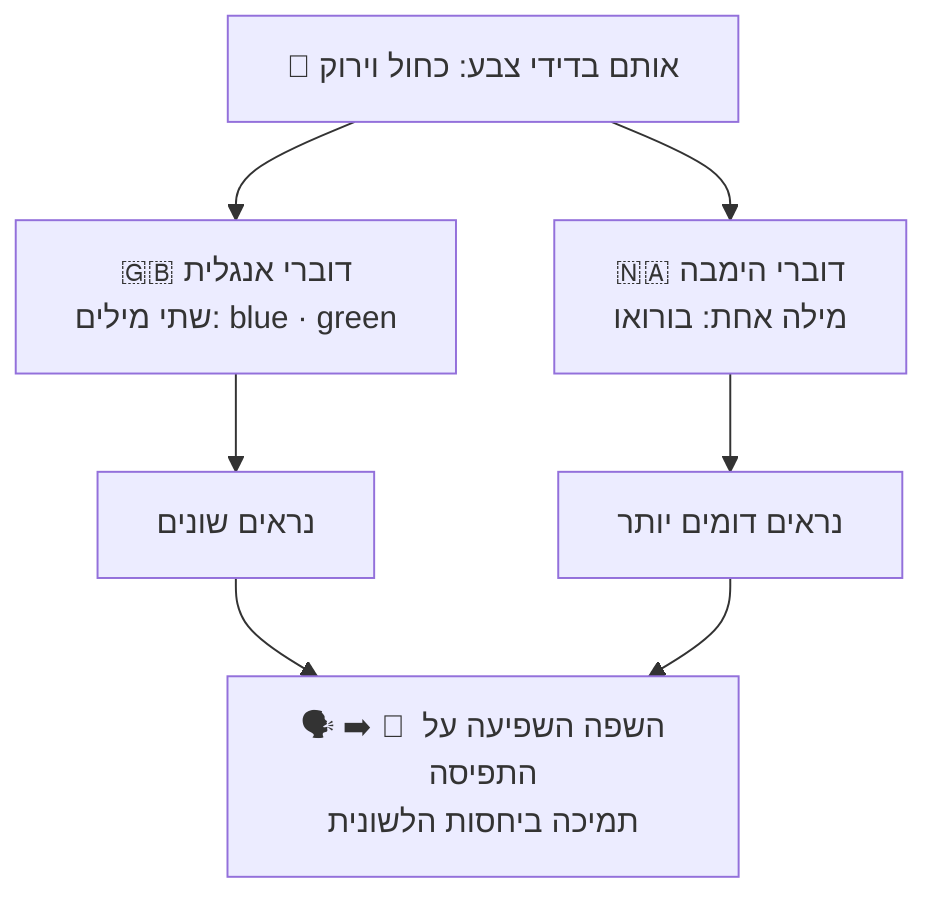

### 7.3 · היריסטיקות, שיפוט וקבלת החלטות

### שאלה-35

**מהו שיפוט?** · ↩ סעיף 13.2

- **שיפוט (judgment):** התהליך שבו **מגבשים דעות**, מגיעים **למסקנות** ומעריכים **באופן ביקורתי** אירועים ואנשים. הרבה פעמים ספונטני.
- 📖 אחרי שיחה קצרה במסיבה: "הוא אינטליגנטי, מעניין ונחמד".

### שאלה-36

**מהי קבלת החלטות?** · ↩ סעיף 13.2

- **קבלת החלטות (decision making):** התהליך של **בחירה בין חלופות**: לבחור אחת ולדחות אחרות. קשורה יותר ל**פעולה**.
- 📖 להעביר איתו את הערב ולקבוע פגישה לסוף השבוע.

### שאלה-37

**מה הקשר בין שיפוט לקבלת החלטות?** · ↩ סעיף 13.2

🧭

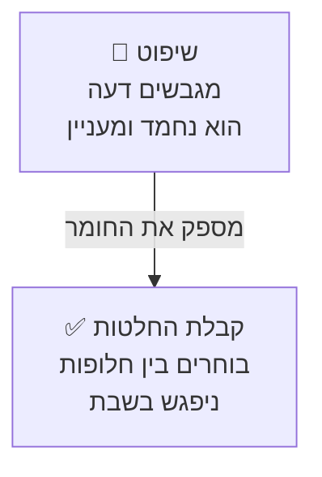

- קודם **שופטים**, ואחר כך **מחליטים** לפי השיפוט. שניהם קורים באי־ודאות ועם **רציונליות מוגבלת** (bounded rationality) של הרברט סימון (Herbert Simon).

### שאלה-38

**מהן היריסטיקות, לפי טברסקי וכהנמן?** · ↩ סעיף 13.3

- עמוס טברסקי (Amos Tversky) ודניאל כהנמן (Daniel Kahneman): **היריסטיקות (heuristics)** הן **כללי אצבע** לא פורמליים.
- הן **קיצורי דרך** שמקטינים את מורכבות השיפוט, ומאפשרים לחשוב **מהר** ובמעט קשב.
- 📘 הן **לא** טעויות. בדרך כלל הן מובילות למסקנה **טובה מספיק**. רק לפעמים הן מטעות.

### שאלה-39

**למה כשלים עוזרים לחקור את התהליכים הקוגניטיביים?** · ↩ סעיף 13.3

- כשהשיפוט עובד, לא רואים **איך** הגענו אליו. **הטעות חושפת את קיצור הדרך** שהשתמשנו בו.
- זה כמו ש**אילוזיות** חושפות את התפיסה (פרק 4).

### 7.3.1 · היריסטיקת הזמינות

### שאלה-40

**מהי היריסטיקת הזמינות?** · ↩ סעיף 14

- **היריסטיקת הזמינות (availability heuristic):** מבססים את השיפוט על מידע **שזמין בזיכרון**, כלומר על מה ש**קל להיזכר** בו.
- בדרך כלל זה עובד: 📖 כששופטים שבאולינג מסוכן פחות מדאייה, הזמינות משרתת היטב.

### שאלה-41

**איך הזמינות משתקפת במחקר על האות k?** · ↩ סעיף 14

- טברסקי וכהנמן (Tversky & Kahneman, 1973): רוב האנשים חושבים שיש יותר מילים ש**מתחילות** ב־k.
- **במציאות** k מופיעה כאות **שלישית** בערך **פי שניים**.
- **למה:** המילים **מאורגנות בזיכרון** לפי האות הראשונה, ולכן קל יותר להיזכר ב־kangaroo מאשר ב־duke. מה שקל לשלוף נראה שכיח.

### שאלה-42

**שתי הסיבות שבגללן הזמינות עלולה להוביל לשיפוט מוטעה** · ↩ סעיף 14.1

🧭

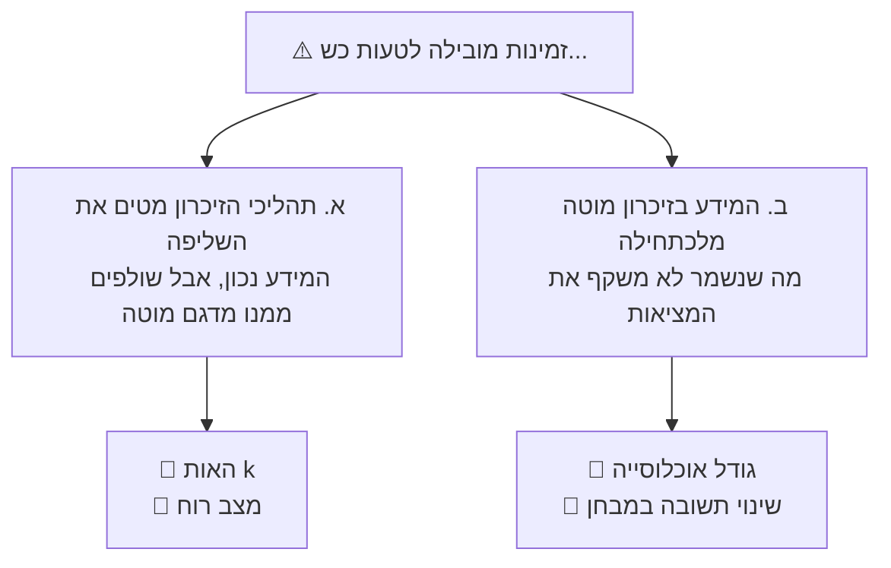

### שאלה-43

**הזמינות במחקר על מצב רוח (Macleod & Campbell, 1992). איזו מהסיבות?** · ↩ סעיף 14.1

- **מה מצאו:** במצב רוח **טוב** נזכרו בקלות באירועים **נעימים** מהעבר. לכן ניבאו **יותר** אירועים נעימים ופחות לא נעימים בעתיד.
- **הסיבה: א, תהליכי הזיכרון.** מצב הרוח משנה **מה נשלף בקלות**, ולא את מה ששמור בזיכרון.

### שאלה-44

**הזמינות במחקר על שינוי תשובה במבחן (Kruger et al., 2005). איזו מהסיבות?** · ↩ סעיף 14.1

- **מה מצאו:** שינוי תשובה בדרך כלל **משתלם** (51.4% משגויה לנכונה, מול 25.4% מנכונה לשגויה). ובכל זאת 75% חשבו שעדיף לדבוק בתשובה הראשונה.
- **למה:** בזיכרון נשמרים יותר מקרים שבהם השינוי **הזיק**. בניסוי 2 הם הגזימו בתדירות של "נכונה ← שגויה".
- **הסיבה: ב, המידע בזיכרון מוטה מלכתחילה.** 📖 השיפוט נשען על "בסיס נתונים מוטה" מהניסיון.

### שאלה-45

**דוגמה מהחיים שבה הזמינות השפיעה על השיפוט** · ↩ סעיף 14

*(דוגמאות שלי)*

- **מסקנה טובה מספיק:** כדי להחליט באיזה סופר לקנות, נזכרים בפעמים שהיה בו תור ארוך. הזיכרון באמת משקף את המציאות.
- **טעות:** אחרי שראית בחדשות כמה תאונות מטוס, טיסה נראית מסוכנת יותר מנסיעה ברכב. האירועים הבולטים **זמינים** יותר, אבל לא **שכיחים** יותר.

### 7.3.2 · היריסטיקת היציגות

### שאלה-46

**מהי היריסטיקת היציגות?** · ↩ סעיף 15

- **היריסטיקת היציגות (representativeness heuristic):** אם למשהו יש את התכונות **הטיפוסיות** של קטגוריה, מניחים שהוא **שייך** אליה.
- 📘 **למה היא מטעה:** מתעלמים ממידע רלוונטי: **שיעור הבסיס** באוכלוסייה, **גודל המדגם** וחשבון **הסתברויות**. נשענים יותר מדי על **תכונות מאפיינות**.

### שאלה-47

**איך היציגות משתקפת במחקר על עורך הדין הירושלמי?** · ↩ סעיף 15

- בר־הלל ונטר (Bar-Hillel & Neter, 1993): התיאור (תחרותי, רזה, שחצן) נשמע כמו "שחקן **טניס** טיפוסי". רובם דירגו טניס ראשון.
- **הטעות:** טניס **נכלל** בתוך "משחק כדור". הקטגוריה הכוללת **תמיד** סבירה יותר.
- היציגות גרמה להתעלם מ**מבנה הקטגוריות**, גם כשהוצע כסף (45 דולר) על תשובה נכונה.

🧭

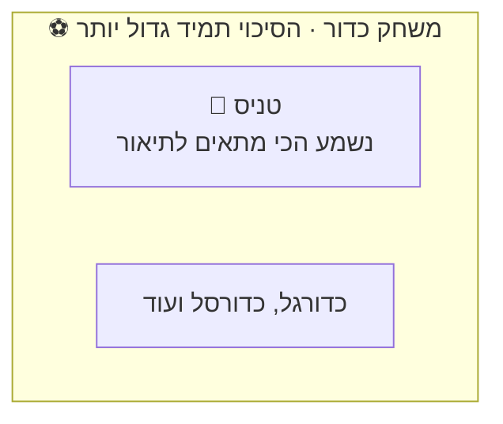

### שאלה-48

**דוגמה מהחיים שבה היציגות השפיעה על השיפוט** · ↩ סעיף 15

*(דוגמאות שלי)*

- **מסקנה טובה מספיק:** 📖 מתלבטת אם לנסות דייג? שואלים עד כמה הוא דומה לפעילויות שנהנית מהן בעבר.
- **טעות:** מועמד לעבודה מגיע בחליפה ומדבר בביטחון, ולכן נראה "מנהל טיפוסי". מתעלמים מכך שאין לו ניסיון בתחום.

### 7.3.3 · היריסטיקת העיגון

### שאלה-49

**מהי היריסטיקת העיגון?** · ↩ סעיף 16

- **היריסטיקת העיגון (anchoring heuristic):** מתחילים מ**ערך התחלתי** (העוגן) ומתקנים למעלה או למטה, אבל **התיקון לא מספיק**.

### שאלה-50

**איך העיגון משתקף במחקר על המכפלה 1×2×...×8?** · ↩ סעיף 16

🧭 טברסקי וכהנמן (Tversky & Kahneman, 1974), 5 שניות להעריך:

| הסדר | מה מספיקים לחשב (העוגן) | חציון ההערכות |
|---|---|---|
| עולה: 1×2×3×... | 1×2×3×4 = 24 | **512** |
| יורד: 8×7×6×... | 8×7 = 56 | **2,250** |
| **התשובה הנכונה** | | **40,320** (פי 18 מההערכה הגבוהה) |

- העוגן **הגבוה** יותר (בסדר היורד) הוביל להערכה גבוהה יותר. בשני המקרים **התיקון רחוק מלהספיק**.

### שאלה-51

**למה העיגון עלול לגרום לטעויות בשיפוט?** · ↩ סעיף 16

- מתקנים מהעוגן רק עד הערך **הראשון שנראה סביר**, ועוצרים שם.
- נצמדים לעוגן **גם כשהוא חסר ערך**: 📖 מספר זיהוי אקראי העלה את ההערכה של מספר הרופאים מ־219 ל־539 (Wilson et al., 1996).
- וגם עוגן **סביר** מטעה: 📖 שנה על מאדים הוערכה ב־492 ימים במקום 869 (Epley & Gilovich, 2006).

### 7.3.4 · היריסטיקות: סיכום

### שאלה-52

**לאיזו היריסטיקה שייך כל משפט?** · ↩ סעיף 17

*(תשובות שלי)*

| המשפט | ההיריסטיקה | למה |
|---|---|---|
| א. רבים יבחרו "תאונות דרכים" כגורם מוות נפוץ יותר מדלקת ריאות, אף שדלקת ריאות נפוצה יותר | **זמינות** | תאונות מופיעות בחדשות, ולכן קל להיזכר בהן |
| ב. יניב קנה עוגה ב־30 ₪ בסופר, ולכן מעריך שבמאפייה היא תעלה 50 ₪ | **עיגון** | המחיר בסופר הוא העוגן, ומתקנים ממנו |
| ג. שולה בחליפה ובזנב סוס מתוח, וחבר אומר: "את בטח עורכת דין!" | **יציגות** | היא נראית כמו "עורכת דין טיפוסית" |

### 7.3.5 · הפסיכולוגיה של קבלת החלטות

### שאלה-53

**מהי "מסגרת" בקבלת החלטות?** · ↩ סעיף 18.2

- **מסגרת (frame):** **תיאור מסוים** של בעיית בחירה. אותו מידע אפשר לתאר בכמה מסגרות.
- **נקודות ייחוס (reference points):** הציפייה שלפיה משהו נראה **רווח** או **הפסד**. 📖 העלאה של 300 ₪ היא רווח, אבל הפסד אם ציפית ל־3,000 ₪.

### שאלה-54

**איך מסגור ההחלטה משפיע על קבלת ההחלטות? מסגור רווח ומסגור הפסד** · ↩ סעיף 18.2

- **אותו מידע**, במסגרת **רווח** או במסגרת **הפסד**, מוביל להחלטות **שונות**.
- 📖 מקניל ועמיתיו (McNeil et al., 1982), סרטן ריאות: בחרו בהקרנות **18%** במסגרת **הישרדות**, ו־**44%** במסגרת **תמותה**. גם אצל רופאים מנוסים.
- 📖 מוכר מכונית יציג "78% לא צריכות תיקון" (רווח). כדאי לך לחשוב על "22% צריכות תיקון" (הפסד).

🧭

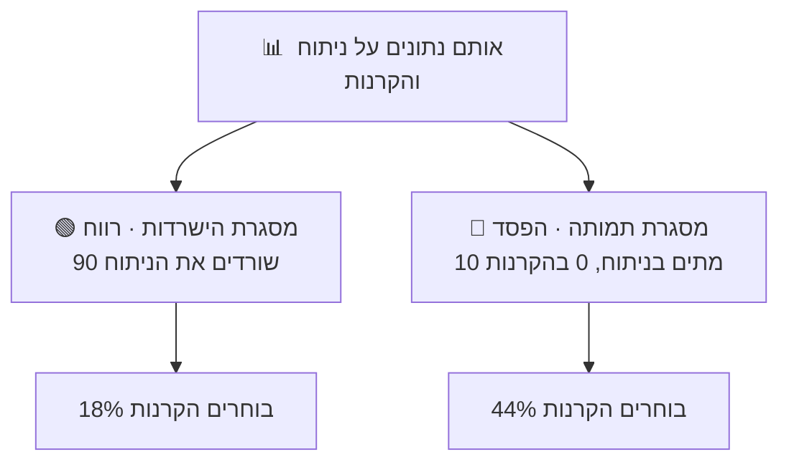

- 📖 **מה עושים:** חושבים על החלטה חשובה **בשתי המסגרות**, ושואלים איך **אחרים** ממסגרים לך את המידע.

### שאלה-55

**מהי רתיעה מהחלטה?** · ↩ סעיף 18.3

- **רתיעה מהחלטה (decision aversion):** נמנעים מלהחליט בכלל, כדי לא להרגיש **חרטה**.
- מתחרטים יותר כש**המחיר ברור** (קופסה עם 30,000 ₪ שלא בחרת). 📖 תחומי החרטה הנפוצים: **לימודים** ו**קריירה**.

### שאלה-56

**למה הוספת מידע (אפשרות נוספת) מגדילה את הרתיעה מהחלטה?** · ↩ סעיף 18.3

🧭 📖 נגן התקליטורים (Tversky & Shafir, 1992), כמה **חיכו למידע נוסף**:

| האפשרויות | מחכים |
|---|---|
| סוני ב־350 ₪ בלבד | ███████ 34% |
| סוני + **אייווה איכותי** ב־480 ₪ | █████████ 46% |
| סוני + נגן **ירוד** | █████ 24% |

- אפשרות **טובה** נוספת יוצרת **קונפליקט**: זול מול איכותי. קשה לבחור, ולכן נוח לדחות.
- אפשרות **ירודה** הופכת את הבחירה בסוני לקלה, ולכן פחות מחכים.

### שאלה-57

**שני סוגי מקבלי ההחלטות: איך הסגנון משפיע על ההחלטות ועל התחושה?** · ↩ סעיף 18.4

| | **מסתפקים** (satisficers) | **מחפשי שלמות** (maximizers) |
|---|---|---|
| **איך מחליטים** | מחפשים עד שמוצאים אפשרות **טובה מספיק** | בודקים **הכול** עד שבטוחים שמצאו את **הטובה ביותר** |
| **התוצאה** 📖 בחיפוש עבודה | משכורת נמוכה יותר | משכורת גבוהה **בכ־20%** |
| **התחושה** | **מרוצים יותר** | **פחות מרוצים**: לחוצים, חרדים, פסימיים, מדוכאים |

- 📖 אייאנגר ועמיתיו (Iyengar et al., 2006), 548 סטודנטים: המרדף אחרי "הטוב ביותר" מעמיס **נטל פסיכולוגי**.
- *(לא מהספר)* **איך לזכור:** המסתפקים חיים לפי הרברט סימון (Herbert Simon): "**טוב מספיק**".
