# עמ' 856–864, 866–888, 903–914, 927–939 · פסיכולוגיה חברתית

> **מקור:** ספר הקורס, כרך ב, פרקים 16–17 · **מדריך הלמידה:** פרק 8 (סעיפים 8.1–8.4): 68 שאלות מנחות ו־4 "שאלות למחשבה".
> **פודקאסטים (6 חלקים):** [1. ייחוס ונבואות המגשימות את עצמן](../פודקאסטים/פרק-8-856-864-ייחוס-ונבואות-המגשימות-את-עצמן.m4a) · [2. עמדות ושכנוע](../פודקאסטים/פרק-8-866-872-עמדות-ושכנוע.m4a) · [3. דיסוננס, תפיסה עצמית והיענות](../פודקאסטים/פרק-8-873-878-דיסוננס-תפיסה-עצמית-והיענות.m4a) · [4. דעות קדומות וסטריאוטיפים](../פודקאסטים/פרק-8-878-888-דעות-קדומות-וסטריאוטיפים.m4a) · [5. כוחו של המצב](../פודקאסטים/פרק-8-903-914-כוחו-של-המצב.m4a) · [6. תוקפנות](../פודקאסטים/פרק-8-927-939-תוקפנות.m4a)
> **תוכניות הפודקאסטים:** [1](../פודקאסטים/תוכניות/פרק-8-856-864-ייחוס-ונבואות-המגשימות-את-עצמן-תוכנית.md) · [2](../פודקאסטים/תוכניות/פרק-8-866-872-עמדות-ושכנוע-תוכנית.md) · [3](../פודקאסטים/תוכניות/פרק-8-873-878-דיסוננס-תפיסה-עצמית-והיענות-תוכנית.md) · [4](../פודקאסטים/תוכניות/פרק-8-878-888-דעות-קדומות-וסטריאוטיפים-תוכנית.md) · [5](../פודקאסטים/תוכניות/פרק-8-903-914-כוחו-של-המצב-תוכנית.md) · [6](../פודקאסטים/תוכניות/פרק-8-927-939-תוקפנות-תוכנית.md)
> **מפת חשיבה:** [XMind](../מפות-חשיבה/פרק-8-856-939-פסיכולוגיה-חברתית.xmind) · [HTML](../מפות-חשיבה/פרק-8-856-939-פסיכולוגיה-חברתית.html) · [תמונה](../מפות-חשיבה/פרק-8-856-939-פסיכולוגיה-חברתית.png)
>
> **סימנים:** ★ = מונח רשמי (בשולי הספר) · 📖 = מהספר · 📘 = מהמדריך · *(לא מהספר)* = אנלוגיה, דוגמה או ניתוח שלי.

---

## איך לקרוא את הפרק (לפי מדריך הלמידה)

| חלק במדריך | נושא | עמ' בספר | שאלות | בסיכום |
|---|---|---|---|---|
| 8.1.1 | ייחוס סיבתיות לגורמים פנימיים וחיצוניים | 856–858 | 1–4 | 1 |
| 8.1.2 | טעות הייחוס הבסיסית | 858–860 | 5–6 | 2 |
| 8.1.3 | הטיות בשירות העצמי | 860–862 | 7–8 | 3 |
| 8.1.4 | ציפיות ונבואות המגשימות את עצמן | 862–864 (עד "התנהגויות המאשרות ציפיות") | 9–10 | 4 |
| 8.2.1 | עמדות | 866–869 | 11–14 | 5 |
| 8.2.2.1 | גיבוש עמדה מתוך מידע: מודל סבירות העיבוד | 870–872 | 15–17 · למחשבה 1 | 6 |
| 8.2.2.2 | שינוי עמדה בעקבות ההתנהגות: דיסוננס קוגניטיבי | 873–875 | 18–21 | 7 |
| 8.2.2.3 | גיבוש עמדה מתוך התנהגות: תיאוריית התפיסה העצמית | 875–876 | 22–24 · למחשבה 2 | 8 |
| 8.2.2.4 | היענות: הדדיות, מחויבות, נדירות | 876–878 | 25–31 | 9 |
| 8.2.3 | דעות קדומות וסטריאוטיפים | 878–879 · 880–882 · 884–888 | 32–40 · למחשבה 3 | 10–13 |
| 8.3.1 | תפקידים וכללים | 903–908 | 41–46 | 14 |
| 8.3.2 | נורמות וקונפורמיות (+ קיטוב קבוצתי במדריך) | 908–914 (עד "קבלת החלטות בקבוצה") | 47–54 · למחשבה 4 | 15 |
| 8.3.3 | ציות לסמכות (מילגרם) | 📘 רק במדריך | 55–56 | 16 |
| 8.4.1 | תוקפנות: גישה חברתית־קוגניטיבית | 📘 רק במדריך | 57 | 17 |
| 8.4.2 | גישה אבולוציונית | 927–928 | 58–59 | 18 |
| 8.4.3 | גישה ביולוגית וגישה אישיותית | 928–931 ("הבדלים בין בני אדם") | 60–62 | 19 |
| 8.4.4 | גישה מצבית | 931–935 ("השפעת המצב") | 63–65 | 20 |
| 8.4.5 | גישה חברתית־תרבותית | 935–939 | 66–68 | 21 |

> 📘 **מה לא קוראים:** עמ' 864 מהסעיף "התנהגויות המאשרות ציפיות" ועד 865 · עמ' 883 (מסגרת "חשיבה ביקורתית": פרסומות בלילה) · עמ' 889–902 (יחסים חברתיים, סוף פרק 16 ופתיחת פרק 17) · עמ' 914 מ"קבלת החלטות בקבוצה" ועד 926 (כולל אלטרואיזם) · עמ' 940–946 (מילגרם בספר): לפי המדריך הם "אינם נכללים בחומר הקורס". את מילגרם לומדים **מהמדריך** (טקסט ותרשים).
> 📘 בסעיף 8.4.4 המדריך כותב "עמ' 928–935". בספר, הסעיף "השפעת המצב" מתחיל בעמ' 931, ועמ' 928–931 כבר שייכים ל־8.4.3. לא נוסף ולא חסר עמוד.
> 📘 **מיומנויות של הפרק:** להשתמש בתיאוריה כדי לנתח מקרה מהחיים (קלי) · לקרוא מחקר: השערה, משתנים, תוצאות ומסקנה (לא לשנן שמות ופרטים) · להבחין בין מונחים שקשורים **בקשר קטגוריאלי** (תרשים עץ) לבין מונחים שקשורים **בקשר תהליכי** (תרשים זרימה) · להבחין בין **שפת היום־יום** למונח המקצועי (למשל "דיסוננס").

## בקצרה

- **תפיסה חברתית:** אנחנו לא רק רואים אנשים. אנחנו **מפרשים** אותם ומחפשים **סיבות** להתנהגות שלהם (**ייחוס**): באדם או במצב? ואנחנו טועים בעקביות: **טעות הייחוס הבסיסית**, **הטיה בשירות העצמי**. הציפיות שלנו אפילו יכולות **ליצור** את המציאות (**נבואה המגשימה את עצמה**).
- **עמדות:** הערכה חיובית או שלילית, שנשענת על רגש, התנהגות וקוגניציה (**ABC**). עמדה מנבאת התנהגות כשהיא **נגישה** ו**ספציפית**. עמדות משתנות ב**שכנוע** (מסלול מרכזי או היקפי), בעקבות **ההתנהגות שלנו עצמה** (**דיסוננס**, **תפיסה עצמית**), ובטכניקות **היענות**.
- **דעות קדומות:** עמדה שלילית כלפי קבוצה. נולדת מ**קטגוריזציה חברתית** ("אנחנו" מול "הם"), ונשמרת בעזרת **סטריאוטיפים**. מה שמפחית אותה: **מגע** עם **תלות הדדית ומטרה משותפת** (שריף, טכניקת התצרף).
- **כוחו של המצב:** **תפקידים** (סטנפורד), **נורמות** ו**קונפורמיות** (שריף, אש), **קיטוב קבוצתי** ו**ציות** (מילגרם) מראים שהמצב מסביר הרבה מההתנהגות, לפעמים יותר מהאישיות.
- **תוקפנות** היא מקרה בוחן: אותה תופעה מוסברת בחמש גישות: **חברתית־קוגניטיבית**, **אבולוציונית**, **ביולוגית ואישיותית**, **מצבית** ו**חברתית־תרבותית**.

---

## 1. תפיסה חברתית ותיאוריית הייחוס (עמ' 856–858 · 📘 מדריך 8.1.1, שאלות [1](#שאלה-1)–[4](#שאלה-4))

### 1.1 הבניית המציאות החברתית ★ (constructing social reality)

- **הגדרה:** כל אחד מאיתנו **בונה** פירוש משלו לאירוע חברתי. 📖 בריאיון עבודה המנהל שופט אותך רק לפי מה שגלוי לעין. אם את רוצה את המשרה, עלייך לגרום לו **לבנות פירוש חדש**.
- 📖 **הניסוי של הייסטורף וקנטריל** (Hastorf & Cantril, 1954): משחק כדורגל אמריקאי פרוע בין פרינסטון לדרטמות'. סטודנטים משתי האוניברסיטאות צפו בסרט של המשחק וספרו עבירות.
  - כמעט כל סטודנטי פרינסטון: המשחק "מלוכלך", ודרטמות' התחילה. סטודנטי דרטמות': שני הצדדים אשמים באותה מידה.
  - בסרט, סטודנטי פרינסטון "ראו" אצל דרטמות' **כפליים** עבירות מאשר אצל קבוצתם. סטודנטי דרטמות' "ראו" מספר שווה.
  - **המסקנה:** אי אפשר לצפות באירוע חברתי מורכב באופן **אובייקטיבי**. אותה פעילות, שני משחקים שונים.
- 📖 **הקשר לפרק 4:** ידע קודם מכריע בין פירושים של גירוי **דו־משמעי** (עיבוד **מלמעלה־למטה**). כאן הגירויים הם **בני אדם ומצבים**.

### 1.2 תפיסה חברתית ★ ותיאוריית ייחוס ★ (שאלות [1](#שאלה-1)–[2](#שאלה-2))

- **תפיסה חברתית ★** (social perception): התהליך שבו אנחנו מבינים את התנהגותם של אחרים וממיינים אותה ל**קטגוריות**.
- **תיאוריית ייחוס ★** (attribution theory): גישה כללית שמתארת איך התופס החברתי משתמש במידע כדי לבנות **הסברים סיבתיים**. 📖 "למה חברתי נפרדה ממני?", "למה הוא קיבל את המשרה ולא אני?".
- **פריץ היידר** (Fritz Heider, 1958), אבי התיאוריה: בני אדם הם **"פסיכולוגים אינטואיטיביים"**. השאלה המרכזית בכל ניתוח סיבתי (📘 [שאלה 2](#שאלה-2)):

| | **ייחוס נטייתי / פנימי ★** (dispositional/internal attribution) | **ייחוס מצבי / חיצוני ★** (situational/external attribution) |
|---|---|---|
| הסיבה | **באדם**: הנטיות, האישיות, היכולות שלו | **במצב**: גורמים חיצוניים, הנסיבות |
| 📖 החברה מאחרת לפגישה | "איזו גועלית! לא יכלה להתאמץ קצת?" | "כנראה קרה משהו חשוב שמנע ממנה להגיע בזמן" |

### 1.3 עקרון ההשתנות המשותפת ★ של קלי (covariation principle) ([שאלה 3](#שאלה-3))

**הרולד קלי** (Harold Kelley, 1967) הפך את הרעיון של היידר לשיטה. אנחנו מסיקים סיבה מתוך מידע **מאירועים רבים**: נייחס התנהגות לגורם סיבתי אם הגורם **נוכח** כשהיא מתרחשת ו**נעדר** כשהיא לא מתרחשת. שלושה ממדי מידע:

| ממד | השאלה | 📖 חבר מצביע על סוס וצורח |
|---|---|---|
| **ייחודיות ★** (distinctiveness) | האם ההתנהגות **ספציפית למצב הזה**? | הוא צורח לכל סוס, או רק לסוס הזה? |
| **עקיבות ★** (consistency) | האם ההתנהגות **חוזרת** במצב הזה? | הסוס הזה גרם לו לצרוח גם בעבר? |
| **הסכמה ★** (consensus) | האם **אחרים** מתנהגים כך באותו מצב? | כולם מצביעים וצורחים? |

- 📖 אם החבר הוא **היחיד** שצורח (הסכמה **נמוכה**), גדל הסיכוי ל**ייחוס פנימי**.
- *(לא מהספר: הדפוס המקובל בתיאוריה של קלי)*

| הסכמה | ייחודיות | עקיבות | הייחוס |
|---|---|---|---|
| **נמוכה** (רק הוא) | **נמוכה** (לכל סוס) | **גבוהה** (תמיד) | **פנימי**: "הוא פחדן מסוסים" |
| **גבוהה** (כולם) | **גבוהה** (רק לסוס הזה) | **גבוהה** (תמיד) | **חיצוני**: "הסוס הזה מסוכן" |
| — | — | **נמוכה** (רק היום) | משהו **חד־פעמי** בנסיבות |

- 📘 **מיומנות: תיאוריה ככלי ניתוח.** התיאוריה של קלי מארגנת שלושה מונחים תחת עיקרון אחד. אפשר להשתמש בה כדי **להסביר** מקרה שקרה, או כדי **לנבא** איזה ייחוס יעשו צופים כשיש להם מידע על ייחודיות, עקיבות והסכמה. 📘 **קשר קטגוריאלי:** ייחודיות, עקיבות והסכמה הם שלושה **רכיבים** של אותה תיאוריה (תרשים עץ).

### 1.4 📘 [שאלה 4](#שאלה-4): ניתוח מקרה

- ✍️ מקרה מהחיים, מנותח לפי קלי: [שאלה 4](#שאלה-4).

---

## 2. טעות הייחוס הבסיסית (עמ' 858–860 · 📘 מדריך 8.1.2, שאלות [5](#שאלה-5)–[6](#שאלה-6))

### 2.1 ההגדרה (שאלות [5](#שאלה-5)–[6](#שאלה-6))

- **טעות הייחוס הבסיסית ★** (FAE, fundamental attribution error): הנטייה, כשמחפשים סיבה להתנהגות, **להעריך יותר מדי** את הגורמים **הפנימיים** (לזקוף לזכות האדם או לחובתו) ו**להעריך פחות מדי** את הגורמים **החיצוניים** (המצב).
- את השם נתן **לי רוס** (Lee Ross, 1977). 📖 הנטייה לייחוס פנימי כה חזקה, שהוא קרא לה "בסיסית" (Ross & Nisbett, 1991).

### 2.2 📖 מחקר "קרב מוחות" (Ross et al., 1977 · תרשים 16.1)

- **השאלה:** האם צופים יתעלמו מיתרון שהמצב נותן לאדם, וייחסו לו יכולת?
- **השיטה:** גרסה ניסויית של משחק טריוויה. **הטלת מטבע** קבעה מי **שואל** ומי **מתחרה**. השואלים חיברו שאלות קשות **מהידע האישי שלהם** (למשל על תחביב). המתחרים ניסו לענות, רוב הזמן בלי הצלחה. בסוף, השואל, המתחרה וצופים דירגו את הידע הכללי של השואל ושל המתחרה (50 = סטודנט ממוצע).
- **התוצאות:**

| מי דירג | השואל | המתחרה |
|---|---|---|
| השואלים | כ־53 (ממוצע) | כ־50 (ממוצע) |
| המתחרים | כ־67 | כ־41 (**מתחת** לממוצע) |
| הצופים | כ־**82** | כ־49 |

- **המסקנה:** המצב נתן לשואל **יתרון עצום** (הוא בחר את השאלות). המתחרים והצופים **התעלמו** מהמצב, וראו בשואל "גאון" ובמתחרה "חסר ידע". זו טעות הייחוס הבסיסית.
- 📘 **מיומנות: קריאת מחקר.** לא צריך לזכור שמות ופרטים של רוב המחקרים. צריך להבין את **ההשערה**, **המשתנים** ו**מהלך המחקר** (המונחים מפרק 2), ואיך התוצאות **תומכות בתיאוריה**.

### 2.3 איך נמנעים ממנה

- 📖 לעצור ולשאול: **האם משהו במצב** יכול היה לגרום להתנהגות הזאת? הספר קורא לזה **"ייחוס של חסד"**. במיוחד כשאת עומדת לייחס משהו **שלילי** לאדם אחר.
- זה לא תמיד קל: כוחות מצביים (כמו נורמות חברתיות) לפעמים סמויים מהעין, ואנחנו רואים רק את ההתנהגות.

### 2.4 שורשים תרבותיים

- 📖 יש ראיות לכך שלטעות יש **שורשים תרבותיים** (Miller, 1984). **מרקוס וקיטאיאמה** (Markus & Kitayama, 1991): תרבויות מערביות מטפחות תפיסה של העצמי **כעצמאי**, ותרבויות מזרחיות תפיסה של העצמי **כתלוי** (בהרחבה בסעיף 21.1).
- 📖 **מחקר העיתונים** (Menon et al., 1999): כתבות על שערוריות כספים (למשל קריסת בנק ברינגס, 1995) ב"ניו יורק טיימס" וב"אסאהי שימבון" היפני. **כותבים אמריקאים** עשו יותר ייחוסים **פנימיים** (אשמת האדם). **כותבים יפנים** עשו יותר ייחוסים **חיצוניים** (אשמת הארגון).
- **מה זה מראה:** סגנון הייחוס התרבותי **עובר** לקוראים דרך התקשורת, וכך **נשמר**.

---

## 3. הטיה בשירות העצמי (עמ' 860–862 · 📘 מדריך 8.1.3, שאלות [7](#שאלה-7)–[8](#שאלה-8))

### 3.1 ההגדרה ([שאלה 7](#שאלה-7))

- **הטיה בשירות העצמי ★** (self-serving bias): אנחנו **זוקפים לזכותנו** הצלחות (ייחוס **פנימי**) ו**מתנערים** מכישלונות (ייחוס **חיצוני**). 📖 "קיבלתי את הפרס בזכות הכישרון שלי"; "הפסדתי כי שמו אותי מול יריב לא הוגן" (Gilovich, 1991).
- ⚠️ שימי לב לסתירה לכאורה: כלפי **אחרים** אנחנו עושים טעות ייחוס בסיסית (פנימי). כלפי **עצמנו**, בכישלון, אנחנו עושים בדיוק **ההפך** (חיצוני).
- 📖 **בלימודים:** סטודנטים מייחסים ציון גבוה **לעצמם**, וציון נמוך **לגורמים חיצוניים** (McAllister, 1996). גם מרצים: הצלחות הסטודנטים בזכותם, הכישלונות לא.
- **המחיר:** בטווח הקצר זה טוב להערכה העצמית. אבל אם הכישלון תמיד "בגלל המבחן", לא תלמדי מספיק בפעם הבאה. וההפך: אם תתעלמי מהסיבות החיצוניות להצלחה ("הבחינה הייתה קלה"), תופתעי.

### 3.2 📖 בקבוצה: חברים מול זרים (Campbell et al., 2000 · תרשים 16.2)

- **השיטה:** משתתפים ביצעו מטלה יצירתית בזוג, **עם חבר או עם זר**. בלי קשר לביצוע, חצי קיבלו משוב של **הצלחה** (הצמד באחוזון ה־93) וחצי של **כישלון** (אחוזון ה־31). אחר כך דירגו מי אחראי לתוצאה, מ־1 (השותף) עד 10 (אני).
- **התוצאות:**

| | הצלחה | כישלון | הפער |
|---|---|---|---|
| **עם זר** | כ־6.2 | כ־5.0 | **גדול**: הטיה בשירות העצמי |
| **עם חבר** | כ־5.75 | כ־5.6 | **קטן**: ייחוס כמעט שווה |

- **המסקנה:** ההטיה פועלת גם בקבוצה (נייחס לעצמנו את הצלחת הקבוצה ואת כישלונה לאחרים), אבל **חברות מציבה לה גבולות**.

### 3.3 📘 [שאלה 8](#שאלה-8): מתי "חטאתי" בהטיה?

- ✍️ [שאלה 8](#שאלה-8).

---

## 4. ציפיות ונבואות המגשימות את עצמן (עמ' 862–864 · 📘 מדריך 8.1.4, שאלות [9](#שאלה-9)–[10](#שאלה-10))

### 4.1 נבואה המגשימה את עצמה ★ (self-fulfilling prophecy)

- **הגדרה:** **ציפייה** לגבי התנהגות או אירוע **משנה את האינטראקציה** כך שהציפייה **מתממשת** (Merton, 1957).
- 📖 **מסיבה:** את מצפה ליהנות, וחברך מצפה שיהיה משעמם. כל אחד מתנהג אחרת בהתאם (את פתוחה, הוא מסתגר), ולכן גם האנשים במסיבה מגיבים אליכם אחרת. סביר שאת באמת תיהני יותר.

### 4.2 📖 אפקט פיגמליון ★ (Pygmalion effect) (Rosenthal & Jacobson, 1968)

- השם מהמחזה **"פיגמליון"** של ג'ורג' ברנרד שאו (George Bernard Shaw): נערה פשוטה הופכת לגברת מכובדת בזכות הדרכתו של פרופסור.
- **החוקרים:** **רוברט רוזנטל** (Robert Rosenthal) ו**לאונורה ג'קובסון** (Lenore Jacobson), מנהלת בית ספר.
- **השאלה:** האם ציפיות של מורים משנות את ההישגים של תלמידים?
- **השיטה:** בבית ספר יסודי בבוסטון אמרו למורים שמבחנים גילו כמה תלמידים שעומדים "לפרוח" אינטלקטואלית. בפועל, שמות ה"מוכשרים" נבחרו **באקראי**. (משתנה בלתי תלוי: הציפייה. משתנה תלוי: מנת המשכל בסוף השנה.)
- **התוצאות:** בסוף השנה, ל־**30%** מה"מוכשרים" עלתה מנת המשכל ב־**22 נקודות** בממוצע, וכמעט לכולם לפחות ב־10 נקודות. השיפור גדול משמעותית מזה של חבריהם ל**קבוצת הביקורת**, שהתחילו באותה מנת משכל.
- **המסקנה:** ציפיות כוזבות של המורים הפכו לאמת.

### 4.3 איך הציפייה הופכת להישג: ארבעה תהליכים (רוזנטל, Rosenthal, 1974)

| # | מה המורים עשו לתלמידים ה"פורחים" |
|---|---|
| 1 | יצרו **אווירה חמה** של קבלה חברתית |
| 2 | הציבו **דרישות גבוהות** יותר: יותר חומר, וקשה יותר |
| 3 | נתנו **משוב** יותר, וברור יותר (שבח וביקורת) |
| 4 | נתנו **יותר הזדמנויות להגיב** בכיתה, להציג עבודות ולקבל חיזוק |

### 4.4 גבולות ומקרים נוספים

- 📖 בניסוי, המורים **הונחו** לפתח ציפייה שקרית. **בחיים**, ציפיות המורים לרוב **מדויקות**: הן מבוססות על הישגים אמיתיים (Jussim & Harber, 2005).
- 📖 ההשפעה **הגדולה ביותר** היא על תלמידים עם **הישגים נמוכים** (Madon et al., 1997): אם מצפים מהם לחולשה הם עלולים להידרדר, ואם מצפים להצלחה חייהם בבית הספר יכולים להשתנות מקצה לקצה.
- 📖 **לא רק בבית הספר:** הורים שמעריכים יותר מדי את צריכת האלכוהול **העתידית** של ילדיהם המתבגרים עלולים להגשים את הציפייה. ההשפעה הגדולה ביותר: כשה**שניים** הגזימו בהערכה (Madon et al., 2004).

### 4.5 📘 תרשים 1 במדריך: המעגל (לפי מרק סניידר, Mark Snyder) ([שאלה 9](#שאלה-9))

```
האמונות שלנו (הרושם)  →  ההתנהגות שלנו כלפי מושא הרושם
        ↑                                   ↓
ההתנהגות של מושא הרושם   ←   האמונות של מושא הרושם מאיתנו
   (התממשות הציפיות)          (מה חושב שמצופה ממנו)
```

- ✍️ איך כל שלב בא לידי ביטוי בניסוי של רוזנטל וג'קובסון: [שאלה 9](#שאלה-9).

- 📘 **שימי לב:** **נבואה המגשימה את עצמה**, **אפקט פיגמליון** ו**אישור התנהגותי ★** (behavioral confirmation) הם שלושה שמות **לאותה תופעה**.
- 📘 **מיומנות: קשר תהליכי.** כאן המונחים קשורים ב**קשר תהליכי** (שלב אחד משפיע על הבא), ולכן מציגים אותם ב**תרשים זרימה** עם חצים, ולא בתרשים עץ.

### 4.6 📘 [שאלה 10](#שאלה-10): מרים הפיזיקאית

- ✍️ [שאלה 10](#שאלה-10).

---

## 5. עמדות (עמ' 866–869 · 📘 מדריך 8.2.1, שאלות [11](#שאלה-11)–[14](#שאלה-14))

### 5.1 עמדה ★ (attitude) ([שאלה 11](#שאלה-11))

- **הגדרה:** **הערכה חיובית או שלילית** של אנשים, עצמים או רעיונות. 📖 "מה דעתך על החולצה שלי?". יש לנו עמדות על ספורט, מכוניות, מיסים, אמנות ואסטרולוגיה.
- 📖 חלק מהעמדות **אינן גלויות**: ייתכן שאיננו מודעים לכך שאנחנו מחזיקים בהן.
- **למה חשוב:** עמדות משפיעות על **ההתנהגות** שלנו ועל האופן שבו אנחנו **בונים מציאות חברתית** (אוהדי פרינסטון "ראו" משחק אחר).

### 5.2 שלושת מקורות המידע: ABC ([שאלה 12](#שאלה-12) · 📖 אנג'לינה ג'ולי)

📖 "אני נהנה לצפות בסרטים של אנג'לינה ג'ולי": סימנת 3 מתוך 9. מאיפה זה בא?

| רכיב | השאלה | 📖 התגובה |
|---|---|---|
| **A: מידע רגשי** (Affective) | אילו **רגשות** השם מעורר? | "היא נראתה טוב יותר בתחילת דרכה" |
| **B: מידע התנהגותי** (Behavioral) | איך את **מתנהגת** כלפיה? | "אחרי 'סקיי קפטן' אחכה לביקורות לפני שאלך" |
| **C: מידע קוגניטיבי** (Cognitive) | אילו **מחשבות** עולות? | "היא לא שחקנית רצינית" |

- 📘 **כשלושת המקורות מתאימים** (כולם שליליים), העמדה **ברורה** יותר. כשהם **סותרים** (למשל רגש חיובי ומידע קוגניטיבי שלילי), קשה יותר לגבש עמדה.

### 5.3 מתי עמדה מנבאת התנהגות? (שאלות [13](#שאלה-13)–[14](#שאלה-14))

📖 לא תמיד. אנשים שאומרים שהם לא אוהבים את ג'ולי לפעמים בכל זאת קונים כרטיס. 📘 שני מצבים **מחזקים** את הקשר בין עמדה להתנהגות:

**א. נגישות העמדה** (attitude accessibility)

- **הגדרה:** **עוצמת הזיקה** בין מושא העמדה לבין ההערכה שלך (Fazio, 1995). אם התשובה "קופצת" מיד, העמדה **נגישה**. ככל שהתשובה מהירה יותר, גדל הסיכוי לעקביות בין העמדה להתנהגות.
- **מה מגביר נגישות:**
  - **התנסות ישירה:** צפית בהרבה סרטים שלה (לא רק שמעת או קראת).
  - **חזרה:** כל פעם שאת מנסחת את העמדה (שוקולד ולא וניל), היא נגישה יותר.
  - **אפילו שקר!** 📖 (Johar & Sengupta, 2002, טבלה 16.1): ארבעה מותגים לא מוכרים של חטיפים. קבוצה אחת ציינה את עמדתה **האמיתית** חמש פעמים. קבוצה שנייה **שיקרה** (אמרה את ההפך) חמש פעמים. קבוצת ביקורת לא הביעה דעה. בסוף בחרו חטיף לאכול.

| הקבוצה | המתאם בין העמדה האמיתית לבחירה |
|---|---|
| הביעו עמדה אמיתית | 0.61 |
| הביעו עמדה **כוזבת** | 0.54 |
| קבוצת ביקורת | 0.39 |

  - **למה השקר עזר?** כדי לשקר צריך **לחשוב** קודם על העמדה האמיתית. החזרה המנטלית הפכה אותה לנגישה יותר.

**ב. ספציפיות**

- 📖 עמדה מנבאת טוב יותר כשהעמדה וההתנהגות נמדדות **באותה רמת ספציפיות** (Davidson & Jaccard, 1979, טבלה 16.2). 270 נשים בנות 18–38; ניבוי השימוש בגלולות בשנתיים הבאות:

| העמדה שנמדדה | המתאם עם ההתנהגות |
|---|---|
| כלפי אמצעי מניעה | 0.08 |
| כלפי גלולות למניעת היריון | 0.32 |
| כלפי **שימוש** בגלולות | 0.52 |
| כלפי שימוש בגלולות **בשנתיים הבאות** | **0.57** |

- 📖 **דוגמה נוספת** (Sia et al., 1997): "אני סומך על פוליטיקאים". התשובה תלויה **באיזה** פוליטיקאי עלה בדעתך (בן־גוריון? נתניהו?). עמדה שנבנית כל פעם ממידע **אחר** יכולה להשתנות מאוד. רק כשה"ראיות" **יציבות** לאורך זמן אפשר לצפות לקשר חזק בין עמדה למעשה.
- 📘 **סיבה נוספת לפער:** **כוחו של המצב**. לפעמים לחץ חברתי חזק יותר מהעמדה, ואנשים פועלים בניגוד לה (סעיפים 14–16).
- *(לא מהספר)* **איך לזכור:** עמדה מנבאת כשהיא **"קרובה לפה"** (נגישה) ו**"קרובה למעשה"** (ספציפית).

---

## 6. שכנוע: מודל סבירות העיבוד (עמ' 870–872 · 📘 מדריך 8.2.2.1, שאלות [15](#שאלה-15)–[17](#שאלה-17), [למחשבה 1](#למחשבה-1))

### 6.1 שני מסלולים ([שאלה 15](#שאלה-15))

- **שכנוע ★** (persuasion): מאמץ מכוון לשנות עמדות.
- **מודל סבירות העיבוד ★** (ELM, elaboration likelihood model) (Petty et al., 2005): מגדיר **עד כמה** אנשים ירכזו את התהליכים הקוגניטיביים שלהם בעיבוד מסר שנועד לשכנע.

| | **מסלול מרכזי ★** (central route) | **מסלול היקפי ★** (peripheral route) |
|---|---|---|
| מה קורה | חושבים **בזהירות** על המסר | לא מתמקדים במסר; מגיבים ל**רמזים שטחיים** |
| מה משנה את העמדה | **חוזק הטיעונים** | הקשר: מי מציג, איך זה נראה |
| העיבוד | **גבוה** ("עיבוד מעמיק") | **נמוך** |
| 📖 דוגמה | מישהו מנסה לשכנע שליטר דלק צריך לעלות 6 ₪: נעבד את המידע בזהירות | דוגמנית סקסית לפני המוצר; ידוען שמפרסם |

- **מה קובע את המסלול:** **המוטיבציה והיכולת** לעבד את המסר. 📖 מפרסמים שמשלמים לידוענים מקווים שתבחרי במסלול **ההיקפי**: שתשתכנעי בגלל החיבה לידוען, ולא תשימי לב שאין "נתונים".

### 6.2 📖 שעת היום האופטימלית (Martin & Marrington, 2005 · תרשים 16.3)

- **ההשערה:** בשעה האופטימלית שלנו יש יותר אנרגיה ומוטיבציה לעיבוד **מרכזי**.
- **השיטה:** "אנשי בוקר" ו"אנשי ערב", במפגשים ב־8:30 בבוקר וב־19:00 בערב. דירגו עמדות (1–9) בסוגיות חברתיות, כולל **עונש מוות**. קראו **טיעונים חזקים** נגד עונש מוות, רשמו את מחשבותיהם ודירגו שוב.
- **התוצאות:** כשהמפגש היה **בשעה האופטימלית**, המשתתפים רשמו יותר מחשבות על הטיעונים, ו**שינו את עמדתם הרבה יותר** לכיוון הטיעונים (כ־0.7–0.8, לעומת כ־0.15 בשעה הלא אופטימלית).
- **המסקנה:** מוטיבציה מובילה לעיבוד מרכזי. מכיוון שהטיעונים היו **חזקים**, העיבוד הוביל לשינוי. 📖 אילו היו **חלשים**, עיבוד גבוה היה **מונע** שינוי.

### 6.3 התאמה בין סוג העמדה לסוג הטיעון ([שאלה 17](#שאלה-17))

- 📖 גורם נוסף: **ההתאמה** בין סוג העמדה לסוג הטיעון (Ajzen & Sexton, 1999). עמדה **קוגניטיבית** משתנה בטיעון קוגניטיבי; עמדה **רגשית** בטיעון רגשי.
- 📖 **המחקר של שביט** (Shavitt, 1990 · תרשים 16.4): **קפה** (עמדה קוגניטיבית: טעם, מחיר) מול **כרטיסי ברכה** (עמדה רגשית).
  - פרסומת קוגניטיבית: "תערובת של פולי קפה טריים מעניקה לקפה טעם עשיר".
  - פרסומת רגשית: "הקפה שאתם שותים מספר משהו עליכם כבני אדם".
  - **התוצאה:** כשסוג הפרסומת **התאים** לסוג המוצר, המשתתפים כתבו מחשבות **חיוביות** יותר (כ־+1.5 עד +1.7). כשלא התאים, כמעט אפס או שלילי.
- 📖 **הלקח:** כדי לשכנע, שאלי קודם: לעמדה הזאת יש רכיב קוגניטיבי חזק או רכיב רגשי חזק?

### 6.4 📘 טבלה 1 במדריך ([שאלה למחשבה 1](#למחשבה-1))

- ✍️ הטבלה המלאה, לפי המדריך: [שאלה למחשבה 1](#למחשבה-1).

### 6.5 📘 [שאלה 16](#שאלה-16): שכנוע לנסוע בתחבורה ציבורית

- ✍️ מסלול מרכזי ומסלול היקפי: [שאלה 16](#שאלה-16). ההתאמה לסוג העמדה: [שאלה 17](#שאלה-17).

---

## 7. דיסוננס קוגניטיבי: ההתנהגות משנה את העמדה (עמ' 873–875 · 📘 מדריך 8.2.2.2, שאלות [18](#שאלה-18)–[21](#שאלה-21))

### 7.1 ההגדרה ([שאלה 18](#שאלה-18), [20](#שאלה-20))

- **תיאוריית הדיסוננס הקוגניטיבי ★** (cognitive dissonance theory) של **לאון פסטינגר** (Leon Festinger, 1957). ההנחה: בני אדם רוצים שהעמדות שלהם יישארו **עקביות** לאורך זמן.
- **דיסוננס קוגניטיבי ★** (cognitive dissonance): **מצב של קונפליקט** שחווים אחרי שמקבלים החלטה, נוקטים פעולה או נחשפים למידע, שסותרים את האמונות, הרגשות או הערכים שלנו. זה מצב **מעורר ולא נעים**, ואנחנו **מונעים** להפחית אותו.
- 📖 **המכונית:** קנית מכונית בניגוד לעצת חבר. כדי להפחית את הדיסוננס תגזימי בתיאור המעלות שלה (ואולי גם תוריד את הערכתך לחבר).
- 📖 **ככל שהדיסוננס חזק יותר, המוטיבציה להפחית אותו גדולה יותר** (Wood, 2000).
- 📘 **שלוש דרכים להפחית** *(הדוגמה מהמדריך: מעשן שיודע שעישון מסוכן)*:

| הדרך | 📘 המעשן | כמה קל |
|---|---|---|
| **לשנות את ההתנהגות** | להפסיק לעשן | הכי נכון, אבל **הכי קשה** |
| **לשנות את העמדה** | "אמנם מזיק, אבל יש בעולם הרבה סכנות, ועדיף ליהנות מהחיים" | **קל יותר**: רק שינוי מחשבתי |
| **לגבש עמדה חדשה** (📘 המדריך מונה גם אותה) | *(דוגמה שלי)* "הספורט שאני עושה מאזן את הנזק" | גם קל: מוסיפים מחשבה מצדיקה |

- 📘 התיאוריה מתמקדת בשינוי **העמדה**, כי שינוי התנהגות קשה יותר לביצוע.

### 7.2 📖 הניסוי הקלאסי: דולר או 20 דולר (Festinger & Carlsmith, 1959) ([שאלה 19](#שאלה-19))

- **השיטה:** סטודנטים באוניברסיטת סטנפורד ביצעו מטלה **משעממת מאוד**. אחר כך התבקשו (כטובה לנסיין) **לשקר** למשתתף הבא ולומר שהמטלה **מהנה ומעניינת**. חצי קיבלו על השקר **20 דולר**, וחצי **דולר אחד**. בסוף דירגו כמה המטלה הייתה מהנה.
- **ההיגיון:**
  - 20 דולר = **הצדקה חיצונית מספקת** לשקר. אין דיסוננס.
  - דולר אחד = **אין הצדקה**. שתי קוגניציות סותרות: "המטלה משעממת" מול "בחרתי לשקר לסטודנט אחר, בלי סיבה טובה".
- **התוצאות:** מי שקיבלו **דולר אחד** שינו את הערכתם: "המטלה בעצם **הייתה** מעניינת". מי שקיבלו 20 דולר **לא שינו**: הם שיקרו "בשביל הכסף".
- **המסקנה:** בדיסוננס חזק, אדם **מצדיק את התנהגותו בדיעבד**: זהו **שכנוע עצמי**. הדרך לשנות עמדות היא קודם כול **לשנות התנהגות**.
- 📖 חז"ל הכירו בעיקרון: לא להתעקש על אמונה לפני תפילה, אלא לתת לאנשים **להתפלל תחילה** (להתנהג), והאמונה (העמדה) תתגבש בהמשך.
- *(לא מהספר)* **איך לזכור:** **"משכורת קטנה, שכנוע גדול".** מי שקיבל מעט, היה צריך לשכנע את עצמו הרבה.

### 7.3 [שאלה 21](#שאלה-21): למה זה "שכנוע עצמי"?

- ✍️ [שאלה 21](#שאלה-21).

### 7.4 📖 דיסוננס ותרבות (Hoshino-Browne et al., 2005)

- **השיטה:** משתתפים **קנדים** ו**יפנים** בחנו תפריט סיני: בחרו 10 מתוך 25 מנות שהם אוהבים (תנאי 1), או שלדעתם **חבר** יאהב (תנאי 2), ודירגו אותן. אחר כך בחרו אחד משני שוברים לארוחה חינם, למנה החמישית או השישית בדירוג, ובסוף דירגו שוב.
- **ההיגיון:** אחרי **בחירה קשה** (5 או 6), דיסוננס דוחף לשנות את הדירוג: "אם בחרתי במנה 5, היא בטח הרבה יותר טובה ממנה 6".
- **התוצאות:** הדירוג של הקנדים השתנה יותר בבחירה **לעצמם** (העצמי **כעצמאי**). הדירוג של היפנים השתנה יותר בבחירה **לחבר** (העצמי **כתלוי**).
- **המסקנה:** דיסוננס מתעורר ב**תחומים שחשובים לתפיסת העצמי** בתרבות.

> 📘 **מיומנות: שפת היום־יום והשפה המקצועית.** "דיסוננס" נשמע מוכר, אבל המונח המקצועי מדויק: **מצב מעורר ולא נעים** שנוצר מ**חוסר עקביות** בין קוגניציות (עמדה ↔ התנהגות), ו**מניע** להפחית אותו.

---

## 8. תיאוריית התפיסה העצמית (עמ' 875–876 · 📘 מדריך 8.2.2.3, שאלות [22](#שאלה-22)–[24](#שאלה-24), [למחשבה 2](#למחשבה-2))

### 8.1 ההגדרה ([שאלה 22](#שאלה-22))

- **תיאוריית התפיסה העצמית ★** (self-perception theory) של **דריל בם** (Daryl Bem, 1972): אנחנו **מסיקים** מה המצב הפנימי שלנו (אמונות, עמדות, מניעים, רגשות) מתוך **התבוננות בהתנהגות שלנו**, עכשיו ובעבר.
- 📖 "את אוהבת פסיכולוגיה?". "בטח! אני לומדת מבוא, אף שהוא לא חובה, קוראת את כל הביבליוגרפיה, מקשיבה בשיעורים ומקבלת ציונים טובים". את עונה מתוך **מה שאת עושה**, ולא מבדיקה של המחשבות והרגשות.
- **מתי:** בעיקר במצבים **לא ברורים** ומול אירועים **לא מוכרים**, כשאין עמדה מגובשת (Fazio, 1987). 📖 צפית בסרט הראשון של ג'ולי ומצאת את עצמך מרותקת: "כנראה יש לי עמדה חיובית כלפיה".

### 8.2 החיסרון

- 📖 אנחנו **לא רגישים** מספיק להשפעת המצב על ההתנהגות שלנו. 📖 המתחרים ב"קרב מוחות" (סעיף 2.2) שפטו את עצמם לפי ההתנהגות ("לא ידעתי לענות"), בלי לקחת בחשבון שהשאלות נבחרו כדי להכשיל, ודירגו את עצמם **מתחת לממוצע**. כך תפיסה עצמית יכולה לעורר **הערכה עצמית שלילית**.

### 8.3 📖 עוגה ביום ההולדת של המנהל: אותו מצב, שתי תיאוריות ([שאלה 24](#שאלה-24))

- החלטת לא לאכול קלוריות מיותרות, ואכלת עוגה.
- **דיסוננס:** "לא הייתי יכולה להרשות לעצמי שהמנהל יכעס כי סירבתי לעוגה" (מצדיקים, ומפחיתים מתח).
- **תפיסה עצמית:** "אכלתי עוגה, כנראה יום ההולדת של המנהל חשוב לי מאוד" (מסיקים עמדה מההתנהגות, ונמנעים מהערכה עצמית שלילית).
- 📖 שכנוע עצמי עשוי לפעמים **להועיל**.

### 8.4 השוואה: דיסוננס מול תפיסה עצמית ([שאלה 23](#שאלה-23))

| | **דיסוננס קוגניטיבי** (פסטינגר) | **תפיסה עצמית** (בם) |
|---|---|---|
| **משותף** | בשתיהן **ההתנהגות משפיעה על העמדה** ("שכנוע עצמי") | |
| מה מניע | **מוטיבציה**: להפחית מתח לא נעים | **אין מוטיבציה**: רק **הסקה** ("מה אני מרגישה? אבדוק מה עשיתי") |
| מתי | כשיש **סתירה** בין עמדה קיימת להתנהגות | כשאין עמדה ברורה, במצב **לא ברור** |
| המשפט האופייני | "אני ממש **חייבת**..." (הצדקה) | "**סימן ש**אני אוהבת..." (הסקה) |

- 📖 "התפיסה העצמית **חסרה את מרכיבי המוטיבציה**" של הדיסוננס.
- *(לא מהספר)* **איך לזכור:** **דיסוננס = "מצדיקה כי לא נעים לי". תפיסה עצמית = "מסיקה כי אני לא יודעת".**

### 8.5 📘 [שאלה למחשבה 2](#למחשבה-2): איזו תיאוריה?

- ✍️ ארבעה מקרים, ואיך מבדילים ביניהם: [שאלה למחשבה 2](#למחשבה-2).

---

## 9. היענות: איך גורמים לנו להסכים (עמ' 876–878 · 📘 מדריך 8.2.2.4, שאלות [25](#שאלה-25)–[31](#שאלה-31))

- **היענות ★** (compliance): שינוי **ההתנהגות** בהתאם לבקשה של מישהו. 📖 מפרסמים לא מסתפקים בעמדה חיובית, הם רוצים שתקני. **צ'יאלדיני** (Cialdini, 2001) חקר את הטכניקות של אנשי מכירות.

| העיקרון | מה זה | 📖 המחקר או הדוגמה |
|---|---|---|
| **נורמת ההדדיות ★** (reciprocity norm) ([שאלה 25](#שאלה-25)) | מי שעשה בשבילנו משהו, **חייבים לו**. אפילו טובה קטנה גורמת להחזיר טובה **גדולה** בהרבה (Regan, 1971) | "תראי, אתן לך הנחה של 20 ₪"; "קחי דוגמית במתנה" |
| **טכניקת הדלת בפרצוף ★** (door-in-the-face technique) ([שאלה 26](#שאלה-26)) | אחרי **סירוב** לבקשה גדולה, יותר קל להסכים לבקשה **קטנה** | (Cialdini et al., 1975): ביקשו מסטודנטים לשמש יועצים לנערים עבריינים שעתיים בשבוע במשך שנתיים. **כולם** סירבו. אחר כך ביקשו ללוות קבוצה לטיול בגן החיות: **50%** הסכימו. בלי הבקשה הגדולה: רק **17%** |
| **תחושת המחויבות ★** (sense of commitment) ([שאלה 27](#שאלה-27)) | מרגע שהסכמנו למשהו, אנחנו רוצים להיות **עקביים** | אנשי מכירות: "אני יודע שאת אוהבת מוצרי איכות, לכן לא תתנגדי לשלם קצת יותר" |
| **טכניקת רגל בדלת ★** (foot-in-the-door technique) ([שאלה 28](#שאלה-28)) | **בקשה קטנה** תחילה, ואז **גדולה** | (Freedman & Fraser, 1966): מי שנענו לבקשה קטנה (לחתום על עצומה) נענו יותר אחר כך לבקשה גדולה (להציב שלט גדול ומכוער בחצר) |
| **עקרון הנדירות ★** (principle of scarcity) ([שאלה 30](#שאלה-30)) | מה שקשה להשיג **שווה** יותר | (Worchel et al., 1975): אותן עוגיות דורגו טעימות יותר בצנצנת עם **2** עוגיות מאשר בצנצנת עם **10**. "זה האחרון שנשאר", "לא בטוח שהמחיר יהיה גם מחר" |

- **הדלת בפרצוף ← הדדיות** ([שאלה 26](#שאלה-26)): המבקש "ויתר" (מבקשה גדולה לקטנה). עכשיו **אנחנו** צריכים "לוותר" בחזרה ולהסכים, אחרת אנחנו מפרים נורמה.
- **רגל בדלת ← מחויבות** ([שאלה 28](#שאלה-28)): ההסכמה הראשונה יוצרת מחויבות, ואנחנו רוצים להמשיך להיות עקביים.
- *(לא מהספר)* **איך לזכור את הכיוון:** **"דלת בפרצוף" = טורקים את הדלת על הגדולה, ואז מסכימים לקטנה. "רגל בדלת" = נכנסים בקטנה, ואז דוחפים לגדולה.**

### 9.1 📘 [שאלה 29](#שאלה-29): רגל בדלת דרך הדיסוננס

- ✍️ [שאלה 29](#שאלה-29).

### 9.2 📘 [שאלה 31](#שאלה-31): תחבורה ציבורית בתל אביב

- ✍️ שלוש תכניות (הדדיות, מחויבות, נדירות): [שאלה 31](#שאלה-31).

> 📖 **צרכנית נבונה:** כשמשתמשים בטכניקות האלה כדי לגרום לך לעשות משהו שלא רצית, לזהות אותן: להתעלם מ"טובות" חסרות משמעות, להיזהר מעקביות מופרזת, לחפש טענות שווא על נדירות, ולפעול רק אחרי זמן ושיקול דעת.

---

## 10. דעות קדומות (עמ' 878–879 · 📘 מדריך 8.2.3, שאלות [32](#שאלה-32)–[34](#שאלה-34))

### 10.1 ההגדרה ([שאלה 32](#שאלה-32))

- **דעה קדומה ★** (prejudice): **עמדה נלמדת** כלפי מושא מטרה, שכוללת:
  - **רגשות שליליים** (עוינות או פחד);
  - **אמונות שליליות** (**סטריאוטיפים**) שמצדיקות את העמדה;
  - **כוונה התנהגותית** להימנע ממגע עם חברי קבוצת המטרה, לשלוט בהם, לפקח עליהם או אפילו להשמיד אותם.
- 📖 **הנאצים** חוקקו חוקים כדי לאכוף את הדעות הקדומות שלהם, שלפיהן היהודים הם קבוצה "תת־אנושית" שמנסה להביא כליה על התרבות הארית.
- 📖 **אמונה כוזבת היא דעה קדומה כשהיא לא משתנה** גם מול ראיות מוצקות שהיא שגויה (למשל "כל האפרו־אמריקאים עצלנים", למרות ראיות לחריצות).
- 📖 דעות קדומות פועלות כ**פילטרים מוטים**: הן משפיעות על האופן שבו בני אדם **נתפסים** מרגע שמכניסים אותם לקטגוריה.

### 10.2 📘 דעה קדומה כעמדה: ABC ([שאלה 33](#שאלה-33) · תרשים 2 במדריך)

| רכיב | בדעה קדומה |
|---|---|
| **A: רגשי** | תחושות **עוינות** |
| **B: התנהגותי** | **התרחקות**, התנהגות עוינת, **אפליה** |
| **C: קוגניטיבי** | **סטריאוטיפ**: הידע על הקבוצה והציפיות ממנה. **יישום** הסטריאוטיפ: הכללת הידע על **היחיד** |
| **הבסיס לכולם** | **קטגוריזציה חברתית** (סעיף 11) |

- 📘 **הערה במדריך:** בקורס הזה דעה קדומה מוצגת כ**סוג של עמדה** (שלושה רכיבים). בספרים אחרים מציגים לפעמים רק את הרכיב הרגשי.
- *(לא מהספר)* **איך לזכור:** **דעה קדומה = עמדה. סטריאוטיפ = הרכיב הקוגניטיבי שלה. אפליה = הרכיב ההתנהגותי שלה.**

### 10.3 מדע בשירות החברה: קנת קלרק

- 📖 מאז, הפסיכולוגיה החברתית שמה את חקר הדעות הקדומות בראש סדר היום (Allport, 1954; Nelson, 2006). פסק הדין של בית המשפט העליון בארצות־הברית (1954) שהוציא אל מחוץ לחוק את **ההפרדה הגזעית בחינוך** התבסס בחלקו על מחקר של **קנת קלרק** (Kenneth Clark): ההשפעה השלילית של ההפרדה ושל החינוך הלא שוויוני על **ילדים שחורים** (Clark & Clark, 1947).

### 10.4 [שאלה 34](#שאלה-34): למה קשה להפריך דעות קדומות?

- ✍️ ארבע סיבות, לפי הספר: [שאלה 34](#שאלה-34).

---

## 11. המקורות: קטגוריזציה חברתית (עמ' 880–882 · 📘 שאלות [35](#שאלה-35)–[36](#שאלה-36), [למחשבה 3](#למחשבה-3))

### 11.1 אנחנו והם ([שאלה 35](#שאלה-35))

- **קטגוריזציה חברתית ★** (social categorization): התהליך שבו אנשים **מארגנים** את סביבתם החברתית, ומסווגים את עצמם ואת האחרים **לקבוצות**. הצורה הפשוטה ביותר: האם האדם **דומה לי** או לא.
- מכאן החלוקה של העולם ל:
  - **קבוצות פנים ★** (in-groups): קבוצות שאני משתייכת אליהן ומזדהה איתן ("**אנחנו**").
  - **קבוצות חוץ ★** (out-groups): קבוצות שאני לא מזדהה איתן ("**הם**").
- **הטיית קבוצת הפנים ★** (in-group bias) ([שאלה 36](#שאלה-36)): ההערכה שהקבוצה **שלי** טובה יותר מהאחרות (Nelson, 2006).
- 📖 **די ברמז מבדיל, ולו הקטן ביותר**, כדי לגרום להטיה נגד קבוצת החוץ.

### 11.2 📖 ניסוי "הצבעים" (Rabbie, 1981, הולנד)

- **השיטה:** המשתתפים חולקו **באקראי** לקבוצה **כחולה** ולקבוצה **ירוקה**. קיבלו עטים בצבע הקבוצה, כתבו על נייר בצבע שלה, והנסיין פנה אליהם לפי הצבע.
- **התוצאה:** אף שלצבע **לא הייתה שום משמעות** והחלוקה הייתה שרירותית, הם העריכו את קבוצתם באופן **חיובי** יותר. ההטיה הופיעה עוד **לפני** שהקבוצה התחילה לעבוד יחד.
- **המסקנה:** הקטגוריזציה החברתית **מהירה מאוד** ומתרחשת כמעט "מעצמה".

### 11.3 העדפה, לא בהכרח עוינות

- 📖 רוב האנשים מגלים **העדפה כלפי חברי קבוצתם**, ולאו דווקא **הטיה נגד** הקבוצה האחרת (Hewstone et al., 2002). הם מדרגים את קבוצת הפנים גבוה יותר במדדים **חיוביים** (נעימות, שיתוף פעולה, יושר), מרגשות חיוביים כלפיה ורגשות **ניטרליים** כלפי קבוצת החוץ.
- כלומר, אפשר שתהיה **הטיית קבוצת פנים בלי דעה קדומה**.
- 📖 אבל לפעמים הרגשות כלפי קבוצת החוץ מונעים על־ידי **דעות קדומות נלמדות**, ואז ההטיה הרסנית יותר:
  - **גזענות ★** (racism): אפליה על בסיס צבע עור או מוצא אתני.
  - **סקסיזם ★** (sexism) (בעברית גם "מיננות"): אפליה על בסיס מין.
- 📖 החלוקה ל"אנחנו" ו"הם" **מתחזקת כשהמשאבים נדירים** ומספיקים רק לקבוצה אחת על חשבון השנייה.

### 11.4 📖 דעות קדומות והמוח (Chiu et al., 2004)

- **השיטה:** סטודנטים עם רמה **גבוהה** או **נמוכה** של דעות קדומות נגד אפרו־אמריקאים צפו בפרצופים של שחורים ולבנים, שמחים או כועסים. על כל פרצוף נשאלו: "את מעוניינת לעבוד עם האדם הזה?". מראש ידעו איזה סוג פרצוף יופיע. **אלקטרודות** תיעדו את פעילות המוח אחרי המידע הזה.
- **התוצאות:** מול פרצופים שחורים כועסים, סטודנטים עם דעות קדומות **נמוכות** הפעילו משאבי מוח כדי **להעריך כל פרצוף בנפרד**, ולא להגיב סטריאוטיפית. סטודנטים עם דעות קדומות **גבוהות** התאמצו **פחות**, וענו מיד "לא".
- **המסקנה:** מי שמחזיק בדעות קדומות לא מנסה בכלל להעריך את חברי קבוצת החוץ **כפרטים**, אלא רואה בהם חברים בקטגוריה שהסטריאוטיפים חלים עליה.
- 📖 **סולם הנטייה האוניברסלית** (universal orientation scale) (Phillips & Ziller, 1997): אנשים בלי דעות קדומות מתמקדים פחות בהבדלים בין אנשים. הם מסכימים עם "כשאני פוגשת מישהו, אני שמה לב לדמיון בינינו", ודוחים את "אפשר לומר הרבה על אדם רק לפי המגדר שלו". כלומר, יש **יכולת** להתגבר על חוויית העולם במונחים של "אנחנו" ו"הם".

### 11.5 📘 [שאלה למחשבה 3](#למחשבה-3): הלגה ואמיר

- ✍️ הניתוח לפי המדריך (קטגוריזציה, דעה קדומה, סטריאוטיפ, אפליה): [שאלה למחשבה 3](#למחשבה-3).

---

## 12. סטריאוטיפים (עמ' 884–885 · 📘 שאלות [37](#שאלה-37)–[39](#שאלה-39))

### 12.1 ההגדרה והתפקיד (שאלות [37](#שאלה-37)–[38](#שאלה-38))

- **סטריאוטיפים ★** (stereotypes): **הכללות** על קבוצת אנשים, שמייחסות **אותם מאפיינים לכל** חברי הקבוצה. 📖 על גברים ונשים, יהודים, מוסלמים ונוצרים, אסיאתים, אמריקאים ועוד.
- **"נתונים חסרים"** ([שאלה 38](#שאלה-38)): במצבים חברתיים עמומים אין לנו את כל המידע. אנשים **שואבים מהסטריאוטיפ** כדי להשלים: 📖 "אני לא נכנס למכונית עם הירושי, כל האסיאתים נהגים איומים".
- 📖 הסטריאוטיפ **מקדים ציפיות**, ולכן תורם להבניית המציאות החברתית (סעיף 1) וליצירת **אישור התנהגותי** (סעיף 4): אם את חושבת שהאנגלים קרי מזג, אולי לא תיתני להם הזדמנות להוכיח שאת טועה.

### 12.2 📖 מידע לבדו לא מפריך (Munro & Ditto, 1997)

- **השיטה:** סטודנטים עם דעות קדומות **גבוהות** או **נמוכות** כלפי הומוסקסואלים קראו שני מחקרים: אחד **תומך** בסטריאוטיפ (הומוסקסואליות קשורה להתנהגות חריגה), ואחד **סותר** אותו.
- **התוצאות:** כל סטודנט העריך כ**איכותי** יותר את המחקר שתמך **בהשקפה שלו**. ויותר מזה: אחרי שקראו את **שני** המאמרים, האמונות שלהם זזו **עוד יותר** לכיוון העמדה המקורית.
- **המסקנה:** מידע לבדו בדרך כלל **לא מפחית** דעות קדומות. אנשים **מפחיתים בערכו** של מידע שלא עקבי עם הסטריאוטיפ.

### 12.3 איום סטריאוטיפ ★ (stereotype threat) ([שאלה 39](#שאלה-39))

- **קלוד סטיל** (Claude Steele) ועמיתיו (Steele, 1997; Steele & Aronson, 1995, 1998): **איום הסטריאוטיפ** מתרחש כשאנשים נמצאים במצב שבו **היבטים שליליים** של סטריאוטיפ **על הקבוצה שלהם** רלוונטיים.
- 📖 ביצועים של **אפרו־אמריקאים** במבחני יכולת נפגעים כשהם מאמינים שתוצאת המבחן רלוונטית לסטריאוטיפ של נחיתות אינטלקטואלית.
- **מה מיוחד כאן** ([שאלה 39](#שאלה-39)): הסטריאוטיפ לא פוגע רק דרך **אחרים** שמפלים. הוא פוגע דרך **המחשבות וההתנהגות שלנו**: עצם הידיעה שיש סטריאוטיפ על **הקבוצה שלי** משבשת את הביצוע.
- *(דוגמה שלי)* תלמידה לפני מבחן במתמטיקה נזכרת ב"בנות פחות טובות במתמטיקה", מתוחה ומשיגה ציון נמוך מהיכולת שלה.

### 12.4 גם בלי כוונה

- 📖 גם מי שלא רואה את עצמה בעלת דעות קדומות **מכירה** את הסטריאוטיפים שבחברה. הידע הזה יכול להשפיע עלייך, **אפילו בלי מודעות** (Crandall & Eshleman, 2003; Payne, 2005). אנשים שמשוחררים מדעות קדומות **מודעות** עלולים לנקוט פעולות **אוטומטיות** שנובעות מהן.
- 📖 **השורה התחתונה:** קל לייצר דעות קדומות, וקשה למגר אותן.

---

## 13. שינוי דעות קדומות (עמ' 886–888 · 📘 [שאלה 40](#שאלה-40))

### 13.1 📖 המחנה של שריף (Sherif et al., 1961/1988)

- **מוצפר שריף** (Muzafer Sherif) ועמיתיו, **1954**: שתי קבוצות נערים במחנה קיץ באוקלהומה, **"נשרים"** ו**"נחשים"**.
- **שלב 1, גיבוש:** כל קבוצה בנתה קשרים **בנפרד** (טיולים, שחייה, בניית בקתות), ובמשך שבוע לא ידעה על הקבוצה השנייה.
- **שלב 2, תחרות:** משחקים תחרותיים (בייסבול, כדורגל, משיכת חבל). היריבות **הסלימה לאלימות**: שרפו דגלים, בזזו בקתות, קרבות אוכל.
- **ניסיונות שנכשלו:**
  - **תעמולה** (לשבח את הקבוצה האחרת): לא עזרה.
  - **מפגש** בלי תחרות (למשל צפייה משותפת בסרט): לא עזר. העוינות נמשכה.
- **הפתרון:** בעיות שאפשר לפתור **רק בשיתוף פעולה** להשגת **מטרה משותפת**. למשל, **"תקלה"** מבוימת במשאית, ושתי הקבוצות נדרשו **למשוך יחד** את המשאית במעלה גבעה.
- **התוצאה:** נוכח **התלות ההדדית**, העוינות התפוגגה, ונוצרו חברויות **שחצו את גבולות הקבוצה**.

### 13.2 השערת המגע ★ (contact hypothesis)

- 📖 **מגע לבדו לא מספיק** (Allport, 1954). **השערת המגע**: תכנית להפחתת דעות קדומות חייבת לטפח **תלות הדדית אישית** בתהליך השגת **מטרות משותפות** (Dovidio et al., 2003; Pettigrew & Tropp, 2006).
- 📖 **סקירה של 515 מחקרים** מכל העולם (Pettigrew & Tropp, 2006): **מגע** עם חברי קבוצת החוץ **מפחית** דעות קדומות.
- 📖 **גרמניה:** אחרי האיחוד (אוקטובר 1990), תושבי **מזרח** גרמניה מגלים יותר עוינות כלפי זרים. ההשערה: בגלל **הבידוד ההיסטורי** של מזרח גרמניה היו שם פחות זרים, ולכן פחות הזדמנויות למגע (Wagner et al., 2003). סקר של 2,893 תושבים אישר: מי שהיו לו יותר **חברים זרים** החזיק בפחות דעות קדומות.
- 📖 **למה חברות כל כך יעילה?**
  - עם הזמן אפשר **להזדהות** עם חברי קבוצת החוץ ולחוש **אמפתיה** כלפיהם.
  - **דה־פרובינציאליזציה** (de-provincialization) (Pettigrew, 1997): מי שלומד יותר על הנורמות והמנהגים של קבוצות חוץ, רואה את התהליכים בקבוצה **שלו** כ"פרובינציאליים" פחות, כלומר פחות מרכזיים וחשובים, ומקבל יותר את נורמות קבוצת החוץ.

### 13.3 טכניקת התצרף ★ (jigsaw technique)

- **אליוט ארונסון** (Elliot Aronson, 1978) ועמיתיו: תכנית שמבוססת על הפילוסופיה של המחנה של שריף, בכיתות בטקסס ובקליפורניה, זמן קצר אחרי ביטול ההפרדה הגזעית.
- **איך זה עובד:** כל תלמיד מקבל **חלק** מחומר הלימוד. עליו ללמוד אותו ו**ללמד** את חברי הקבוצה. ההערכה נעשית על **כל** החומר, ולכן התרומה של **כל** חבר **חיונית**. במקום להתחרות, הילדים **תלויים** זה בזה.
- **התוצאות:** בכיתות האלה תלמידים לבנים, לטינים ואפרו־אמריקאים, שבעבר נהגו בעוינות, הפכו ל**צוות** עם מטרה משותפת. 📖 **קרלוס**, ששפת אמו לא הייתה אנגלית, קיבל תפקיד חיוני (נעוריו של ג'וזף פוליצר). חבריו נאלצו לעזור לו להציג את המידע, פיתחו חיבה כלפיו, והוא גילה הנאה בלמידה. (לימים, נתקבל לבית הספר למשפטים בהרווארד.)

### 13.4 📘 [שאלה 40](#שאלה-40): נכון או לא נכון?

- ✍️ שלושה משפטים, לפי ניסוי המחנה של שריף: [שאלה 40](#שאלה-40).

---

## 14. תפקידים וכללים: ניסוי בית הכלא בסטנפורד (עמ' 903–908 · 📘 מדריך 8.3.1, שאלות [41](#שאלה-41)–[46](#שאלה-46))

### 14.1 כוחו של המצב

- 📖 פסיכולוגים חברתיים טוענים שהגורם העיקרי להתנהגות הוא **טבעו של המצב החברתי**. למצבים חברתיים יש **שליטה ניכרת** בהתנהגות, ולעתים קרובות הם משתלטים על האישיות, הערכים והאמונות.
- **תפקיד חברתי ★** (social role) ([שאלה 41](#שאלה-41)): **דפוס התנהגות** שהחברה מגדירה, ו**מצפה** ממי שממלא אותו בסביבה או בקבוצה מסוימת. 📖 בבית: "הילדה", "האחות". בכיתה: "הסטודנטית". עם חברים: "החברה הכי טובה".
- **כלל ★** (rule): **הנחיה** להתנהגות בסביבות מסוימות.
  - **מפורש:** שלט "אסור לעשן", "אסור לאכול בכיתה", "והדרת פני זקן".
  - **נלמד באינטראקציה:** כמה חזק מותר לשמוע מוזיקה, כמה קרוב לעמוד ליד אדם אחר, מתי אפשר לפנות למורה בשמו הפרטי. 📖 ביפן לא פותחים מתנה מול הנותן, כדי שלא יחשוש שהמתנה לא תיראה ראויה. 📖 למה במעלית לא מקובל לדבר?

### 14.2 📖 ניסוי בית הכלא בסטנפורד (Haney & Zimbardo, 1977; Zimbardo, 1975) ([שאלה 42](#שאלה-42))

- **החוקר:** **פיליפ זימברדו** (Philip Zimbardo).
- **השאלה:** עד כמה **תפקיד** יכול לשנות התנהגות של אנשים רגילים?
- **השיטה:**
  - מתנדבים שהשיבו למודעה בעיתון, לשבועיים של "חיים בכלא". נבחרו מתוך מאגר גדול, אחרי מבחנים וריאיונות, כאנשים **שומרי חוק**, **יציבים רגשית**, **בריאים** ו"**נורמליים־ממוצעים**".
  - **הטלת מטבע** קבעה מי **אסיר** ומי **סוהר** (חלוקה **אקראית**).
  - האסירים "נעצרו" בבית בידי שוטרים, הובאו לכלא מבוים במרתף בסטנפורד, הופשטו, קיבלו מדים ו**מספר** (📖 תומי ויטלאו הפך ל"אסיר 647"). שהו בכלא **24 שעות ביממה**. הסוהרים עבדו במשמרות של **8 שעות**.
- **התוצאות:**
  - **הסוהרים:** תוקפניים, לפעמים אף **סדיסטיים**. דרשו ציות לכל כלל בלי עוררין. עונשים: שלילת זכויות (לקרוא, לכתוב, לשוחח), ובהמשך גם "הטבות" כמו אוכל, שינה ורחצה; עבודות משפילות (ניקוי שירותים בידיים), שכיבות סמיכה בזמן שסוהר עומד על הגב, בידוד.
  - **האסירים:** פסיביים, **חסרי אונים**, התנהגו באופן פתולוגי. אחרי פחות מ־36 שעות, האסיר 8412, ממנהיגי המרד, בכה בלי שליטה, התפרץ בזעם ושקע בדיכאון. עוד שלושה פיתחו תסמינים דומים, וחמישי פיתח פריחה פסיכוסומטית.
  - חמישה אסירים שוחררו. הניסוי **הופסק אחרי 6 ימים** במקום שבועיים.
  - 📖 **תרשים 17.1** (25 פרקי תצפית במשך 6 ימים): אצל הסוהרים בולטים **פקודות**, **עלבונות**, **התייחסות של דה־אינדיווידואציה**, **תוקפנות** ו**איומים**. אצל האסירים בולטת **התנגדות סבילה**, ואחריה מידע ושאלות.
  - בדיקות מעקב: **אין** תוצאות שליליות ארוכות טווח.
- **המסקנה:** כוחו של מצב בית הכלא יצר **מציאות חברתית חדשה**, כלא אמיתי, בראשם של הסוהרים והאסירים. 📖 ב־2004 פורסמו התעללויות של סוהרים אמריקאים באסירים עיראקים בכלא **אבו־גריב**: ניסוי סטנפורד שופך אור על השערורייה (Fiske et al., 2004; Zimbardo, 2004).
- 📖 **למה זה קרה?** איש לא לימד את המשתתפים איך למלא תפקיד. כולם כבר חוו **הבדלי כוח** (הורה–ילד, מורה–תלמיד, רופא–חולה, מנהל–עובד). הם **עידנו והגבירו** את הדפוסים האלה. הסוהר מגביל את החירות של האסיר כדי שהתנהגותו תהיה **צפויה**. לאסיר יש רק שתי אפשרויות: **מרד** (עונש) או **ציות** (אובדן אוטונומיה וכבוד). 📖 די היה **בלבישת מדים** כדי להפוך סטודנטים לסוהרים תוקפניים.

### 14.3 📘 שאלות [43](#שאלה-43)–[44](#שאלה-44): מה לומדים, ולמה אפשר להסיק?

- ✍️ כוחו של התפקיד, והקצאה מקרית מול כלא אמיתי: [שאלה 43](#שאלה-43), [שאלה 44](#שאלה-44).

### 14.4 📘 שאלות [45](#שאלה-45)–[46](#שאלה-46): אתיקה

- ✍️ להיטיב ולא להזיק, הסכמה מדעת, רווח מול הפסד, הטעיה ושיחת הבהרה: [שאלה 45](#שאלה-45), [שאלה 46](#שאלה-46). ראי גם [פרק 2, סעיף 9](פרק-2-39-69-שיטות-מחקר-בפסיכולוגיה.md).

---

## 15. נורמות וקונפורמיות (עמ' 908–914 · 📘 מדריך 8.3.2, שאלות [47](#שאלה-47)–[54](#שאלה-54), [למחשבה 4](#למחשבה-4))

### 15.1 נורמה חברתית ★ (social norm) ([שאלות 47](#שאלה-47)–[48](#שאלה-48), [51](#שאלה-51))

- **הגדרה:** **ציפיות** של קבוצה לגישות ולהתנהגויות מקובלות, שמתבטאות ב**כללים** מפורשים או משתמעים.
  - **כלליות:** 📖 חברי ארגון הדמוקרטים צפויים להחזיק בעמדות ליברליות.
  - **ספציפיות:** 📖 קופאיות צפויות לנהוג בלקוחות באדיבות, גם אם הלקוחות גסים.
- **שתי דרכים להסתגל לנורמות בקבוצה חדשה** ([שאלה 48](#שאלה-48)):
  1. **אחידות בהתנהגות:** שמים לב למה שכל חברי הקבוצה, או רובם, עושים.
  2. **תוצאות שליליות:** רואים מה קורה למי ש**מפר** נורמה.
- **התפקיד של נורמות:** עוזרות לכוון את החברים ומחליקות את יחסי הגומלין. כל אחד יכול לצפות מראש איך האחרים יתנהגו ומה לעשות כדי לזכות באישור.
- 📖 **סובלנות לחריגה** היא חלק מהנורמה: רבה במקרים מסוימים ומעטה באחרים (מכנסיים קצרים בטקס דתי: חריגה גדולה מדי). חברי קבוצה יכולים להעריך עד כמה מותר להרחיק לכת לפני **כוח הכפייה** של הקבוצה: **לעג**, **חינוך מחדש** או **דחייה**.

### 15.2 קונפורמיות ★ (conformity): שני כוחות (שאלות [49](#שאלה-49)–[50](#שאלה-50))

- **הגדרה:** הנטייה **לאמץ** את ההתנהגויות והדעות של חברי הקבוצה האחרים.

| | **השפעת המידע ★** (informational influence) | **השפעת הנורמה ★** (normative influence) |
|---|---|---|
| הרצון | **לפעול נכון** ולהבין מה הדרך הנכונה במצב | ש**יחבבו** אותי, **יקבלו** ו**יאשרו** אותי |
| מתי | מצב **עמום, דו־משמעי** | גם כשהמציאות **ברורה** |
| 📖 דוגמה | ארוחה במסעדה מהודרת, הרבה סכו"ם: באיזה מזלג להתחיל? מסתכלים על האחרים | ללבוש בגדים שנראים לך מגוחכים כי אמרו שהם אופנתיים |
| 📖 הניסוי | **שריף**: האפקט האוטוקינטי | **אש**: הקווים |
| *(לא מהספר)* בפנים | "**הם יודעים** יותר ממני" | "**אני לא רוצה** להיות שונה" |

### 15.3 📖 השפעת המידע: האפקט האוטוקינטי של שריף (Sherif, 1935) ([שאלה 52](#שאלה-52))

- **התגבשות נורמה ★** (norm crystallization): התהליך שבו נורמה **נוצרת ומתקבעת**.
- **האפקט האוטוקינטי** (autokinetic effect): בחדר חשוך לגמרי, נקודת אור **קבועה** נראית **זזה** (תעתוע חזותי).
- **השיטה והתוצאות:**
  1. **לבד:** הערכות התנועה של המשתתפים **שונות מאוד** זו מזו.
  2. **בקבוצה** של זרים, כשכל אחד אומר את הערכתו **בקול**: ההערכות **מתכנסות** לכיוון ולמרחק דומים: נורמה קבוצתית.
  3. **שוב לבד**, באותו חדר: כל משתתף **המשיך לדבוק** בנורמה הקבוצתית.
- **עמידות:** הנורמה נשמרה גם במבחן **כעבור שנה**, בלי חברי הקבוצה (Rohrer et al., 1954). בניסוי שבו החליפו חבר אחד בכל פעם, הנורמה נשמרה לאורך כמה **"דורות"** של משתתפים (Jacobs & Campbell, 1961). כך נורמות **עוברות מדור לדור**.
- ✍️ מתי הדיווחים דומים יותר, בדיווח פרטני או קבוצתי: [שאלה 52](#שאלה-52).

### 15.4 📖 השפעת הנורמה: הניסוי של אש (Solomon Asch, 1940, 1956) ([שאלה 53](#שאלה-53))

- **החוקר:** **סולומון אש** (Solomon Asch).
- **השאלה:** האם אנשים יתאימו את עצמם לרוב גם כשהמציאות **ברורה**?
- **השיטה:** סטודנטים, בניסוי "תפיסה חזותית". על כרטיס: קו בסיסי ושלושה קווים. המשימה: איזה קו שווה לבסיסי? ההבדלים ברורים מאוד. המשתתף ישב **במקום הלפני־אחרון** בחצי מעגל של 6–8 "משתתפים", שהיו בפועל **שותפי סוד** של הנסיין. בשלושת הסבבים הראשונים כולם ענו נכון. בסבב הרביעי, ובסך הכול ב־**12 מתוך 18** "צעדים קריטיים", כל שותפי הסוד ענו **אותה תשובה שגויה**.
- **התוצאות:**
  - כ**רבע** מהמשתתפים נשארו **עצמאיים לגמרי**.
  - **50%–80%** (בניסויים שונים) התאימו את עצמם לרוב **לפחות פעם אחת**.
  - **שליש** נכנעו לרוב בלפחות **מחצית** מהצעדים הקריטיים.
  - חלק אמרו שהיה להם דחף עז "לא להיראות שונים", ואחדים אף טענו שהקווים באמת **נראו** להם שווים.
- **שלושה גורמים** ששינה אש בהמשך:

| הגורם | מה נמצא |
|---|---|
| **גודל הרוב** | קונפורמיות חזקה כבר ברוב של **3–4** אנשים |
| **שותף** שחולק על הרוב | אפילו **שותף אחד** הפחית את הקונפורמיות **מאוד** (📖 תרשים 17.2: מצב 2) |
| **הפער** בין הגירוי הנכון לבחירת הרוב | גם הוא משפיע |

- 📖 **תרשים 17.2:** אחוז התשובות הנכונות ב־12 הצעדים הקריטיים: (1) **לבד נגד הרוב**: כ־50%–80%; (2) **עם שותף**: כ־80%–100%; (3) **קבוצת ביקורת**, בלי דעות מנוגדות: כמעט 100%.
- **פרשנות שנייה: עצמאות** (Friend et al., 1990): אש עצמו קרא לניסויים "**עצמאות**". ב**שני שלישים** מהמקרים המשתתפים ענו **נכון**. רוב ספרי הלימוד מדגישים את השליש שנכנע.
- **שני לקחים:** אנשים **לא תמיד** נכנעים להשפעת הנורמה; לרוב שומרים על עצמאות. מצד שני, לפעמים נכנעים אפילו במצב **חד־משמעי** לגמרי. **הפוטנציאל לקונפורמיות** הוא חלק חשוב מטבע האדם.

### 15.5 📖 קונפורמיות בחיי היום־יום (Bassili, 2003)

- 📖 בגדים "אופנתיים" שנראים לך מגוחכים; מתבגרים שמתאימים את עצמם לבני גילם בהתנהגות מסוכנת (סמים).
- 📖 **צורה מרומזת:** לבעלי דעות **מיעוט** לוקח **יותר זמן** להשמיע את דעתם.
  - 714 סטודנטים בטורונטו, בטלפון: "עלינו להפגין סובלנות לקבוצות שאינן שותפות לערכים קנדיים בסיסיים". **88%** הסכימו, תוך **2.71** שניות. **11%** לא הסכימו, תוך **4.59** שניות.
  - 191 סטודנטים באינדיאנה: **76%** ("אני מחבבת רופאי שיניים") ענו תוך **1.28** שניות; **24%** (המיעוט) תוך **1.72** שניות.
- **שימי לב:** המשתתפים **לא** ענו בפומבי (מראיין שלא הגיב, או מקשים במחשב). ובכל זאת, כשדעתם לא תאמה את הרוב, הם **היססו**.

### 15.6 השפעת המיעוט ונון־קונפורמיות ([שאלה 54](#שאלה-54))

- **סרז' מוסקוביצ'י** (Serge Moscovici), הצרפתי, חלוץ בחקר **השפעת המיעוט**. בארצות־הברית התמקדו בקונפורמיות; באירופה, בכוח של מעטים **לשנות** את הרוב.
- 📖 **הניסוי:** המשתתפים זיהו צבעים. הרוב זיהה **כחול** נכון, אבל **שני** שותפי סוד חזרו **בעקביות** על "**ירוק**".
- **התוצאות:** בהתחלה **אין** השפעה על הרוב. אבל מאוחר יותר, כשנבחנו **ביחידות**, חלק מהמשתתפים הזיזו את הגבול בין כחול לירוק **לכיוון הכחול** (Moscovici & Faucheux, 1972). מיעוט **משוכנע ועקבי** יכול בסופו של דבר לערער את כוח הרוב (Moscovici, 1980, 1985).
- **הסבר במונחי שני הכוחות** ([שאלה 54](#שאלה-54)):
  - **השפעת נורמה** של מיעוט בדרך כלל **קטנה**: לרוב לא אכפת אם המיעוט מחבב אותו.
  - מיעוטים יכולים להפעיל **השפעת מידע**: לגרום לרוב **לחשוב מנקודות מבט אחרות** (Peterson & Nemeth, 1996). לכן השינוי נראה **בפרטי**, ולא מול הקבוצה.
  - 📖 למרבה הצער, רק לעתים רחוקות המיעוט מצליח לממש את פוטנציאל השפעת המידע מול **הלחץ הנורמטיבי** של הרוב (Wood, 2000).
- 📖 **למה זה חשוב:** בכל חברה הרוב שומר על **הסטטוס קוו**. חדשנות ושינוי באים בדרך כלל מ**מיעוט** או מיחידים שלא מרוצים מהמערכת. הקונפליקט בין רוב למיעוט הוא **תנאי מוקדם לחדשנות**.

### 15.7 📘 קיטוב קבוצתי ★ (group polarization) (מהמדריך)

- **הגדרה:** לקבוצות יש נטייה לקבל **החלטות** ולאמץ **עמדות קיצוניות יותר** מאשר החברים היו מקבלים או מאמצים לבדם.
- 📘 **הדוגמה מהמדריך:** במפגש הנחיה, סטודנט אחד מתלונן על כמות העמודים, אחרת על כך שהממ"נים מסובכים, ועוד אחד שהמנחה לא מספיק להסביר. בסוף השיחה העמדה שלך על הקורס **שלילית וברורה** יותר מבהתחלה.
- **שני הכוחות** (כמו בקונפורמיות):

| | **מודל השפעת המידע ★** (information-influence model) | **מודל השפעת הנורמה** (מודל ההשוואה החברתית) |
|---|---|---|
| מה קורה | כל חבר תורם **מידע**. אם המידע מתמקד בצד **השלילי**, העמדה הקבוצתית שלילית **יותר** מהמקורית | כל חבר רוצה **הערכה חיובית** מהאחרים, ולכן מאמץ אידיאל קבוצתי **קצת יותר קיצוני** מהנורמה, כדי להיראות "חבר **אמיתי**" |
| למה קיצוני | כל אחד הכיר רק **חלק** מהמידע. העמדה הקבוצתית משקללת את **כל** המידע, ולכן התמונה ברורה (וקיצונית) יותר | תחרות להיות "הכי נאמן" לנורמה |

- 📘 ✍️ ציון ממוצע מול ציון משותף בדיון: [שאלה למחשבה 4](#למחשבה-4).

---

## 16. ציות לסמכות: מילגרם (📘 רק במדריך · מדריך 8.3.3, שאלות [55](#שאלה-55)–[56](#שאלה-56))

> 📘 בספר, מילגרם מופיע בעמ' 940–946, אבל לפי המדריך העמודים האלה **אינם בחומר הקורס**. לומדים מהמדריך: הטקסט, התרשים (שהוא תרשים 17.7 מעמ' 945 בספר) והסרטון.

- 📘 **הרקע:** אחרי מלחמת העולם השנייה ניסו פסיכולוגים חברתיים להבין איך כל כך הרבה אנשים היו לחלק מהמנגנון הנאצי והשתתפו באופן פעיל ברצח השיטתי של היהודים (ושל קבוצות מיעוט נוספות) בשואה.
- 📘 **סטנלי מילגרם** (Stanley Milgram, 1965, 1974): הציות העיוור של הנאצים **לא נבע** מהאופי הלאומי הגרמני או מאישיות המשתתפים. בדומה לקונפורמיות, **מידת הציות נובעת בעיקר ממאפייני המצב**, ולא ממאפייני האדם.
- **מה התבקשו המשתתפים לעשות** ([שאלה 55](#שאלה-55), לפי התרשים): המשתתף ("**המורה**") נדרש לתת **הלם חשמלי** ל"**לומד**", בעוצמות עולות עד **450 וולט**, ו**בעל הסמכות** (החוקר) דרש להמשיך. המדד: **אחוז הנותנים הלם של 450 וולט**. *(לא מהספר ולא מהמדריך, מהניסוי הידוע: הלומד היה שותף סוד, וההלמים לא היו אמיתיים.)*
- 📘 **19 גרסאות של הניסוי** (התרשים): מילגרם שינה את **המצב** כדי להוכיח שהציות נובע ממשתני מצב.

| הציות | המצבים (מספר המצב בתרשים) | כ־% |
|---|---|---|
| **נמוך מאוד** | (1) הלומד **דורש** הלם והחוקר דורש להפסיק · (2) בעל הסמכות הוא הקרבן, ואדם רגיל נותן הוראות · (3) **שתי דמויות סמכות** נותנות **הוראות סותרות** · (4) המשתתף בוחר בעצמו את רמת ההלם | 0–5 |
| **נמוך** | (5) **שני עמיתים מורדים** · (6) **אדם רגיל** נותן הוראות · (7) בעל הסמכות **במקום מרוחק** · (8) המשתתף חייב **לשים את יד הלומד** על המכשיר | 12–30 |
| **בינוני** | (9) **קרבה לקרבן**: הלומד והמשתתף באותו חדר · (10) הלומד הצהיר שיוכל לעזוב כשיבקש · (11) הניסוי עבר מהאוניברסיטה **לבניין משרדים** · (12) חוקר אדיב יותר ולומד קשוח יותר | 40–45 |
| **גבוה** | (13–15) הקרבן **בחדר אחר** (עם או בלי משוב קולי, או שהודיע על בעיות לב) · (16) **נשים** המשתתפות · (17) שתי דמויות סמכות, אחת מהן הקרבן · (18) המשתתף רק **צופה** ורושם את רמת ההלם | 63–70 |
| **הגבוה ביותר** | (19) **עמית** נותן את ההלם (מודל לציות) | כ־**92** |

- 📘 **מה מעלה ציות:** **מודל** לציות (עמית שמציית, מצב 19). **מה מוריד ציות:** **קרבה** (היכרות) לקרבן (מצב 9); **שתי דמויות סמכות** סותרות (מצב 3); בעל סמכות **מרוחק** (מצב 7).
- ✍️ ההסבר במונחי השפעת המידע והשפעת הנורמה: [שאלה 56](#שאלה-56).

---

## 17. תוקפנות כמקרה בוחן: הגישה החברתית־קוגניטיבית (📘 רק במדריך · מדריך 8.4.1, [שאלה 57](#שאלה-57))

> 📘 הסעיף הזה לא נמצא בעמודי הספר שאנחנו קוראים. הוא **מחבר** את כל המונחים של הפרק להסבר אחד של תוקפנות.

- 📘 **ארווין שטאוב** (Ervin Staub, 1989, 2000) חקר מקרים של **רצח עם**. הממצא: רצח עם מתרחש לרוב על רקע **תנאי חיים קשים** (משבר כלכלי, כאוס פוליטי).
- 📘 **השרשרת:**
  1. תנאי חיים קשים **מעצימים** את הדחף להבחין בין **קבוצות פנים** ל**קבוצות חוץ**.
  2. קבוצות החוץ **מואשמות** בחוליי החברה.
  3. מכאן נוצרת **הצדקה** להפעיל אלימות כלפיהן.
- 📘 **הדוגמה: הנאצים** האשימו את היהודים והצוענים במשבר הכלכלי של שנות השלושים. היהודים ייצגו את הרוע בהתגלמותו.
- **דה־הומניזציה** (dehumanization) 📘: היהודים הוצגו בקריקטורות ובסיפורים כ**מפלצות** וכ**טפילים**, כלומר **כאובייקטים לא אנושיים**. ההצדקה הזאת אפשרה לרבים לפעול להשמדה, ועדיין לראות בעצמם **אנשי תרבות**: הכללים המוסריים חלים על בני אדם, לא על "אובייקטים".

- ✍️ 📘 **טבלה 2 במדריך** (כל מונח כצעד בדרך לתוקפנות), והשרשרת המלאה בדיאגרמה: [שאלה 57](#שאלה-57).

---

## 18. הגישה האבולוציונית (עמ' 927–928 · 📘 מדריך 8.4.2, שאלות [58](#שאלה-58)–[59](#שאלה-59))

- **תוקפנות ★** (aggression): התנהגות שגורמת **נזק פסיכולוגי או פיזי** לזולת. 📖 כותרות מגיליון אחד של הניו־יורק טיימס (18 ביוני 2006): רצח, הרג במלחמה, ירי בנערים, אלימות שוטרים. המטרה של המחקר: להשתמש בידע כדי **לצמצם** את האלימות בחברה.
- **[שאלה 58](#שאלה-58): למה בעלי חיים תוקפניים?** כדי להבטיח לעצמם **גישה לבני זוג**, וכדי להגן על **המשאבים** שמאפשרים להם ולצאצאים שלהם **לשרוד**.
- 📖 **קונרד לורנץ** (Konrad Lorenz, 1966), "על התוקפנות":
  - לבעלי חיים מסוכנים יש **מנגנוני עכבה**: עורב יכול לעקור עין של עורב אחר במכת מקור, וזאב לקרוע וריד בנשיכה, אבל הם **לא** עושים זאת. אחרת לא היו נשארים עורבים וזאבים.
  - **לבני אדם אין** מנגנונים מפותחים לעיכוב התוקפנות. הסיבה: עד ש**כלי הנשק** הומצאו, בני אדם לא יכלו לגרום זה לזה נזק רב, ולכן העכבה לא התפתחה. עם הנשק, האדם הוא כמו **יונה שקיבלה פתאום מקור של עורב**.
- 📖 **הביקורת** (Lore & Schultz, 1993), בשתי דרכים:
  1. גם אצל מינים אחרים יש טווח תוקפנות **דומה** לשלנו. אפילו **שימפנזים** חוברים יחד כדי **להרוג** בני מינם (Goodall, 1986). כלומר, יש **רציפות אבולוציונית**.
  2. היכולת של בני אדם **לרסן** תוקפנות גדולה **יותר** ממה שלורנץ חשב.
- **[שאלה 59](#שאלה-59): איך הסביבה החברתית משפיעה?** מידת התוקפנות **תלויה בסביבה החברתית**. **תרבויות** מגדירות מתי תוקפנות **מקובלת** או **נדרשת**, וקובעות כמה בני אדם "מסוגלים" לרסן אותה.
- 📖 **השורה התחתונה:** ההישרדות יצרה **נטייה מולדת** לצורות אלימות מסוימות. אבל **פרטים שונים** תוקפניים ברמות שונות. ומכאן לסעיף הבא.

---

## 19. הגישה הביולוגית והגישה האישיותית: הבדלים בין בני אדם (עמ' 928–931 · 📘 מדריך 8.4.3, שאלות [60](#שאלה-60)–[62](#שאלה-62))

### 19.1 גנים ([שאלה 60](#שאלה-60))

- 📖 **מחקרי תאומים ואימוץ** מצביעים על **מרכיב גנטי חזק** (DiLalla, 2002; Miles & Carey, 1997): אצל תאומים **זהים** (מונוזיגוטים) המתאם ברמת התוקפנות **גבוה** יותר מאשר אצל תאומים **לא זהים** (דיזיגוטים) (Arsenault et al., 2003). אבל תפקיד הגנטיקה **משתנה לפי סוג התוקפנות**:
- 📖 **המחקר של ברנדגן** (Brendgen et al., 2005): **234** תאומים בני **6**. מורים וחברים דירגו את הילדים. שני המקורות יחד נתנו **ראיות מתכנסות** (כל ראיה לבד לא מוכיחה הרבה, אבל כולן מצביעות לאותו כיוון).

| סוג התוקפנות | מה זה | כמה מהשונות מוסברת בגנים |
|---|---|---|
| **פיזית** | להתקוטט, להכות, לנשוך, לבעוט | **50%–60%** |
| **חברתית** | להפיץ שמועות זדוניות, להסית נגד ילד בכיתה | **20%** בלבד |

  **למה פחות גנטיקה בתוקפנות חברתית?** אולי בגלל **סוג ההורות**: הורים שמעוררים בילד **בושה או אשמה** כדי להשפיע עליו, משמשים לו **מודל** להתנהגות בכיתה.

### 19.2 מוח והורמונים ([שאלה 60](#שאלה-60))

| גורם | מה נמצא |
|---|---|
| **אמיגדלה וקורטקס** | ממלאים תפקיד בהבעת רגשות ובוויסותם. הפעלה **לא מתאימה** של האמיגדלה ← קושי לעכב רגשות שליליים שגורמים לתוקפנות (Davidson et al., 2000) |
| **הגן MAOA** | התצורה **"בעלת הביטוי הנמוך"** (low expressive variant) קשורה יותר לתוקפנות. ב־**fMRI**: אזור **לימבי** קטן יותר, **תגובתיות יתר באמיגדלה**, ותגובתיות **פחותה** באזורים **קדם־מצחיים** שמווסתים (Meyer-Lindenberg et al., 2006) |
| **סרוטונין** | רמות לא מתאימות פוגעות בוויסות רגשות שליליים ובהתנהגות אימפולסיבית (Enserink, 2000). אצל גברים עם עבר תוקפני, מערכת הסרוטונין הגיבה **חלש** לתרופה (פנפלורמין) (Manuck et al., 2002) |
| **קורטיזול** (הורמון העקה) | הבנים התוקפניים ביותר (גיל 7–12) היו עם רמות **נמוכות** (McBurnett et al., 2000): הגוף שלהם **לא חווה** את תגובת העקה שמרסנת את רוב האנשים |

### 19.3 אישיות: שני סוגי תוקפנות ([שאלה 62](#שאלה-62))

| | **תוקפנות אימפולסיבית ★** (impulsive aggression) | **תוקפנות אינסטרומנטלית ★** (instrumental aggression) |
|---|---|---|
| מקור | **רגשי**: תגובה למצב, **בלהט הרגע** | **קוגניטיבי**: **במחשבה תחילה** |
| מטרה | אין מטרה מעבר לתגובה | התוקפנות היא **כלי** להשגת יעד |
| 📖 דוגמה | קטטה אחרי **תאונת דרכים** | להפיל אישה מבוגרת כדי **לגנוב את התיק** שלה |
| 📖 אישיות (Caprara et al., 1996) | **תגובתיות רגשית חזקה** למגוון מצבים | ציון גבוה ב**"הערכה חיובית של אלימות"**: אלימות מוצדקת, ו**התנערות מאחריות מוסרית** |

- **המסקנה ([שאלה 62](#שאלה-62)):** כן, לאישיות יש השפעה, אבל **לא כל סוגי האלימות נובעים מאותם גורמי אישיות**.
- ✍️ האם לפי הגישה הביולוגית יש לסביבה השפעה: [שאלה 61](#שאלה-61).

---

## 20. הגישה המצבית: השפעת המצב (עמ' 931–935 · 📘 מדריך 8.4.4, שאלות [63](#שאלה-63)–[65](#שאלה-65))

### 20.1 השערת התסכול והתוקפנות ★ (frustration-aggression hypothesis) (שאלות [63](#שאלה-63)–[64](#שאלה-64))

- 📖 **הסיפור:** סטודנט שנאמר לו בפעם האלף "לך למשרד אחר" **בעט בדלת** ועשה בה חור.
- **ההשערה** (Dollard et al., 1939): **תסכול** מתעורר כשמונעים מאדם להשיג את **מטרותיו**, או כשהדרך אליהן **נחסמת**. ככל שהתסכול **עולה**, כך גדלה הסבירות ל**תוקפנות**.
- 📖 **תמיכה:** ילדים שהתוסכלו כי חיכו לצעצועים מושכים, התנהגו **בתוקפנות כלפי הצעצועים** כשקיבלו אותם (Barker et al., 1941; Berkowitz, 1993, 1998).
- 📖 **אבטלה בסן פרנסיסקו** (Catalano et al., 1997, 2002): החוקרים השוו את שיעור **האבטלה** לשיעור האשפוזים של תושבים שנחשבים **"מסוכנים לציבור"**. האלימות **עלתה** עם האבטלה, אבל **רק עד נקודה מסוימת**. כשהאבטלה גבוהה מדי, האלימות **ירדה**: הפחד **לאבד גם את העבודה** ריסן את התוקפנות. כוחות **הפרט** וכוחות **החברה** פועלים יחד.
- 📖 **תסכול לא תמיד מוליד תוקפנות:** כשהוא נגרם **בתום לב** (ילד שופך מיץ על שמלה חדשה של אמא), הסיכוי לתוקפנות **קטן** (Burnstein & Worchel, 1962). **הכוונה חשובה.**
- ✍️ איך ההשערה מסבירה רצח עם: [שאלה 64](#שאלה-64).

### 20.2 טמפרטורה ותוקפנות ([שאלה 65](#שאלה-65))

- 📖 **הסיפור:** ביום חם, עם מזגן מקולקל, נהג "חתך" סטודנט. הוא רדף אחריו וניסה להוריד אותו מהכביש.
- 📖 **תרשים 17.5** (Bushman et al., 2005): **36,617** תקיפות במיניאפוליס, במשך **שנתיים**. מספר התקיפות הממוצע (בפרק זמן של 3 שעות) לפי הטמפרטורה:
  - **9 בערב עד 3 לפנות בוקר:** קשר **חזק**. התקיפות עולות בעקביות עם החום (מכ־6 ועד כ־17).
  - **3 לפנות בוקר עד 9 בערב:** כמעט **שטוח** (כ־3 עד 5).
- **שני הסברים:**

| הסבר | מה הוא אומר |
|---|---|
| **חברתי** | בחום אנשים **יוצאים** החוצה ולכן "זמינים" יותר כקרבנות. בשעות הערב הם **פחות מחויבים** (עבודה, לימודים, משפחה), ושותים **אלכוהול** שמפחית עכבות (Ito et al., 1996) |
| **פסיכולוגי** | **איך מפרשים את אי־הנוחות** (הערכה ורגשות, ספר, פרק 12). אם מייחסים את העוררות **לאדם השני** ולא **לחום**, הסיכוי לתוקפנות עולה. 📖 זו **תוצאה מסוכנת של טעות הייחוס הבסיסית** (סעיף 2). ככל שהיום נמשך, קשה יותר לזכור "אני מרגיש כך כי חם", וקל יותר להסיק "כי המטומטם הזה משגע אותי" |

- ✍️ מתאם או סיבתיות? ההסתייגויות, לפי פרק 2: [שאלה 65](#שאלה-65).

### 20.3 התגרות ישירה ★ (direct provocation) והסלמה ★ (escalation)

- 📖 **הסיפור:** בספרייה, שתי נשים דיברו בקול. הסטודנט ביקש בנימוס, ואחרי 5 דקות שוב. הן רק הגבירו את הקול. אז הוא קילל ואיים. "זה עבד".
- **התגרות ישירה ★:** כשמישהו מרגיז אותנו, ואנחנו חושבים שהוא עושה זאת **בכוונה**, הסיכוי לתגובה תוקפנית (פיזית או מילולית) **גדל** (Johnson & Rule, 1986). **הכוונה** שוב חשובה: פעולה בלי כוונה מתפרשת פחות שלילית.
- 📖 **ירי בבתי ספר** (Leary et al., 2003): **15** מקרים בארצות־הברית (1995–2001). הידוע מכולם: **קולומביין**, 1999 (12 תלמידים ומורה). בסך הכול נהרגו כ־40 בני אדם (כולל יורים שהתאבדו).
  - ב־**12 מתוך 15** המקרים, היורים סבלו מ**הצקות, לעג, דחייה, בריונות** או השפלה רומנטית.
  - ב־**10 מתוך 15** היו גם סימנים מוקדמים של **מצוקה נפשית** (דיכאון, התעללות בבעלי חיים).
  - 📖 הנתונים **לא מצדיקים** את המעשים. הם רק עוזרים **להסביר** אותם.
- **הסלמה ★:** כשתגובות חלשות לא עוזרות, התגובה נעשית **תוקפנית יותר**. 📖 Mikolic et al., 1997: שותפי סוד סירבו לחלוק משאבים. האמירות של המשתתפים הסלימו לפי **רצף מסודר**:
  **דרישה** ("אנחנו צריכים את זה עכשיו") ← **כעס** ("אתם ממש מתחילים לעלות לי על העצבים") ← **עלבון** ("אתם חבורה של מטומטמים").
- **תסריט הסלמה ★** (escalation script): **מבנה זיכרון** שמקודדות בו **נורמות תרבותיות**, ושקובע **באיזו מידה** להגביר את התוקפנות מול התגרות מתמשכת. גם כאן יש **תסכול**: הכישלון של הניסיונות הראשונים מתסכל, וזה מגביר את התוקפנות.
- 📘 **הגשר לגישה התרבותית (מהמדריך):** **מה נחשב התגרות**, ומה נכלל בתסריט ההסלמה, **תלוי בתרבות**. בתרבויות אחדות **מגע קל בכתף** ייתפס כהתגרות, ובאחרות כהתנהגות מקובלת. גם **התגובה** שונה: בתרבויות מסוימות פונים לרשויות **אכיפת החוק**, ובאחרות לעזרת **חברים ומשפחה** בלי לערב את הרשויות.
- 📖 **שימי לב:** כל הדוגמאות בסעיף הזה הן של תוקפנות **אימפולסיבית**. תוקפנות **אינסטרומנטלית** (שודדים) מוסברת בתיאוריה רחבה יותר של **פשיעה**.

---

## 21. הגישה החברתית־תרבותית: ההגבלות שהתרבות מטילה (עמ' 935–939 · 📘 מדריך 8.4.5, שאלות [66](#שאלה-66)–[68](#שאלה-68))

- 📖 **נורמות וערכים** של התרבות **מגבילים** במידה רבה את הסבירות לתוקפנות (Bond, 2004).

### 21.1 תפיסת העצמי ([שאלה 66](#שאלה-66))

- **תפיסת העצמי כעצמאי** (independent construal of self, רוב תרבויות המערב) מול **תפיסת העצמי כתלוי** (interdependent construal of self, תרבויות המזרח) (Markus & Kitayama, 1991; ראי גם סעיף 2.4).
- 📖 מי שמרגיש **קשור** באופן יסודי לחברי התרבות שלו, **פחות** תוקפני: התוקפנות תהיה מכוונת בעצם נגד **ה"עצמי" שלו** (Bergeron & Schneider, 2005).
- 📖 **המחקר של זאן־וקסלר** (Zahn-Waxler et al., 1996): ילדי גן **אמריקאים** ו**יפנים**, בני כ־4.5, השלימו בעזרת **בובות** סיפור שהיה בו סכסוך.
  - הילדים האמריקאים קיבלו ציונים **גבוהים בהרבה** גם ב**מלל תוקפני** ("אני שונא אותך") וגם ב**התנהגות תוקפנית** (דחיפה, הכאה).
  - **המסקנה:** הילדים היפנים כבר הפנימו **תלות הדדית**, נורמה שפועלת **נגד** פגיעה בזולת. העצמי **העצמאי** של האמריקאים "חייב" להתגונן מפני עלבונות.
- 📖 **שאלה בשולי הספר:** למה תורת ההתנגדות **הלא־אלימה** של **גנדי** התאימה במיוחד לתרבות ההודית? *(רמז שלי: עצמי תלוי.)*

### 21.2 תרבות של כבוד ([שאלה 66](#שאלה-66))

- **ריצ'רד ניסבט** (Richard Nisbett) ו**כהן** (Cohen) (Nisbett & Cohen, 1996): בדרום ארצות־הברית יש **תרבות של כבוד**: אפילו ויכוח קטן הופך לתחרות על **מוניטין ומעמד**. היא לא תומכת בכל תוקפנות, אלא רק בתוקפנות **כדי להגן על רכוש** או **לתבוע עלבון** (Cohen & Nisbett, 1994).
- 📖 **הניסוי** (Cohen et al., 1996): סטודנטים גברים במכללות בצפון ובדרום. במסדרון, שותף סוד **דחף** כל משתתף בכתף וקרא לו **"טמבל"** (בקבוצת הביקורת: בלי עלבון). אחר כך, שותף סוד שני הלך **ישר לקראתו** (בדומה למשחק **"פחדן"**). המדד: **במרחק כמה** המשתתף **פינה את הדרך**.
- 📖 **תרשים 17.6** (המרחק באינצ'ים שבו המשתתף פינה את הדרך. מספר גבוה = **מנומס** יותר):

| | **בלי עלבון** (ביקורת) | **עם עלבון** |
|---|---|---|
| **דרום** | כ־108: פינו את הדרך **מוקדם** (מנומסים **יותר**) | כ־37: פינו **מאוחר מאוד** (מנומסים **פחות**) |
| **צפון** | כ־75 | כ־60 |

- **המסקנה:** הנימוס הדרומי **נעלם** כשהכבוד נפגע. גם **בתוך** תרבות של עצמי עצמאי יש הבדלים דקים יותר (Vandello & Cohen, 2004).

### 21.3 נורמות של תוקפנות: מודלים ומודל התוקפנות הכללי (שאלות [67](#שאלה-67)–[68](#שאלה-68))

- 📖 **מודלים של תוקפנות** בסביבה: ילדים שצפו במבוגרים **מכים בובת פלסטיק** חיקו אותם (Bandura et al., 1963; ספר, פרק 6). הטלוויזיה מביאה הביתה מספר עצום של מודלים תוקפניים, ויש קשר הדוק בין חשיפה לאלימות לבין תוקפנות של מבוגרים (Comstock & Scharrer, 1999; Huesmann et al., 2003).
- **מודל התוקפנות הכללי ★** (general aggression model) (Bushman & Anderson, 2002) ([שאלה 67](#שאלה-67)): חשיפה לאלימות בתקשורת בונה **מערך כללי של מבני ידע** על תוקפנות. כל אירוע אלים הוא עוד צעד בהבנה ש**העולם מסוכן**, שתוקפנות היא **דרך מתאימה** להתמודד עם סכסוך וכעס, ושיש בה **תועלת**.
- 📖 **הניסוי:** **224** סטודנטים שיחקו **20 דקות** במשחק וידאו **אלים** (Mortal Kombat) או **לא אלים** (3D Pinball). אחר כך, במטלה "לא קשורה", השלימו **סיפורים בלי סוף** (טוד בולם בצהוב, ומכונית פוגעת בו מאחור. מה קרה אחר כך?).
  - **התוצאה:** מי ששיחקו במשחק אלים כתבו המשכים **אלימים יותר** בעקביות (טוד ניפץ חלון, דקר את הנהג או ירה בו).
  - **הכללה:** ילדים וצעירים שמשחקים במשחקים אלימים מתאפיינים ביותר **התנהגויות, מחשבות ורגשות** תוקפניים (Anderson & Bushman, 2001).
- 📖 **העולם באמת מסוכן** לילדים רבים: **ענישה גופנית** בבית מלמדת להשתמש בתוקפנות כדי לשלוט באחרים, ויש שכונות עניות וצפופות עם **אלימות יום־יומית** (Berkowitz, 2003; Salzinger et al., 2006; Bingenheimer et al., 2005).
- 📖 **שני כפרים זפוטקים** במדינת אואחקה במקסיקו (Scott, 1992): שיעור הרצח באחד גבוה **פי חמישה** מבשני. שניהם באותו מקום לפחות **מהמאה ה־16**, עם דת וכלכלה דומות. ההסבר היחיד: **יציבות התרבות**. כל כפר פיתח רמת אלימות משלו, והיא **נשמרה**. כך נורמות **עוברות ונשמרות** (כמו "הדורות" של שריף, סעיף 15.3). 📖 ארצות־הברית, דרך התקשורת, היא "כפר גדול מאוד" שמשמר נורמות של תוקפנות.
- ✍️ אילו תהליכי למידה מובילים לתוקפנות: [שאלה 68](#שאלה-68).

### 21.4 חמש הגישות לתוקפנות: טבלת השוואה

| הגישה | למה אנשים תוקפניים? | מושגים ומחקרים | 📌 משפט אחד |
|---|---|---|---|
| **חברתית־קוגניטיבית** 📘 | **תהליכי חשיבה** על קבוצות: ייחוס, קטגוריזציה, דעות קדומות, נורמות, ציות | שטאוב, דה־הומניזציה, טבלה 2 | "**איך אנחנו חושבים** על הקבוצה האחרת" |
| **אבולוציונית** | **הישרדות**: בני זוג ומשאבים | לורנץ (היונה עם מקור העורב), גודול | "**למה** בכלל יש תוקפנות" |
| **ביולוגית ואישיותית** | **הבדלים** בגנים, במוח, בהורמונים ובאישיות | ברנדגן, MAOA, סרוטונין, קורטיזול, אימפולסיבית מול אינסטרומנטלית | "**למי** יש יותר תוקפנות" |
| **מצבית** | **מצבים**: תסכול, חום, התגרות, הסלמה | סן פרנסיסקו, מיניאפוליס, ירי בבתי ספר, Mikolic | "**מתי** פורצת תוקפנות" |
| **חברתית־תרבותית** | **נורמות** שהתרבות מלמדת ומשמרת | יפן מול ארה"ב, תרבות כבוד, מודל התוקפנות הכללי, הכפרים הזפוטקים | "**איפה** תוקפנות מקובלת" |

> 📘 **השאלה המסכמת של המדריך:** אפשר לנתח **כל** מקרה תוקפני בעזרת כל הגישות יחד. *(דוגמה שלי)* **זעם כבישים בערב קיץ:** הנהג מניח שהשני "חתך" אותו **בכוונה** (חברתית־קוגניטיבית: טעות הייחוס הבסיסית) · יש לו נטייה לתוקפנות **אימפולסיבית** (אישיותית) · חם, מאוחר ומתסכל (מצבית) · ובתרבות שלו "לא נותנים לאף אחד לדרוך עליך" (תרבותית).

---

## ⚠️ מלכודות: מה קל לבלבל

1. **"הסכמה" אצל קלי ≠ "הסכמה מדעת".** אצל קלי (consensus) השאלה היא אם **אנשים אחרים** מתנהגים כך. "הסכמה מדעת" (פרק 2) היא כלל **אתי** במחקר.
2. **טעות הייחוס הבסיסית ≠ הטיה בשירות העצמי.** הראשונה: על **אחרים** (מגזימים בגורמים **פנימיים**). השנייה: על **עצמי** (הצלחה = פנימי, כישלון = חיצוני).
3. **נבואה המגשימה את עצמה = אפקט פיגמליון = אישור התנהגותי.** לפי המדריך אלה שלושה שמות **לאותה תופעה** (פיגמליון הוא השם שלה בכיתה). לא לחפש ביניהם הבדל, ולא לבלבל אותם עם **טעות הייחוס הבסיסית** (שם אין ציפייה שיוצרת מציאות, רק הסבר שגוי).
4. **"הדלת בפרצוף" ≠ "רגל בדלת".** הדלת: מתחילים בבקשה **גדולה** (סירוב) ואז **קטנה** (הדדיות). הרגל: מתחילים בבקשה **קטנה** (הסכמה) ואז **גדולה** (מחויבות).
5. **דיסוננס ≠ תפיסה עצמית.** בשתיהן ההתנהגות משנה את העמדה. בדיסוננס יש **אי־נוחות** כי היה **עמדה קודמת** סותרת. בתפיסה עצמית **אין** עמדה ברורה, ופשוט **מסיקים** אותה מההתנהגות.
6. **דולר אחד מול 20 דולר:** מי שקיבל **מעט** שינה את העמדה **יותר** (אין הצדקה חיצונית). קל להפוך.
7. **דעה קדומה ≠ סטריאוטיפ ≠ אפליה.** דעה קדומה = **העמדה** כולה. סטריאוטיפ = הרכיב **הקוגניטיבי** שלה. אפליה = הרכיב **ההתנהגותי**.
8. **הטיית קבוצת פנים ≠ דעה קדומה.** אפשר להעדיף את "שלנו" ולהרגיש **ניטרלי** כלפי "הם" (Hewstone).
9. **Chiu: מי התאמץ?** דווקא בעלי דעות קדומות **נמוכות** הפעילו **יותר** משאבי מוח כדי להעריך כל פרצוף. בעלי דעות קדומות **גבוהות** ענו מיד "לא".
10. **שני ניסויים של שריף!** **המחנה** ("נשרים" ו"נחשים", דעות קדומות, סעיף 13) ו**האפקט האוטוקינטי** (נורמות, השפעת מידע, סעיף 15.3). אותו חוקר, נושאים שונים.
11. **שריף ≠ אש.** שריף: מצב **עמום** ← **השפעת מידע**. אש: מצב **ברור** ← **השפעת נורמה**.
12. **אש: רבע מול שליש.** **רבע** מעולם לא נכנעו. **שליש** נכנעו בלפחות **חצי** מהצעדים הקריטיים. ו־50%–80% נכנעו **לפחות פעם אחת**.
13. **מוסקוביצ'י:** המיעוט **לא** השפיע בגלוי. השפעה **בפרטי**, דרך **השפעת מידע**.
14. **מגע לבדו לא מספיק.** צריך **תלות הדדית** ו**מטרה משותפת** (המשאית, התצרף).
15. **מילגרם = מהמדריך בלבד.** עמ' 940–946 בספר **לא** בחומר. ציות **גבוה** כשעמית מציית (19); **נמוך** עם קרבה לקרבן (9), שתי סמכויות סותרות (3), סמכות מרוחקת (7).
16. **אימפולסיבית ≠ אינסטרומנטלית.** אימפולסיבית: **רגש**, בלהט הרגע (תאונת דרכים). אינסטרומנטלית: **מטרה**, במחשבה תחילה (גניבת תיק). בגישה המצבית **כל** הדוגמאות אימפולסיביות.
17. **גנים ותוקפנות:** פיזית **50%–60%**, חברתית **20%**. לא להפוך.
18. **קורטיזול נמוך** (לא גבוה) אצל הבנים התוקפניים: פחות **עקה** שמרסנת.
19. **שני דייווידסונים** (לא מהספר, הבחנה שלי): Davidson & Jaccard (עמדה **ספציפית**, סעיף 5) ≠ Davidson et al., 2000 (**אמיגדלה**, סעיף 19).
20. **שני ארונסונים?** **אליוט ארונסון** (טכניקת התצרף). ב־"Steele & Aronson" (איום סטריאוטיפ) הספר לא אומר מי זה, אז לא מחברים ביניהם.
21. **8.4.4:** המדריך כותב "928–935", אבל הגישה המצבית בספר מתחילה בעמ' **931**.
22. **סן פרנסיסקו:** האלימות לא עולה **בלי סוף** עם האבטלה. מעל נקודה מסוימת היא **יורדת** (פחד לאבד את העבודה).

---

## שאלות לבדיקה עצמית

### השאלות המנחות של המדריך (68 שאלות ו־4 שאלות למחשבה)

✍️ **התשובות לכל השאלות** נמצאות בסוף הקובץ, מ[שאלה 1](#שאלה-1) ועד [שאלה 68](#שאלה-68), כולל [למחשבה 1](#למחשבה-1)–[4](#למחשבה-4).

| שאלות | הנושא | בסיכום |
|---|---|---|
| 1–4 | ייחוס, היידר, קלי | 1 |
| 5–6 | טעות הייחוס הבסיסית, תרבות | 2 |
| 7–8 | הטיה בשירות העצמי | 3 |
| 9–10 | נבואה המגשימה את עצמה, פיגמליון | 4 |
| 11–14 | עמדות: ABC, נגישות, ספציפיות | 5 |
| 15–17 · למחשבה 1 | מודל סבירות העיבוד | 6 |
| 18–21 | דיסוננס קוגניטיבי | 7 |
| 22–24 · למחשבה 2 | תפיסה עצמית | 8 |
| 25–31 | היענות | 9 |
| 32–40 · למחשבה 3 | דעות קדומות, סטריאוטיפים, שינוי | 10–13 |
| 41–46 | תפקידים, סטנפורד, אתיקה | 14 |
| 47–54 · למחשבה 4 | נורמות, קונפורמיות, מיעוט, קיטוב | 15 |
| 55–56 | מילגרם | 16 |
| 57 | שטאוב, טבלה 2 | 17 |
| 58–68 | ארבע הגישות לתוקפנות | 18–21 |

### שאלות יישום שלי

1. נועה ראתה בחור צועק על מלצרית. מה צריך לדעת לפי **קלי** כדי לייחס את זה **לבחור** ולא **למלצרית**? (רמז: ייחודיות, עקיבות, הסכמה.)
2. סטודנטית אומרת: "הציון הנמוך הוא בגלל המרצה, והציון הגבוה בגלל שאני חרוצה". איזו **הטיה** זו?
3. בחנות כתוב "נשארו רק 2 יחידות!". איזה **עקרון היענות** מופעל כאן?
4. דני הצביע בשביל מפלגה כי חבריו הצביעו לה, אבל בקלפי, לבד, הוא שוקל מחדש. **השפעת מידע** או **השפעת נורמה**?
5. שתי קבוצות עובדים במפעל עוינות זו את זו. הציעי פתרון לפי **שריף** ו**השערת המגע**. למה ארוחת צהריים משותפת **לא** מספיקה?
6. אחרי דיון בקבוצת וואטסאפ של הורים, כולם **הרבה יותר** כועסים על המורה מאשר לפני הדיון. איך קוראים לתופעה, ואילו **שני** מודלים מסבירים אותה?
7. **(חשיבה ביקורתית מהספר)** בניסוי משחקי הווידאו, למה היה חשוב שהמשתתפים יחשבו שהשלמת הסיפורים **לא קשורה** למשחק?
8. מישהו דחף אותך בתור. **מצבית**: מה יגביר את הסיכוי שתגיבי בתוקפנות? **תרבותית**: מה יגביר אותו?

### תרשימים ונתונים שכדאי לזכור

| תרשים / מחקר | הנתון המרכזי |
|---|---|
| חידון (Ross) | הצופים דירגו את השואל כ־**82** ואת המתחרה כ־49 (ממוצע = 50) |
| פיגמליון (Rosenthal & Jacobson) | 30% מהתלמידים "המבטיחים" עלו ב־**22** נקודות IQ ויותר |
| פסטינגר וקרלסמית' | **דולר אחד** ← העמדה השתנתה **יותר** מאשר ב־20 דולר |
| הדלת בפרצוף | **50%** הסכימו (אחרי בקשה גדולה) לעומת **17%** |
| ברנדגן | פיזית **50%–60%** גנטית · חברתית **20%** |
| 17.1 סטנפורד | הסוהרים: הכי הרבה **פקודות** |
| 17.2 אש | עם **שותף** הקונפורמיות יורדת מאוד |
| מילגרם (המדריך) | **92%** כשעמית נותן את ההלם · כ־**2%–3%** עם סמכויות סותרות |
| 17.5 חום | 9 בערב עד 3 לפנות בוקר: ככל שחם יותר, יותר תקיפות |
| 17.6 כבוד | דרומיים: הכי מנומסים **בלי** עלבון, הכי פחות **עם** עלבון |

### 🧠 אתגר פיינמן

**הסבירי לי כמו לילד בן 12:** למה סטודנטים שקיבלו **דולר אחד** על כך שאמרו שמטלה משעממת היא "מעניינת" **שכנעו את עצמם** שהיא באמת מעניינת, ומי שקיבלו **20 דולר** לא? השתמשי במילים **דיסוננס קוגניטיבי** ו**הצדקה**.

---

## איך זה מתחבר

- **[פרק 1: שבע הגישות, סעיף 9](פרק-1-16-25-שבע-הגישות-בנות-זמננו.md):** שם ראינו לראשונה איך כל גישה מסבירה **תוקפנות**. כאן זה המקרה המלא (סעיפים 17–21).
- **[פרק 2: שיטות מחקר](פרק-2-39-69-שיטות-מחקר-בפסיכולוגיה.md):** **אתיקה** (סעיף 9: סטנפורד, מילגרם, הטעיה ושיחת הבהרה) · **הקצאה מקרית** (סטנפורד) · **מתאם אינו סיבתיות** (חום ותוקפנות).
- **[פרק 3: היסודות הביולוגיים](פרק-3-96-143-היסודות-הביולוגיים-של-ההתנהגות.md):** **אמיגדלה**, **סרוטונין**, **מחקרי תאומים**, **fMRI** (סעיף 19).
- **[פרק 4: חישה ותפיסה](פרק-4-149-211-חישה-ותפיסה.md):** עיבוד **מלמעלה־למטה** ופירוש גירוי **דו־משמעי** (הבניית המציאות החברתית, סעיף 1). **האפקט האוטוקינטי** הוא תעתוע תפיסתי (סעיף 15.3).
- **[פרק 5: למידה](פרק-5-263-310-למידה.md):** **למידה באמצעות צפייה** (בובת בנדורה) ו**ענישה** כמקור לתוקפנות (סעיף 21.3).
- **פרק 11 (רגש) במדריך:** **הערכה קוגניטיבית** של עוררות (חום ותוקפנות, סעיף 20.2).
- **פרק 12 (הבנת האישיות) במדריך:** **עצמי עצמאי** מול **עצמי תלוי** (סעיפים 2.4, 21.1).

---

## 📌 סיכום מקוצר: כל הקטע בעמוד אחד

**א. איך אנחנו מבינים אחרים (תפיסה חברתית)**
- **הבניית המציאות החברתית:** כל אחד **מפרש** אירוע חברתי אחרת (פרינסטון מול דרטמות').
- **ייחוס** (היידר): **נטייתי/פנימי** (באדם) או **מצבי/חיצוני** (במצב). **קלי**: **ייחודיות**, **עקיבות**, **הסכמה**.
- **טעות הייחוס הבסיסית:** על **אחרים** מגזימים בגורם הפנימי (החידון של Ross). חזקה יותר במערב (עצמי עצמאי).
- **הטיה בשירות העצמי:** ההצלחה שלי = אני, הכישלון שלי = המצב.
- **נבואה המגשימה את עצמה:** ציפייה ← התנהגות ← אישור (**פיגמליון**, **אישור התנהגותי**).

**ב. עמדות ואיך הן משתנות**
- **עמדה = ABC** (רגש, התנהגות, קוגניציה). מנבאת התנהגות כשהיא **נגישה** ו**ספציפית**.
- **מודל סבירות העיבוד:** מסלול **מרכזי** (תוכן, מוטיבציה ויכולת) מול **היקפי** (רמזים שטחיים).
- **דיסוננס** (פסטינגר): סתירה ← אי־נוחות ← משנים עמדה (**דולר אחד מול 20**).
- **תפיסה עצמית** (בם): בלי עמדה ברורה, מסיקים אותה מההתנהגות שלנו.
- **היענות:** **הדדיות** (הדלת בפרצוף), **מחויבות** (רגל בדלת), **נדירות**.

| | דיסוננס | תפיסה עצמית |
|---|---|---|
| עמדה קודמת | יש, וסותרת | אין, או לא ברורה |
| מה מניע | **אי־נוחות** | **הסקה** |

**ג. דעות קדומות**
- **דעה קדומה** = עמדה שלילית (A עוינות · B אפליה · C **סטריאוטיפ**). בסיס: **קטגוריזציה חברתית**: **קבוצת פנים** מול **קבוצת חוץ**, **הטיית קבוצת פנים** (גם בצבעים שרירותיים).
- **סטריאוטיפים** משלימים "נתונים חסרים", לא משתנים ממידע (Munro & Ditto), ויוצרים **איום סטריאוטיפ** (סטיל).
- **הפתרון:** לא תעמולה, לא מפגש בלבד, אלא **תלות הדדית ומטרה משותפת** (המחנה של **שריף**, **השערת המגע**, **טכניקת התצרף** של **ארונסון**).

**ד. כוחו של המצב**
- **תפקידים וכללים:** **סטנפורד** (זימברדו): הטלת מטבע הפכה סטודנטים לסוהרים אכזריים. הופסק אחרי 6 ימים.
- **נורמות** ו**קונפורמיות:** **השפעת מידע** (רוצים לצדוק, מצב עמום: **שריף**, האפקט האוטוקינטי) מול **השפעת נורמה** (רוצים שיחבבו, מצב ברור: **אש**, הקווים).
- **מיעוט עקבי** (מוסקוביצ'י) משנה בפרטי. **קיטוב קבוצתי:** הקבוצה קיצונית יותר מהפרטים.
- **ציות** (מילגרם, מהמדריך): המצב קובע. כ־**92%** כשעמית מציית, כ־**2%** כששתי סמכויות סותרות.

**ה. תוקפנות: חמש גישות**

| גישה | הרעיון | דוגמה |
|---|---|---|
| חברתית־קוגניטיבית 📘 | ייחוס, קטגוריזציה, דעות קדומות, ציות | שטאוב, **דה־הומניזציה** |
| אבולוציונית | הישרדות, בני זוג ומשאבים | **לורנץ**: יונה עם מקור של עורב |
| ביולוגית ואישיותית | גנים, אמיגדלה, MAOA, סרוטונין, **קורטיזול נמוך** · **אימפולסיבית** מול **אינסטרומנטלית** | ברנדגן: פיזית 50%–60%, חברתית 20% |
| מצבית | **תסכול**, **חום**, **התגרות ישירה**, **הסלמה** | מיניאפוליס, ירי בבתי ספר |
| חברתית־תרבותית | עצמי תלוי, **תרבות כבוד**, **מודל התוקפנות הכללי** | גן יפני מול אמריקאי, "טמבל" במסדרון, משחקי וידאו |

---

## ✍️ תשובות לשאלות המדריך

> 68 השאלות המנחות ו־4 השאלות למחשבה של פרק 8 במדריך. מכל סעיף בסיכום יש קישור לתשובה, ומכל תשובה יש קישור חזרה לסעיף.
> **השאלות המנחות:** למדריך אין תשובות להן. אלה תשובות שלי, לפי הספר (ובסעיפים 8.3.3 ו־8.4.1 לפי המדריך). בשאלות שמבקשות מקרה אישי כתבתי *(דוגמה שלי)*. כדאי להחליף אותה בדוגמה מהחיים שלך. **השאלות למחשבה:** 📘 התשובות לפי המדריך (עמ' 116), במילים שלי.
> 🧭 = דיאגרמה שעוזרת לזכור.

### 8.1.1 · ייחוס סיבתיות לגורמים פנימיים ולגורמים חיצוניים

### שאלה-1

**מהי תיאוריית ייחוס?** · ↩ סעיף 1.2

- **תיאוריית ייחוס (attribution theory):** גישה שמתארת איך התופס החברתי משתמש במידע כדי לבנות **הסברים סיבתיים** להתנהגות. 📖 "למה חברתי נפרדה ממני?"
- פריץ היידר (Fritz Heider) הוא אבי התיאוריה. לפיו כולנו **"פסיכולוגים אינטואיטיביים"**: אנחנו כל הזמן מחפשים סיבות להתנהגות של אחרים.

### שאלה-2

**מהם, לפי היידר, גורמים פנימיים וגורמים חיצוניים?** · ↩ סעיף 1.2

| | **ייחוס פנימי / נטייתי** (dispositional) | **ייחוס חיצוני / מצבי** (situational) |
|---|---|---|
| איפה הסיבה | **באדם**: אישיות, יכולות, נטיות | **במצב**: נסיבות, גורמים מבחוץ |
| 📖 חברה מאחרת לפגישה | "לא יכלה להתאמץ קצת?" | "כנראה קרה משהו שעיכב אותה" |

### שאלה-3

**הסבירו את תיאוריית הייחוס של קלי: השתנות משותפת, ייחודיות, עקיבות והסכמה** · ↩ סעיף 1.3

- **עקרון ההשתנות המשותפת (covariation principle)** של הרולד קלי (Harold Kelley): מייחסים התנהגות לגורם ש**נוכח** כשההתנהגות קורית ו**נעדר** כשהיא לא קורית. המידע נאסף מ**הרבה אירועים**, ולא מאירוע אחד.
- שלושה ממדי מידע: **ייחודיות** (רק במצב הזה?), **עקיבות** (זה חוזר?), **הסכמה** (גם אחרים מתנהגים כך?).

🧭 📖 החבר שצורח כשהוא רואה סוס *(הדפוס המקובל בתיאוריה, לא מהספר)*:

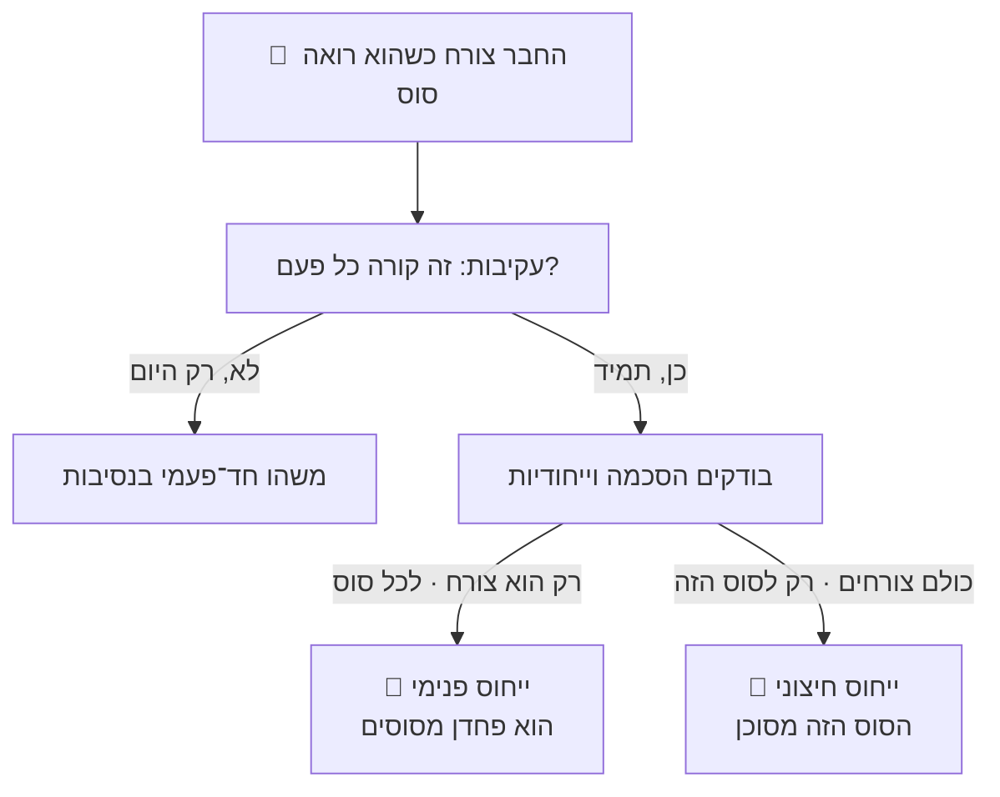

### שאלה-4

**ניתוח מקרה מהחיים: איזה ייחוס עשיתי, ומה היה משנה אותו?** · ↩ סעיף 1.4

*(דוגמה שלי)*

- **המצב:** במסעדה, דנה צועקת על המלצר כי המנה התאחרה.
- **הייחוס הראשון:** "דנה עצבנית ואגרסיבית". זה ייחוס **פנימי**.
- **הניתוח לפי קלי:** האם רק דנה צועקת (**הסכמה**)? האם היא צועקת על כל מלצר (**ייחודיות**)? האם היא צועקת בכל פעם שמנה מתאחרת (**עקיבות**)?
- **מה היה משנה לייחוס חיצוני:** אם כל הסועדים מתלוננים (הסכמה **גבוהה**), ודנה רגועה בכל מסעדה אחרת (ייחודיות **גבוהה**), נייחס את ההתנהגות **למסעדה**. ההבדל נוגע ל**הסכמה** ול**ייחודיות**.

### 8.1.2 · טעות הייחוס הבסיסית

### שאלה-5

**מהי טעות הייחוס הבסיסית?** · ↩ סעיף 2.1

- **טעות הייחוס הבסיסית (fundamental attribution error):** כשמסבירים התנהגות של **אחרים**, מעריכים **יותר מדי** את הגורמים **הפנימיים**, ו**פחות מדי** את הגורמים **החיצוניים**. את השם נתן לי רוס (Lee Ross).
- 📖 **"קרב מוחות":** הטלת מטבע קבעה מי שואל. הצופים התעלמו מהיתרון שהמצב נתן לשואל, ודירגו אותו כ"גאון" (כ־82 מול 50 בממוצע).

### שאלה-6

**דוגמה לטעות הייחוס הבסיסית: איפה הערכת היתר של הפנימי, ואיפה הערכת החסר של החיצוני?** · ↩ סעיף 2.1

*(דוגמה שלי)* פוסט ברשת: "נהג האוטובוס נסע ולא עצר לי בתחנה. איזה חוצפן!"

- **הערכת יתר של גורם פנימי:** "חוצפן", "לא אכפת לו מאנשים". הסבר דרך **האישיות** שלו.
- **הערכת חסר של גורמים חיצוניים:** אולי האוטובוס היה מלא, אולי רכב חסם את התחנה ולא ראה אותי, אולי החברה לחצה עליו לעמוד בלוח הזמנים.
- **איך נמנעים:** 📖 **"ייחוס של חסד"**: לעצור ולשאול מה **במצב** יכול היה לגרום להתנהגות (סעיף 2.3).

### 8.1.3 · הטיות בשירות העצמי

### שאלה-7

**מהי הטיה בשירות העצמי?** · ↩ סעיף 3.1

- **הטיה בשירות העצמי (self-serving bias):** הצלחה שלי ← ייחוס **פנימי** ("אני מוכשרת"). כישלון שלי ← ייחוס **חיצוני** ("המבחן היה לא הוגן").
- 📖 עם **חבר** ההטיה כמעט נעלמת, ועם **זר** היא גדולה (Campbell et al.).

🧭 ההבדל מטעות הייחוס הבסיסית:

| | **טעות הייחוס הבסיסית** | **הטיה בשירות העצמי** |
|---|---|---|
| על מי | על **אחרים** | על **עצמי** |
| הצלחה | פנימי | **פנימי** ("בזכותי") |
| כישלון | פנימי ("הוא לא מוכשר") | **חיצוני** ("בגלל המצב") |

### שאלה-8

**האם גם את "חטאת" בהטיה בשירות העצמי?** · ↩ סעיף 3.3

*(דוגמה שלי)*

- "קיבלתי 95 כי למדתי ברצינות" (**פנימי**). שבוע אחרי: "קיבלתי 60 כי המרצה כתבה שאלות מכשילות" (**חיצוני**).
- **המחיר:** ההערכה העצמית מוגנת, אבל אם הכישלון תמיד "בגלל המבחן", לא אלמד יותר בפעם הבאה.

### 8.1.4 · ציפיות ונבואות המגשימות את עצמן

### שאלה-9

**איך באים שלבי סניידר (תרשים 1) לידי ביטוי באפקט פיגמליון?** · ↩ סעיף 4.5

🧭 המעגל של מרק סניידר (Mark Snyder), בניסוי של רוברט רוזנטל (Robert Rosenthal) ולאונורה ג'קובסון (Lenore Jacobson):

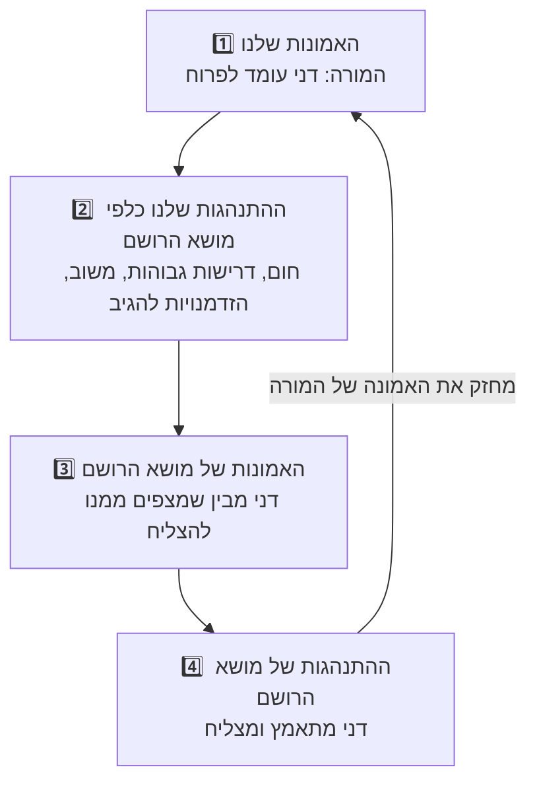

- 📖 השמות של ה"פורחים" נבחרו **באקראי**, כלומר האמונה הייתה **כוזבת**. ובכל זאת היא התממשה: ל־30% מהם עלתה מנת המשכל ב־22 נקודות בממוצע.

### שאלה-10

**מרים הפיזיקאית: הסבירו בעזרת נבואה המגשימה את עצמה ותרשים 1** · ↩ סעיף 4.6

*(תשובה שלי)*

| שלב בתרשים | הסיפור של מרים |
|---|---|
| **האמונות שלנו** | האם האמינה "מרגע שנולדה" שיש למרים כישרון |
| **ההתנהגות שלנו** | קנתה לה ערכות ניסויים, שאלה אותה שאלות, שיבחה כל הצלחה במתמטיקה |
| **האמונות של מושא הרושם** | מרים הבינה שמצפים ממנה להצטיין במדעים |
| **ההתנהגות של מושא הרושם** | השקיעה ובחרה בפיזיקה. ההצלחה חיזקה עוד יותר את אמונת האם |

### 8.2.1 · עמדות

### שאלה-11

**מהי עמדה? בחרו דמות והציגו את עמדתכם כלפיה** · ↩ סעיף 5.1

- **עמדה (attitude):** **הערכה חיובית או שלילית** של אנשים, עצמים או רעיונות.
- *(דוגמה שלי)* העמדה שלי כלפי שחקן הכדורגל ליונל מסי (Lionel Messi): **חיובית**.

### שאלה-12

**שלושת מקורות המידע: איך כל אחד בא לידי ביטוי בעמדה שלך? האם כולם מצביעים לאותו כיוון?** · ↩ סעיף 5.2

🧭

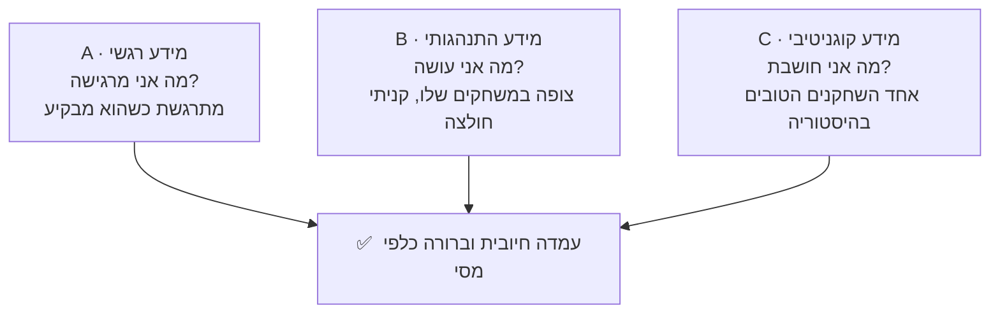

- *(דוגמה שלי)* כאן שלושת המקורות **מצביעים לאותו כיוון**, ולכן העמדה **ברורה**.
- 📘 כשהמקורות **סותרים** (למשל רגש חיובי ומידע קוגניטיבי שלילי), קשה יותר לגבש עמדה.

### שאלה-13

**שני מצבים שמחזקים את הקשר בין עמדה להתנהגות** · ↩ סעיף 5.3

- **נגישות העמדה (attitude accessibility):** העמדה "קופצת" מהר לראש. מגבירים אותה **התנסות ישירה** ו**חזרה** על העמדה.
- **ספציפיות:** העמדה וההתנהגות נמדדות **באותה רמת פירוט**.

### שאלה-14

**מה אפשר להסיק ממחקר העמדה הכוזבת וממחקר הגלולות?** · ↩ סעיף 5.3

- **עמדה כוזבת** (Johar & Sengupta, טבלה 16.1): המתאם בין העמדה לבחירה: אמת 0.61 · **שקר 0.54** · ביקורת 0.39. כדי לשקר צריך לחשוב קודם על העמדה האמיתית. החזרה הזאת הופכת אותה ל**נגישה**, וכך היא מנבאת טוב יותר.
- **גלולות** (Davidson & Jaccard, טבלה 16.2): ככל שהעמדה **ספציפית** יותר להתנהגות, המתאם גבוה יותר.

🧭 טבלה 16.2:

| העמדה שנמדדה | המתאם עם ההתנהגות |
|---|---|
| כלפי אמצעי מניעה | █ 0.08 |
| כלפי גלולות | ████ 0.32 |
| כלפי **שימוש** בגלולות | ███████ 0.52 |
| כלפי שימוש בגלולות **בשנתיים הבאות** | ████████ 0.57 |

### 8.2.2.1 · גיבוש עמדה מתוך מידע: מודל סבירות העיבוד

### שאלה-15

**תארו את שני מסלולי השכנוע במודל סבירות העיבוד** · ↩ סעיף 6.1

🧭

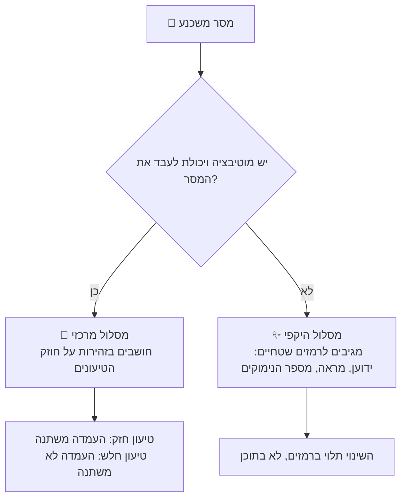

- 📖 **מסלול מרכזי (central route):** עיבוד **גבוה**. **מסלול היקפי (peripheral route):** עיבוד **נמוך**.
- 📖 בשעה **האופטימלית** של היום יש יותר מוטיבציה, ולכן עיבוד מרכזי (Martin & Marrington).

### שאלה-16

**הציעו לעיריית תל אביב שתי דרכים לשכנע לנסוע בתחבורה ציבורית: מסלול מרכזי ומסלול היקפי** · ↩ סעיף 6.5

*(תשובה שלי)*

- **מסלול מרכזי:** חוברת עם נתונים: כמה זמן וכסף חוסכים, השוואת זמני נסיעה, חישוב עלות החניה.
- **מסלול היקפי:** שלט חוצות עם זמרת אהובה באוטובוס, מוזיקה ותחושה ש"כולם עושים את זה".

### שאלה-17

**מהי ההתאמה בין סוג העמדה לסוג הטיעון, ולמה היא חשובה? האם יש התאמה בתכניות שהצעת?** · ↩ סעיף 6.3

- 📖 עמדה **קוגניטיבית** משתנה בטיעון **קוגניטיבי**. עמדה **רגשית** משתנה בטיעון **רגשי** (Ajzen & Sexton).
- 📖 **המחקר של שביט (Shavitt):** קפה (עמדה קוגניטיבית) מול כרטיסי ברכה (עמדה רגשית). כשהפרסומת **התאימה** לסוג המוצר, המחשבות היו חיוביות יותר.
- **בתכניות שלי** *(תשובה שלי)*: חוברת הנתונים מתאימה לעמדה **קוגניטיבית** (עלות ונוחות). השלט עם הזמרת מתאים לעמדה **רגשית**. לכן צריך קודם לבדוק את סוג העמדה של התושבים: אם הם נוסעים ברכב "כי זה נוח ויוקרתי" (רגש), חוברת נתונים תשפיע פחות.

### למחשבה-1

**טבלה 1: ההבדלים בין המסלול המרכזי למסלול ההיקפי** · ↩ סעיף 6.4

📘

| | **מסלול מרכזי** | **מסלול היקפי** |
|---|---|---|
| **המידע המעובד** | המסר עצמו (למשל **חוזק** הנימוקים) | רמזים שטחיים (למשל **מספר** הנימוקים) |
| **אופן העיבוד** | בכובד ראש | בלי תשומת לב |
| **הצורך במוטיבציה ויכולת** | מוטיבציה ויכולת **גבוהות** (למשל בשעות היום האופטימליות) | **אין צורך** במוטיבציה או ביכולת רבה (למשל בשעות לא אופטימליות) |
| **מקור המידע (ABC)** | שינוי עמדה שמבוססת על מידע **קוגניטיבי** | שינוי עמדה שמבוססת על מידע **רגשי** |

### 8.2.2.2 · שינוי עמדה בעקבות ההתנהגות: דיסוננס קוגניטיבי

### שאלה-18

**מהו דיסוננס קוגניטיבי?** · ↩ סעיף 7.1

- **דיסוננס קוגניטיבי (cognitive dissonance)**, לפי לאון פסטינגר (Leon Festinger): **מצב של קונפליקט**, מעורר ולא נעים, כשהתנהגות, החלטה או מידע **סותרים** את האמונות או הערכים שלנו. אנחנו **מונעים** להפחית אותו.

🧭 📘 הדוגמה מהמדריך: מעשן שיודע שעישון מסוכן.

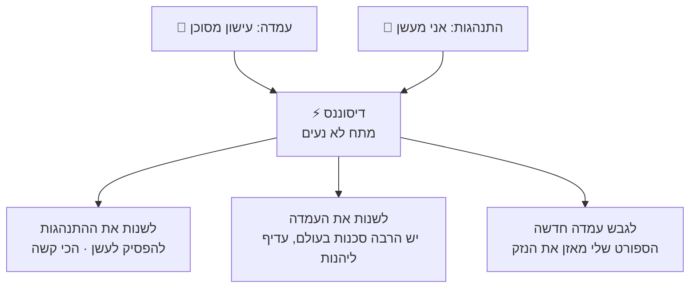

### שאלה-19

**איך ניסוי פסטינגר וקרלסמית' (Festinger & Carlsmith) תומך בקיומו של דיסוננס?** · ↩ סעיף 7.2

🧭

```mermaid
flowchart TB
  T["😴 מטלה משעממת מאוד"] --> L["🤥 אומרים למשתתף הבא: היה מעניין"]
  L --> M1["💵 קיבלו 20 דולר"]
  L --> M2["🪙 קיבלו דולר אחד"]
  M1 --> N1["יש הצדקה חיצונית לשקר<br>אין דיסוננס"]
  N1 --> O1["העמדה לא משתנה<br>היה משעמם"]
  M2 --> N2["אין הצדקה<br>דיסוננס חזק"]
  N2 --> O2["העמדה משתנה<br>בעצם היה מעניין"]
```

- **למה זה תומך בתיאוריה** *(ניתוח שלי)*: דווקא מי שקיבל **פחות** שינה את העמדה **יותר**. רק דיסוננס מסביר את זה: בלי הצדקה חיצונית, הדרך להפחית את המתח היא לשנות את העמדה.

### שאלה-20

**מצב שבו חשת דיסוננס קוגניטיבי. איך פתרת אותו?** · ↩ סעיף 7.1

*(דוגמה שלי)*

- **הסתירה:** "חשוב לי לשמור על הסביבה" מול "נסעתי ברכב למכולת, חמש דקות הליכה מהבית".
- **פתרון בשינוי עמדה:** "הייתי עייפה, ופעם אחת לא משנה כלום" (מוסיפה מחשבה מצדיקה).
- **פתרון בשינוי התנהגות** (הקשה יותר): בפעם הבאה הלכתי ברגל.

### שאלה-21

**למה דיסוננס הוא תהליך של שכנוע עצמי, שבו ההתנהגות משפיעה על העמדה ולא להפך?** · ↩ סעיף 7.3

*(ניתוח שלי)*

- **הכיוון הרגיל:** עמדה ← התנהגות ("אני אוהבת, ולכן אני עושה").
- **בדיסוננס:** התנהגות ← עמדה. כבר עשיתי (שיקרתי בשביל דולר), ואי אפשר לבטל את המעשה. מה שנשאר לשנות הוא **העמדה**, וכך אני משכנעת **את עצמי**.

### 8.2.2.3 · גיבוש עמדה מתוך התנהגות: תיאוריית התפיסה העצמית

### שאלה-22

**מהי תיאוריית התפיסה העצמית?** · ↩ סעיף 8.1

- **תיאוריית התפיסה העצמית (self-perception theory)** של דריל בם (Daryl Bem): אנחנו **מסיקים** מה אנחנו מרגישים וחושבים מתוך **התבוננות בהתנהגות שלנו**.
- 📖 פועלת בעיקר במצבים **לא ברורים**, כשאין עמדה מגובשת.

### שאלה-23

**השוו בין דיסוננס קוגניטיבי לתיאוריית התפיסה העצמית: מה משותף ומה שונה?** · ↩ סעיף 8.4

- **משותף:** בשתיהן **ההתנהגות משפיעה על העמדה**.
- **שונה:** בדיסוננס יש **מוטיבציה** להפחית מתח, כי יש עמדה קודמת **סותרת**. בתפיסה עצמית **אין מוטיבציה**, רק **הסקה**, כי אין עמדה ברורה.

🧭 איך מזהים איזו תיאוריה (עוזר גם ל[למחשבה 2](#למחשבה-2)):

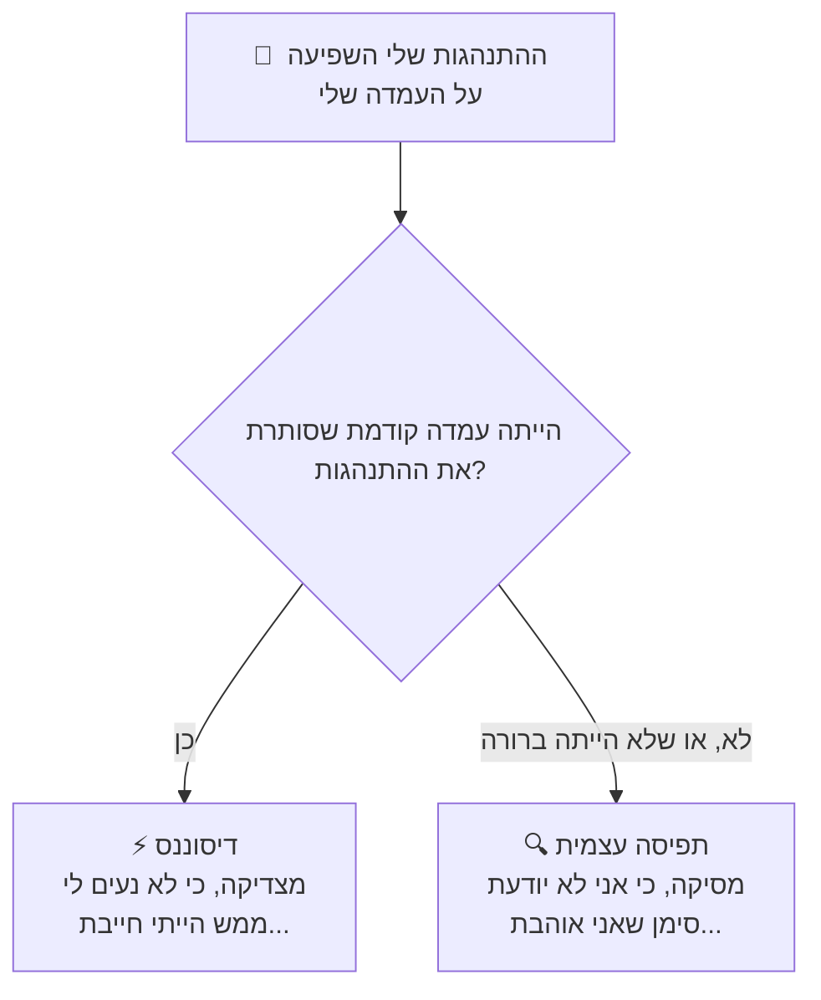

### שאלה-24

**מצב שבו אפשר להסביר את העמדה שלך בעזרת תיאוריית התפיסה העצמית** · ↩ סעיף 8.3

*(דוגמה שלי)*

- נרשמתי לחוג יוגה רק כי חברה גררה אותי, ולא הייתה לי דעה על יוגה. אחרי חודש ראיתי שלא החסרתי אף שיעור: "**סימן ש**אני אוהבת יוגה".
- זו תפיסה עצמית: **לא הייתה עמדה קודמת**, ואין מתח להפחית. רק **הסקה** מההתנהגות.

### למחשבה-2

**איזו דוגמה מתאימה לתפיסה העצמית, ואיזו לדיסוננס?** · ↩ סעיף 8.5

📘 התשובה במדריך: **תפיסה עצמית: א, ג. דיסוננס: ב, ד.** (במדריך: 1, 3 ו־2, 4.)

| | המקרה | התיאוריה | למה *(הסבר שלי)* |
|---|---|---|---|
| א | יעל: "נראה לי שאני אוהבת את ריצ'רד גיר, כי אני אוהבת את הסרטים שלו" | **תפיסה עצמית** | מסיקה עמדה מהתנהגות, בלי מתח |
| ב | שדי בחר באוניברסיטה הפתוחה, ומאז דעתו עליה חיובית יותר | **דיסוננס** | אחרי בחירה, מצדיק אותה |
| ג | ירון: "אם התחתנתי עם גילה, סימן שאני אוהב אותה" | **תפיסה עצמית** | "סימן ש..." = הסקה |
| ד | ליאת עקפה שיירה בניגוד להרגלה: "ממש הייתי חייבת להגיע בזמן" | **דיסוננס** | מצדיקה התנהגות שסותרת ערך |

### 8.2.2.4 · היענות: הדדיות, מחויבות, נדירות

### שאלה-25

**מהי נורמת ההדדיות, ואיך משפיעים בעזרתה?** · ↩ סעיף 9

- **נורמת ההדדיות (reciprocity norm):** מי שעשה בשבילנו משהו, אנחנו מרגישים שאנחנו **חייבים לו**.
- 📖 אפילו טובה **קטנה** גורמת להחזיר טובה **גדולה** בהרבה (Regan). למשל, "קחי דוגמית במתנה", ואחר כך קונים.

### שאלה-26

**מהי טכניקת הדלת בפרצוף, ומה הקשר שלה לנורמת ההדדיות?** · ↩ סעיף 9

- **הדלת בפרצוף (door-in-the-face):** קודם בקשה **גדולה**, שמסרבים לה, ואז בקשה **קטנה**.
- **הקשר להדדיות:** המבקש "ויתר" לנו, ועכשיו **אנחנו** "מוותרים" בחזרה ומסכימים.
- 📖 צ'יאלדיני (Robert Cialdini): אחרי סירוב לייעוץ לנערים עבריינים במשך שנתיים, **50%** הסכימו ללוות טיול לגן החיות. בלי הבקשה הגדולה: **17%**.

🧭 שתי הטכניקות זו מול זו (גם ל[שאלה 28](#שאלה-28)):

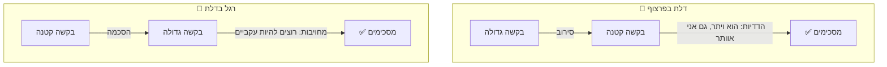

### שאלה-27

**מהי תחושת מחויבות, ואיך משפיעים בעזרתה?** · ↩ סעיף 9

- **תחושת מחויבות (sense of commitment):** מרגע שהסכמנו למשהו, אנחנו רוצים להיות **עקביים** עם ההסכמה.
- 📖 איש מכירות: "אני יודע שאת אוהבת מוצרי איכות, לכן לא תתנגדי לשלם קצת יותר".

### שאלה-28

**מהי טכניקת רגל בדלת, ומה הקשר שלה לנורמת ההדדיות?** · ↩ סעיף 9

- **רגל בדלת (foot-in-the-door):** קודם בקשה **קטנה**, שמסכימים לה, ואז בקשה **גדולה**. 📖 מי שחתמו על עצומה הסכימו יותר אחר כך להציב שלט גדול בחצר (Freedman & Fraser).
- ⚠️ **שימי לב:** המדריך שואל על **הדדיות**, אבל בספר רגל בדלת קשורה ל**תחושת המחויבות**: ההסכמה הראשונה יוצרת רצון להישאר עקביים. אין כאן "ויתור" של המבקש שצריך להחזיר. ההדדיות שייכת ל**דלת בפרצוף** (ראי את הדיאגרמה ב[שאלה 26](#שאלה-26)).

### שאלה-29

**הסבירו בעזרת הדיסוננס הקוגניטיבי למה רגל בדלת עובדת** · ↩ סעיף 9.1

*(ניתוח שלי)*

- חתמת על עצומה למען בטיחות בדרכים. עכשיו מבקשים ממך להציב שלט בחצר.
- סירוב ייצור **סתירה** בין "אני אדם שתומך בבטיחות בדרכים" (מה שההתנהגות הראשונה אמרה) לבין "אני מסרבת לעזור". הסתירה לא נעימה: **דיסוננס**.
- הדרך הקלה להפחית אותו: **להסכים** גם לבקשה הגדולה, ולהישאר עקבית.

### שאלה-30

**מהו עקרון הנדירות, ואיך משפיעים בעזרתו?** · ↩ סעיף 9

- **עקרון הנדירות (principle of scarcity):** מה שקשה להשיג נראה **שווה יותר**.
- 📖 אותן עוגיות דורגו טעימות יותר בצנצנת עם **2** עוגיות מאשר עם **10** (Worchel et al.). "זה האחרון שנשאר".

### שאלה-31

**שלוש תכניות לנציגי העירייה במרכזי הקניות: הדדיות, מחויבות, נדירות** · ↩ סעיף 9.2

*(תשובות שלי)*

| העיקרון | התכנית |
|---|---|
| **הדדיות** | מחלקים כרטיס נסיעה **חינם** או בקבוק מים, ואז מבקשים לנסות את האוטובוס שבוע |
| **מחויבות** (רגל בדלת) | קודם מבקשים רק לחתום "אני תומך באוויר נקי בעיר". שבוע אחר כך: להתחייב לנסוע באוטובוס פעם בשבוע |
| **נדירות** | "המנוי המוזל זמין רק ל־500 הנרשמים הראשונים, עד סוף החודש" |

### 8.2.3 · דעות קדומות וסטריאוטיפים

### שאלה-32

**מהי דעה קדומה?** · ↩ סעיף 10.1

- **דעה קדומה (prejudice):** **עמדה נלמדת**, לרוב שלילית, כלפי קבוצה וחבריה. היא כוללת **רגשות** שליליים, **אמונות** שליליות (סטריאוטיפים) ו**כוונה התנהגותית** להתרחק, לשלוט ואפילו להשמיד.
- 📖 אמונה כוזבת היא דעה קדומה כשהיא **לא משתנה** גם מול ראיות שהיא שגויה.

### שאלה-33

**איך באים שלושת מקורות המידע של עמדה (ABC) לידי ביטוי בדעה קדומה?** · ↩ סעיף 10.2

🧭 📘 תרשים 2 במדריך:

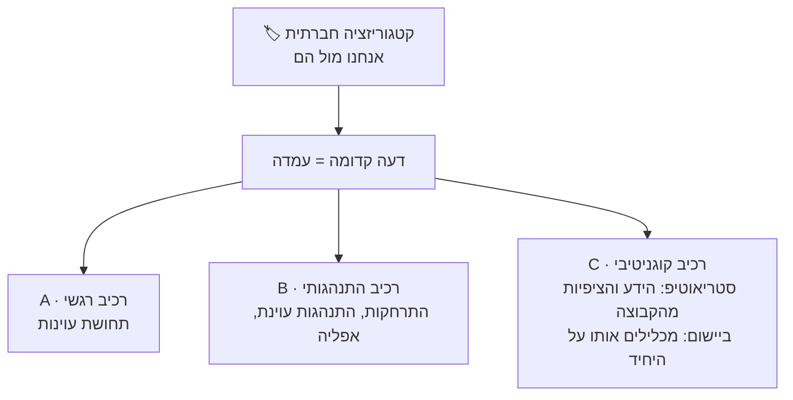

### שאלה-34

**למה קשה להפריך דעות קדומות?** · ↩ סעיף 10.4

*(לפי הספר)*

1. אמונה כוזבת **לא משתנה** מול ראיות. זו ההגדרה שלה.
2. היא פועלת כ**פילטר מוטה**: רואים את מה שמאשר אותה.
3. אנשים **מפחיתים בערכו** של מידע שסותר את הסטריאוטיפ (Munro & Ditto, סעיף 12.2).
4. סטריאוטיפים יוצרים **אישור התנהגותי**: לא נותנים לאחר הזדמנות להוכיח אחרת (סעיף 12.1).

### שאלה-35

**מהי קטגוריזציה חברתית? קבוצות פנים וקבוצות חוץ** · ↩ סעיף 11.1

- **קטגוריזציה חברתית (social categorization):** אנחנו **ממיינים** את עצמנו ואת האחרים **לקבוצות**. הצורה הפשוטה: האם האדם **דומה לי**?
- **קבוצת פנים (in-group)** = "**אנחנו**", הקבוצה שאני מזדהה איתה. **קבוצת חוץ (out-group)** = "**הם**".
- זה **הבסיס** לדעות קדומות.

### שאלה-36

**מהי הטיית קבוצת הפנים?** · ↩ סעיף 11.1

- **הטיית קבוצת הפנים (in-group bias):** ההערכה שהקבוצה **שלי** טובה יותר מהאחרות.
- 📖 **ניסוי הצבעים** (Rabbie): חלוקה **אקראית** לכחולים וירוקים הספיקה כדי ליצור העדפה.
- 📖 לרוב זו **העדפה** של "שלנו", ולא בהכרח **עוינות** כלפי "הם" (Hewstone et al., סעיף 11.3).

### שאלה-37

**מהם סטריאוטיפים?** · ↩ סעיף 12.1

- **סטריאוטיפים (stereotypes):** **הכללות** על קבוצת אנשים, שמייחסות **אותם מאפיינים לכל** חברי הקבוצה.
- הם **הרכיב הקוגניטיבי** של דעה קדומה.

### שאלה-38

**מה תפקיד הסטריאוטיפים במצבים עמומים, כשחסר מידע?** · ↩ סעיף 12.1

- אנחנו **משלימים את הנתונים החסרים** מתוך הסטריאוטיפ. 📖 "לא אכנס למכונית עם הירושי, כל האסיאתים נהגים איומים".
- 📖 כך הסטריאוטיפ **מקדים ציפיות**, ותורם ל**אישור התנהגותי** (סעיף 4).

### שאלה-39

**איך סטריאוטיפ על הקבוצה שלנו יכול להשפיע על החשיבה וההתנהגות שלנו? (איום סטריאוטיפ)** · ↩ סעיף 12.3

- **איום סטריאוטיפ (stereotype threat)**, לפי קלוד סטיל (Claude Steele): כשסטריאוטיפ שלילי על **הקבוצה שלי** רלוונטי למצב, **הביצוע שלי נפגע**.
- 📖 אפרו־אמריקאים הצליחו פחות במבחן יכולת כשהאמינו שהוא רלוונטי לסטריאוטיפ.
- **החידוש:** הסטריאוטיפ פוגע לא רק דרך **אחרים** שמפלים, אלא דרך **המחשבות שלי**.

### שאלה-40

**נכון או לא נכון? (לפי המחנה של שריף)** · ↩ סעיף 13.4

| המשפט | | למה |
|---|---|---|
| כדי להפריך סטריאוטיפ צריך לתת מידע שסותר אותו | **לא נכון** | התעמולה במחנה נכשלה. מידע לבדו לא מפחית דעות קדומות (גם Munro & Ditto) |
| כדי להפחית קונפליקט ודעות קדומות בין שתי קבוצות, די להפגיש ביניהן | **לא נכון** | מפגש בלי תחרות לא עזר. מגע **לבדו** לא מספיק |
| משימה שדורשת שיתוף פעולה בין קבוצות יריבות יכולה להפחית דעות קדומות | **נכון** | המשאית: **תלות הדדית** ו**מטרה משותפת** פיזרו את העוינות |

🧭 📖 המחנה של מוצפר שריף (Muzafer Sherif):

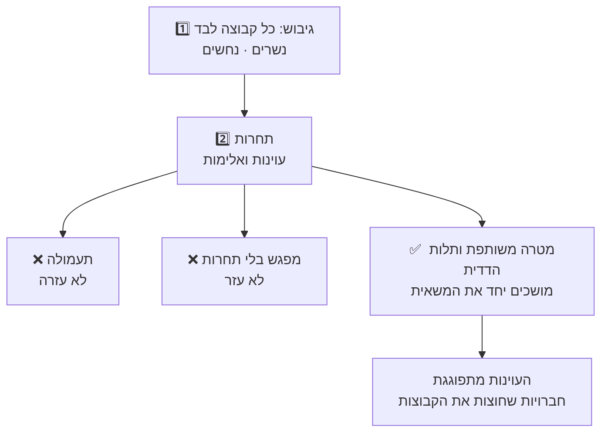

### למחשבה-3

**הלגה ואמיר: הסבירו בעזרת קטגוריזציה חברתית, דעות קדומות וסטריאוטיפים** · ↩ סעיף 11.5

📘

1. **קטגוריזציה חברתית:** בעזרת התכונות והידע שלה, הלגה משייכת את אמיר ל**קבוצת חוץ** (מוסלמים).
2. **דעה קדומה:** היא מחזיקה בעמדה שלילית כלפי מוסלמים כקבוצה.
3. **הרכיב הקוגניטיבי, סטריאוטיפ:** **מבנה זיכרון** עם הידע והציפיות שלה מהקבוצה. בעקבות מידע על התנהגות לא הולמת של מהגרים מוסלמים כלפי נשים, יש לה בזיכרון ש"מוסלמים לא מכבדים נשים גרמניות". היא **מכלילה** את זה על אמיר, ומצפה שגם הוא ינהג כך.
4. **הרכיב ההתנהגותי, אפליה:** היא בוחרת לא להעסיק אותו.

### 8.3.1 · תפקידים וכללים

### שאלה-41

**מהו תפקיד חברתי?** · ↩ סעיף 14.1

- **תפקיד חברתי (social role):** **דפוס התנהגות** שהחברה מגדירה, ו**מצפה** ממי שממלא אותו בקבוצה מסוימת. 📖 "הסטודנטית" בכיתה, "האחות" בבית.

### שאלה-42

**אילו תפקידים חברתיים היו בניסוי בית הכלא בסטנפורד?** · ↩ סעיף 14.2

- שני תפקידים: **סוהרים** ו**אסירים**. 📖 הטלת מטבע קבעה מי ממלא איזה תפקיד.
- **הסוהרים:** נהיו תוקפניים, לפעמים סדיסטיים. 📖 בתרשים 17.1 בולטים אצלם **פקודות**, **עלבונות** ו**איומים**.
- **האסירים:** נהיו פסיביים וחסרי אונים. בולטת אצלם **התנגדות סבילה**.

### שאלה-43

**מה לומדים מהניסוי על כוחם של תפקידים?** · ↩ סעיף 14.3

- **לתפקיד** יש כוח עצום על ההתנהגות, גם אצל אנשים בריאים ו"נורמליים". 📖 די היה **בלבישת מדים** כדי להפוך סטודנטים לסוהרים תוקפניים.

### שאלה-44

**איזה הבדל בין סטנפורד לבתי כלא אמיתיים מאפשר את המסקנה?** · ↩ סעיף 14.3

*(ניתוח שלי, לפי הספר)*

🧭

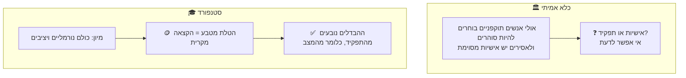

- ההקצאה המקרית מפרק 2 מבטלת את ההסבר של **האישיות**.

### שאלה-45

**עד כמה הניסוי עומד בעקרון "להיטיב ולא להזיק" (Beneficence and Nonmaleficence)?** · ↩ סעיף 14.4

*(ניתוח שלי · ראי [פרק 2, סעיף 9](פרק-2-39-69-שיטות-מחקר-בפסיכולוגיה.md))*

- **לא עמד בו במלואו:** המשתתפים סבלו **נזק נפשי** (בכי, זעם, דיכאון, פריחה).
- **מה שהקטין את הנזק:** הניסוי **הופסק** אחרי 6 ימים, ובדיקות המעקב לא מצאו נזק ארוך טווח.

### שאלה-46

**האם ניתן מענה מספק להסכמה מדעת, לרווח מול הפסד, להטעיה ולשיחת הבהרה?** · ↩ סעיף 14.4

*(ניתוח שלי)*

| הסוגיה | בסטנפורד |
|---|---|
| **הסכמה מדעת** | המתנדבים הסכימו ל"חיים בכלא", אבל לא ידעו מראש כמה קשה זה יהיה. **מעצר מפתיע בבית** בידי שוטרים |
| **רווח מול הפסד** | הידע על כוחו של המצב חשוב מאוד (אבו־גריב), אבל הסבל היה גדול מהצפוי |
| **הטעיה ושיחת הבהרה** | החלוקה לא הוסתרה, אבל המעצר המבוים הפתיע. חשוב לערוך **שיחת הבהרה** ולוודא שאף משתתף לא יוצא פגוע |

### 8.3.2 · נורמות וקונפורמיות

### שאלה-47

**מהן נורמות חברתיות?** · ↩ סעיף 15.1

- **נורמה חברתית (social norm):** **ציפיות** של קבוצה לעמדות ולהתנהגויות מקובלות, בכללים **מפורשים** או **משתמעים**.
- 📖 הן עוזרות לחזות איך האחרים יתנהגו, ומה לעשות כדי לזכות באישור.

### שאלה-48

**שתי דרכי ההסתגלות לנורמות בקבוצה: התנהגות אחידה ותוצאות שליליות** · ↩ סעיף 15.1

- **התנהגות אחידה:** שמים לב למה ש**כולם**, או רובם, עושים.
- **תוצאות שליליות:** רואים מה קורה למי ש**מפר** נורמה (לעג, חינוך מחדש, דחייה).

### שאלה-49

**מהי קונפורמיות?** · ↩ סעיף 15.2

- **קונפורמיות (conformity):** הנטייה **לאמץ** את ההתנהגויות והדעות של חברי הקבוצה האחרים.

### שאלה-50

**שני הכוחות שמביאים לקונפורמיות: השפעת המידע והשפעת הנורמה** · ↩ סעיף 15.2

- **השפעת המידע (informational influence):** רוצים **לצדוק**. במצב **עמום** משתמשים באחרים כמקור מידע ("הם יודעים יותר"). 📖 שריף.
- **השפעת הנורמה (normative influence):** רוצים ש**יחבבו ויקבלו** אותנו, גם כשהמציאות **ברורה** ("לא רוצה להיות שונה"). 📖 אש.

### שאלה-51

**שתי נורמות בקבוצה שלך: איך הן נלמדות, כמה קונפורמיות יש, ואיך פועלים שני הכוחות?** · ↩ סעיף 15.1

*(דוגמה שלי)* קבוצת הוואטסאפ של הסטודנטים בקורס.

| | **נורמה 1:** לא שולחים תשובות לממ"ן | **נורמה 2:** עונים בנימוס לכל שאלה על החומר |
|---|---|---|
| **התנהגות אחידה** | אף אחד לא שולח, רק מתייעצים על כיוון | כולם עונים בסבלנות, גם לשאלות "פשוטות" |
| **תוצאות שליליות** | מי ששלח תשובה קיבל נזיפה ממנהלת הקבוצה | מי שלעג לשאלה קיבל תגובות כועסות |
| **קונפורמיות** | גבוהה מאוד | גבוהה |
| **השפעת המידע** | סטודנטית חדשה לא יודעת מה מותר, ולומדת מהאחרים | מבינה מהאחרים איך "נכון" לענות |
| **השפעת הנורמה** | לא רוצה להיות זו שננזפת | רוצה שיחבבו אותה בקבוצה |

### שאלה-52

**מתי הדיווחים יהיו דומים יותר במצב עמום: בדיווח פרטני או בדיווח קבוצתי? (שריף)** · ↩ סעיף 15.3

*(תשובה שלי, לפי שריף)*

- **בתהליך הקבוצתי**, כשכולם שומעים את הדיווחים של כולם. במצב עמום, כל אחד משתמש בהערכות של האחרים **כמידע**, וההערכות **מתכנסות** לנורמה.
- וכשהנורמה כבר נוצרה, היא נשמרת גם בדיווח **פרטי**.

🧭 📖 האפקט האוטוקינטי (autokinetic effect), התגבשות נורמה:

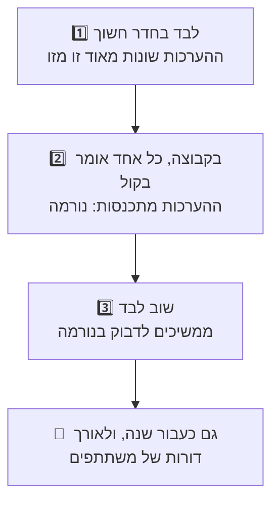

### שאלה-53

**הניסוי של אש: המשימה, התוצאות ושלושת הגורמים** · ↩ סעיף 15.4

- **המשימה:** סולומון אש (Solomon Asch). איזה קו שווה לקו הבסיסי? המצב **ברור**. כל האחרים בחדר היו **שותפי סוד**, וב־12 צעדים קריטיים ענו תשובה **שגויה**.
- **התוצאות:** כ**רבע** נשארו עצמאיים לגמרי. **50%–80%** התאימו את עצמם לרוב לפחות פעם אחת. **שליש** נכנעו בלפחות חצי מהצעדים.
- **שלושת הגורמים:** **גודל הרוב** (כבר 3–4 מספיקים) · **שותף** שחולק על הרוב (מפחית מאוד) · **הפער** בין התשובה הנכונה לתשובת הרוב.

🧭 📖 תרשים 17.2, אחוז התשובות הנכונות:

| המצב | תשובות נכונות |
|---|---|
| לבד נגד הרוב | ██████ 50%–80% |
| עם **שותף** | █████████ 80%–100% |
| ביקורת, בלי רוב שטועה | ██████████ כמעט 100% |

### שאלה-54

**המחקר של מוסקוביצ'י: המשימה, התוצאות, והסבר בעזרת שני הכוחות** · ↩ סעיף 15.6

- **המשימה:** סרז' מוסקוביצ'י (Serge Moscovici). מזהים צבע **כחול**. **שני** שותפי סוד אומרים **בעקביות** "ירוק".
- **התוצאות:** **בגלוי** הרוב לא השתנה. אבל **בפרטי**, אחר כך, חלק הזיזו את הגבול בין כחול לירוק.
- **ההסבר:** **השפעת נורמה** של מיעוט קטנה (לא אכפת לנו אם הוא מחבב אותנו). אבל מיעוט עקבי מפעיל **השפעת מידע**: גורם לחשוב מזווית אחרת. לכן השינוי נראה **בפרטי**.

### למחשבה-4

**ציון ממוצע מול ציון שנקבע בדיון קבוצתי: מה ההבדל כשיש קיטוב קבוצתי?** · ↩ סעיף 15.7

📘 **הציון המשותף יהיה קיצוני יותר מהציון הממוצע.**

🧭 למה:

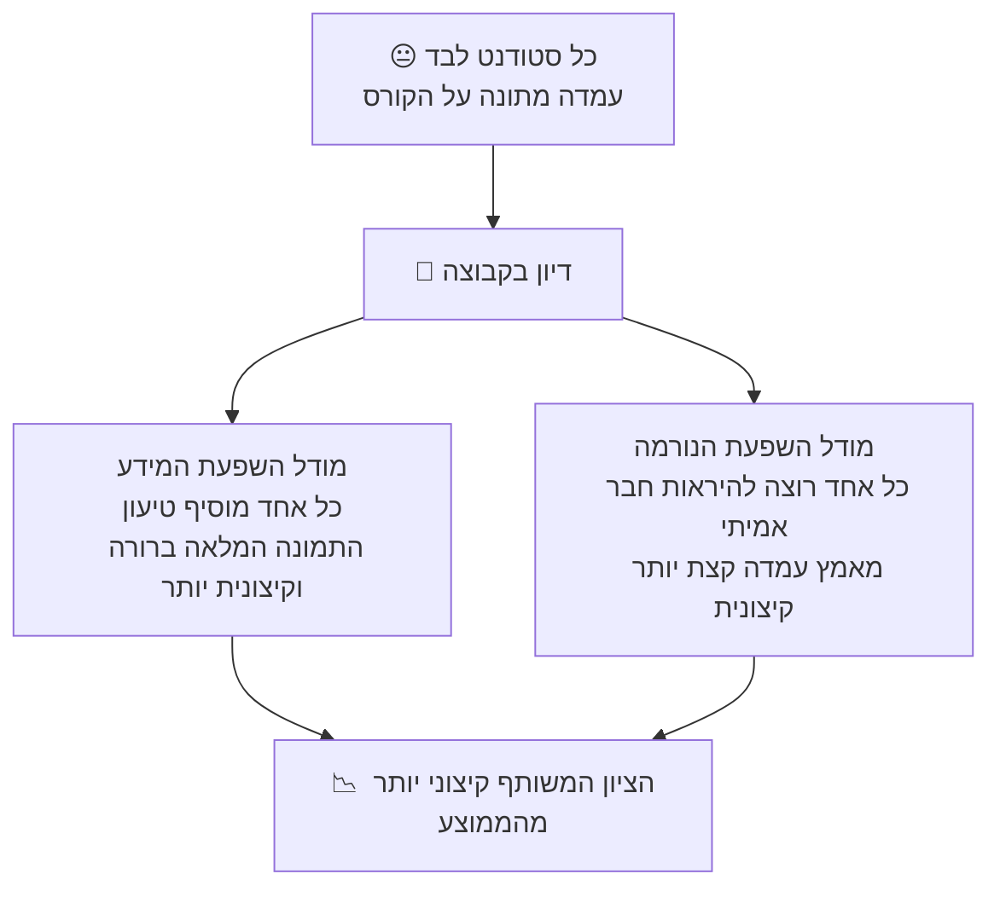

### 8.3.3 · ציות לסמכות

### שאלה-55

**הניסוי של מילגרם: המשימה, התוצאות, והתנאים שהשפיעו** · ↩ סעיף 16

- **המשימה:** 📘 סטנלי מילגרם (Stanley Milgram). המשתתף ("המורה") נדרש לתת **הלם חשמלי** ל"לומד", בעוצמות עולות עד **450 וולט**, והחוקר דרש להמשיך.
- **המסקנה המרכזית:** 📘 הציות נובע בעיקר מ**מאפייני המצב**, ולא מאישיות המשתתפים או מאופי לאומי.

🧭 📘 התרשים במדריך, אחוז הנותנים 450 וולט (מקובץ לפי רמה):

| התנאים (מספר המצב) | ציות |
|---|---|
| (19) **עמית** נותן את ההלם, מודל לציות | █████████ כ־92% |
| (13–18) הקרבן בחדר אחר · נשים · המשתתף רק רושם | ███████ 63%–70% |
| (9–12) **קרבה לקרבן** · בניין משרדים · הלומד יכול לעזוב | ████ 40%–45% |
| (5–8) שני עמיתים **מורדים** · אדם רגיל נותן הוראות · סמכות **מרוחקת** | ██ 12%–30% |
| (1–4) **שתי סמכויות סותרות** · המשתתף בוחר את העוצמה | ▏ 0%–5% |

### שאלה-56

**הסבירו את ממצאי מילגרם בעזרת השפעת המידע והשפעת הנורמה** · ↩ סעיף 16

*(ניתוח שלי)*

- **השפעת המידע:** המצב **עמום** ("זה מסוכן?"). החוקר הוא המומחה, ולכן סומכים על **הידע** שלו. כששתי דמויות סמכות **סותרות** זו את זו (מצב 3), אין מידע ברור, והציות כמעט נעלם.
- **השפעת הנורמה:** לא נעים **לסרב** לבעל סמכות. כשעמיתים **מורדים** (מצב 5), יש נורמה אחרת ו"שותף" לסירוב (כמו השותף אצל אש), והציות יורד. כשעמית **מציית** (מצב 19), הציות עולה.

### 8.4.1 · תוקפנות: גישה חברתית־קוגניטיבית

### שאלה-57

**הסבירו תוקפנות כלפי קבוצה בעזרת המונחים של הפרק: איך התגבשו העמדות השליליות כלפי יהודים? (טבלה 2)** · ↩ סעיף 17

🧭 *(ניתוח שלי)* השרשרת, לפי ארווין שטאוב (Ervin Staub) ומונחי הפרק:

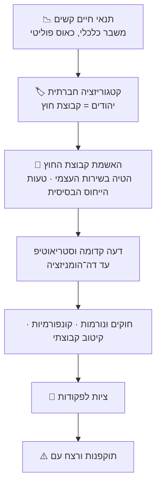

📘 **טבלה 2 במדריך** *(התשובות שלי, לפי מונחי הפרק)*:

| מונח / תיאוריה | כצעד בדרך לתוקפנות |
|---|---|
| **טעות הייחוס הבסיסית** (סעיף 2) | המשבר מוסבר ב**תכונות** של קבוצת החוץ ("הם חמדנים"), ולא בגורמים **מצביים** (כלכלה, פוליטיקה) |
| **הטיה בשירות העצמי** (סעיף 3) | הכישלון **שלנו** מיוחס לגורם **חיצוני**: לקבוצת החוץ. היא הופכת ל"שעיר לעזאזל" |
| **נבואה המגשימה את עצמה** (סעיף 4) | מצפים שקבוצת החוץ עוינת ← מתנהגים אליה בעוינות ← היא מגיבה בעוינות ← "הנה, צדקנו" |
| **קטגוריזציה חברתית** (סעיף 11) | הבסיס: חלוקה ל"אנחנו" ו"הם" |
| **דעות קדומות** (סעיף 10) | עמדה שלילית: **רגשות** עוינים, **סטריאוטיפ** ו**כוונה** להתרחק, לשלוט או להשמיד |
| **סטריאוטיפים** (סעיף 12) | "הם טפילים": מצדיקים את העוינות, פועלים כפילטר, ולא משתנים מול ראיות |
| **נורמות** (סעיף 15) | כשהחוק והחברה מגדירים עוינות כ**מקובלת** (חוקי הנאצים, סעיף 10), מי שחורג נענש |
| **קונפורמיות** (סעיף 15) | אנשים מאמצים את העמדות וההתנהגויות של הרוב (מידע: "הם יודעים"; נורמה: "לא רוצה להיות שונה") |
| **קיטוב קבוצתי** (סעיף 15.7) | דיון בתוך הקבוצה הופך את העמדה השלילית ל**קיצונית יותר** |
| **ציות לסמכות** (סעיף 16) | אנשים רגילים מבצעים פקודות של בעל סמכות, גם כשהן פוגעות באחרים |

### 8.4.2 · גישה אבולוציונית

### שאלה-58

**למה, לפי הגישה האבולוציונית, בני אדם תוקפניים?** · ↩ סעיף 18

- תוקפנות עוזרת **לשרוד**: להשיג **בני זוג**, ולהגן על **המשאבים** שלי ושל הצאצאים.
- 📖 קונרד לורנץ (Konrad Lorenz): לבני אדם **אין** מנגנוני עכבה מפותחים, כי לפני כלי הנשק לא יכלו לגרום נזק רב. 📖 הביקורת: גם שימפנזים הורגים בני מינם, ובני אדם יודעים **לרסן** תוקפנות יותר ממה שלורנץ חשב.

### שאלה-59

**איך, לפי הגישה האבולוציונית, משפיעה הסביבה החברתית על תוקפנות?** · ↩ סעיף 18

- הנטייה **מולדת**, אבל **מידת** התוקפנות תלויה בסביבה החברתית. **התרבות** מגדירה מתי תוקפנות **מקובלת** או **נדרשת**, וכמה מרסנים אותה.

### 8.4.3 · גישה ביולוגית וגישה אישיותית

### שאלה-60

**למה, לפי הגישה הביולוגית, בני אדם תוקפניים? גנים, מוח, הורמונים** · ↩ סעיף 19.1

🧭

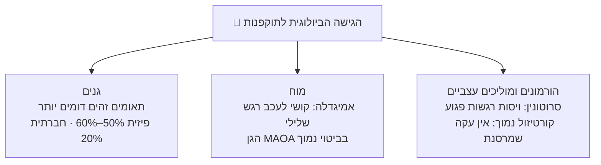

- פירוט ומחקרים: סעיפים 19.1–19.2.

### שאלה-61

**האם, לפי הגישה הביולוגית, יש לסביבה החברתית השפעה על תוקפנות?** · ↩ סעיף 19.1

*(תשובה שלי, לפי הספר)*

- **כן.** הגנים מסבירים רק **חלק** מהשונות. בתוקפנות **חברתית** רק 20%, ואולי ההורות משמשת **מודל** (הורים שמעוררים בושה ואשמה).
- 📖 רוב האנשים לא קיצוניים, אבל **מצבים מסוימים** יכולים לגרום אפילו לאנשים המתונים ביותר להיות תוקפניים. זה הגשר לגישה המצבית.

### שאלה-62

**האם לאישיות יש השפעה על תוקפנות? אימפולסיבית מול אינסטרומנטלית** · ↩ סעיף 19.3

- **כן, אבל לא אותה השפעה לכל הסוגים.**
- **תוקפנות אימפולסיבית (impulsive aggression):** **רגש**, בלהט הרגע (📖 קטטה אחרי תאונה). קשורה ל**תגובתיות רגשית חזקה**.
- **תוקפנות אינסטרומנטלית (instrumental aggression):** **כלי** להשגת מטרה, במחשבה תחילה (📖 לגנוב תיק). קשורה ל**הערכה חיובית של אלימות** ולהתנערות מאחריות מוסרית (Caprara et al.).

### 8.4.4 · גישה מצבית

### שאלה-63

**מהי השערת התסכול והתוקפנות?** · ↩ סעיף 20.1

- **השערת התסכול והתוקפנות (frustration-aggression hypothesis)** (Dollard et al.): כשהדרך למטרה **נחסמת** מתעורר **תסכול**. ככל שהתסכול גדל, גדל הסיכוי ל**תוקפנות**.

🧭

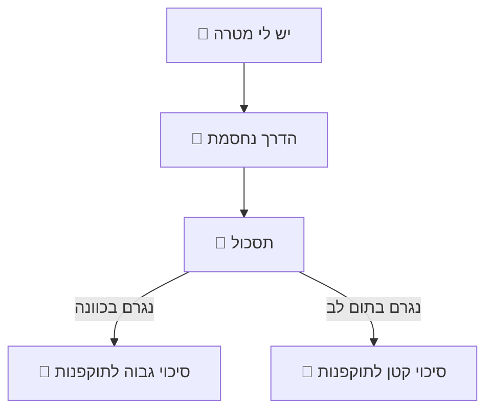

- 📖 **סן פרנסיסקו:** האלימות עלתה עם האבטלה, אבל רק **עד נקודה מסוימת**. מעליה, הפחד לאבד את העבודה ריסן אותה.

### שאלה-64

**איך ההשערה יכולה להסביר תוקפנות כמו רצח עם?** · ↩ סעיף 20.1

*(ניתוח שלי)*

- משבר כלכלי **חוסם מטרות** של אנשים רבים ← **תסכול** המוני ← התוקפנות מופנית ל**קבוצת חוץ** שמואשמת במצב.
- זה מתחבר ל"תנאי החיים הקשים" של שטאוב ([שאלה 57](#שאלה-57)).

### שאלה-65

**האם חום גורם לתוקפנות? הממצאים וההסתייגויות (פרק 2)** · ↩ סעיף 20.2

- 📖 **הממצא** (תרשים 17.5, מיניאפוליס): בין 9 בערב ל־3 לפנות בוקר, ככל שחם יותר, יש **יותר** תקיפות. בשאר היום הקשר כמעט שטוח.
- **ההסתייגות** *(ניתוח שלי, לפי [פרק 2](פרק-2-39-69-שיטות-מחקר-בפסיכולוגיה.md))*: זה מחקר **מתאמי**, ומתאם **לא מוכיח סיבתיות**. ייתכנו **משתנים שלישיים**.

🧭

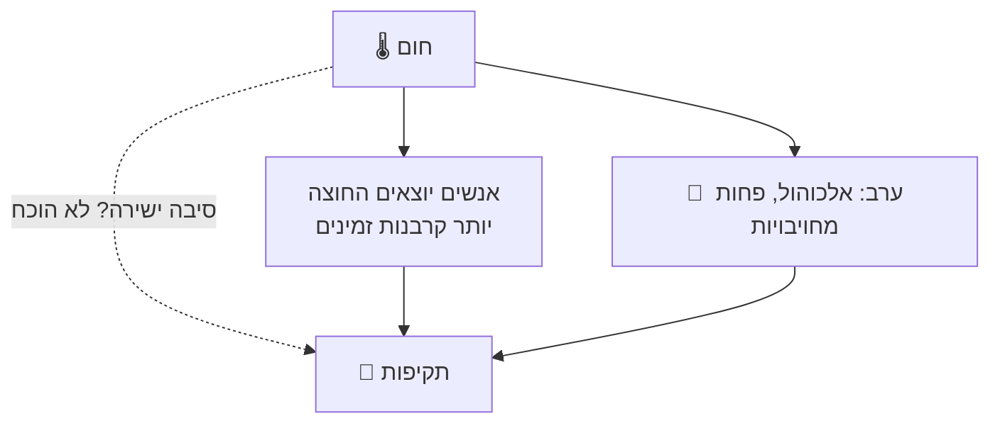

- 📖 **ההסבר הפסיכולוגי:** מייחסים את אי־הנוחות **לאדם השני** ולא **לחום**. זו טעות הייחוס הבסיסית.

### 8.4.5 · גישה חברתית־תרבותית

### שאלה-66

**למה, לפי הגישה התרבותית, בני אדם תוקפניים? עצמי עצמאי ותלוי, ותרבות של כבוד** · ↩ סעיף 21.1

- **עצמי תלוי** (interdependent, מזרח): פגיעה באחר היא כמו פגיעה **בעצמי**, ולכן פחות תוקפנות. 📖 ילדי גן יפנים היו פחות תוקפניים מאמריקאים במשחק הבובות.
- **עצמי עצמאי** (independent, מערב): העצמי "חייב" להתגונן מפני עלבונות.
- **תרבות של כבוד** (ריצ'רד ניסבט, Richard Nisbett, וכהן, Cohen): תוקפנות כדי להגן על **רכוש** או על **כבוד**. 📖 סטודנטים מהדרום שנקראו "טמבל" פינו את הדרך מאוחר מאוד (סעיף 21.2).

### שאלה-67

**איך מסביר מודל התוקפנות הכללי את התוקפנות?** · ↩ סעיף 21.3

- **מודל התוקפנות הכללי (general aggression model)** (Bushman & Anderson): חשיפה חוזרת לאלימות בונה **מבני ידע** על תוקפנות.

🧭

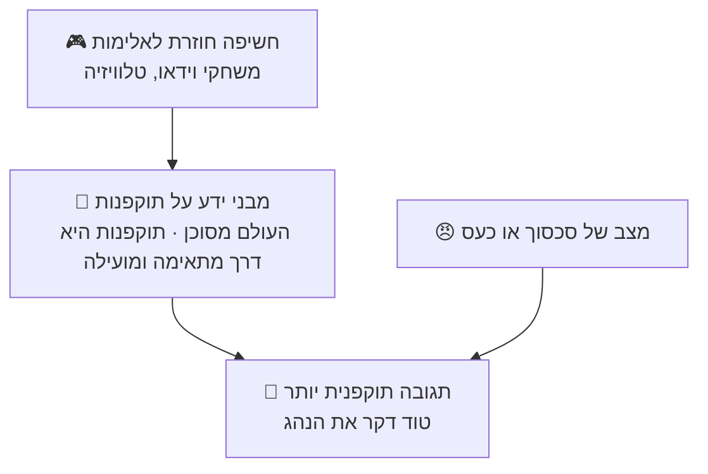

- 📖 מי ששיחקו 20 דקות במשחק **אלים** כתבו המשכים **אלימים יותר** לסיפור.

### שאלה-68

**אילו תהליכי למידה מובילים לתוקפנות?** · ↩ סעיף 21.3

*(תשובה שלי)*

- **למידה באמצעות צפייה:** חיקוי **מודלים** (📖 בובת הפלסטיק של בנדורה, Albert Bandura; אלימות בטלוויזיה ובמשחקים).
- **ענישה:** ילד שנענש בגופו לומד שתוקפנות היא **דרך לשלוט** באחרים.
- ראי [פרק 5 (למידה), סעיף 16](פרק-5-263-310-למידה.md).
